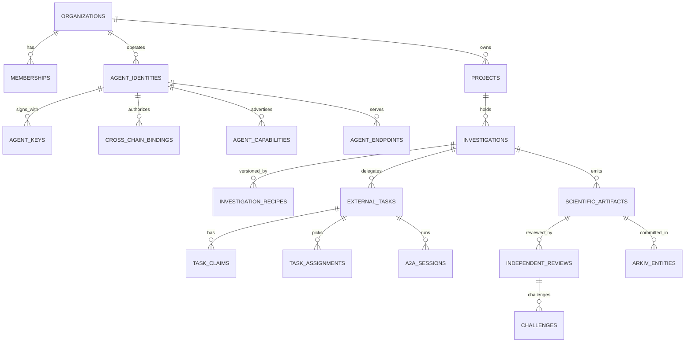

# ORCA Architecture Doc 4 (Revised) — Complete Database & Persistence Integration Design

**Version 3.0.** Extends [original database architecture](https://teampflresearch.vercel.app/doc4.html), not a destructive rewrite. **Implementation SQL:** [`../db/001_orca_v3_extensions.sql`](../db/001_orca_v3_extensions.sql) (35 additive tables; starter migration, NOT production-proven). **Status:** proposed design.

## 1. Retain the four original stores and why

| Store | Keep from old design | V3 extension |
|---|---|---|
| **PostgreSQL + PostGIS + optional pgvector** | Structured source catalog, workflows, evidence, claims, GIS, Marine State, alerts, conversations, 7 memory planes | Tenants, scientific projects, identity bindings, external A2A tasks, method/recipe versions, reviews, ENS/Arkiv projections, traceable authorization |
| **S3-compatible object storage** | Immutable raw NetCDF/GRIB/CSV/HDF, normalized products, COG/tiles, results | Versioned per-tenant source snapshots, encrypted research artifacts, reproducible packages, signed manifests, WORM/object-lock option |
| **Parquet / analytical engine** | Historical time-series/climatologies/feature tables | Frozen backtesting samples, large benchmark tables, repro/verification comparison reports |
| **Redis** | Rate limits, hot source cache, transient task/session, dedup | Agent discovery caches, non-authoritative index/query cache, distributed locks only where validated, SSE projections |

**Arkiv is the fifth specialized external store** and **ENSv2 is a separate identity lookup system**, neither replaces PostgreSQL. Each has its own chain/network and eventual consistency.

## 2. Old core tables — keep and map to new

The public portal's original Doc 4 describes at least these existing *designed* groups; verify actual migration state before assuming they exist on the developer machine:

| Existing group | Representative existing tables | V3 usage |
|---|---|---|
| Source catalog | `data_sources`, `datasets`, `canonical_variables`, `variable_mappings` | Remain canonical provider/variable registry; research snapshot refs map back by source/dataset IDs |
| Pipeline | `ingestion_records`, `validation_records`, `quality_records` | Preserve source/QC; add snapshot digest/licensing/as-of context |
| Spatial | `coastal_gazetteer`, `marine_boundaries`, `geofences`, `ports_harbours` | All research studies and decisions use deterministic GIS checks |
| Evidence | `evidence_records`, **`claims`** | **Legacy `claims` = scientific factual claims**, not task bids. New task claims live in `federation.task_claims` |
| Workflow | `workflows`, **`tasks`**, `tool_executions`, `investigation_events` | Existing internal execution; externally delegated work lives in `federation.external_tasks` with crosswalk to `research.investigations` |
| Marine state | `marine_states`, `marine_state_versions`, `marine_state_deltas` | Temporal spatial state and parent/diff history preserved |
| Intelligence | `marine_events`, `event_evidence`, `event_relationships`; `decision_*`; `scenario_*`; `uncertainty_*` | Existing event and decision science; link to reviewed research artifact IDs |
| Users/conversations | `users`, `sessions`, `conversations`, `conversation_turns` | Organization membership/roles layered on top, privacy managed separately |
| Alerts | `alerts`, `alert_subscriptions` | Official warnings and user opt-in, never published to public Arkiv with private info |
| Memory | `memory_items`, `memory_embeddings`, `memory_links`, `memory_events` | Seven memory planes with tenant scope and evidence-reference freshness checks |
| Config | `system_config` | Versioned policy, source quotas, model/feature flags |

**Do not write SQL `ALTER TABLE public.claims` or `public.tasks` to reinterpret their meaning.** Introduce explicit schema-qualified V3 tables. A database inspection/migration comparison must determine actual legacy primary-key types and constraints before binding cross-schema FKs.

## 3. New schemas and relationships

The migration adds **35 new tables**, organized as follows:

| New schema | Entities | Business rules |
|---|---|---|
| `iam` (8) | `organizations`, `memberships`, `organization_credentials`, `agent_identities`, `agent_keys`, `agent_authorizations`, `cross_chain_bindings`, `revocations` | An ENS name can be asserted but only separately verified credential/authorization yields institution membership; keys versioned; binding scoped/expiring/revocable |
| `federation` (7) | `agent_capabilities`, `agent_endpoints`, `external_tasks`, `task_claims`, `task_assignments`, `a2a_sessions`, `provider_health` | Multiple claims allowed; assignment authorized; A2A session IDs correlated; provider health measured |
| `research` (12) | `projects`, `project_members`, `investigations`, `investigation_recipes`, `method_versions`, `dataset_snapshots`, `compute_runs`, `scientific_artifacts`, `review_requests`, `independent_reviews`, `challenges`, `historical_evaluations` | All artifacts versioned and hash-addressed, methods validated, reviews separately signed, raw data rights respected |
| `web3` (5) | `arkiv_entities`, `arkiv_write_outbox`, `chain_receipts`, `arkiv_sync_cursor`, `ens_resolution_cache` | Off-chain projections, receipts and recovery; **not authoritative over actual chain** |
| `audit` (3) | `audit_events`, `data_access_decisions`, `policy_versions` | Auditable authorization and policy changes, avoid sensitive public content |

> Counts above by schema are indicative inventory; the actual starter migration is the authoritative enumeration. Inspect table DDL and build migration tests before using counts in product material.

### 3.1 Entity relationship overview



### 3.2 Critical join semantics

**Internal vs external:** `public.workflows` is the original supervisor execution; `research.investigations.legacy_workflow_id` optionally references it **by ID, no FK yet**; `public.tasks` is internal DAG work, `federation.external_tasks` is A2A delegation, both belong to one research investigation through a mapping. A non-research fisherman workflow may never have a `research.investigations` row.

**Scientific claim vs job claim:** Existing `public.claims` stores scientific propositions; a new external `federation.task_claims` row records a bid to work on something. Prevent same API route or type name being reused for both.

**Evidence vs published artifact:** `public.evidence_records` is original evidence chain; `research.scientific_artifacts` is signed/versioned bundle; `research.independent_reviews` states review results. Every `research.scientific_artifacts` reference to source must resolve to a licensed dataset snapshot/manifest or clearly list a missing input.

**Arkiv read model:** `web3.arkiv_entities` is a cache/index projection of public chain entities; a row remaining after its chain record expired is NOT a live on-chain record. End-user UI must display projection timestamp and verify critical owner/expiry through chain reads.

## 4. Core table columns, constraints and indexes

### 4.1 Institutions and agents

- `iam.organizations(id, legal_name, display_name, verification_status, default_visibility, created_at)`: legal identity workflow separate from ENS.
- `iam.memberships(organization_id, external_user_id, role, status)`: unique per org/member and tenant role.
- `iam.organization_credentials(issuer_id, credential_type, digest, encrypted_location, status, expires_at)`: credential stored securely, metadata in DB.
- `iam.agent_identities(organization_id, agent_name, ens_name, agent_kind, status)`: organizational agent model; active ENS name uniqueness across same environment.
- `iam.agent_keys(agent_id, purpose, public_key, algorithm, valid_from, valid_until, revoked_at)`: NEVER store wallet private keys in DB.
- `iam.agent_authorizations(agent_id, organization_id, scope, data_access_scope, action_policy_version, expires, revoked_at)`: enforce when A2A delegated, results accepted or network claims processed.
- `iam.cross_chain_bindings(agent_id, ENS name & chain, Rabdi wallet & chain, A2A key ID, scope, signature manifest, nonce, expiry, revocation epoch)`: verifies ENS–Arkiv–A2A separation.
- `iam.revocations(agent_id, subject_type, subject_id, revocation_epoch, timestamp)`: immutable logical denial history and cache invalidation.

Indexes: active ENS names, organization memberships, authorized scopes, wallet binding `(agent_id, arkiv_chain_id, lower(arkiv_wallet), expires_at)`; don't index every JSON field until EXPLAIN ANALYZE shows need.

### 4.2 Scientific research

- `research.projects`: project owner/org and access class.
- `research.investigations`: research question, geometry, as-of evaluation date, state, optional legacy workflow ID.
- `research.investigation_recipes`: **versioned JSONB** approved method, source selection, baseline and QC; digest protects against silent edits.
- `research.method_versions`: allowed method IDs, input/output JSON schema, code/image digests and reproducibility policy.
- `research.dataset_snapshots`: product version, exact content digest, source, distinct observation, forecast and retrieval time, rights and QC.
- `research.compute_runs`: specific recipe + environment, input/output manifests, execution metrics and failures.
- `research.scientific_artifacts`: immutable logical results, digest, manifest URI, provider key, supersedes link and scientific validation status.
- `research.review_requests`, `research.independent_reviews`, `research.challenges`: bounded review and disagreement chain.
- `research.historical_evaluations`: as-of timestamp, frozen benchmark digest, independent metrics and leakage check.

Index PostGIS `investigations.geographic_scope` with GIST, `(project_id, status, created_at)`, artifact refs and benchmark searches. Large raster arrays in S3/Zarr/Parquet, **not SQL JSONB**.

### 4.3 Federation

- `federation.agent_capabilities(agent_id, capability_id, version, regions/methods, I/O digest, enable flag)`. In source recommendations, capability must be tested against actual scientific method support.
- `federation.agent_endpoints(agent_id, transport, endpoint_uri, agent_card_uri, verification status)`. SSRF-safe validation; don't trust string merely because saved.
- `federation.external_tasks`: explicit public ID, requester organization, required capability, deadline, scope and lifecycle state.
- `federation.task_claims`: many per task, each from agent id and signed claim digest; optional Arkiv entity key.
- `federation.task_assignments`: requester-authorized selected claim. **Need transaction/trigger for single-vs-multi policy**; starter DDL doesn't yet enforce exactly one active assignment for single-award tasks.
- `federation.a2a_sessions`: remote task ID and idempotency key with local correlation; task responses can arrive after cancellation.
- `federation.provider_health`: operational reliability metrics, not scientific trust.

### 4.4 Chain integration, outbox and recovery

`web3.arkiv_write_outbox` stores intended public operation with unique `operation_id` and signed digest. A worker uses **only delegated wallet signature** and writes transaction. Workflow:

```text
DB transaction: insert task + insert outbox op
   → worker validates scope, public payload, expiry, network
   → sign/submit transaction and store txHash
   → confirm on-chain success + check expected owner
   → wait for query/indexer visibility (not necessarily same event)
   → upsert projection with observed_block and expiry
   → mark outbox INDEXED
```

Failure handling: network timeout after submit = **UNKNOWN**, not 'failed'. Query receipt or owner/entity key before retry. Multiple agent wallets are not kept in one ORCA admin wallet. If user signs browser/provider writes, gateway coordinates intent and independently verifies result without custody.

`web3.ens_resolution_cache` is non-authoritative and short-lived. Authority-sensitive actions must resolve/verify current revocation, expected resolver and signed binding. Reorg/rollback and stale cache handling require integration testing.

## 5. Arkiv schema mapping (public records)

| Entity family | Indexed short attributes | Owner | Lifetime example | Full data |
|---|---|---|---|---|
| `orca.agent.v1` | `agentId`, `capability`, `region`, `status` | Agent operator | 30d renewable | Signed Agent Card off-chain, ENS pointer |
| `orca.task.v1` | `taskId`, `capability`, `region`, `status` | Requester | 24–72h | Detailed task private/A2A |
| `orca.claim.v1` | `taskId`, `agentId`, `status` | Claimant wallet | Through task deadline | Signed claim off-chain |
| `orca.result.v1` | `taskId`, `agentId`, `artifactDigest`, `methodId` | Producer wallet | 30–90d | Research package off-chain |
| `orca.review.v1` | `resultDigest`, `verdict`, `reviewerId` | Reviewer wallet | 30–90d | Reproduction/challenge package off-chain |

These are proposed schema fields and TTLs. Keep each named schema under Arkiv's column and UTF-8 string limits, use compact hashes/IDs and short public categories; *all queries must verify owner against institutional binding*. A schema name is not exclusive or a trust authority. Arkiv may expire/delete entities; persist durable artifacts and receipts elsewhere.

## 6. RLS and tenant security policy

Every private object must have a verifiable owner org or project permission. Existing public tables were designed before institutional tenancy, so add an application-controlled organization scope to legacy query adapters while migrating any rows that need shared-scoped ownership. Proposed RLS pattern:

```sql
-- EXAMPLE policy pattern; adapt to actual auth database role setup:
ALTER TABLE research.projects ENABLE ROW LEVEL SECURITY;
CREATE POLICY project_org_isolation ON research.projects
USING (organization_id = NULLIF(current_setting('orca.organization_id', true), '')::uuid)
WITH CHECK (organization_id = NULLIF(current_setting('orca.organization_id', true), '')::uuid);
```

This only works when the app never gives untrusted clients DB-level ability to modify `orca.organization_id`; set it via a trusted transaction-scoped server role, forbid direct end-user SQL, audit `SECURITY DEFINER` functions and test connection-pool leakage. For shared projects, policy should use membership joins, not just owner equality. Actual implementation needs roles/grants, RLS for **all** tenant data tables, and negative tests. **The starter SQL does not automatically guarantee RLS isolation.**

## 7. Object storage layout and rights

```text
orca-raw/{source}/{dataset_id}/{version}/{date}/{sha256}.nc
orca-derived/{method_id}/{method_version}/{dataset_digest}/{artifact_id}.zarr
orca-research/{organization_id}/{project_id}/{investigation_id}/{artifact_id}/
  evidence-manifest.json
  numerical-results.parquet
  map.geojson
  reproducibility-recipe.yaml
  method-environment.lock
  plots/*
orca-restricted/{organization_id}/encrypted/*
orca-public-review/{result_digest}/{review_id}.json
```

Preserve licensed source bytes only with appropriate authorization, and keep signed manifests immutable/versioned. For independent reproduction where redistribution prohibited, allow authorized re-fetch or institution-side execution, not unauthorized raw file sharing. Arkiv gets only permitted reference/digest.

## 8. Redis, caching and retention

- `dataset:{product_version}:{bbox_hash}:{time}:{scope}` with TTL matched to product freshness; do not cache one tenant's restricted data for another.
- `ens:{chain}:{name}:{resolver_block}` with bounded TTL plus invalidation on role/record changes.
- `arkiv:{chain}:{schema}:{query_hash}` for read acceleration **with observed_at and expiry**, never sole truth.
- `workflow:{id}:lease` and `a2a:{task_id}:pending` with durable DB state behind them.
- User conversation/memory retention follows user/org privacy settings; never public-chain user content.
- Scientific raw/derived artifacts retained by license, policy and archival suitability; Arkiv TTL is independent and can be much shorter. Archival copies include original/final scientific versions and correction relationship.

## 9. Index and query examples

```sql
-- Find active eligible independent providers (further identity checks required):
SELECT a.id, a.ens_name, c.capability_id, e.endpoint_uri
FROM iam.agent_identities a
JOIN federation.agent_capabilities c ON c.agent_id = a.id AND c.is_enabled
JOIN federation.agent_endpoints e ON e.agent_id = a.id AND e.transport='a2a'
WHERE a.status='active' AND a.agent_kind='institution_hosted_a2a'
  AND c.capability_id='sst_anomaly_analysis'
  AND e.status='verified';

-- Find independently reviewed artifacts for a research investigation:
SELECT ar.id AS artifact_id, ar.content_digest, ar.scientific_status,
       rv.id AS review_id, rv.verdict, rv.method_digest
FROM research.scientific_artifacts ar
LEFT JOIN research.independent_reviews rv ON rv.artifact_id = ar.id
WHERE ar.investigation_id = :investigation_id
ORDER BY ar.created_at DESC;
```

`EXPLAIN (ANALYZE, BUFFERS)` for real workloads; add composite indexes only after evaluating query plans and RLS/security overhead.

## 10. Migration strategy (no destructive changes)

1. Inspect real DB (`\dt`, `information_schema`, Alembic history) and compare to the web dossier's proposed 44+ tables.
2. Freeze old migration snapshot and automated fixtures; do not fabricate existing data.
3. Apply additive namespace migration in a staging database; record actual table count; test rollback strategy (new schema data may prevent simple drop).
4. Run contract adapters reading old `public.workflows`, `public.evidence_records` and `public.memory_items` while writing new research/federation data.
5. Migrate legacy workflows to research investigations **only if** user explicitly chooses project mode; otherwise leave original chat work untouched.
6. Add scope/tenant policy and RLS tests before protected institution data.
7. Verify idempotent Arkiv outbox/receipt sync and read-model rebuild from chain.
8. Backfill source versions and archived rights where available; where not, label metadata `unknown`, never invented.
9. Test backup restore, exact scientific artifact digests, disaster recovery and duplicate task assignments.

## 11. Database acceptance tests

- Null org ID or forged org header cannot read another research project.
- Cross-org review allowed **only** via signed dataset/review access policy.
- Revoked binding invalidates external provider on read and write.
- Submitted Arkiv tx has distinct `submitted`, `confirmed`, `indexed` states and correct owner.
- Two task claims can coexist; single-award selection permits exactly one active authorized assignment; multi-award explicitly allowed.
- Event history is append-only logically and old artifact hash is retained after correction.
- An expired Arkiv entity is excluded from live views even if local projection still exists.
- Archival source file hash re-verifies after object restore.
- Memory references cannot be mistaken for live marine observations.
- All unique/fk/index/RLS checks run from a fresh staging DB with the **real legacy migrations**.

**Sources:** [Original Doc 4](https://teampflresearch.vercel.app/doc4.html), [Arkiv limits](https://docs.arkiv.network/reference/limits/), [ENS permissioned resolver](https://docs.ens.domains/ensv2/permissioned-resolver/), [Current Rabdi reference](https://docs.arkiv.network/networks/rabdi/).
