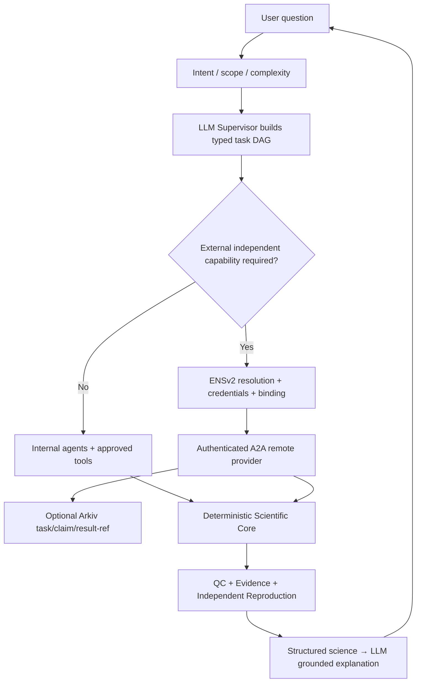

# ORCA Companion Update — Core Agentic Technical Architecture

**Old source:** https://teampflresearch.vercel.app/core-agentic-technical.html.

## Non-negotiable old boundary

`LLM = plans/interprets/explains` · `Scientific engines = calculate` · `Data foundation = evidence`.

## V3 technical diagram

No LLM directly issues unsafe warning, edits scientific measurements, changes ENS permissions, signs wallet transactions, bypasses authorization or judges scientific truth by agent reputation. The network makes additional expertise available; it doesn't replace scientific computation.
