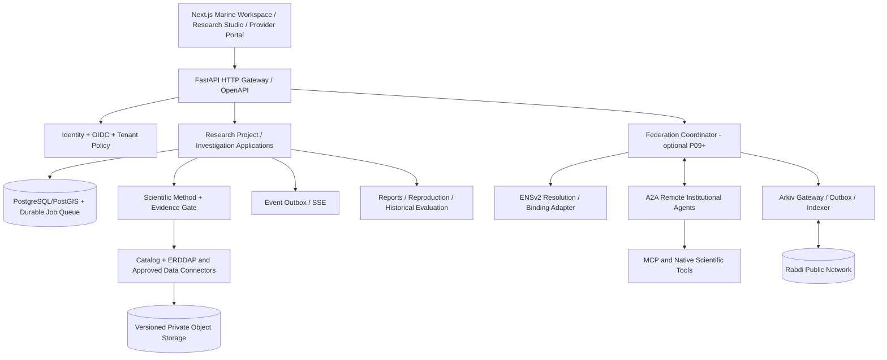

# ORCA 3.0 — Complete Backend API Design & Contract Specification

**File name:** `api design.md`  
**Date:** 2026-11-06  
**Contract revision:** `3.1.0-proposal`  
**Delivery status:** **PLANNING ONLY — P00–P12 NOT STARTED. NO API ROUTE, DATABASE MIGRATION, SCIENTIFIC INTEGRATION, TEST, OR CHAIN TRANSACTION IS CLAIMED IMPLEMENTED.**  
**Intended location:** project root, beside `design.md`, `implementation plan.md`, and `phases and subphases.md`  
**API base:** `/v1` (proposed); `https://api.orca.example` is a **placeholder**, not a deployment.  
**Contract language:** OpenAPI 3.1 + JSON Schema 2020-12 + generated TypeScript interfaces; this Markdown is the **human source design**, and eventual executable OpenAPI must be validated against it.  
**Ownership:** Backend team; frontend consumes generated contracts and a **separate test-only mock harness**.

> **READ FIRST — Important evidence boundary.** The user supplied an excerpt of `phases and subphases.md` covering P00–P05 and the P06 heading. The complete `api design.md` and `implementation plan.md` referred to in that excerpt were **not provided**. This document uses that supplied excerpt as the controlling gate policy and expands later P06–P12 contracts from the previously created ORCA 3.0 architecture package, source audit, seven documents, and research portal. **P06–P12 phase allocations here are design proposals to reconcile with the full companion plans when available.** No claims about a tested ERDDAP product, actual credential, real institution, deployment or sponsor success are made.

## 0. Reading guide, definitions and authority order

1. **Gate authority:** supplied `phases and subphases.md`, P00–P05 + P06 header, dated 2026-11-06; full P06–P12 is *not supplied*.
2. **Architecture authority:** ORCA 3.0 `design.md`, `docs/00_SOURCE_AUDIT_AND_MIGRATION.md`, revised `docs/01` through `docs/07` and `docs/13_legacy_integration_playbook.md` from the earlier architecture ZIP (proposed; not migration evidence).
3. **Historical background:** [ORCA research dossier](https://teampflresearch.vercel.app/), Doc 1 user flows, Doc 2 agentic, Doc 3 pipeline, Doc 4 database, Doc 5 implementation, Doc 6 memory and System 7 science, plus Data Acquisition and Agentic Engineering specifications.
4. **External protocol authority:** [A2A 1.x specification](https://a2a-protocol.org/latest/specification/), [MCP specification](https://modelcontextprotocol.io/specification/2025-11-25), [ENSv2 overview](https://docs.ens.domains/ensv2/overview/), [ENSv2 resolver](https://docs.ens.domains/ensv2/permissioned-resolver/), [Arkiv Rabdi](https://docs.arkiv.network/networks/rabdi/), [Arkiv limits](https://docs.arkiv.network/reference/limits/), [RFC 9457](https://www.rfc-editor.org/rfc/rfc9457).
5. **When in conflict:** current verified upstream protocol > legacy guesses for protocol wire format; supplied newer gate policy > older broad implementation estimates; scientific source documentation > assumptions. Record unresolved choices in P00 ADRs, never silently retrofit data.

**Terminology:** A *scientific claim* is a falsifiable proposition supported by evidence, historically `public.claims`. A *task claim* is a provider's offer to undertake external work, `federation.task_claims` and optionally an Arkiv claim entity. An *Arkiv entity* is a separate public time-scoped database record. These must NEVER share a DTO name or API resource path.

**Operation status levels:**
- **DESIGNED:** appears in this specification, no handler or real test implied.
- **CONTRACT_READY:** schema/generator and contract tests exist; does not imply a production handler.
- **IMPLEMENTED:** actual backend code exists with required tests.
- **LIVE_VERIFIED:** its required end-to-end dependencies or external provider/chain confirmed and gate passed.
- **BLOCKED:** required evidence, credential, license, method or test missing; no substitute with mocks.

All operations below are **DESIGNED**. A route's phase is the **earliest planned implementation gate**, not proof of completion.

### 0.1 Release profiles

| Release | Dependencies | User-visible promise | Explicitly absent |
|---|---|---|---|
| `core-A` | G00–G02 | Validated contract, secure org/project APIs, storage staging | Real science, AI inference, live marine findings |
| `core-B` | G00–G05 | Source-backed bounded historical SST calculation, durable investigation and scientific evidence | General autonomous scientific model, institution federation |
| `core-C` | G00–G08 | Source-backed research reports, reproducibility, maps and institutional-ready core | Public multi-institution agents unless federation gates pass |
| `federation` | core-C + G09–G11 | A2A providers + verified identity binding + Arkiv coordination | Proof of real institutional adoption unless an external org joins |
| `expanded` | core-C or federation per explicit release selection + G12 | Chat, additional methods, alerts and models **only as individually gated** | Unverified general-purpose safety or prediction claims |

**Gates:** P00→P01→…→P08 core; P09→P10→P11 optional *after core*; P12 only for explicitly selected release. A skipped, blocked, or failed required test blocks dependent phase. No frontend mock establishes live-source readiness. Gate output `docs/gates/Pxx/{manifest.json,report.md,test-results.*}` is internal CI/developer evidence, never a public runtime API.

## 1. Architecture and protocol boundaries



**Public REST `/v1`** is ORCA's application API (auth, science, projects, reports, network portal). **Official A2A** has its **own** protocol endpoints, task envelopes and Agent Cards managed by the SDK; we do not fake A2A by naming a REST endpoint `/a2a/send-task`. **MCP** exposes tools/resources to authorized agent runtimes, separate from public REST. **ENSv2** is name/permission resolution (not institutional accreditation). **Arkiv** holds public wallet-owned expiring coordination entities (not scientific data, authorization, or permanent archive). **Postgres** is authoritative for private organization state and task assignment; off-chain artifact hashes and chain receipts are correlated, not identical.

### 1.1 Dependency and trust zones

| Boundary | External-facing? | Trust assumption | Access policy |
|---|---|---|---|
| Browser → REST | Yes | Untrusted client input and tokens | OIDC JWT, authorization, limits, CSRF protections where cookie-based |
| Browser → SSE | Yes | Reconnect can replay | Same user/org authorization; redacted events; token renewal |
| API → Worker | Internal | Queue messages may be duplicated | Idempotent handlers, leases and fencing tokens |
| API → Scientific connector | External | Data may be erroneous, stale or huge | Allowlisted providers, response limits, metadata/QC checks |
| API/Coordinator → A2A | External | Agent Cards/endpoints are untrusted until verified | ENS binding + institutional permission + authenticated transport |
| A2A agent → MCP tool | External/internal | Tool descriptors are untrusted | Per-tool ACL, sandbox, input/output validation, no arbitrary network access |
| Adapter → ENS | Public chain | Name alone asserts no accreditation | Resolve pinned chain/deployment, check controller and binding |
| Adapter → Arkiv | Public testnet | Anyone can publish schema-like records | Verify wallet ownership/binding, expiry and finality; no private data |
| Application → Object store | Internal / signed ephemeral read | URLs can leak | scoped, short-lived, audited signed URLs; versioned blobs |

## 2. Global HTTP contract

### 2.1 URL, media types, lifecycle

- Canonical prefix `/v1`; lower-case kebab resource names, plural collections, UUID IDs serialized as lower-case canonical strings. Typed, opaque external identifiers never treated as UUIDs unless declared.
- JSON requests/responses use `application/json`; errors `application/problem+json` (RFC 9457). Streaming `text/event-stream`. Large downloads use signed object-store links or `application/octet-stream` through a protected proxy where required.
- For *single resources*, respond as an object **without an extra success wrapper**. Lists use `{ "items": [...], "next_cursor": null, "page_size": 20 }`. Long-running mutations use `202 Accepted` + an `Operation` and `Location`.
- Every object has `id`, `created_at`, `updated_at`, and `schema_version` when applicable. Entity versions are represented by a strong `ETag`, not by a silently mutable client timestamp.
- `X-Request-ID` accepted as a client correlation hint only if valid and bounded; server generates trace ID. Never let user-provided trace ID grant privileges or influence audit identity.
- Datetimes RFC 3339 UTC `Z`, with original calendar/timezone metadata preserved for science; never compare local timestamps with UTC timestamps without explicit conversion. No naive date-time request fields.
- GeoJSON WGS84 longitude/latitude `[lon, lat]`; validate ring closure, non-self-intersection, antimeridian behavior, max coordinates and approved area. Data gridding/area weighting uses scientific method policy, not frontend drawing units. Exact geometry may be sensitive.
- `number` for lat/lon and display statistics, decimal **strings** for money or high-precision quantities; no `NaN`, `Infinity`, or silent float rounding. Missing vs unknown vs inapplicable are distinct typed states.
- No unknown request fields: reject with `422` and a stable field error list; `null` only when a schema explicitly allows it. Empty/zero are not synonyms for missing data.
- UTC times `as_of` (what information was accessible) and `valid_at` (what event was predicted/observed) remain separate. Source observation time, issued time, publication time, fetched time and archived availability have independent properties.
- Read pagination: opaque signed cursor bound to filter, sort, org and principal scope; default page size 20, maximum 100 (internal bounded exceptions separately approved). Stable ordering by `(created_at,id)`; expired/revoked scope invalidates cursor with `410` or explicit resync response.
- Listing order must be stable. Filter only allowlisted keys; unbounded full-text, raw JSONB querying or arbitrary SQL never exposed.
- `Idempotency-Key` required for every create/start/claim/assign/commit/financial action; UUID or 16–128 visible ASCII characters, scoped by principal+org+route+canonical payload. Same key/body returns stored outcome, same key/different body returns `409 IDEMPOTENCY_KEY_REUSE`. Store idempotency decision durably transactionally; documented retention minimum 24h or release-specific longer window.
- Mutation of versioned resources requires `If-Match: "..."`; missing precondition `428`; stale `412`. `DELETE` returns `204` only when successful and permitted; scientific/artifact/audit history is tombstoned or versioned, never erased silently.
- Conditional reads support `ETag`/`If-None-Match` → `304` where authorized; cache includes tenant/license/as-of scope. `Vary: Authorization, Origin` where appropriate; private research `Cache-Control: private, no-store` by default.
- `Retry-After` on `429` / transient `503`, not a guarantee that a request is safe to repeat; clients retry only idempotent operations with capped jitter.

### 2.2 Authentication / authorization

**Primary:** OIDC JWT Bearer (`iss`, `aud`, `sub`, `exp`, `nbf`, `iat`, signing algorithm, JWKS rotation). Reject mismatched or invalid tokens; never trust `X-Organization-ID` as authority. An org context path segment is validated against server-side membership and RLS. Use a non-owner DB runtime role with RLS on **every** tenant-private table and test transaction-scoped context/pool reset.

**Proposed roles:** `org_owner`, `org_admin`, `principal_investigator`, `researcher`, `reviewer`, `viewer`, `agent_operator`, `auditor`, `platform_operator`. RBAC narrows permitted operation; ABAC additionally restricts project, data license, geography, time, method, value/safety risk. Cross-org review requires an explicit invitation/grant + signed authorization. A paid institutional role does not confer public warning authority.

**Suggested action scopes** used in endpoint catalog: `org:read`, `org:write`, `org:members`, `project:read`, `project:write`, `project:share`, `dataset:read`, `source:manage`, `research:plan`, `research:run`, `evidence:read`, `evidence:write`, `review:write`, `report:publish`, `agent:register`, `agent:operate`, `identity:manage`, `network:publish`, `network:claim`, `network:assign`, `network:review`, `audit:read`, `ops:read`, `alerts:subscribe`, `model:operate`, `operation:read`, `network:read`, `user:read`, `user:write`, `marine:read`. These are **proposed ORCA scopes**, not claimed OIDC/OAuth standardized scope names. All endpoints must also enforce row/resource ownership.

**External organizations:** A2A providers use authenticated service identity and scoped task grants, not a human user's bearer token forwarded to another organization. ENS owner + institution credential + signed chain/service binding + current revocation state checked; Arkiv `$owner` alone is insufficient. HSM/KMS for organization signing keys. Don't centralize private keys for genuinely independent provider wallets.

### 2.3 Standard statuses and response headers

| Status | Meaning | Additional required behavior |
|---|---|---|
| 200 | Synchronous GET/accepted update | `ETag` on versioned resource |
| 201 | New resource committed | `Location`; for asynchronous work see 202 |
| 202 | Durable job accepted | `Location` to operation; never fabricate completed result |
| 204 | Authorized deletion/tombstone/cancel/no payload | No response body |
| 206 | Byte range for permitted proxy download | `Content-Range` validated |
| 304 | Authorized cached content still current | No body |
| 400 | Invalid syntax or unsupported media boundary | Problem body |
| 401 | Authentication required/invalid | No leak of resource existence |
| 403 | Authenticated but forbidden | Entitlement-safe message |
| 404 | Not found or intentionally concealed | No cross-tenant existence leak |
| 409 | State conflict, idempotency mismatch, duplicate authoritative assignment | Machine-readable state code |
| 410 | Expired cursor/retired public resource | Resync guidance; don't imply old evidence deleted |
| 412 | Stale ETag | Current ETag may be returned if authorized |
| 413 | Too large | Accurate accepted limits |
| 415 | Unsupported media type | Accepted type list |
| 422 | Semantically invalid request/scientific parameters | Field/path errors; no synthetic results |
| 424 | Required external scientific dependency not usable | Redacted dependency type, not secrets |
| 428 | Required precondition missing | Explain `If-Match` |
| 429 | Quota exceeded | `Retry-After` and quota category |
| 500/502/503/504 | Internal/upstream unavailable | Sanitized problem; no claim of scientific completion |

### 2.4 Error schema (RFC 9457)

```json
{
  "type": "https://docs.orca.example/problems/scientific-input-incompatible",
  "title": "Scientific inputs are incompatible",
  "status": 422,
  "detail": "Selected baseline uses a different reference period than the approved recipe.",
  "instance": "/v1/research/investigations/00000000-0000-4000-8000-000000000042/runs",
  "code": "SCIENTIFIC_INPUT_INCOMPATIBLE",
  "request_id": "req-example-001",
  "errors": [
    {"path": "/baseline/reference_period", "reason": "Mismatch with approved recipe"}
  ],
  "retryable": false
}
```

`type` URI above is **proposed documentation URL, not a published site**. Never reveal internal connection strings, file paths, bearer tokens, partner access keys, model hidden reasoning, unreleased research datasets, or upstream raw response bodies.

### 2.5 Common DTOs

| DTO | Required fields | Optional fields / constraints |
|---|---|---|
| `ResourceRef` | `type`, `id`, `version` | `digest`, `access_class` |
| `Page<T>` | `items:T[]`, `next_cursor:null|string`, `page_size:int` | `total` only if safe and explicitly requested; cursor bound to scope |
| `Operation` | `id`, `kind`, `status`, `resource_ref`, `created_at`, `updated_at` | `progress`, `retry_after_seconds`, `failure`, `links` |
| `GeoScope` | `type:"Point"|"Polygon"|"MultiPolygon"`, valid GeoJSON `geometry` | `crs:"EPSG:4326"`; geometric limits per method |
| `TimeWindow` | `start`, `end` RFC3339 UTC | `calendar`, `temporal_resolution`; end > start |
| `SourceClock` | `observed_at`, `valid_at`, `issued_at`, `published_at`, `available_at`, `retrieved_at` | Each nullable only with explicit `availability_status`/reason; never silently inferred |
| `ScientificQuantity` | `value:number|null`, `unit`, `status:known|unknown|not_applicable` | `uncertainty`, `method_id`, `precision_policy`; `value:null` if unknown |
| `ProvenanceRef` | `source_id`, `product_id`, `version_ref`, `snapshot_digest` | `license_ref`, `quality_ref`, `source_url` if authorized |
| `MethodRef` | `method_id`, `method_version`, `code_digest` | `environment_digest`, `parameters_digest` |
| `AccessDecision` | `allowed`, `policy_version`, `evaluated_at` | `reason_code` redacted for unprivileged callers |
| `ScientificOutcome` | `status:supported|insufficient_evidence|inconclusive|invalid`, `claim_ids`, `artifact_ids` | `limitations`, `quality_metrics`, `uncertainty`; `supported` requires valid evidence |
| `MoneyBudget` | `currency:"USD"`, `max_amount:string` | `spent_amount:string`, `reserved_amount:string`, cannot be negative |
| `ChainReference` | `chain_id`, `tx_hash`, `entity_key`, `owner`, `state` | `block_number`, `observed_at`, `expires_at`, `index_confirmed_at` |

### 2.6 Stable error-code registry

`UNAUTHENTICATED`, `TOKEN_ISSUER_INVALID`, `TOKEN_AUDIENCE_INVALID`, `ACCESS_DENIED`, `TENANT_SCOPE_INVALID`, `RESOURCE_NOT_FOUND`, `UNSUPPORTED_MEDIA_TYPE`, `INVALID_FIELD`, `INVALID_GEOMETRY`, `INVALID_TIME_WINDOW`, `CONCURRENT_EDIT`, `PRECONDITION_REQUIRED`, `IDEMPOTENCY_KEY_REUSE`, `QUOTA_EXCEEDED`, `DATASET_LICENSE_RESTRICTED`, `SOURCE_UNAVAILABLE`, `SOURCE_RATE_LIMITED`, `SOURCE_METADATA_INVALID`, `SOURCE_RESPONSE_OVERSIZE`, `SOURCE_ACCESS_BLOCKED`, `SOURCE_BASELINE_INCOMPATIBLE`, `SCIENTIFIC_INPUT_INCOMPATIBLE`, `SCIENCE_COVERAGE_INSUFFICIENT`, `SCIENCE_UNCERTAINTY_UNKNOWN`, `METHOD_VERSION_UNAVAILABLE`, `RECIPE_APPROVAL_REQUIRED`, `RECIPE_DIGEST_MISMATCH`, `JOB_BUDGET_EXCEEDED`, `JOB_CANCELLED`, `STALE_WORKER_LEASE`, `EVIDENCE_CHAIN_INCOMPLETE`, `ARTIFACT_DIGEST_MISMATCH`, `REPRODUCTION_MISMATCH`, `REVIEW_UNAUTHORIZED`, `HISTORICAL_AS_OF_UNKNOWN`, `EXPORT_RESTRICTED`, `A2A_PROVIDER_UNAVAILABLE`, `A2A_CAPABILITY_MISMATCH`, `ENS_BINDING_UNVERIFIED`, `AGENT_KEY_REVOKED`, `AGENT_SCOPE_DENIED`, `ARKIV_ENTITY_EXPIRED`, `ARKIV_OWNER_UNTRUSTED`, `ARKIV_TRANSACTION_UNKNOWN`, `CHAIN_UNAVAILABLE`, `MODEL_OUTPUT_UNSUPPORTED`, `ALERT_AUTHORITY_UNVERIFIED`, `CURSOR_EXPIRED`. Additional codes require a versioned registry, not ad hoc strings.

## 3. Operation inventory and endpoint-by-endpoint contracts

> **Inventory generated from this document:** **220 planned endpoints** across **14 endpoint families**. Phase counts:
- **P01**: 4 designed operations
- **P02**: 31 designed operations
- **P03**: 20 designed operations
- **P04**: 8 designed operations
- **P05**: 19 designed operations
- **P06**: 17 designed operations
- **P07**: 15 designed operations
- **P08**: 12 designed operations
- **P09**: 14 designed operations
- **P10**: 16 designed operations
- **P11**: 22 designed operations
- **P12**: 42 designed operations


Every operation below specifies: **phase**, **HTTP method/path**, **permission**, **request DTO** and required input fields, **success DTO** and key output fields, **response status**, and **special guards/failure cases**. Path, query, JSON body, headers and response are distinct; a `—` body means no JSON body. Any query parameter not explicitly listed is rejected or ignored only through a documented compatibility policy. All lists enforce cursor-based pagination. Unless stated otherwise: read requires user-level principal and resource permission; mutation requires idempotency and/or ETag as in §2.

### 3.1 Runtime identity, capability & contract metadata

P01 surface, P08 readiness enforcement. These routes must not lie about scientific readiness: liveness is not readiness, and health responses are never secrets-bearing.

| Gate | Method | Path | Authorization | Request contract | Success contract | HTTP | Critical rules / errors |
|---|---|---|---|---|---|---:|---|
| P01 | `GET` | `/livez` | `public` | `—` | `{status:"alive"}` | 200 | Process-only; does not assert DB, source, science or chain is available. |
| P01 | `GET` | `/readyz` | `ops/readiness` | `—` | `ReadinessReport{components,release_profile,blocked_gates}` | 200 | 200 only when release-specific required components pass; otherwise 503; no credentials. |
| P01 | `GET` | `/v1/meta` | `public` | `—` | `APIMetadata{revision,release_profile,enabled_capabilities}` | 200 | All capabilities include implemented:boolean, live_verified:boolean; default false; do not disclose internal hosts. |
| P01 | `GET` | `/openapi.json` | `docs-policy` | `—` | `OpenAPI31Document` | 200 | Only generated operations marked implemented/exposed; design-only OpenAPI separate offline artifact. |
| P08 | `GET` | `/v1/operations/{operation_id}` | `operation:read` | `path operation_id` | `Operation` | 200 | Must check ownership and include retryable error/links; opaque operations not enumerated globally. |
| P08 | `GET` | `/v1/operations` | `ops:read` | `query state?,kind?,cursor?,limit?` | `Page<Operation>` | 200 | Tenant scoped; output sanitized. |

### 3.2 Identity, organizations, membership and access grants

OIDC supplies identity externally; ORCA only verifies and manages local memberships and project permissions. Do not invent password-login/token-mint endpoints.

| Gate | Method | Path | Authorization | Request contract | Success contract | HTTP | Critical rules / errors |
|---|---|---|---|---|---|---:|---|
| P02 | `GET` | `/v1/me` | `authenticated` | `—` | `CurrentPrincipal{user_id,orgs,roles,capabilities}` | 200 | No cross-org leaked claims; user ID derived from verified token. |
| P02 | `GET` | `/v1/organizations` | `org:read` | `query cursor?,limit?` | `Page<OrganizationSummary>` | 200 | Only orgs caller is member of or public verified directory visibility. |
| P02 | `POST` | `/v1/organizations` | `platform/invite-policy` | `body CreateOrganization{name,slug,visibility}` | `Organization` | 201 | Idempotency; legal verification NOT auto granted; org owner created atomically. |
| P02 | `GET` | `/v1/organizations/{org_id}` | `org:read` | `path org_id` | `Organization` | 200 | Privacy-aware 404. |
| P02 | `PATCH` | `/v1/organizations/{org_id}` | `org:write` | `If-Match; PatchOrganization{display_name?,settings?}` | `Organization` | 200 | Cannot self-mark institution verified. |
| P02 | `GET` | `/v1/organizations/{org_id}/members` | `org:members` | `cursor?,limit?,role?` | `Page<Member>` | 200 | Membership privacy; no PII to unauthorized users. |
| P02 | `POST` | `/v1/organizations/{org_id}/invitations` | `org:members` | `CreateInvitation{email,role,expires_at}` | `Invitation` | 201 | Invite token only in out-of-band channel; secure TTL, role policy, idempotency. |
| P02 | `POST` | `/v1/invitations/{token}/accept` | `authenticated` | `path token; body {accept:true}` | `Membership` | 200 | Single use invitation; bind to authenticated principal; avoid token replay. |
| P02 | `PATCH` | `/v1/organizations/{org_id}/members/{member_id}` | `org:members` | `If-Match; PatchMember{role,status}` | `Member` | 200 | Enforce no removing last active owner/admin; prevent privilege escalation. |
| P02 | `DELETE` | `/v1/organizations/{org_id}/members/{member_id}` | `org:members` | `If-Match` | `—` | 204 | Hard no last-owner removal; audit event preserved. |
| P02 | `GET` | `/v1/organizations/{org_id}/policies` | `org:read` | `—` | `OrgPolicy{version,retention,quotas}` | 200 | Sanitize security internals. |
| P02 | `PATCH` | `/v1/organizations/{org_id}/policies` | `org:write` | `If-Match; PatchOrgPolicy` | `OrgPolicy` | 200 | Cannot weaken platform enforced source license/safety policies. |
| P02 | `GET` | `/v1/organizations/{org_id}/access-grants` | `org:members` | `query resource?,principal?,cursor?` | `Page<AccessGrant>` | 200 | Shows limited grants; no indirect cross-tenant membership leakage. |
| P02 | `POST` | `/v1/organizations/{org_id}/access-grants` | `org:members` | `GrantAccess{resource_ref,principal_ref,scopes,expires_at}` | `AccessGrant` | 201 | Deny blanket cross-tenant grant; explicit license checks. |
| P02 | `DELETE` | `/v1/organizations/{org_id}/access-grants/{grant_id}` | `org:members` | `If-Match` | `—` | 204 | Revocation immediate for new requests; cache invalidation/audit. |

### 3.3 Research projects, memberships and authorized storage

Maps to `research.projects`, `research.project_members`, scoped object-storage metadata. Raw object bytes never accepted as an unrestricted public upload or direct filesystem path.

| Gate | Method | Path | Authorization | Request contract | Success contract | HTTP | Critical rules / errors |
|---|---|---|---|---|---|---:|---|
| P02 | `GET` | `/v1/research/projects` | `project:read` | `org_id; cursor?,limit?,state?` | `Page<ResearchProject>` | 200 | Only membership-permitted projects. |
| P02 | `POST` | `/v1/research/projects` | `project:write` | `CreateProject{organization_id,name,description?,visibility,default_data_policy}` | `ResearchProject` | 201 | Idempotent; organization server-authorized; no implicit public access. |
| P02 | `GET` | `/v1/research/projects/{project_id}` | `project:read` | `path project_id` | `ResearchProject` | 200 | ETag; project scope enforced with RLS. |
| P02 | `PATCH` | `/v1/research/projects/{project_id}` | `project:write` | `If-Match; PatchProject` | `ResearchProject` | 200 | Stale 412; preserve prior policy changes. |
| P02 | `POST` | `/v1/research/projects/{project_id}/archive` | `project:write` | `If-Match; {reason}` | `ResearchProject` | 200 | Archive reversible only via explicit policy; no deletion of evidence chains. |
| P02 | `GET` | `/v1/research/projects/{project_id}/members` | `project:read` | `cursor?,limit?` | `Page<ProjectMember>` | 200 | Project member grants separate from org membership. |
| P02 | `POST` | `/v1/research/projects/{project_id}/members` | `project:share` | `AddProjectMember{principal_id,role}` | `ProjectMember` | 201 | Cross-organization requires explicit data/license agreement. |
| P02 | `PATCH` | `/v1/research/projects/{project_id}/members/{member_id}` | `project:share` | `If-Match; {role,status}` | `ProjectMember` | 200 | Cannot elevate beyond issuer rights. |
| P02 | `DELETE` | `/v1/research/projects/{project_id}/members/{member_id}` | `project:share` | `If-Match` | `—` | 204 | No access after revoke; in-flight scoped downloads bounded by TTL. |
| P02 | `POST` | `/v1/research/projects/{project_id}/uploads` | `project:write` | `UploadIntent{filename,media_type,size_bytes,sha256,classification}` | `UploadSession{upload_id,parts,expires_at}` | 201 | Staged and quarantined; size limits, extension/type sniffing, encryption, digest. |
| P02 | `POST` | `/v1/research/uploads/{upload_id}/complete` | `project:write` | `CompleteUpload{part_etags,sha256}` | `ArtifactUpload{status:"pending_validation"}` | 202 | Verify bytes and malware/file format before publication; partial upload never visible. |
| P02 | `GET` | `/v1/research/uploads/{upload_id}` | `project:read` | `path upload_id` | `UploadSessionStatus` | 200 | Only owner; never expose raw storage credentials. |
| P02 | `DELETE` | `/v1/research/uploads/{upload_id}` | `project:write` | `path upload_id` | `—` | 204 | Abort multipart/staged upload; audit. |
| P02 | `GET` | `/v1/research/projects/{project_id}/files` | `project:read` | `query cursor?,classification?,media_type?` | `Page<ProjectFile>` | 200 | Only finalized files; size/license restrictions. |
| P02 | `GET` | `/v1/research/files/{file_id}` | `project:read` | `path file_id` | `ProjectFile` | 200 | Metadata only; signed download separate. |
| P02 | `POST` | `/v1/research/files/{file_id}/download-intents` | `project:read` | `DownloadIntent{purpose}` | `EphemeralDownload{url,expires_at,sha256}` | 200 | Short-lived URL, identity/license check, controlled download logging. |

### 3.4 Marine source catalog, products, datasets, snapshots and licensed data

First required live connector is ERDDAP as selected in supplied P03. Never publish invented product IDs or choose baseline via guess; public provider IDs remain “candidate” until live metadata is captured.

| Gate | Method | Path | Authorization | Request contract | Success contract | HTTP | Critical rules / errors |
|---|---|---|---|---|---|---:|---|
| P03 | `GET` | `/v1/catalog/providers` | `dataset:read` | `cursor?,q?,source_class?` | `Page<SourceProvider>` | 200 | Provider visibility depends on license; public metadata only. |
| P03 | `GET` | `/v1/catalog/providers/{provider_id}` | `dataset:read` | `path provider_id` | `SourceProvider` | 200 | Provider status includes available/unknown/restricted, no imagined working status. |
| P03 | `GET` | `/v1/catalog/products` | `dataset:read` | `provider_id?,variable?,kind?,bbox?,start?,end?,cursor?` | `Page<ScientificProduct>` | 200 | Filter safe typed metadata; coverage is not license entitlement. |
| P03 | `GET` | `/v1/catalog/products/{product_id}` | `dataset:read` | `path product_id` | `ScientificProduct` | 200 | Classification observational/forecast/reanalysis/static; source ID exact once verified. |
| P03 | `GET` | `/v1/catalog/products/{product_id}/versions` | `dataset:read` | `cursor?,limit?` | `Page<ProductVersion>` | 200 | Version and archive availability distinct from product name. |
| P03 | `GET` | `/v1/catalog/products/{product_id}/versions/{version_id}` | `dataset:read` | `path IDs` | `ProductVersion` | 200 | Source-issued and availability clocks; method compatibility. |
| P03 | `GET` | `/v1/catalog/products/{product_id}/distributions` | `dataset:read` | `cursor?` | `Page<Distribution>` | 200 | URLs may be sensitive; do not echo credentialed URLs. |
| P03 | `GET` | `/v1/catalog/products/{product_id}/variables` | `dataset:read` | `cursor?,kind?` | `Page<CanonicalVariableMapping>` | 200 | Preserve CF standard name, native units, dimensions and depth semantics. |
| P03 | `GET` | `/v1/catalog/products/{product_id}/coverage` | `dataset:read` | `query version?,geometry_ref?,period?` | `ProductCoverage` | 200 | Bounding box not proof of full valid ocean pixel coverage. |
| P03 | `GET` | `/v1/catalog/products/{product_id}/licenses` | `dataset:read` | `path product_id` | `LicenseProfile` | 200 | Metadata visibility vs download/republication/derived output rights. |
| P03 | `POST` | `/v1/catalog/products/{product_id}/fitness-checks` | `research:plan` | `FitnessRequest{method_id,version_ref,geo_scope,time_window,depth?,as_of?}` | `FitnessReport` | 200 | May return incompatible/unknown; never silently substitute product. |
| P03 | `GET` | `/v1/catalog/snapshots` | `dataset:read` | `project_id?,product_id?,digest?,cursor?` | `Page<DatasetSnapshot>` | 200 | Authorized snapshots only, exact digest and clock distinctions. |
| P03 | `GET` | `/v1/catalog/snapshots/{snapshot_id}` | `dataset:read` | `path snapshot_id` | `DatasetSnapshot` | 200 | Frozen inputs immutable; if source rights prohibit storage mark unavailable. |
| P03 | `GET` | `/v1/catalog/snapshots/{snapshot_id}/manifest` | `dataset:read` | `path snapshot_id` | `DatasetSnapshotManifest` | 200 | Contains QC, location, version, source URL sanitized, rights, digests. |
| P03 | `POST` | `/v1/catalog/snapshot-requests` | `research:plan` | `SnapshotRequest{product_version_id,geo_scope,time_window,variables,depth?,as_of?}` | `Operation{kind:"snapshot"}` | 202 | Bounded size/cost; source retrieval may fail; no fixture substitution in runtime. |
| P03 | `GET` | `/v1/catalog/snapshot-requests/{request_id}` | `dataset:read` | `path request_id` | `SnapshotRequestStatus` | 200 | Operation links and checked source status. |
| P03 | `POST` | `/v1/catalog/source-probes` | `source:manage` | `ProbeRequest{provider_id,distribution_id,region,time_window,limits}` | `Operation{kind:"source_probe"}` | 202 | Operator-only live bounded probe; SSRF, redirect, byte/time, API quota enforced. |
| P03 | `GET` | `/v1/catalog/source-probes/{probe_id}` | `source:manage` | `path probe_id` | `SourceProbeEvidence` | 200 | Never treat integration mock as live evidence; includes provider response digest. |
| P03 | `GET` | `/v1/catalog/variable-definitions` | `dataset:read` | `q?,standard_name?,cursor?` | `Page<VariableDefinition>` | 200 | Canonical units, semantics, coordinate/depth definitions. |
| P03 | `POST` | `/v1/catalog/compatibility-checks` | `research:plan` | `DataCompatibilityRequest{products,method_id,baseline_ref,geo_scope,time_window}` | `CompatibilityReport` | 200 | Fail closed for uncertain product kind, calendar/QC/depth mismatch. |

### 3.5 Scientific method registry, recipe templates and scientific policy

P04 defines contracts and reference methods; execution endpoints must not claim results until P05 durable worker and G04 live data verification.

| Gate | Method | Path | Authorization | Request contract | Success contract | HTTP | Critical rules / errors |
|---|---|---|---|---|---|---:|---|
| P04 | `GET` | `/v1/science/methods` | `dataset:read` | `kind?,status?,cursor?` | `Page<ScientificMethod>` | 200 | Only approved methods available to the planner. |
| P04 | `GET` | `/v1/science/methods/{method_id}` | `dataset:read` | `path method_id` | `ScientificMethod` | 200 | Defined inputs/outputs, code digest, method authority and limitations. |
| P04 | `GET` | `/v1/science/methods/{method_id}/versions/{version}` | `dataset:read` | `path ID,version` | `MethodVersion` | 200 | Immutable and reproducibility-capable; version not floating latest. |
| P04 | `GET` | `/v1/science/recipe-templates` | `research:plan` | `variable?,method_id?,cursor?` | `Page<RecipeTemplate>` | 200 | Templates are not evidence of data compatibility. |
| P04 | `GET` | `/v1/science/recipe-templates/{template_id}` | `research:plan` | `path template_id` | `RecipeTemplate` | 200 | Shows required baseline/QC/resampling policies. |
| P04 | `POST` | `/v1/science/recipe-validations` | `research:plan` | `RecipeValidationRequest{recipe,selected_sources}` | `RecipeValidationReport` | 200 | Only static/metadata validation; cannot stand in for real analysis gate. |
| P04 | `GET` | `/v1/science/policies` | `research:plan` | `method_id?,version?` | `ScientificPolicySummary` | 200 | Thresholds and rationale from pre-registered method; no arbitrary model confidence. |
| P04 | `GET` | `/v1/science/quality-codebook` | `dataset:read` | `source_id?,variable?` | `QualityCodebook` | 200 | Flags are product-specific with documented mapping. |

### 3.6 Research investigations, approved plans, durable runs and events

P05 implements end-to-end typed work; a user’s draft question alone never starts an external provider or bypasses source feasibility and recipe approvals.

| Gate | Method | Path | Authorization | Request contract | Success contract | HTTP | Critical rules / errors |
|---|---|---|---|---|---|---:|---|
| P05 | `GET` | `/v1/research/investigations` | `project:read` | `project_id, state?,cursor?,limit?` | `Page<InvestigationSummary>` | 200 | Query limited to project authorized membership. |
| P05 | `POST` | `/v1/research/investigations` | `research:plan` | `CreateInvestigation{project_id,question,geo_scope,time_window,as_of?,risk_tier}` | `Investigation` | 201 | Initial DRAFT; raw question private; no side effect on source or chain. |
| P05 | `GET` | `/v1/research/investigations/{investigation_id}` | `project:read` | `path investigation_id` | `Investigation` | 200 | ETag, scientific_status and source readiness explicit. |
| P05 | `PATCH` | `/v1/research/investigations/{investigation_id}` | `research:plan` | `If-Match; PatchInvestigation{question?,scope?,description?}` | `Investigation` | 200 | Cannot silently change an approved/running recipe; create a new revision. |
| P05 | `POST` | `/v1/research/investigations/{investigation_id}/plans` | `research:plan` | `PlanRequest{strategy:"typed",method_hint?,data_constraints,budget}` | `Operation{kind:"plan"}` | 202 | Plan compiler typed DAG, no free-form execution, bound tools/time/cost. |
| P05 | `GET` | `/v1/research/investigations/{investigation_id}/plans` | `project:read` | `cursor?` | `Page<InvestigationPlan>` | 200 | All versions auditable, no hidden replacing earlier plans. |
| P05 | `GET` | `/v1/research/investigations/{investigation_id}/plans/{plan_id}` | `project:read` | `path IDs` | `InvestigationPlan` | 200 | DAG, assumptions, source IDs, baseline and plan digest. |
| P05 | `POST` | `/v1/research/investigations/{investigation_id}/plans/{plan_id}/approve` | `research:run` | `If-Match; ApprovePlan{digest,accepted_assumptions,approver_comment?}` | `ApprovedPlan` | 200 | Exact approved digest; reject modification/stale authorization. |
| P05 | `POST` | `/v1/research/investigations/{investigation_id}/runs` | `research:run` | `StartRun{approved_plan_id,approved_digest,execution_budget}` | `Operation{kind:"investigation_run"}` | 202 | Atomic enqueue and reservation; idempotent; cannot run mock product in live release. |
| P05 | `GET` | `/v1/research/investigations/{investigation_id}/runs` | `project:read` | `cursor?,status?` | `Page<ComputeRun>` | 200 | State distinct from scientific verdict. |
| P05 | `GET` | `/v1/research/investigations/{investigation_id}/runs/{run_id}` | `project:read` | `path IDs` | `ComputeRun{stage,lease_status,scientific_outcome?}` | 200 | Uncertainty and missing evidence explicit. |
| P05 | `POST` | `/v1/research/investigations/{investigation_id}/runs/{run_id}/cancel` | `research:run` | `CancelRun{reason}` | `Operation{kind:"cancel"}` | 202 | Race-safe cancellation; late worker cannot publish after fence invalidation. |
| P05 | `POST` | `/v1/research/investigations/{investigation_id}/runs/{run_id}/retry` | `research:run` | `RetryRun{failed_stage?,reason}` | `Operation{kind:"retry"}` | 202 | Only eligible safe retries; non-idempotent stages reconciled first. |
| P05 | `GET` | `/v1/research/investigations/{investigation_id}/events` | `project:read` | `cursor?,limit?,event_type?` | `Page<InvestigationEvent>` | 200 | Persisted event log, no private model chain-of-thought. |
| P05 | `GET` | `/v1/research/investigations/{investigation_id}/events/stream` | `project:read` | `Accept:text/event-stream; Last-Event-ID?` | `SSE<InvestigationEvent>` | 200 | Replay from committed log, reauth and access recheck, heartbeat only, bounded backlog. |
| P05 | `GET` | `/v1/research/investigations/{investigation_id}/activity` | `project:read` | `cursor?` | `Page<ActivityItem>` | 200 | UI “what ran” not hidden LLM reasoning; actual tools/provenance only. |
| P05 | `GET` | `/v1/research/investigations/{investigation_id}/outcome` | `project:read` | `path investigation_id` | `ScientificOutcome` | 200 | Supported/insufficient/invalid/inconclusive; no invented result on failure. |
| P05 | `GET` | `/v1/research/investigations/{investigation_id}/task-graph` | `project:read` | `path ID` | `TaskGraph{nodes,edges,statuses}` | 200 | Cycles prohibited; P09 external task refs optional. |
| P05 | `GET` | `/v1/research/investigations/{investigation_id}/costs` | `project:read` | `path ID` | `CostSummary{reserved,actual,breakdown}` | 200 | Measured compute/source cost; no impossible totals. |

### 3.7 Scientific evidence, results, maps, reports, exports and downloads

P06 scope reconstructed from updated design and supplied P06 heading; finalize exact gate after receiving untruncated phase plan. All scientific artifacts are versioned; public chain references do not grant download access.

| Gate | Method | Path | Authorization | Request contract | Success contract | HTTP | Critical rules / errors |
|---|---|---|---|---|---|---:|---|
| P06 | `GET` | `/v1/research/investigations/{investigation_id}/artifacts` | `evidence:read` | `type?,version?,cursor?` | `Page<ScientificArtifact>` | 200 | Only published/finalized artifacts; preserve superseded versions. |
| P06 | `GET` | `/v1/research/artifacts/{artifact_id}` | `evidence:read` | `path artifact_id` | `ScientificArtifact` | 200 | Digest, classification, source/method lineage, scientific review status. |
| P06 | `GET` | `/v1/research/artifacts/{artifact_id}/manifest` | `evidence:read` | `path artifact_id` | `EvidenceManifest` | 200 | No restricted raw source URLs; supports signed canonical manifest. |
| P06 | `GET` | `/v1/research/artifacts/{artifact_id}/lineage` | `evidence:read` | `path artifact_id` | `LineageGraph{nodes,edges}` | 200 | Every supporting factual claim resolves to source/method or explicit gap. |
| P06 | `GET` | `/v1/research/artifacts/{artifact_id}/claims` | `evidence:read` | `path artifact_id; cursor?` | `Page<ScientificClaim>` | 200 | Legacy scientific claims, NOT task bids. |
| P06 | `GET` | `/v1/research/claims/{claim_id}` | `evidence:read` | `path claim_id` | `ScientificClaim{evidence_refs,status,uncertainty}` | 200 | Claim must not be detached from source lineage. |
| P06 | `GET` | `/v1/research/investigations/{investigation_id}/map-layers` | `project:read` | `cursor?,kind?` | `Page<MapLayerDescriptor>` | 200 | Descriptors: tiles, GeoJSON, raster, times, license, quality, min/max; no silent map extrapolation. |
| P06 | `GET` | `/v1/research/map-layers/{layer_id}` | `project:read` | `path layer_id` | `MapLayerDescriptor` | 200 | ETag + bounds/attribution/valid_time. |
| P06 | `POST` | `/v1/research/map-layers/{layer_id}/access` | `project:read` | `MapAccessIntent{render_type,viewport?,zoom?}` | `MapAccessDescriptor` | 200 | Signed/short-lived map access; tile auth; no unrestricted third-party proxy. |
| P06 | `POST` | `/v1/research/investigations/{investigation_id}/reports` | `report:publish` | `BuildReport{run_id,template,locale,review_policy}` | `Operation{kind:"report"}` | 202 | Evidence gate completed, outcomes/limitations included; not auto official advisory. |
| P06 | `GET` | `/v1/research/investigations/{investigation_id}/reports` | `project:read` | `cursor?,status?` | `Page<ResearchReport>` | 200 | Reports revisioned, no in-place mutation of accepted research. |
| P06 | `GET` | `/v1/research/reports/{report_id}` | `project:read` | `path report_id` | `ResearchReport{sections,citations,limitations}` | 200 | Every numeric claim bound to artifact; visible study assumptions. |
| P06 | `POST` | `/v1/research/reports/{report_id}/publish` | `report:publish` | `If-Match; PublishReport{access_level,signoff_refs}` | `ResearchReport` | 200 | Cannot publish embargoed/restricted source artifacts; role/license check. |
| P06 | `POST` | `/v1/research/investigations/{investigation_id}/exports` | `project:read` | `ExportRequest{format:ro_crate\|notebook\|zip\|json\|csv\|parquet,include_data?}` | `Operation{kind:"export"}` | 202 | Rights check, reproducible environment, missing components listed; ZIP safety limits. |
| P06 | `GET` | `/v1/research/exports/{export_id}` | `project:read` | `path export_id` | `ExportRecord` | 200 | Pending/succeeded/failed with manifest digest. |
| P06 | `POST` | `/v1/research/exports/{export_id}/download-intents` | `project:read` | `DownloadIntent{purpose}` | `EphemeralDownload` | 200 | Protect export bytes, link short-lived and audit. |
| P06 | `GET` | `/v1/research/investigations/{investigation_id}/evidence-summary` | `evidence:read` | `path ID` | `EvidenceSummary{supported,uncertain,missing}` | 200 | Clear status UI; absence is not zero. |

### 3.8 Scientific reproduction, reviews, challenges and historical evaluation

P07 allocation is inferred from core release architecture; scientific review is not a majority vote. Independent replication uses permitted input snapshots and reviewed method/parameters.

| Gate | Method | Path | Authorization | Request contract | Success contract | HTTP | Critical rules / errors |
|---|---|---|---|---|---|---:|---|
| P07 | `POST` | `/v1/research/artifacts/{artifact_id}/reproductions` | `review:write` | `ReproduceRequest{method_ref,input_snapshot_refs,execution_budget,independent_worker?}` | `Operation{kind:"reproduce"}` | 202 | Independent implementation/worker, no copy-pasted origin output, rights gate. |
| P07 | `GET` | `/v1/research/artifacts/{artifact_id}/reproductions` | `evidence:read` | `cursor?,status?` | `Page<ReproductionRun>` | 200 | Includes reviewer identity, method and input digests. |
| P07 | `GET` | `/v1/research/reproductions/{reproduction_id}` | `evidence:read` | `path ID` | `ReproductionResult{verdict,delta,tolerance}` | 200 | Reproduced arithmetic ≠ established causal truth. |
| P07 | `POST` | `/v1/research/artifacts/{artifact_id}/reviews` | `review:write` | `CreateReview{reviewer_id,scope,criterion,statement,evidence_refs}` | `IndependentReview` | 201 | Reviewed identity + access; cannot approve own disallowed independent review. |
| P07 | `GET` | `/v1/research/artifacts/{artifact_id}/reviews` | `evidence:read` | `cursor?,verdict?` | `Page<IndependentReview>` | 200 | Separate original/correction; expose qualified evidence and signatures. |
| P07 | `GET` | `/v1/research/reviews/{review_id}` | `evidence:read` | `path review_id` | `IndependentReview` | 200 | Preserve immutable reviewer attribution. |
| P07 | `POST` | `/v1/research/artifacts/{artifact_id}/challenges` | `review:write` | `ChallengeRequest{discrepancy_type,claim_ids,source_refs,explanation}` | `ScientificChallenge` | 201 | Requires supported discrepancy; not automatically proof original wrong. |
| P07 | `GET` | `/v1/research/artifacts/{artifact_id}/challenges` | `evidence:read` | `cursor?,status?` | `Page<ScientificChallenge>` | 200 | Status OPEN/RESPONDED/RESOLVED/INCONCLUSIVE. |
| P07 | `POST` | `/v1/research/challenges/{challenge_id}/responses` | `evidence:write` | `ChallengeResponse{response_artifact_id,method_ref,comment}` | `ChallengeResponseRecord` | 201 | Respond with new signed version, not edit original. |
| P07 | `POST` | `/v1/research/challenges/{challenge_id}/resolve` | `review:write` | `If-Match; ResolveChallenge{verdict,arbitration_refs,limitations}` | `ScientificChallenge` | 200 | Independent resolver and governance; unresolved permitted. |
| P07 | `POST` | `/v1/research/investigations/{investigation_id}/historical-evaluations` | `research:run` | `HistoricalEvalRequest{decision_as_of,observation_window,benchmark_id,selection_policy}` | `Operation{kind:"historical_eval"}` | 202 | As-of must be reconstructible; future-data leakage forbidden; label impossible replay. |
| P07 | `GET` | `/v1/research/investigations/{investigation_id}/historical-evaluations` | `project:read` | `cursor?` | `Page<HistoricalEvaluation>` | 200 | Metrics by issue/valid/observation time, no conflation. |
| P07 | `GET` | `/v1/research/historical-evaluations/{evaluation_id}` | `project:read` | `path evaluation_id` | `HistoricalEvaluation{metrics,limitations}` | 200 | Ground truth source and evaluation code version. |
| P07 | `GET` | `/v1/research/benchmarks` | `project:read` | `domain?,method?,cursor?` | `Page<BenchmarkDefinition>` | 200 | Frozen test set and independent reference policy visible. |
| P07 | `GET` | `/v1/research/benchmarks/{benchmark_id}` | `project:read` | `path ID` | `BenchmarkDefinition` | 200 | No secret benchmark answer leakage in public endpoints. |

### 3.9 Policy, audit, limits and production operational API

P08 proposed operational hardening. Security and scientific gate proofs live in CI files, not HTTP flags that can be set by request.

| Gate | Method | Path | Authorization | Request contract | Success contract | HTTP | Critical rules / errors |
|---|---|---|---|---|---|---:|---|
| P08 | `GET` | `/v1/organizations/{org_id}/audit-events` | `audit:read` | `start?,end?,actor?,event_type?,cursor?` | `Page<AuditEvent>` | 200 | Append-only semantics, redaction; never expose credentials or unapproved private narratives. |
| P08 | `GET` | `/v1/research/projects/{project_id}/access-decisions` | `audit:read` | `cursor?,since?` | `Page<AccessDecisionRecord>` | 200 | Reason codes only as permitted; preserve denial audit. |
| P08 | `GET` | `/v1/organizations/{org_id}/usage` | `org:read` | `window,group_by?` | `UsageSummary` | 200 | Billing/compute/LLM/source; never use hallucinated usage. |
| P08 | `GET` | `/v1/organizations/{org_id}/quotas` | `org:read` | `—` | `QuotaSet` | 200 | Include hard/soft limits by source, model, task class. |
| P08 | `PATCH` | `/v1/organizations/{org_id}/quotas` | `org:write` | `If-Match; PatchQuotaSet` | `QuotaSet` | 200 | Cannot exceed platform bounds; audit and protect concurrency. |
| P08 | `GET` | `/v1/admin/source-health` | `source:manage` | `provider_id?` | `Page<SourceHealth>` | 200 | Operator-only redacted status; access probe success is not scientific accuracy. |
| P08 | `GET` | `/v1/admin/job-health` | `ops:read` | `queue?,since?` | `JobHealthSummary` | 200 | Backlog, retries, lease recovery, fencing failures. |
| P08 | `GET` | `/v1/admin/retention` | `ops:read` | `org_id?` | `RetentionPolicyView` | 200 | No raw private content in returns. |
| P08 | `POST` | `/v1/admin/retention/preview` | `ops:read` | `RetentionPreviewRequest{scope,as_of}` | `RetentionImpact` | 200 | Preview before irreversible deletion; legal holds respected. |
| P08 | `GET` | `/v1/admin/data-rights` | `source:manage` | `cursor?,product_id?` | `Page<DataRightsRecord>` | 200 | Source licensing and distribution/export limits. |

### 3.10 Federation agent registry, capability discovery and provider onboarding

P09 optional after core-C. External agents may be ORCA-hosted or independently operated, but only the latter are described as independent. The Agent Card is fetched via real A2A SDK; discovery is separate from trust.

| Gate | Method | Path | Authorization | Request contract | Success contract | HTTP | Critical rules / errors |
|---|---|---|---|---|---|---:|---|
| P09 | `GET` | `/v1/network/agents` | `network:read` | `capability?,region?,method_id?,provider_mode?,verified_only?,cursor?` | `Page<AgentSummary>` | 200 | Unknown self-claims may be shown as unverified but never eligible without trust checks. |
| P09 | `POST` | `/v1/network/agents` | `agent:register` | `RegisterAgent{organization_id,name,provider_mode,declared_capabilities,endpoint_ref}` | `Agent` | 201 | No auto accreditation/verification; confirm org policy. |
| P09 | `GET` | `/v1/network/agents/{agent_id}` | `network:read` | `path agent_id` | `AgentDetail` | 200 | Split claims, verification and actual operating status. |
| P09 | `PATCH` | `/v1/network/agents/{agent_id}` | `agent:operate` | `If-Match; PatchAgent{display_name,status?,metadata?}` | `AgentDetail` | 200 | No unchecked self-upgrade to institution-verified. |
| P09 | `POST` | `/v1/network/agents/{agent_id}/suspend` | `org:write` | `If-Match; {reason}` | `AgentDetail` | 200 | Immediately disallow new tasks; scheduled token revoke. |
| P09 | `GET` | `/v1/network/agents/{agent_id}/capabilities` | `network:read` | `cursor?` | `Page<AgentCapability>` | 200 | Methods, data rights, geo/time, input/output contracts. |
| P09 | `POST` | `/v1/network/agents/{agent_id}/capabilities` | `agent:operate` | `DeclareCapability{capability_id,method_versions,regions,input_schema_ref,output_schema_ref}` | `AgentCapability` | 201 | Self-declared vs independently reviewed distinguished. |
| P09 | `PATCH` | `/v1/network/agents/{agent_id}/capabilities/{capability_id}` | `agent:operate` | `If-Match; PatchCapability` | `AgentCapability` | 200 | Changing supported science contract invalidates cached eligibility. |
| P09 | `GET` | `/v1/network/agents/{agent_id}/endpoints` | `network:read` | `cursor?` | `Page<AgentEndpoint>` | 200 | Sensitive endpoints may be restricted to authorized peers. |
| P09 | `POST` | `/v1/network/agents/{agent_id}/endpoints` | `agent:operate` | `EndpointRegistration{transport,uri,auth_scheme,card_url}` | `AgentEndpoint` | 201 | SSRF/host validation; no arbitrary URL fetch from registration. |
| P09 | `POST` | `/v1/network/agents/{agent_id}/endpoint-checks` | `agent:operate` | `EndpointCheckRequest{endpoint_id}` | `Operation{kind:"endpoint_check"}` | 202 | Allowlisted egress; actual A2A Card compatibility test; rate bounded. |
| P09 | `GET` | `/v1/network/agents/{agent_id}/health` | `network:read` | `—` | `AgentHealth{observed_at,availability}` | 200 | Operational health not proof of scientific reliability. |
| P09 | `POST` | `/v1/network/discovery` | `research:plan` | `AgentDiscoveryRequest{capability,geo_scope,time_window,method_ref,trust_policy}` | `AgentDiscoveryResult` | 200 | Hard filters for authorization/source license, soft rank for latency/reliability; explain exclusions safely. |
| P09 | `GET` | `/v1/network/provider-onboarding/{agent_id}/checklist` | `agent:operate` | `path agent_id` | `OnboardingChecklist` | 200 | Distinguish self-declaration/verified identity/service auth/science method checks. |

### 3.11 ENSv2 identities, institutional verification and cross-chain authorization

P10 optional. ENSv2 names are discovery/permission-controlled records on a configured Ethereum deployment; cross-chain Arkiv service-wallet authorization needs an explicit signed binding. Draft ENS agent-record conventions are optional metadata, not universally deployed guarantees.

| Gate | Method | Path | Authorization | Request contract | Success contract | HTTP | Critical rules / errors |
|---|---|---|---|---|---|---:|---|
| P10 | `POST` | `/v1/identity/ens/resolutions` | `identity:manage` | `ResolveENSRequest{name,ens_chain_id,record_keys,force_refresh?}` | `ENSResolutionSnapshot` | 200 | Resolve via verified RPC/contract; latest block, resolver address, TTL; no client-provided RPC URL. |
| P10 | `GET` | `/v1/identity/ens/names/{encoded_name}` | `identity:manage` | `query chain_id` | `ENSNameRecord` | 200 | Name encoded safely; ownership and record state distinct from credentials. |
| P10 | `POST` | `/v1/identity/ens/registrations` | `identity:manage` | `ENSRegistrationIntent{name,parent_name,registry_mode,expected_controller}` | `Operation{kind:"ens_registration"}` | 202 | Only if ORCA controls authorized signer; default institution signs on own wallet; transaction simulation/review first. |
| P10 | `POST` | `/v1/identity/ens/record-updates` | `identity:manage` | `ENSRecordIntent{name,key,value,controller_ref}` | `Operation{kind:"ens_record_update"}` | 202 | Resolver permission checks; EAC cannot implicitly isolate sibling names; restrict supported keys. |
| P10 | `POST` | `/v1/identity/ens/permission-grants` | `identity:manage` | `ENSGrantIntent{name,role,delegate,scope,expires_at?}` | `Operation{kind:"ens_grant"}` | 202 | Verify resolver/registry actual boundary; simulate unauthorized sibling mutation negative test. |
| P10 | `POST` | `/v1/identity/ens/permission-revocations` | `identity:manage` | `ENSRevokeIntent{name,role,delegate}` | `Operation{kind:"ens_revoke"}` | 202 | Re-check chain state; invalidate cache immediately; cannot promise third-party network revocation beyond block finality. |
| P10 | `GET` | `/v1/identity/ens/transactions/{transaction_id}` | `identity:manage` | `path ID` | `ChainTransactionStatus` | 200 | Transaction submitted vs confirmed vs indexed distinct. |
| P10 | `POST` | `/v1/identity/agent-bindings/challenges` | `agent:operate` | `BindingChallengeRequest{agent_id,ens_name,arkiv_wallet,a2a_key_id,scopes}` | `BindingChallenge{nonce,domain,audience,expires_at}` | 201 | Nonce one-time, scoped, server-generated; never accept unbounded arbitrary identity claim. |
| P10 | `POST` | `/v1/identity/agent-bindings` | `agent:operate` | `SubmitBinding{challenge_id,typed_manifest,controller_signature,service_signature?,credential_ref?}` | `AgentBinding` | 201 | Verify ENS controller, ENS chain, Arkiv chain, expected wallet, service key, scope, nonce, expiry, institutional credential. |
| P10 | `GET` | `/v1/identity/agent-bindings` | `identity:manage` | `agent_id?,wallet?,cursor?` | `Page<AgentBinding>` | 200 | Only authorized org/agent operators; redact signed credential contents. |
| P10 | `GET` | `/v1/identity/agent-bindings/{binding_id}` | `identity:manage` | `path ID` | `AgentBinding` | 200 | Current verified/revoked/expired status; latest chain resolution snapshot. |
| P10 | `POST` | `/v1/identity/agent-bindings/{binding_id}/verify` | `identity:manage` | `{force_chain_read?:boolean}` | `BindingVerification` | 200 | Read current ENS state and service key; cached identity alone insufficient for privileged operation. |
| P10 | `POST` | `/v1/identity/agent-bindings/{binding_id}/revoke` | `identity:manage` | `RevokeBinding{reason,revocation_epoch}` | `AgentBinding` | 200 | Immediate local authorization deny, audit, invalidate cache and pending grants; no retroactive erase. |
| P10 | `GET` | `/v1/identity/institution-credentials` | `identity:manage` | `org_id?,cursor?` | `Page<CredentialMetadata>` | 200 | Credential proofs stored encrypted and access restricted; no self-attested automatic government verification. |
| P10 | `POST` | `/v1/identity/institution-credentials` | `identity:manage` | `CredentialSubmission{org_id,issuer,credential_type,digest,encrypted_artifact_ref}` | `CredentialReview` | 201 | Reviewed issuer trust policy; confidential artifact not on-chain. |
| P10 | `POST` | `/v1/identity/institution-credentials/{credential_id}/decisions` | `platform_operator` | `CredentialDecision{accepted,reason_code,evidence_refs}` | `CredentialReview` | 200 | Separation of duties; cannot approve self; audit all decisions. |

### 3.12 Arkiv coordination, independent task claims, assignments and public scientific reviews

P11 optional. These paths are **ORCA application API**, NOT Arkiv RPC paths. Public-chain entities are written via permitted wallet identity or a separately owned adapter; provider-controlled writes should originate from provider wallets. Arkiv does not automatically assign exclusive tasks.

| Gate | Method | Path | Authorization | Request contract | Success contract | HTTP | Critical rules / errors |
|---|---|---|---|---|---|---:|---|
| P11 | `GET` | `/v1/network/tasks` | `network:read` | `capability?,region?,state?,network?,cursor?` | `Page<ExternalTask>` | 200 | Public task subset only; verify Arkiv owner/expiry; stale projection labeled. |
| P11 | `POST` | `/v1/network/tasks` | `network:publish` | `PublishNetworkTask{investigation_id,public_summary,required_capability,deadline,visibility}` | `ExternalTask{arkiv_state}` | 202 | Private research details remain off-chain; durable outbox; avoid double creation on unknown tx. |
| P11 | `GET` | `/v1/network/tasks/{external_task_id}` | `network:read` | `path ID` | `ExternalTask` | 200 | Separate internal status, chain state, as_of, expiry; public task may expire. |
| P11 | `POST` | `/v1/network/tasks/{external_task_id}/claims` | `network:claim` | `SubmitTaskClaim{agent_id,binding_id,availability,budget_offer?}` | `TaskClaim{arkiv_state}` | 202 | Claim from claimant wallet; task owner does not sign for another org; duplicates/non-exclusivity explicit. |
| P11 | `GET` | `/v1/network/tasks/{external_task_id}/claims` | `network:read` | `cursor?` | `Page<TaskClaim>` | 200 | Untrusted claims flagged; cannot reveal private bids outside policy. |
| P11 | `POST` | `/v1/network/tasks/{external_task_id}/assignments` | `network:assign` | `AssignProvider{accepted_claim_id,policy_digest,scope,budget}` | `TaskAssignment` | 201 | ONE authoritative single-award assignment unless explicit multi-award policy; DB constraint and ETag. |
| P11 | `GET` | `/v1/network/tasks/{external_task_id}/assignments` | `network:read` | `cursor?` | `Page<TaskAssignment>` | 200 | Signed assignment required by external executor, not just Arkiv claim. |
| P11 | `POST` | `/v1/network/tasks/{external_task_id}/dispatch` | `network:assign` | `DispatchTask{assignment_id,a2a_message_digest,deadline}` | `Operation{kind:"a2a_dispatch"}` | 202 | A2A SDK transport, authenticated task scope; do not call arbitrary unverified endpoint. |
| P11 | `GET` | `/v1/network/tasks/{external_task_id}/a2a-sessions` | `network:read` | `cursor?` | `Page<A2ASession>` | 200 | Correlate remote task ID, transport, auth, status; no raw A2A secret. |
| P11 | `POST` | `/v1/network/results` | `network:publish` | `PublishNetworkResult{external_task_id,agent_id,artifact_id,binding_id,public_digest}` | `Operation{kind:"arkiv_result"}` | 202 | Artifact scientific gate independently checked; public reference rights verified; wallet owner matches signed agent. |
| P11 | `GET` | `/v1/network/results` | `network:read` | `task_id?,agent_id?,cursor?` | `Page<NetworkResultRef>` | 200 | Live chain projection vs expired reflected; not raw research files. |
| P11 | `GET` | `/v1/network/results/{result_ref_id}` | `network:read` | `path ID` | `NetworkResultRef` | 200 | Digest and scientific provenance URI allowed only if public/authorized. |
| P11 | `POST` | `/v1/network/reviews` | `network:review` | `PublishNetworkReview{result_ref_id,review_id,binding_id,visibility}` | `Operation{kind:"arkiv_review"}` | 202 | Independent reviewer wallet; signed review and off-chain artifact validated separately. |
| P11 | `GET` | `/v1/network/reviews` | `network:read` | `result_ref_id?,verdict?,cursor?` | `Page<NetworkReviewRef>` | 200 | Cannot collapse disagreement into vote based on number of reviews. |
| P11 | `POST` | `/v1/network/arkiv/queries` | `network:publish` | `ArkivSafeQuery{schema_id,filters:{capability?,region?,status?,owner?},cursor?}` | `ArkivQueryPage` | 200 | Allowlisted schemas and indexed attributes only; max row/page; owner verification, bounds, quota. |
| P11 | `GET` | `/v1/network/arkiv/entities/{entity_key}` | `network:read` | `path key; query chain_id` | `ArkivEntityProjection` | 200 | `observed_at`, expiry, owner, last chain block; after expiry 410 or expired state. |
| P11 | `GET` | `/v1/network/arkiv/transactions/{transaction_id}` | `network:read` | `path tx ID` | `ChainTransactionStatus` | 200 | Submitted/confirmed/indexed/unknown; reconciliation after timeout. |
| P11 | `POST` | `/v1/network/arkiv/reconciliation-requests` | `ops:read` | `ReconcileRequest{entity_key?,tx_hash?}` | `Operation{kind:"arkiv_reconcile"}` | 202 | Operator-only; never blind-resubmit after ambiguous timeout. |
| P11 | `GET` | `/v1/network/arkiv/indexer-status` | `ops:read` | `—` | `IndexerStatus{block,height,lag,last_error}` | 200 | Indexer projection is not chain authority; staleness visible. |
| P11 | `GET` | `/v1/network/investigations/{public_task_id}/timeline` | `network:read` | `cursor?` | `Page<NetworkTimelineEvent>` | 200 | User-facing task→claim→result→review chain from real entities, no hardcoded demo rows. |
| P11 | `POST` | `/v1/network/verifications` | `network:review` | `VerifyNetworkEvidence{task_id,result_ref_id,expected_digest,policy_version}` | `Operation{kind:"network_verify"}` | 202 | Verify chain owner/digest and independent science separately; no fake assurance. |
| P11 | `GET` | `/v1/network/verifications/{verification_id}` | `network:review` | `path ID` | `NetworkVerification{chain_status,cryptographic_status,science_status}` | 200 | Labels truthfully distinct; run verifier separately with ORCA API offline. |

### 3.13 Extended ORCA marine companion, multi-turn chat and personalization

P12 is optional expansion, explicitly selected release only. Original four UI surfaces remain; user-facing advice never overrides official marine warnings. Model inference may be optional; deterministic fallback only where scientifically valid.

| Gate | Method | Path | Authorization | Request contract | Success contract | HTTP | Critical rules / errors |
|---|---|---|---|---|---|---:|---|
| P12 | `GET` | `/v1/conversations` | `user:read` | `cursor?,kind?` | `Page<Conversation>` | 200 | Tenant/user scoped and consent-aware. |
| P12 | `POST` | `/v1/conversations` | `user:write` | `CreateConversation{project_id?,mode,locale,retention_policy}` | `Conversation` | 201 | Project context authorized; no forced chain write. |
| P12 | `GET` | `/v1/conversations/{conversation_id}` | `user:read` | `path ID` | `Conversation` | 200 | Memory plane exposure controlled; no hidden internal traces. |
| P12 | `POST` | `/v1/conversations/{conversation_id}/messages` | `user:write` | `UserMessage{content,attachments?,geo_scope?,time_context?}` | `Operation{kind:"conversation_turn"}` | 202 | Evidence-gated answer, tool budget, locale; no unsupported marine forecasts. |
| P12 | `GET` | `/v1/conversations/{conversation_id}/messages` | `user:read` | `cursor?` | `Page<ConversationMessage>` | 200 | Signed/cited evidence cards separate from free text. |
| P12 | `GET` | `/v1/conversations/{conversation_id}/events/stream` | `user:read` | `SSE cursor/Last-Event-ID` | `SSE<ConversationEvent>` | 200 | Stream completed *steps*, not hidden chain-of-thought; reauth and redact. |
| P12 | `PATCH` | `/v1/conversations/{conversation_id}` | `user:write` | `If-Match; PatchConversation{title?,archive?,locale?}` | `Conversation` | 200 | No silent project/sensitivity reassignment. |
| P12 | `POST` | `/v1/conversations/{conversation_id}/feedback` | `user:write` | `ConversationFeedback{message_id,rating,category,comment?}` | `FeedbackReceipt` | 201 | Not fed into model training without review/consent. |
| P12 | `GET` | `/v1/me/preferences` | `user:read` | `—` | `UserPreferences` | 200 | Location/privacy/locale, safe non-sensitive output. |
| P12 | `PATCH` | `/v1/me/preferences` | `user:write` | `If-Match; PatchPreferences` | `UserPreferences` | 200 | Consent and privacy, region detection opt-in. |
| P12 | `GET` | `/v1/me/memory` | `user:read` | `cursor?,type?` | `Page<VisibleMemory>` | 200 | Only explicit user-visible memory planes; scientific source not replaced by memory. |
| P12 | `DELETE` | `/v1/me/memory/{memory_id}` | `user:write` | `If-Match` | `—` | 204 | Subject to retention/legal obligations with truthful status; do not claim immutable logs erased. |
| P12 | `GET` | `/v1/marine/conditions` | `marine:read` | `lat,lon,valid_at?,source_policy?` | `MarineConditions` | 200 | Authoritative source, issue/valid timestamps, coverage; no fabricated data. |
| P12 | `GET` | `/v1/marine/pfz` | `marine:read` | `region,bounds?,date?` | `PFZInformation` | 200 | Official available product only; never auto generate fishing zone on missing source. |
| P12 | `GET` | `/v1/marine/warnings` | `marine:read` | `region?,kind?,valid_at?` | `Page<OfficialWarning>` | 200 | Official issuer verification, publication and expiry; safety critical. |
| P12 | `GET` | `/v1/marine/geofences` | `marine:read` | `bbox?,kind?,valid_at?` | `Page<MarineGeofence>` | 200 | Authoritative boundary source and valid version. |
| P12 | `POST` | `/v1/marine/route-exposures` | `marine:read` | `RouteExposureRequest{waypoints,vessel_context,valid_window}` | `Operation{kind:"route_exposure"}` | 202 | Decision support; not certified navigational routing or safety guarantee. |
| P12 | `GET` | `/v1/alerts/subscriptions` | `alerts:subscribe` | `cursor?` | `Page<AlertSubscription>` | 200 | Only caller notifications; official warnings separate from AI alert predictions. |
| P12 | `POST` | `/v1/alerts/subscriptions` | `alerts:subscribe` | `CreateAlertSubscription{region,types,channel,quiet_hours?}` | `AlertSubscription` | 201 | Opt-in; restricted geo retention, rate limiting, no publishing to Arkiv. |
| P12 | `PATCH` | `/v1/alerts/subscriptions/{subscription_id}` | `alerts:subscribe` | `If-Match; PatchAlertSubscription` | `AlertSubscription` | 200 | Scope and confirmed contact channel. |
| P12 | `DELETE` | `/v1/alerts/subscriptions/{subscription_id}` | `alerts:subscribe` | `If-Match` | `—` | 204 | Stop future sends; retain minimal audit. |
| P12 | `GET` | `/v1/alerts/notifications` | `alerts:subscribe` | `cursor?,unread?` | `Page<AlertNotification>` | 200 | Clear issued-vs-generated distinction. |
| P12 | `POST` | `/v1/alerts/notifications/{notification_id}/ack` | `alerts:subscribe` | `AckNotification{ack_at}` | `AlertNotification` | 200 | Acknowledgment does not erase or supersede official alert. |
| P12 | `POST` | `/v1/voice/transcriptions` | `user:write` | `AudioUploadRef{file_id,locale_hint,consent}` | `Operation{kind:"speech_to_text"}` | 202 | Allowed locale, audio retention and size; transcriptions are untrusted user input. |
| P12 | `POST` | `/v1/voice/synthesis` | `user:write` | `TTSRequest{text,locale,voice_profile}` | `Operation{kind:"text_to_speech"}` | 202 | Only approved text; no unsupported claim introduced in translation. |
| P12 | `GET` | `/v1/localization/languages` | `public` | `—` | `Page<LanguageCapability>` | 200 | Distinguish tested vs planned support; avoid fabricated >10-language readiness. |

### 3.14 Model, evaluation and additional scientific capabilities

P12 long-horizon capabilities, gated individually; do not imply all 114 legacy logical tools are implemented public API endpoints. Internal tools are not automatically exposed over REST.

| Gate | Method | Path | Authorization | Request contract | Success contract | HTTP | Critical rules / errors |
|---|---|---|---|---|---|---:|---|
| P12 | `GET` | `/v1/research/model-registry` | `model:operate` | `domain?,kind?,cursor?` | `Page<ModelRecord>` | 200 | Model version, provider, data rights, tested capabilities only. |
| P12 | `POST` | `/v1/research/model-registry` | `model:operate` | `RegisterModel{provider,version,digest,approved_scopes}` | `ModelRecord` | 201 | Never treat source-model assertion as scientific certification. |
| P12 | `GET` | `/v1/research/model-registry/{model_id}` | `model:operate` | `path ID` | `ModelRecord` | 200 | Training provenance, evaluation, owner and current state. |
| P12 | `POST` | `/v1/research/model-evaluations` | `model:operate` | `ModelEvalRequest{model_version_id,benchmark_id,budget,as_of_policy}` | `Operation{kind:"model_evaluate"}` | 202 | Frozen independent test data, source leakage checks. |
| P12 | `GET` | `/v1/research/model-evaluations/{evaluation_id}` | `model:operate` | `path ID` | `ModelEvaluation` | 200 | Measured accuracy, latency, cost, unsupported claim rate. |
| P12 | `POST` | `/v1/research/training-jobs` | `model:operate` | `TrainingJobRequest{dataset_ref,model_version,method,safety_policy,budget}` | `Operation{kind:"training"}` | 202 | Licensing/consent checked; separate training compute; optional 0G is provider not mandatory. |
| P12 | `GET` | `/v1/research/training-jobs/{training_job_id}` | `model:operate` | `path ID` | `TrainingJob` | 200 | Jobs may fail due provider; do not claim trained when queued. |
| P12 | `POST` | `/v1/research/training-jobs/{training_job_id}/cancel` | `model:operate` | `{reason}` | `Operation{kind:"training_cancel"}` | 202 | Provider-specific cancellation and reconciliation. |
| P12 | `GET` | `/v1/science/variables` | `dataset:read` | `family?,cursor?` | `Page<MarineVariable>` | 200 | Ocean/wind/waves/biogeochemistry mappings. |
| P12 | `POST` | `/v1/science/diagnostics` | `research:run` | `DiagnosticRequest{method_id,inputs,scope,time_window}` | `Operation{kind:"diagnostic"}` | 202 | Method registry governs deterministic execution; no generic arbitrary Python. |
| P12 | `GET` | `/v1/science/diagnostics/{diagnostic_id}` | `research:run` | `path ID` | `DiagnosticResult` | 200 | Source/method/limits explicit; supported vs inconclusive. |
| P12 | `POST` | `/v1/research/monitoring-jobs` | `research:run` | `CreateMonitoringJob{project_id,metric,source_policy,schedule,alert_policy}` | `MonitoringJob` | 201 | Only authorized monitoring; delayed source data, false alarms, quotas. |
| P12 | `GET` | `/v1/research/monitoring-jobs` | `project:read` | `project_id?,cursor?` | `Page<MonitoringJob>` | 200 | No assumption data live. |
| P12 | `PATCH` | `/v1/research/monitoring-jobs/{job_id}` | `research:run` | `If-Match; PatchMonitoringJob` | `MonitoringJob` | 200 | Limits and alert policies audited. |
| P12 | `POST` | `/v1/research/monitoring-jobs/{job_id}/pause` | `research:run` | `If-Match; {reason}` | `MonitoringJob` | 200 | Stop future scheduling safely. |
| P12 | `GET` | `/v1/research/monitoring-jobs/{job_id}/evaluations` | `project:read` | `cursor?` | `Page<MonitoringEvaluation>` | 200 | Time/source provenance and missed-window labels. |

## 4. Canonical request/response DTO specifications

This section spells out the core shared models. Implement with Pydantic `extra="forbid"`, constrained discriminated unions and validation boundaries; generate JSON Schema and TypeScript contracts. Every nested DTO has `schema_version` and is versioned when persisted across jobs or chains.

### 4.1 Organization, project and access DTOs

```typescript
// Illustrative TypeScript shape, generated output will be authoritative.
type UUID = string;      // RFC 4122 UUID, canonical lowercase
type RFC3339UTC = string; // explicit UTC offset/Z
type Digest = `sha256:${string}`;
type AccessClass = "public" | "organization" | "project" | "restricted" | "confidential";
type ResearchRole = "org_owner" | "org_admin" | "principal_investigator" |
  "researcher" | "reviewer" | "viewer" | "agent_operator" | "auditor";
interface ResearchProject {
  id: UUID; organization_id: UUID; name: string; description: string|null;
  access_class: AccessClass; state: "active"|"archived";
  created_at: RFC3339UTC; updated_at: RFC3339UTC; etag: string;
}
interface AccessGrant {
  id: UUID; issuer_id: UUID; resource_ref: {type:string;id:UUID};
  principal_ref: {type:"user"|"organization"|"agent";id:string};
  scopes: string[]; data_license_ref: string|null;
  valid_from: RFC3339UTC; expires_at: RFC3339UTC|null; revoked_at: RFC3339UTC|null;
}
```

**Policy:** organization membership ≠ project membership ≠ dataset entitlement. A project viewer cannot infer the existence of another org's project through a 403 vs 404 discrepancy. Imported OIDC identity never sets unrestricted DB `app.user_id` or `orca.organization_id` from a user header; server validates and sets transaction-local context. Deny if grants revoked, even when an old cache says permit.

### 4.2 Scientific Dataset/Source Contract

```json
{
  "schema_version": "orca.dataset-snapshot/1.0",
  "id": "00000000-0000-4000-8000-000000000701",
  "source_id": "provider-registry-key",
  "product_id": "exact-provider-product-id-after-P03",
  "product_version": "pinned-provider-version-after-P03",
  "distribution_id": "approved-distribution-id",
  "variable": {
    "canonical_name": "sea_surface_temperature",
    "native_name": "actual-source-name-after-P03",
    "native_units": "K",
    "normalized_units": "degree_Celsius",
    "physical_definition": "from-provider-quality-document",
    "depth_or_vertical_coordinate": "explicit-or-null-with-reason"
  },
  "scope": {
    "geometry_ref": "opaque-project-geometry-id",
    "time_window": {"start":"2025-06-01T00:00:00Z","end":"2025-08-31T23:59:59Z"},
    "calendar": "source-calendar-recorded"
  },
  "source_clocks": {
    "observed_at": null,
    "issued_at": null,
    "valid_at": null,
    "published_at": null,
    "available_at": null,
    "retrieved_at": "2026-11-06T00:00:00Z",
    "availability_status": "unknown"
  },
  "qc_profile": {"status":"not_yet_validated","flags_mapping_ref":null},
  "rights": {"license_ref":"pending-verification","can_redistribute":false},
  "artifact_digest": "sha256:placeholder-not-a-real-hash",
  "status": "candidate_not_live_verified"
}
```

All product IDs and hashes in this sample are **placeholders**. Live P03 must save exact ERDDAP metadata, units, dimensions, QC flags, retention/reuse rights and the compatible historical baseline. In particular, *monthly Argo temperature at depth is not silently an SST observation*. Cache keys include source/product/version/issue cycle/depth/as-of/license scope/geometry/window/method; an unsuccessful fetch never returns synthetic substitute under a real product ID.

### 4.3 Scientific investigation recipe: versioned, typed, approved

```json
{
  "schema_version": "orca.investigation-recipe/1.0",
  "investigation_id": "00000000-0000-4000-8000-000000000042",
  "version": 1,
  "question": "What was the seasonal SST anomaly in the authorized study area?",
  "method": {
    "method_id": "sst.seasonal_anomaly",
    "method_version": "1.0",
    "code_digest": "sha256:placeholder"
  },
  "data": {
    "observation_snapshot_id": "00000000-0000-4000-8000-000000000701",
    "baseline_snapshot_id": "00000000-0000-4000-8000-000000000702",
    "source_policy": "pinned_versions_only"
  },
  "analysis": {
    "geometry_ref": "private-geo-ref",
    "time_window": {"start":"2025-06-01T00:00:00Z","end":"2025-08-31T23:59:59Z"},
    "vertical_policy": "surface_source_validated",
    "area_weighting": "cell_area_from_grid_geometry",
    "time_weighting": "approved_sample_duration_policy",
    "missing_data_policy": "drop_masked_and_report_coverage",
    "calendar_policy": "explicit_source_calendar"
  },
  "qc_policy_ref": "reviewed-qc-policy-v1",
  "sufficiency_policy_ref": "approved-method-thresholds-v1",
  "as_of": null,
  "limitations": [],
  "approval": {"state":"pending","approved_by":null,"approved_digest":null}
}
```

**Approved digest rule:** Generate canonical bytes for the full meaning-bearing recipe including source versions, geographic/time selection, baseline method, QC, thresholds, and method/code digest. A human reviewer approves that digest; worker execution refuses mismatched digest. *Do not append mutable execution metadata to the canonical approval object.* Re-approval required when a meaning-bearing field changes.

### 4.4 Independent Scientific Artifact / Claim / Evidence Manifest

```json
{
  "schema_version": "orca.scientific-artifact/1.0",
  "artifact_id": "00000000-0000-4000-8000-000000000801",
  "investigation_id": "00000000-0000-4000-8000-000000000042",
  "run_id": "00000000-0000-4000-8000-000000000043",
  "method_ref": {"id":"sst.seasonal_anomaly","version":"1.0","code_digest":"sha256:placeholder"},
  "recipe_digest": "sha256:placeholder",
  "input_snapshots": [
    {"snapshot_id":"00000000-0000-4000-8000-000000000701","digest":"sha256:placeholder"},
    {"snapshot_id":"00000000-0000-4000-8000-000000000702","digest":"sha256:placeholder"}
  ],
  "result": {
    "scientific_status": "insufficient_evidence",
    "values": [],
    "units": "degree_Celsius",
    "area_coverage_fraction": null,
    "time_coverage_fraction": null,
    "uncertainty": {"status":"unknown","reason":"not_evaluated"},
    "limitations": ["Example only; not computed from a live dataset"]
  },
  "claims": [],
  "provenance": {"environment_digest":"sha256:placeholder","outputs":[]},
  "signatures": [],
  "created_at": "2026-11-06T00:00:00Z"
}
```

Scientific claim statuses: `proposed`, `supported`, `unsupported`, `insufficient_evidence`, `superseded`, `retracted`. `supported` requires durable source+method evidence. A later contradictory review produces a new version/linked challenge; it does not rewrite the original bytes. Hash alone proves byte identity, not observational truth or fitness of method.

### 4.5 Reproduction, review, challenge, benchmark

```typescript
interface ReproductionRequest {
  artifact_id: UUID;  // from path, not client override
  approved_method_ref: {id:string;version:string;code_digest:Digest};
  exact_input_snapshot_ids: UUID[];
  run_separately: boolean;
  tolerance_policy_ref: string;
  environment_ref?: string;
}
type ReproductionVerdict = "reproduced" | "mismatch" | "inconclusive" | "blocked";
interface ReproductionResult {
  id: UUID; original_artifact_digest: Digest;
  independent_result_digest: Digest|null;
  verdict: ReproductionVerdict;
  numerical_differences: {variable:string;delta:number|null;tolerance:number|null;}[];
  scientific_caveats: string[]; reviewer_agent_id: UUID|null;
  run_started_at: RFC3339UTC; run_finished_at: RFC3339UTC|null;
}
interface HistoricalEvaluation {
  id: UUID; decision_as_of: RFC3339UTC;
  forecast_issue_time: RFC3339UTC|null; forecast_valid_time: RFC3339UTC|null;
  observation_time: RFC3339UTC|null;
  source_availability_verified: boolean;
  matched_sample_count: number|null; metrics: Record<string,number|null>;
  limitations: string[];
}
```

Reproduction of a calculation is different from validation of a causal hypothesis. A passing numerical check does not establish that wind *caused* warming or that a vessel is safe to proceed.

### 4.6 Network identity and agent contracts

```typescript
interface AgentSummary {
  id: UUID; organization_id: UUID; kind:"orca_hosted"|"institution_hosted_a2a"|"tool_or_dataset_only";
  declared_capabilities:string[]; trust_state:"unverified"|"verified"|"revoked"|"expired";
  ens_name:string|null; a2a_agent_card_ref:string|null;
  created_at:RFC3339UTC; updated_at:RFC3339UTC;
}
interface CrossChainBinding {
  id:UUID; agent_id:UUID; domain:"orca.agent-binding"; audience:string;
  ens:{chain_id:number;name:string;resolver:string;controller:string;resolved_block:string};
  arkiv:{chain_id:number;wallet:string};
  a2a:{public_key_id:string;endpoint_origin:string};
  organization_credential_ref:string|null;
  scopes:string[]; issued_at:RFC3339UTC; expires_at:RFC3339UTC;
  nonce:string; revocation_epoch:number;
  controller_signature:string; service_signature:string|null;
  verification_status:"pending"|"verified"|"rejected"|"expired"|"revoked";
}
interface ExternalTask {
  id:UUID; public_id:string; investigation_id:UUID;
  required_capability:string; assignment_policy:"single"|"multi";
  deadline:RFC3339UTC; local_status:string;
  chain_state:"not_requested"|"pending"|"submitted"|"confirmed"|"indexed"|"unknown"|"expired"|"failed";
  arkiv_entity_ref:string|null;
}
```

ENS identity ownership is not scientific accreditation. Bind ENS controller ↔ Rabdi wallet ↔ A2A signing/service identity under a scoped, expiring signed statement and credential trust policy. Check at assignment and artifact acceptance. Specific ENS text record keys proposed in draft ENSIPs are **not universally deployed**; support ordinary text records and explicit Agent Card URLs as a fallback.

### 4.7 Arkiv application entity schemas (public, minimal)

| ORCA schema | Public attributes | Owner | Typical candidate TTL | Never store |
|---|---|---|---|---|
| `orca.agent.v1` | `agentId`, `capability`, `status`, `manifestDigest`, `ensNameRef` | Agent operator | renewable bounded | private A2A credentials, institution internal endpoints |
| `orca.task.v1` | `taskId`, `capability`, `regionCode`, `status`, `deadlineRef` | Research task requester | ~1–3 days | user question, precise sensitive coordinates |
| `orca.claim.v1` | `taskId`, `agentId`, `status`, `bindingDigest` | Claimant agent | task lifetime | confidential bid terms unless explicitly public |
| `orca.assignment.v1` | `taskId`, `claimRef`, `status`, `assignmentDigest` | Requester | bounded | private authorization token |
| `orca.result.v1` | `taskId`, `artifactDigest`, `methodId`, `status` | Producing agent | several weeks / bounded | large scientific result bytes, restricted data |
| `orca.review.v1` | `resultDigest`, `verdict`, `reviewerId`, `reviewDigest` | Independent reviewer | several weeks / bounded | private research reports, personal info |

These are **proposed ORCA schemas, not official Arkiv system tables**. Verify exact SDK supported types, attribute count, indexed string length, payload and expiry against current docs before implementation. The blockchain entity key, transaction hash, block, `$owner`, expiration, confirmation and indexed-visible state are stored separately in projection. Arkiv query schema tag is not an access policy and does not prevent a malicious wallet from imitating a schema name.

## 5. Canonical operations, lifecycle, failure semantics

### 5.1 Job state machine

`DRAFT → PLAN_PENDING → PLAN_READY → APPROVED → QUEUED → RUNNING → {SUCCEEDED_SUPPORTED | SUCCEEDED_INSUFFICIENT | FAILED | CANCELLED | INCONCLUSIVE}`. A technically successful worker is **not** necessarily a scientifically supported conclusion. A result is published only after evidence, rights and method gates. `SUCCEEDED_INSUFFICIENT` is a truthful complete run with inadequate evidence, not an HTTP 500.

Every durable stage record has `attempt_id`, `job_id`, `lease_id`, `fencing_token`, `started_at`, `deadline`, `checkpoint_digest`, `outbox_sequence`, `budget_reservation`. The DB transaction that creates a runnable operation and its queue entry/outbox must be atomic. Worker completion must require current fencing token and correct state transition. Death/retry never copies output from a fixture into a production artifact.

### 5.2 Agent/federation state machine

`CREATED → DISCOVERABLE → PUBLISHED_ON_ARKIV → CLAIMED (0..N) → ASSIGNED (policy-authorized) → A2A_ACCEPTED → RUNNING → RESULT_SUBMITTED → REVIEW_REQUIRED → {ACCEPTED | CHALLENGED | INCONCLUSIVE | FAILED | CANCELLED | EXPIRED}`.

Important: Arkiv claim ≠ exclusive reservation. A valid claim may lose selection. `PUBLISHED_ON_ARKIV` is **not** `ASSIGNED`; separate local state vs chain state vs remote A2A TaskState. A2A cancellation doesn't guarantee downstream computation stopped. After expired identity/revoked binding, no new protected work, and late result promotion is denied even if its signature is cryptographically valid.

### 5.3 Event envelopes and streaming

```text
id: 00000000-0000-4000-8000-000000000301:0000000000000015
event: scientific.stage.completed
data: {"schema_version":"orca.event/1.0","sequence":15,
       "event_id":"...","investigation_id":"...","time":"2026-11-06T00:00:00Z",
       "type":"scientific.stage.completed","visibility":"project",
       "payload":{"stage":"qc_validation","outcome":"passed"}}

```

SSE rules: monotonically increasing **persisted per-stream** sequence; `Last-Event-ID` references committed events only; reconnect replay with dedup; invalid/out-of-window cursor → 410 with resync GET; heartbeat comments allowed; proxy buffering disabled; revoke/expire auth causes disconnect; each replay event undergoes current authorization and field-level redaction. Rate cap/backpressure, retention and max concurrent streams are ADR choices. **Never stream internal chain-of-thought**. Display agent actions, validated source references and safe reasoning summaries.

Taxonomy: `investigation.created`, `plan.compiled`, `plan.approved`, `run.queued`, `run.started`, `source.requested`, `source.failed`, `qc.completed`, `science.completed`, `evidence.insufficient`, `evidence.supported`, `review.requested`, `review.challenged`, `review.reproduced`, `report.published`, `a2a.task.dispatched`, `a2a.task.status`, `ens.binding.verified`, `arkiv.write.submitted`, `arkiv.write.confirmed`, `arkiv.entity.indexed`, `arkiv.entity.expired`, `run.cancelled`, `run.failed`. Every event includes source and a schema version.

### 5.4 Multi-protocol correlation IDs

| Layer | Correlation identifier | Authority |
|---|---|---|
| Local project | `project_id` | PostgreSQL |
| Investigation | `investigation_id`, `recipe_id`, `recipe_digest` | PostgreSQL/object archive |
| Durable work | `operation_id`, `run_id`, `attempt_id`, `fencing_token` | PostgreSQL durable queue |
| External delegation | `external_task_id`, `task_claim_id`, `assignment_id` | PostgreSQL (optional public chain refs) |
| A2A transport | `remote_task_id`, `context_id`, `agent_card_digest` | Remote A2A provider + authenticated client |
| ENS identity | `chain_id`, `ens_name`, `resolver`, `resolution_block`, `binding_id` | ENS chain snapshot + ORCA trust decision |
| Arkiv data | `chain_id`, `entity_key`, `owner`, `tx_hash`, `block`, `expires_at` | Arkiv chain |
| Science | `artifact_id`, `content_digest`, `snapshot_ids`, `method_version` | Signed off-chain artifact + method registry |
| Trace | `trace_id`, `event_seq` | Observability; never authorization |

## 6. Core end-to-end examples (synthetic placeholders, not evidence)

### 6.1 Create project

```http
POST /v1/research/projects HTTP/1.1
Authorization: Bearer <OIDC_JWT>
Idempotency-Key: 12121212-3434-5656-7878-909090909090
Content-Type: application/json

{"organization_id":"00000000-0000-4000-8000-000000000001",
 "name":"Gujarat SST historical research","visibility":"organization",
 "default_data_policy":"source_license_enforced"}
```

```http
HTTP/1.1 201 Created
Location: /v1/research/projects/00000000-0000-4000-8000-000000000002
ETag: "project-v1-7b4a"

{"id":"00000000-0000-4000-8000-000000000002","organization_id":"00000000-0000-4000-8000-000000000001",
 "name":"Gujarat SST historical research","state":"active","access_class":"organization",
 "created_at":"2026-11-06T00:00:00Z","updated_at":"2026-11-06T00:00:00Z"}
```

### 6.2 Request one historical SST investigation and approve the exact plan

```http
POST /v1/research/investigations HTTP/1.1
Authorization: Bearer <OIDC_JWT>
Idempotency-Key: 34343434-5656-7878-9090-121212121212
Content-Type: application/json

{"project_id":"00000000-0000-4000-8000-000000000002",
 "question":"What was the seasonal SST anomaly in this study polygon?",
 "geo_scope":{"type":"Polygon","geometry":{"type":"Polygon","coordinates":[[[70.0,19.0],[70.2,19.0],[70.2,19.2],[70.0,19.2],[70.0,19.0]]]},"crs":"EPSG:4326"},
 "time_window":{"start":"2025-06-01T00:00:00Z","end":"2025-08-31T23:59:59Z"},
 "risk_tier":"research"}
```

The server returns **DRAFT**, not an SST answer. Then:

```http
POST /v1/research/investigations/{id}/plans
Idempotency-Key: <key>

{"strategy":"typed","method_hint":"sst.seasonal_anomaly",
 "data_constraints":{"require_pinned_product_version":true,"require_compatible_baseline":true},
 "budget":{"currency":"USD","max_amount":"2.00"}}
```

The plan operation eventually exposes candidate product/baseline selection **as actually verified**. An authorized researcher approves it:

```http
POST /v1/research/investigations/{id}/plans/{plan_id}/approve
If-Match: "plan-v1-b0c1"
Idempotency-Key: <key>

{"digest":"sha256:<ACTUAL_CANONICAL_DIGEST>","accepted_assumptions":["source_baseline_matched"]}
```

`POST /v1/research/investigations/{id}/runs` must require the approved digest and enqueues only if G03/G04 source science is genuinely ready. A 202 from queue is **not** a scientific success.

### 6.3 Long-running operation, events and truthful insufficient evidence

```json
{
  "id":"00000000-0000-4000-8000-000000000303",
  "kind":"investigation_run",
  "status":"completed",
  "resource_ref":{"type":"research_investigation","id":"00000000-0000-4000-8000-000000000042","version":1},
  "scientific_outcome":{"status":"insufficient_evidence","claim_ids":[],"artifact_ids":[],
    "limitations":["Source coverage below the preapproved minimum"]},
  "created_at":"2026-11-06T00:00:00Z",
  "updated_at":"2026-11-06T00:01:00Z"
}
```

**Important:** A scientific insufficiency can be a completed operation with no supported claims; it is not silently converted to a guessed number. An entirely unavailable external provider may produce failed operation/424+ problem, depending on whether an investigation can validly abstain.

### 6.4 Independent reproduction and challenge

```http
POST /v1/research/artifacts/{artifact_id}/reproductions
Idempotency-Key: <key>

{"approved_method_ref":{"id":"sst.seasonal_anomaly","version":"1.0","code_digest":"sha256:<code>"},
 "exact_input_snapshot_ids":["<snapshot-a-uuid>","<snapshot-b-uuid>"],
 "run_separately":true,"tolerance_policy_ref":"sst-anomaly-tolerance-v1"}
```

A reproducer may return `reproduced`, `mismatch`, `inconclusive`, `blocked`; `mismatch` exposes exact variable, permitted source references, tolerance and method version. Create a challenge through `/v1/research/artifacts/{artifact_id}/challenges` and resolve through an independent reviewer; **never overwrite the first artifact**.

### 6.5 ENS identity and independent Arkiv claim (federated profile only)

1. `POST /v1/identity/ens/resolutions` with configured testchain and agent name; store resolution block/resolver/owner.
2. `POST /v1/identity/agent-bindings/challenges` → nonce/domain/expiry; controller/service independently sign typed binding.
3. `POST /v1/identity/agent-bindings` validates ENS control, institution credential, Arkiv wallet, A2A service key, scope and revocation epoch.
4. `POST /v1/network/tasks` enqueues public-safe Arkiv task under requester wallet. A **separate provider wallet** queries public Arkiv and creates its own claim via SDK or permitted provider route.
5. Requester selects valid claim via `POST /v1/network/tasks/{id}/assignments`, then uses **real A2A protocol** to dispatch scientific request; remote task and local task stay correlated but distinct.
6. Scientific work completes off-chain with licensed input snapshots. Provider signs artifact and optionally publishes allowed result digest through Arkiv.
7. Independent reviewer publishes a separately owned review; a verifier process with ORCA API stopped checks Arkiv owner/expiry, signatures, accessible evidence and numerical calculations.

Arkiv transaction phases: `pending → submitted → confirmed → indexed` or `unknown`/`failed`/`expired`. Timeout response = **unknown** until receipt/entity query reconciled. Never submit a second write that could duplicate a task without idempotent reconciliation.

### 6.6 Map descriptors and exports

`GET /v1/research/investigations/{id}/map-layers` returns non-secret descriptors: layer ID, CRS, min/max zoom, bbox, temporal range, source attribution/quality status, tile access policy. `POST /v1/research/map-layers/{layer_id}/access` issues short-lived signed access after auth. `POST /v1/research/investigations/{id}/exports` creates an asynchronous reproducibility package; export manifest lists included or excluded raw inputs with licensing reason, pinned dependencies and code digest.

## 7. Scientific correctness, source selection and data licensing requirements

**First mandatory live proof (G03):** select one exact accessible SST provider product version and a scientifically compatible seasonal baseline, save actual metadata/response hash, dimensions/coordinates/vertical definition, QC flags, spatial/temporal coverage, product kind, license/distribution rights, observation/issue/valid/published/available/fetched times and the locally preserved snapshot. If this fails, **BLOCK** downstream P04/P05 scientific gate. Do not interchange Argo 10-m potential temperature and SST, forecast vs observational SST, or a reanalysis created later with an original as-of operational forecast. Data products are discovered, not invented in this document.

**P04 scientific rules:** apply approved QC flags; units via verified conversion (Kelvin↔Celsius); spatial weights from actual grid cell area/valid ocean mask, not naive degree averaging; time weights from calendar and sampling; appropriate seasonal baseline; keep matching depths/product definitions; report area/time coverage and uncertainty unknown when it cannot be estimated. Result variants `supported`/`insufficient_evidence`/`invalid`/`inconclusive`. A strong hash does not fix scientific invalidity.

**Safety:** Hazard/wave/routing answers must show applicable official alerts and relevant times; no autonomous government warning issuance. If authoritative data or scope missing, abstain or return uncertainty; never produce “safe to fish” without appropriate official criteria. Research correlations are never automatically causal explanations.

**Data rights:** catalog metadata accessible only per license; raw bytes preserved/re-exported only when allowed; signed ephemeral downloads are access controlled; private research stays off-chain. Publication requires provenance/license/signature/approval checks.

## 8. Source audit: user-supplied scientific reference and unresolved decisions

The supplied phase document refers to **“the user's pasted source reference described in API §8”**, but the full earlier API §8 and that underlying source reference are **not present** in the provided upload. The user’s pasted excerpt identifies INCOIS ERDDAP as the *first candidate provider*, and the previously created architecture references INCOIS, IMD, Copernicus, NOAA and other providers. **No source/product ID, valid subset URL, baseline dataset or access grant can be verified solely from that citation.** Record this as `UNRESOLVED_SOURCE_REFERENCE` in `docs/gates/P00/source-register.md` and request/access the precise reference at P03 if not otherwise discovered from verified metadata. Do not fill the missing source with a guessed URL or data field.

**Further P00/P03 decisions:** actual study polygon and bounded dates chosen after provider metadata; precise scientific SST variable/physical definition, source calendar, acceptable historical baseline, QC flags, representative coverage threshold, numerical tolerances and uncertainty policy; source redistribution and archiving rights; provider authentication/access and per-provider rate limits. Each has a named owner, evidence link and decision date, or remains `unknown`/`blocked`.

## 9. Proposed backend decomposition and ownership

```text
backend/src/orca/
  api/{app,dependencies,errors,middleware,routers/*}.py
  contracts/{common,identity,catalog,research,science,evidence,events,network}.py
  domain/{identity,catalog,research,workflows,evidence,reviews,federation}/
  application/{projects,planning,investigations,ingestion,publication,exports,reproduction}/
  application/ports/{oidc,storage,scientific_source,job_queue,signer,agent_gateway,chain_gateway}.py
  infrastructure/{db/{models,repositories,tenant_context},auth/oidc,storage/s3_store,
                   jobs/postgres_queue,connectors/erddap,telemetry,network/*}/
  science/{registry,quality,units,spatial,temporal,methods/sst_anomaly,manifests}.py
  workers/{main,runner,leases,handlers/*}.py
contracts/{openapi,schemas,typescript,mocks-test-only}/
services/{ens_adapter,arkiv_adapter,external_agent_providers,independent_verifier}/
docs/gates/Pxx/{manifest.json,report.md,test-results.*}
```

**Dependency direction:** routers → application → domain/ports; infrastructure implements ports. Domain and pure scientific code MUST NOT import FastAPI, SQLAlchemy session, HTTP client, test fixtures or chain SDK. Database transaction belongs to application use case. Export OpenAPI from Pydantic contract schemas and generate TS types deterministically. Never ship a fake production route simply to satisfy an API catalogue.

## 10. Security, threat-model and privacy invariants

| Attack / failure | Required defense | Proving test |
|---|---|---|
| Token forgery, expired JWT, wrong issuer/audience | OIDC JWKS/claims verification with bounded clock skew | Local issuer forged/expired/cross-audience tests |
| Tenant cross-read/write/link and pooled connection context leak | Runtime DB role + RLS + composite tenant FKs + transaction-local context | Two-tenant test with reused pool connection |
| Project ETag race / duplicate research run | `If-Match`, transaction-level idempotency | 100 parallel same-key create/claim attempts |
| Scientific SSRF via ERDDAP URL/redirect | Allowlist/egress control, DNS/IP revalidation, bounded redirects, TLS | Redirect private-IP URL is refused |
| Huge provider responses / ZIP bombs | Streamed size/decompression caps, file quarantine, checksum | Oversize/malformed/redirect errors |
| Source license or confidential data leak | Data classification and per-asset grants at every retrieval/export | Cross-org signed URL rejected, archived rights checks |
| Inaccurate marine calculations | Approved QC/calendar/unit/area weighting, independent references | Constant field, mask, Kelvin, baseline mismatch, leap day tests |
| Agent card/ENS false identity | Verified name/controller, current bound service key, institute credentials | Spoofed ENS name/endpoint denied |
| ENS resolver cross-agent permission leak | Per-agent resolver/registry boundary or verified equivalent | Ocean operator fails to change weather endpoint |
| Arkiv schema spoof, expired/wrong wallet | Verify owner+binding+expiry+chain ID | Foreign-wallet fake task ignored |
| Duplicate task claim / double assignment | Claims nonexclusive, DB unique assignment, writer scope | Concurrent claims → one authorized single-award selection |
| A2A task substitution / response replay | Signed task manifest, nonce/audience/expiry/contract and mTLS/OAuth as configured | Wrong task/agent/key and revoked result rejected |
| MCP prompt injection or arbitrary tool execution | Treat content as data; allowlisted tools; semantic input schema and sandbox | Model cannot call forbidden resource via retrieved text |
| Worker crash / stale completion | Leases, fencing, checkpoints, bounded retry | Kill worker after each stage and prove recoverability |
| SSE event private-data leak | Redaction, per-event authorization, disconnect on revocation | Revoked token cannot resume past events |
| Historical future leakage | Dataset `available_at` and decision-as-of aware snapshot selection | Replay fails if later analysis substituted for historical forecast |
| Official-warning impersonation | Source signature/issuer policy; display separately | LLM cannot publish government warning |
| Chain tx timeout double-spend/double-publish | outbox tx state UNKNOWN + receipt reconciliation + nonce control | Simulate tx timeout with eventual inclusion |
| Artifacts altered after signing | Canonical bytes, content digest, versioning, object lock/backup policy | Modified artifact fails hash or signature validation |

## 11. Contract and testing strategy by mandatory gate

| Gate | Minimum API deliverable and verification | Must not claim |
|---|---|---|
| G00 | Source register, ADRs, candidate product/baseline, route and dataset audit | Live source feasibility |
| G01 | Pydantic DTOs, OpenAPI skeleton/design-only, generated TypeScript, mock transport isolated to tests, harness fail-closed | A production server exists for every designed operation |
| G02 | JWT/organization/project/member/storage endpoints with real PostGIS, runtime-RLS and concurrent idempotency tests | Cross-tenant correctness without negative tests |
| G03 | Source catalogue + ERDDAP adapter, **live** bounded metadata/subset + compatible baseline + rights evidence | Mock alone passing data gate |
| G04 | Method registry, numeric SST anomaly, independently expected calculations and real pinned source computation | A model predicted an accurate ocean anomaly |
| G05 | Durable investigation execution, approval binding, worker recovery, SSE replay/cancel, scoped API/worker/evidence E2E | Queue accepted = science complete |
| G06* | Maps, report and reproducible exports, authorized downloads; source rights / attribution checks | Interactive maps derived from unsupported data |
| G07* | Reproduction, challenges and historical as-of tests; correct abstention / time leakage | Hash confirms truth |
| G08* | Security/load/recovery/backup/tenant/access and release provenance, frontend handoff | Production readiness from design docs alone |
| G09* | Real A2A SDK interoperability with independent keys, remote agent compatibility and provider security | Three separate processes = real independent institutions |
| G10* | ENSv2 real names, role isolation, signed cross-chain binding, revocation | `.eth` display name = accredited institute |
| G11* | Real Arkiv writes + filtered queries, independent wallet claims, expiry/reconciliation, public-safe records | Test fixtures = on-chain integration |
| G12* | Each selected conversational/alert/new-science/model feature has its **own** live scientific and safety gate | “all original 114 tools live” without evidence |

`*` P06–P12 gate mapping is **provisional pending the full companion phase document**. It is not a backdoor: P00–P08 must pass for core; P09–P11 are additive, P12 conditional. Each subphase gate must pass before any dependent subphase. Re-run affected earlier regressions at every phase completion. No required test can be skipped or replaced by a mock. Tests must check presence of test collection (zero collected => fail), report exit codes, skipped/xfail policy, type/lint, source secrets and contract drift.

### 11.1 Concrete API test cases

1. Every route in the **implemented** OpenAPI has authorization, status/error schemas, stable operationId and contract test; **design-only** routes do not appear as available production handlers.
2. JSON Schema rejects unknown fields, missing required fields, NaN/Infinity, unbounded polygons, bad coordinates and naive time.
3. `Idempotency-Key`: same request gives identical outcome; different body conflicts; concurrent requests create one durable resource or documented candidate records.
4. Resource editing: If-Match absent=428; stale=412; current=200; revoked permission=403 or conceal 404.
5. OIDC: valid identity works, invalid issuer/audience/signature/exp fails, no dev dummy principal in deployed runtime.
6. PostGIS and org RLS: two tenants cannot select/update/cross-FK; pooled connection reuse cannot leak.
7. Storage upload: staged asset never listed until finalized; digest mismatch and invalid type/oversize refused.
8. Source adapter: exact ERDDAP metadata dimension mapping; 401/429/timeout/redirect/SSRF/malformed/empty/oversized responses handled.
9. P03 LIVE: genuine bounded subset + genuine matched baseline + license/archival proof saved as gate artifact.
10. P04: independent expected SST values under masks, grid weights, units, seasonal baseline and calendars; negative cases abstain.
11. P05: two workers cannot complete same attempt; failure/restart at each stage; stale fencing completion rejected; cancellation race safe; cost cap enforced.
12. SSE: event sequence stable, resume works, expired cursor resync, revoked user receives no further private events.
13. P06: report excludes unsupported claims; export lists restricted omissions; map descriptors include source attribution and valid time.
14. P07: correct/wrong baseline cases produce meaningful independent verdict, scientific claim original retained; as-of future leakage rejected.
15. P09: official A2A client interoperates with separately started authenticated provider; unverified Agent Card rejected.
16. P10: ENS controller, cross-network wallet and A2A key mismatch fails; unauthorized sibling resolver update fails; revoked identity cannot claim.
17. P11: fake same-schema Arkiv entity ignored, claim race resolves under policy, expiry excludes stale projection, tx timeout reconciled before resubmission.
18. P11 demo: shut down ORCA API, outside verifier independently queries active Arkiv records and validates permitted evidence while source services remain available.
19. P12 safety: unsupported forecast or official warning produces truthful limitation/abstention, not hallucinated positive decision.
20. Production readiness: verified backup restore of encrypted research objects and DB, load/retry benchmarks and privacy review with documented numbers.

### 11.2 Frontend-first handoff without runtime lies

`contracts/openapi/orca.v1.design.yaml` = **proposed**; `contracts/openapi/orca.v1.implemented.yaml` = generated from actual router code; TS types generated from **same** JSON Schema/OpenAPI definitions. `contracts/mock/` is a **separate dev/test server**, never mounted in production app import graph. Mock scenario matrix includes success, pending, empty, partial, insufficient scientific evidence, 401/403/404, 409, 412/428, 422, 429, 503, source blocked and chain unknown. Each fixture stamped `fixture:true`, absent from production DTO schema. No screenshots or comments claiming a live provider when a mock served the result.

## 12. API ↔ database ownership and consistency

| API resource family | Primary tables / stores | Write owner | Key invariants |
|---|---|---|---|
| Organization/project/member | `iam.organizations`, `iam.memberships`, `research.projects`, `research.project_members` | Identity/project application | Tenant scope, last admin protection |
| Source catalog | legacy `data_sources`, `datasets`, `canonical_variables`, `variable_mappings` + snapshot metadata | Catalog ingestion application | Exact provider IDs, licenses, version/as-of |
| Snapshots/QC | `research.dataset_snapshots`, legacy `ingestion_records`,`validation_records`,`quality_records`, S3 objects | Ingestion/snapshot worker | Immutability, checksum, source rights |
| Investigation plan/run | `research.investigations`, `research.investigation_recipes`, `research.compute_runs`; legacy `workflows`, `tasks` | Research workflow application | Approved recipe digest, leases and fencing |
| Scientific claims | legacy `public.claims`, `public.evidence_records`; research artifact package | Science/evidence application | Supported claim requires real lineage |
| Independent review | `research.review_requests`, `research.independent_reviews`, `research.challenges`, `research.historical_evaluations` | Review application | Reviewer authority and immutable original |
| Reports/exports | object storage `orca-research`, approved evidence and report metadata | Publication application | rights, provenance, signed bytes |
| Provider identity | `iam.agent_identities`, `iam.agent_keys`, `iam.agent_authorizations`, `iam.cross_chain_bindings`, `iam.revocations` | Identity service | ENS + wallet + A2A key bound and revocable |
| Federation tasks | `federation.external_tasks`, `federation.task_claims`, `federation.task_assignments`, `federation.a2a_sessions` | Federation coordinator | claims not locks; unique assignment |
| Arkiv state | `web3.arkiv_write_outbox`, `web3.arkiv_entities`, `web3.chain_receipts`, `web3.arkiv_sync_cursor` | Arkiv adapter/projector | Outbox and reconciliation, chain state authoritative |
| ENS lookups | `web3.ens_resolution_cache` | ENS adapter | cache expiry + current controller recheck |
| Auditing | `audit.audit_events`, `audit.data_access_decisions`, `audit.policy_versions` | Auditing services | redact, append-only/versioned |
| Memories / conversations | legacy `memory_items`, `conversations`, `conversation_turns` | Conversation/personalization service | user/tenant isolation, no scientific source substitution |
| Alerts / marine state | legacy `marine_states`, `alerts`, `alert_subscriptions` | Domain service | official sources prioritized, no chain dependency |

**Database correction note:** Earlier ORCA design described 35 *proposed* additive tables. Actual historical DB schema and Alembic history are **not supplied**; do not run the old additive SQL blindly against an unknown production DB. Verify migration, RLS policies and tenant FK design before P02.

## 13. Non-REST interfaces — precise interoperability requirements

### 13.1 A2A (federation only)

- **Protocol:** consume the official [A2A 1.x specification](https://a2a-protocol.org/latest/specification/) and a mutually compatible SDK. Agent Cards are discovered via the official protocol route/transport for selected version (do not invent ORCA REST analogs). Standard A2A message/task lifecycle, cancel, get task, stream/subscribe, artifacts and authentication remain SDK owned.
- **Application payload:** a versioned `orca.scientific_task/1.0` carried as an A2A message data part or Artifact. Fields: `task_id`, `investigation_ref`, `capability`, authorized geometry/time, approved method/version, input manifest digest, deadline, budget, authorization reference and expected outputs. Private data sent only to an authorized provider endpoint.
- **Service authentication:** validate Agent Card publisher/endpoint binding against ENS resolution, organization credentials, method capability, signed authorization, and current revocation status; TLS, OAuth2 client credentials or mTLS where agreed. Agent Card *self-claims* must not become trust.
- **Correlation:** A2A remote `task.id`, `contextId`, progress events and artifact digests stored in local `federation.a2a_sessions`; A2A status is not Arkiv status. Retry/cancel uses protocol semantics and explicit server idempotency guarantees; no repeated financial action on ambiguous timeout.
- **Acceptance:** official SDK interoperability test, separate process/keys, forged Card/key rejection, timeout/disconnect, canceled late-result rejection, independent reproduction.

### 13.2 MCP tool gateway

- Register *allowlisted* scientific tools (e.g. `orca.catalog.get_metadata`, `orca.science.sst_anomaly`, `orca.spatial.intersection`, `orca.evidence.verify_manifest`) using MCP transport and JSON Schemas per current spec. Tools live behind a capability and data license policy; not automatically available to any agent that connects.
- Validate tool arguments, response types, cost/time and workspace scope. Treat documents and model outputs as untrusted input; never let MCP tool descriptions or retrieved ocean text override policies. Disable outbound arbitrary URLs, subprocess execution and credential reads unless separately sandboxed and authorized.
- MCP tool inventory (original ~114 functions) is a **research design inventory**; implementation is incremental and may consolidate multiple logical operations behind methods. No forced one REST endpoint per tool.

### 13.3 ENSv2, Arkiv and independent verifier

- **ENS:** use configured chain and current deployed contracts/resolvers; real current permissions must govern record writes; resolver role scoping must be tested. Draft ENSIP agent text keys are compatible optional conventions, not identity proof. Controller identity and service-key cross-network binding verified.
- **Arkiv:** use current Rabdi SDK, actual public filtered reads, wallet-owned writes and time-scoped entities. Classify query projection freshness/expiry. Query schema names are not identity authority. Keep payload bounded, indexed attrs intentional, and public/private separation strict.
- **Independent verifier:** standalone program not depending on ORCA API; reads Arkiv entities + publicly authorized evidence, verifies owner/binding/digest/signature and replays permitted numerical method. If evidence inaccessible, status `cryptographically_verified_but_science_unverifiable` or explicit `blocked`, never `scientifically_verified`.

## 14. Observability, SLO budgets, governance and open decisions

- **SLOs are not measured:** no latency/throughput/cost target claimed achieved. P00 ADRs set candidate budgets per endpoint; P08 live load tests determine real values. Core science may take minutes; return 202/Operation/SSE rather than enforce chatbot deadlines.
- **Metrics:** `http_requests_total`, 4xx/5xx by code, `science_method_duration_seconds`, `source_latency_seconds`, `source_bytes`, source QC rejected fraction, `job_lease_takeovers`, `fencing_rejects`, `sse_replay_errors`, `tenant_auth_denials`, `a2a_dispatch_failures`, `ens_binding_failures`, `arkiv_tx_unknown_total`, `arkiv_index_lag`, scientific unsupported-claim rate, historical warning miss/false safe, data rights audit count.
- **Tracing:** OpenTelemetry spans for API request → investigation/plan → source snapshot → scientific compute → evidence → optional A2A → chain outbox. Spans never include raw private user prompts or key material without explicit secure sampling policy.
- **Rate limits/cost:** per-user/org/IP for anonymous read, per-provider token budget, source quota, model cap and spend cap; durable reservations. Return 429 and reason/category without leaking internal provider credentials.
- **Backups & DR:** verified restore of Postgres + object data + method registry + audit linkage; separate key recovery and chain projection rebuild. Define retention, deletion, incident response, license revocation propagation, privacy rights and human signoff per project/org.
- **Non-goals for first core release:** no generalized weather warning autonomy, no self-directed raw shell execution, no institutional government credential claims, no mandatory chain requirement, no live prediction from mock fixtures, no transaction-based fisherman safety blocking.

### 14.1 ADR decision register for P00

| ID | Decision to record | Initial proposal | Evidence required |
|---|---|---|---|
| ADR-001 | Release route separation | P00–P08 core; P09–P11 optional; P12 gated selection | User scope + complete companion plans |
| ADR-002 | First scientific source | Discover candidate INCOIS ERDDAP; select exact ID via P03 | Live metadata+sample+baseline+rights |
| ADR-003 | Initial geo/time | Bounded historical Gujarat/Arabian Sea subset | Actual coverage and method feasibility |
| ADR-004 | Auth | OIDC + server membership + RLS | Real local issuer integration |
| ADR-005 | Queue | PostgreSQL transactional queue with lease and fencing | Concurrency/failure tests |
| ADR-006 | Units/algorithm | xarray/NumPy + pinned reviewed method | Numeric independent reference cases |
| ADR-007 | External identity | ENSv2 + signed Rabdi wallet + A2A key binding | Current deployed ENS/Rabdi testnets and proof |
| ADR-008 | Agent interoperability | Official A2A SDK, ORCA data parts | Protocol compatibility tests |
| ADR-009 | Data licensing and archive | Restriction-aware immutable source snapshot | Provider license evidence |
| ADR-010 | Public collaboration | Arkiv task/claim/result review references only | Real write/read & ownership/expiry tests |
| ADR-011 | Frontend mock isolation | Test-only server, stamped fixtures | Import/deploy scanner fails if fixture reachable |
| ADR-012 | Gate results | Required tests fail-closed with manifests | CI executable gate runner |

### 14.2 Source and compatibility references

**User-provided material:** `Pasted text(4).txt` (phase plan P00–P05 and P06 heading), prior ORCA 3.0 architecture `design.md`, seven revised docs, database design, ENS/Arkiv blueprint and source-audit/migration playbook (all **plans**, not deployed features).

**Research portal:** [home](https://teampflresearch.vercel.app/); [Doc 1 user flows](https://teampflresearch.vercel.app/doc1.html); [Doc 2 agents](https://teampflresearch.vercel.app/doc2.html); [Doc 3 pipeline](https://teampflresearch.vercel.app/doc3.html); [Doc 4 database](https://teampflresearch.vercel.app/doc4.html); [Doc 5 implementation](https://teampflresearch.vercel.app/doc5.html); [Doc 6 memory](https://teampflresearch.vercel.app/doc6.html); [System 7 science](https://teampflresearch.vercel.app/scientific.html); [data sources](https://teampflresearch.vercel.app/data-sources.html); [agentic specification](https://teampflresearch.vercel.app/agentic-spec.html).

**Standards:** [A2A](https://a2a-protocol.org/latest/specification/), [MCP](https://modelcontextprotocol.io/specification/2025-11-25), [ENSv2](https://docs.ens.domains/ensv2/overview/), [ENS Permissioned Resolver](https://docs.ens.domains/ensv2/permissioned-resolver/), [Arkiv Rabdi](https://docs.arkiv.network/networks/rabdi/), [Arkiv query filtering](https://docs.arkiv.network/querying/filter/), [Arkiv limits](https://docs.arkiv.network/reference/limits/), [NOAA ERDDAP](https://coastwatch.pfeg.noaa.gov/erddap/information.html), [RFC 9457 HTTP errors](https://www.rfc-editor.org/rfc/rfc9457).

### 14.3 Implementation handoff constraints

This document is deliberately comprehensive but does **not** authorize implementing all operations at once. Build requested *phase and subphase* order and preserve tests/gates. During P01 create design-only OpenAPI and matching mock server in tests; do not put unfinished routes into production routers. For each implemented endpoint, update its request/response examples, authorization matrix, error catalog and generated TypeScript types **in the same pull request**. No `pass`, `TODO`, dummy callback, stub 200 or synthetic science response may masquerade as implemented functionality.

## 15. API-to-UI traceability: original ORCA requirements retained

The original portal's Doc 1 defines **four coordinated UI surfaces**, eight scenario families, progressive map construction, agent activity, source evidence and proactive alerts. Research Studio is an additional institutional workspace, not a substitute for the original interfaces. Route mapping below is planned and does not imply the corresponding live data source is accessible.

| Existing product experience | API operations used | Backing contract | Earliest gate | Scientific/safety boundary |
|---|---|---|---|---|
| Conversation panel, follow-up and context | `/v1/conversations*`, `/v1/me/preferences`, `/v1/me/memory` | `Conversation`, `UserMessage`, evidence cards | P12 | Memory is never a marine observation |
| Marine map / progressive construction | `/v1/research/investigations/{id}/map-layers`, `/v1/research/map-layers/{id}/access`, `/v1/marine/conditions` | `MapLayerDescriptor`, source/valid time | P06/P12 | Never draw unsupported regions as measured |
| Agent activity (what ran) | `/v1/research/investigations/{id}/activity`, `/events`, `/events/stream`, `/task-graph` | Committed events | P05 | No hidden LLM reasoning disclosed |
| Evidence / explainability | `/v1/research/artifacts/{id}/lineage`, `/claims`, `/evidence-summary` | Method/observation/claim lineage | P06 | Provenance of claim is not validity by itself |
| Research workspace | `/v1/research/projects*`, `/investigations*`, `/science/methods` | Project, recipe, run | P02–P05 | Approved exact methods and source rights |
| Review and contradiction | `/v1/research/artifacts/{id}/reproductions`, `/reviews`, `/challenges` | IndependentReview, Reproduction | P07 | Replication does not prove causation |
| Dataset selection | `/v1/catalog/products*`, `/snapshots*`, `/compatibility-checks` | Dataset snapshot and fitness | P03 | Real source/baseline required G03 |
| Provider portal / federation | `/v1/network/agents*`, `/v1/identity/ens*`, `/v1/network/tasks*` | Provider, binding, task state | P09–P11 | Self-declared identity not accreditation |
| Fisheries / PFZ | `/v1/marine/pfz`, `/v1/marine/geofences`, `/v1/marine/warnings` | Official product & warning | P12 | No false fishing suitability or all-clear |
| Marine weather / waves / hazards | `/v1/marine/conditions`, `/warnings`, selected scientific diagnostics | MarineConditions, OfficialWarning | P12 | Respect issue/valid time; prioritize official warnings |
| Route/exposure analysis | `/v1/marine/route-exposures`, `/v1/research/map-layers/*` | RouteExposureResult | P12 | Not certified navigation or maritime authorization |
| Environmental research questions | `/v1/science/diagnostics`, `/v1/research/investigations*` | Approved Ocean/Ecosystem methods | P12 method-dependent | Avoid unsupported cause/effect claims |
| Proactive alerts | `/v1/alerts/subscriptions*`, `/v1/alerts/notifications*` | AlertSubscription and official advisory source | P12 | Opt-in; official issuer separate from AI finding |
| Multilingual voice | `/v1/localization/languages`, `/v1/voice/*` | Locale capability, transcribed input | P12 | Test factual fidelity after translation |

### 15.1 Eight original problem scenarios → route families

1. Nearest potential fishing zone → PFZ source and geofenced map: `/v1/marine/pfz` + `map-layers` with official product provenance.
2. Can a vessel depart tomorrow? → `/v1/marine/conditions`, `/v1/marine/warnings`, scoped route exposure and human decision boundary.
3. Tide/weather/sea conditions near a fishing place → product-specific source queries and valid timestamps; tide support only after a vetted tide connector exists.
4. Lightning/cyclone alerts → authentic warning feed and optionally subscribed notifications; never issue a government warning ourselves.
5. Chlorophyll + favourable SST → supported bivariate study through approved scientific diagnostics and coverage reports, not uncited coordinates.
6. Weather-exposed route alternatives → geofencing and route exposure analysis with navigation caveat.
7. Declining fish productivity → research investigation, data compatibility, historical baseline, multiple hypotheses and *explicitly uncertain causal conclusions*.
8. Hazard/geofence avoidance → authoritative boundary data, dated advisories and applicable context.

These mappings are **requirements**, not assertions all eight have working source-backed demos. P00 records which are core vs later scope; G03/G04 validate only the selected first SST slice.

## 16. Detailed permission and tenancy enforcement matrix

Default action-permission mapping below is illustrative and must be encoded as an actual policy engine with unit + RLS tests. An organization role grants only a maximum permitted action set; project-level grants, license restrictions, secret classifications, institution credentials and risk tier can make it narrower.

| Operation class | Viewer | Researcher | Principal Investigator | Org admin | External agent | Platform operator |
|---|---|---|---|---|---|---|
| Read authorized projects | ✓ | ✓ | ✓ | scoped ✓ | scoped task only | exceptional audited |
| Create/edit project | — | approved ✓ | ✓ | ✓ | — | policy limited |
| Approve scientific recipe | — | if delegated | ✓ | only if scientifically authorized | — | no automatic authority |
| Start/cancel investigation | — | delegated ✓ | ✓ | policy-limited | only assigned A2A task | emergency admin operation only |
| Retrieve restricted raw data | by explicit grant | by license/grant | by license/grant | NOT automatic | exact delegated subset only | not by admin role alone |
| Submit scientific challenge | authorized reviewer | authorized reviewer | independent reviewer | only if reviewer | authenticated assigned reviewer | only if reviewer |
| Register agent | — | — | delegated | ✓ | self within scoped org | reviewed platform action |
| Manage ENS resolver records | — | — | — | if controller/delegate | authorized delegate only | never impersonate independent wallet |
| Claim Arkiv task | — | — | — | as authorized agent | ✓ with its own wallet | never as another institution |
| Assign external task | — | if delegated | ✓ | policy-limited | no | privileged emergency only |
| Publish public research result | — | with signoff | ✓ if rights allow | no automatic scientific authority | signed allowed contribution | not without evidence rights |
| View security/audit evidence | — | limited self | project activity only | org scoped | signed task history only | audited platform scope |

**Rules:** policy evaluation happens (1) at request admission; (2) before private data read; (3) at durable worker execution / A2A dispatch; (4) before artifact promotion or chain publication; (5) at download/stream replay. A previously authorized task cannot exploit newly revoked access at a later stage. In-flight tasks with revoked key must be canceled/contained and their results quarantined, not blindly accepted.

## 17. Protocol-specific wire / trust testing detail

### 17.1 Official A2A is not ORCA REST

A2A 1.x defines **Send Message**, **Send Streaming Message**, **Get/List Task**, **Cancel Task**, **Subscribe**, Agent Cards, `Task`, `Message`, `Part` and `Artifact`. The selected SDK/transport owns endpoint layout and wire method names. ORCA sends typed `orca.scientific_task/1.0` as data parts and returns typed `orca.scientific_artifact/1.0` where permitted.

**Inbound remote acceptance must check:** request authentication, task signature and digest, requester audience/nonce, deadline, method ID/version, permitted GeoScope, dataset access, cost limit, expected output schema, and revocation. **Outbound reply checks:** exact remote `task.id`/context linkage, service key ownership, signature, artifact digest, approved source snapshots, method/units, permission to share and cancellation race. A2A `completed` is **transport completion**, not a science `supported` verdict.

**A2A e2e test steps:** start remote server A with key A and server B with key B, fetch actual SDK Agent Cards; create a signed scoped request; send/stream; intentionally break B; reject forged Card and wrong key; cancel/revoke during work; verify completed original science result survives only if authorized and reproducible. Running three containers controlled by the same developer proves service isolation, not real institutional participation.

### 17.2 MCP tool gateway method IDs (proposed initial registry)

| Tool / method | Input schema | Output schema | Scope |
|---|---|---|---|
| `orca.catalog.search` | `{variable,geo_scope,time_window,kind?}` | `Page<ScientificProduct>` | `dataset:read` |
| `orca.catalog.get_metadata` | `{product_id,version}` | `ProductVersion` | `dataset:read` |
| `orca.catalog.snapshot` | `{product_version_id,geo_scope,time_window,variables}` | `SnapshotRequestStatus` | `research:plan` |
| `orca.science.sst_anomaly` | `{approved_recipe_digest,snapshot_ids}` | `ScientificOutcome` | `research:run` |
| `orca.science.qc_check` | `{snapshot_id,method_ref}` | `ScientificQCReport` | `research:plan` |
| `orca.spatial.intersection` | `{geometry_refs,boundary_version}` | `SpatialIntersectionReport` | `research:plan` |
| `orca.evidence.verify_manifest` | `{artifact_digest,signature_ref}` | `ManifestVerification` | `evidence:read` |
| `orca.science.reproduce` | `{artifact_id,method_ref,exact_inputs}` | `ReproductionResult` | `review:write` |

**Enforcement:** MCP client must not accept instructions inside downloaded dataset metadata as permission to call additional tools. A tool cannot inherit broad token access from the coordinator. Pass purpose-limited credentials, source scope, time budget, artifact restrictions and complete audit context. An LLM can choose only from policy-approved method IDs.

### 17.3 ENSv2 authority boundary

ENS owner/record resolution should return `chain_id`, `resolved_at_block`, `registry`, `resolver`, `controller`, text record, TTL and verification decision; the API never exposes a general-purpose arbitrary resolver write proxy. If a resolver grants rights across multiple names, separate resolver/registry boundaries or demonstrate equivalent true per-name permissions before delegation. Signed ORCA cross-network binding uses normalized ENS name, explicit chain IDs, current controller reference, Arkiv wallet, A2A key, institution credential, scopes, nonce, deadline and revocation epoch. Validate in real code against configured chain deployments; ENS ownership by itself does not imply scientific credential.

### 17.4 Arkiv entity ownership and failure semantics

Arkiv stores **public, time-limited** task/claim/result/review references. Entity schema labels can be spoofed; check `$owner`, creator and current signed binding. Query projection includes `observed_at` and `expires_at` and may be stale. `submitted`, `confirmed` and `query-visible` are distinct states. After an ambiguous `createEntity` transaction timeout, use transaction receipt/entity reconciliation rather than blindly repeating a write; on repeated irreversible finance/external actions require an explicit authenticated reconciliation workflow.

If a provider publishes a claim directly with its wallet, ORCA may learn it through event/indexer rather than creating a second claim. Accept duplicate discoveries but deduplicate by chain ID/entity key, record requested idempotency and enforce requester-authoritative assignment. The independent verifier must be able to read chain records and accessible evidence **without ORCA API**; if not, the system is not demonstrably independent.

### 17.5 SSE browser security pattern

Native browser `EventSource` cannot set arbitrary Authorization headers. Prefer **fetch-based SSE with bearer tokens** and a validated parser/reconnect handler, or a carefully secured same-origin httpOnly session cookie with CSRF/security policy. Never put bearer tokens into an SSE URL query string. Resume token is an opaque stream cursor, not an access credential; re-check auth during replay and on reconnect.

## 18. Expanded status-transition matrices and error mapping

### 18.1 Investigation authorization and lifecycle

| From | Action | To | Required preconditions | Failure response |
|---|---|---|---|---|
| absent | POST investigations | `DRAFT` | Project membership | 403/404 or 201 |
| `DRAFT` | plan | `PLAN_PENDING` | Source candidate policy, bounded plan budget | 422/429 or 202 |
| `PLAN_PENDING` | planner completes | `PLAN_READY` | Valid DAG/recipe and identified limits | Operation may be failed / inconclusive |
| `PLAN_READY` | approve exact digest | `APPROVED` | Reviewer scope, current ETag, complete material assumptions | 409/412/428 |
| `APPROVED` | start run | `QUEUED` | G03/G04 live data/method, budget and exact approved digest | 409/422/424/429 or 202 |
| `QUEUED` | worker lease | `RUNNING` | Current fencing token/lease | Internal requeue, not success |
| `RUNNING` | validated supported evidence | `SUCCEEDED_SUPPORTED` | All QC, lineage, rights, confidence policy | Invalid if evidence missing |
| `RUNNING` | insufficient / conflict | `SUCCEEDED_INSUFFICIENT` or `INCONCLUSIVE` | Scientific method explicitly supports abstention | Scientific outcome shows limitation |
| `RUNNING` | cancel authorized | `CANCEL_REQUESTED` → `CANCELLED` | Revocation and fence of late completions | 202; eventually terminal |
| terminal | retry | new attempt / new operation | Safe retry policy and current budget | 409 if unsafe, never silent redo |

### 18.2 Network task and chain consistency

| Local assignment | Arkiv state | A2A task state | Meaning |
|---|---|---|---|
| `UNASSIGNED` | `task:indexed` | absent | Discoverable public task, not accepted by provider |
| `UNASSIGNED` | `claim:indexed` | absent | One or more offers, no exclusive lock |
| `ASSIGNED` | `assignment:pending` | absent | Local authority has selected, chain may lag |
| `ASSIGNED` | `assignment:indexed` | `submitted` | Remote communication started, no science output yet |
| `RUNNING` | any nonfailed | `working` | Scientific execution off-chain |
| `RESULT_SUBMITTED` | `result:unknown` | `completed` | Off-chain artifact exists; chain reconciliation pending |
| `REVIEW_REQUIRED` | `review:indexed` | `completed` | Review public reference visible; science may remain contested |
| `ACCEPTED` | `result:indexed` | `completed` | Only if local science/authorization gates also passed |
| `CANCELLED` | `claim:indexed` | `completed` after cancel | Late result cannot be promoted without explicit new authorization |
| `EXPIRED` | entity gone from live query | any | Archived off-chain evidence may survive; Arkiv is not audit archive |

## 19. Coverage / completeness checklist for code handoff

For **each endpoint** before changing from DESIGNED to IMPLEMENTED, record in a route-trace table:

- Stable `operationId` in actual generated OpenAPI; request/response `$ref` schemas with `additionalProperties:false` at input boundaries.
- `tags`, summary, semantic version, `x-orca-phase`, `x-orca-gate`, `x-orca-implementation-status`, and source design URL.
- Explicit path/query/header/body parameters, canonical identifiers, max size, auth scope **and ABAC predicate**, idempotency or ETag behavior.
- Success and every expected error status, `application/problem+json`, exact error code, safe retry flag, and redacted logging category.
- Owner module/table and side effects (worker, storage, source, chain, event). No silent cross-module database access.
- Contract test with positive, negative, 401/403, tenant leakage, malformed input, boundary and multi-request/concurrency case.
- Required live-source/chain evidence when applicable (not simulated); gate report path and links to generated OpenAPI/TS type update.
- Dependency graph check that runtime import cannot reach test fixtures; no placeholder handler returns 200/201/202.
- Frontend review of loading, empty, partial, insufficient, canceled, source-offline, permission-revoked, chain-unknown, and final scientific result states.

**Proposed reproducibility commands** (commands to implement in P01; these are **not** claimed to work yet):

```bash
cd backend
uv sync --locked
uv run ruff check .
uv run mypy src
uv run pytest -q --strict-markers
uv run python -m orca_tools.export_contracts --target ../contracts/openapi/orca.v1.implemented.yaml
uv run python -m orca_tools.verify_api_contract --design ../contracts/openapi/orca.v1.design.yaml
uv run python -m orca_tools.run_gate --phase P01 --fail-on-skips --fail-on-zero-tests
```

Document exact tool versions, entrypoint availability, gate-manifest format, missing prerequisites and no-secret test setup before declaring these runnable. Full companion `implementation plan.md` and `phases and subphases.md` will eventually override proposed P06–P12 allocations where necessary; reconcile changes via ADR rather than silently moving phases.

## 20. Limitations, final decisions and change-control status

**Design strengths:** Consistent REST/DTO inventory, strict scientific provenance, true tenant isolation, durable investigations, separation of official A2A/MCP/ENS/Arkiv protocols, independent institutional task and scientific review workflows, and fail-closed testing.

**Explicit gaps:** original fully detailed API document absent; user-uploaded phase plan ends at P06 heading; full source reference named in that phase plan unavailable; first actual ERDDAP product/baseline, preservation license, scientifically justified thresholds, OIDC issuer, old live DB schema, and real deployed chain wallets all unverified. The plan is intentionally comprehensive, but no part is presented as running software.

**Version-control change log:** `3.1.0-proposal` (2026-11-06): consolidates original ORCA research portal, revised 3.0 seven documents, supplied strict P00–P12 gates and new ENS/A2A/Arkiv distributed network, with route inventory and end-to-end examples. Next revision after P00 decision register / full companion documents: `3.1.1-proposal`, then contract version lock at G01.

**End of API design.**

