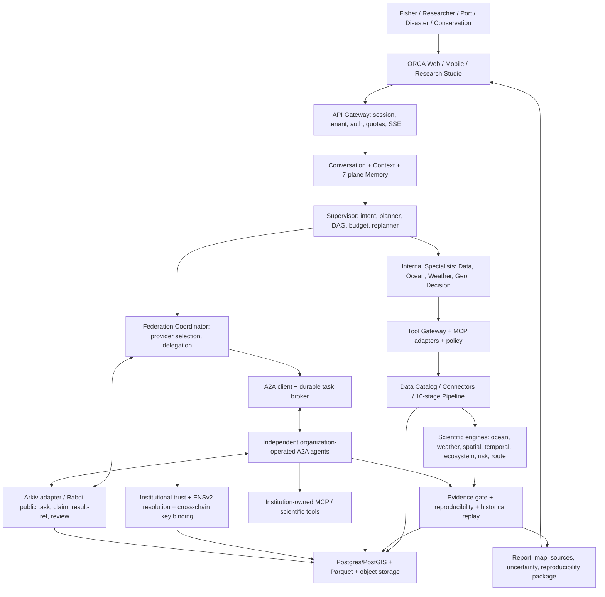
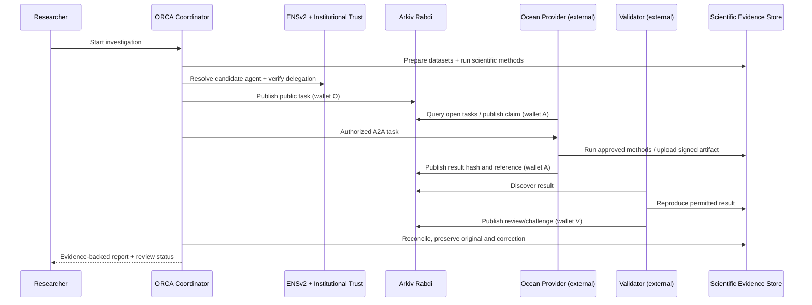
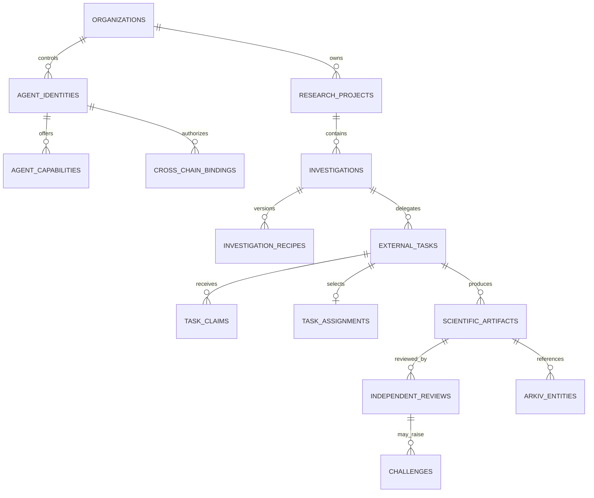

# ORCA 3.0 — Unified System Design

**Status:** Proposed updated architecture (not deployed)  
**Version:** 3.0 / 2026-11-05  
**Scope:** Original Marine Decision Workspace + Research Studio + independently operated agent federation + institutional identity (ENSv2) + shared coordination (Arkiv) + reproducible scientific verification.  
**Authority:** This file is the new architecture entry point. The seven updated documents in `docs/01`–`docs/07` expand it. See `docs/00_SOURCE_AUDIT_AND_MIGRATION.md` for preservation and source provenance.

> **Truthfulness:** Prior ORCA portal documents describe research/design, not a verified production deployment. This package is an updated implementation specification, not a report of completed integrations or validated accuracy. Research documents, existing prototype claims, and new proposals are distinguished in the source audit. External organizations in demo examples are **simulated operators** unless real organizations explicitly participate.

## 1. Product thesis and the problem

ORCA is an evidence-grounded marine intelligence workspace for fishermen, researchers, maritime operators, environmental analysts and disaster-management teams. The existing dossier already defines a conversational investigation system that coordinates a chat, map, agent activity, and evidence panels. The extension adds a **Research Studio**, a **scientific reproduction/challenge system**, and an **open agent federation** in which independently operated organizations can contribute agent services, verified tools and bounded research artifacts.

It solves four different problems rather than conflating them:

1. **Understanding:** turn a marine question into properly scoped spatial, temporal and source requirements.
2. **Scientific analysis:** compute reproducible findings with documented methods, quality controls, uncertainty, and historical validation.
3. **Interoperability:** incorporate existing institutional datasets and scientific code without forcing a transfer of confidential raw data.
4. **Cross-organization accountability:** permit parties to discover agents, delegate bounded tasks, own their signed contributions, challenge results, and independently inspect permitted coordination records.

ORCA does **not** claim to replace INCOIS, IMD, official advisories, certified marine navigation information, research scientists, or established scientific infrastructure (EDITO, Copernicus, Pangeo, etc.). It augments them.

### 1.1 What the upgrade changes

| Before (retained) | After (new or strengthened) |
|---|---|
| Chat + marine map + activity + evidence | Same four surfaces plus researcher-mode projects, notebooks, benchmarks, agent network and institutional administration |
| Single ORCA supervisor delegates to internal domain agents | Same supervisor additionally calls a federation gateway to discover external A2A services |
| Tool Gateway with ~114 catalogued functions in old design | Same tool registry, versioned/scoped; external tools via permissioned MCP; published number is a **design inventory**, not proof of implementation |
| Evidence Gate checks sufficiency | Claim-level checks, method registry, independent reproduction, contradiction resolution, immutable off-chain artifact versioning |
| Data ingestion: ten stages | All ten preserved with archival as-of time, license, depth, uncertainty and QC-aware comparison |
| Postgres/PostGIS + object storage + Parquet + Redis | Preserved; add organization/agent identity, research projects, review/challenge, ENS binding, Arkiv journal and outbox; **no raw science on-chain** |
| Seven memory planes | Preserved; add tenant scope and trusted external evidence references; public Arkiv is never a memory backend |
| Existing fast/complex paths | Fast path unchanged; external network only for genuine collaboration / independent review |

### 1.2 Non-negotiable invariants

- **No evidence → no factual assertion**, with risk-proportionate abstention.
- **LLM plans/interprets; scientific engines calculate**. Scientific numbers, spatial operations and scientific confidence must not be invented by an LLM.
- Every relevant result is tied to **data product, version, valid time, geographic coverage, method version, units, QC, evidence IDs**.
- **Observation time, forecast issue time, forecast valid time, retrieval time, and original availability time are distinct**.
- Official warnings remain authoritative; ORCA never invents, signs, changes, suppresses, or publishes an official government alert. In high-risk workflows always surface applicable official warnings, missing data and limitations.
- Public Arkiv entities contain only deliberately public metadata; confidential coordinates, raw chats, restricted forecasts, and credentials stay under institution-controlled authorization.
- ENS name/wallet ownership ≠ institutional accreditation; Arkiv record owner ≠ authorized agent; valid hash ≠ scientific truth.
- When a network service fails, direct local scientific querying and official warning relay should still work.
- Every actor is least-privileged, every model/tool/contract call has budget and timeout, and mutating external actions require deterministic policy.

## 2. Logical architecture



**Control/data/trust separation:** The **control plane** constructs and monitors task DAGs; the **scientific data plane** retrieves and computes source-grounded results; the **federation plane** connects independent endpoints; the **trust/coordination plane** resolves ENS identities, checks delegated authority, and publishes limited public Arkiv records. These planes are logical; a monorepo/modular deploy is appropriate until measured load requires separation.

## 3. Applications and workflows

| Surface | User outcome | Main path |
|---|---|---|
| Fisher / trip companion | PFZ references, local conditions, risk context, official warnings, multilingual voice | Direct cached authoritative sources → QC and official-warning checks → explain + map; **no wallet needed** |
| Marine Research Studio | Question→typed recipe→source selection→compute→validation→research report | Durable workflow + reproducible evidence; optional independent external review |
| Maritime console | Route exposure, weather time slices, protected zones and scenario comparisons | Dedicated scientific engines and boundaries; not nautical certification |
| Disaster/authority | Authenticated warnings and situation assessments | Official-source priority; model suggestion is non-authoritative |
| Provider portal | Register an institution, prove control of its own agent, publish capabilities, track tasks | ENS + institutional credential + A2A Agent Card; Arkiv public metadata only |
| Independent verifier | Verify public task/claim/result history and inspect reproducible permitted artifacts | Arkiv read + ENS resolve + signature checks + artifact hash + scientific reproducer |

Retain four existing UI surfaces: **conversation, map, activity, evidence**. Research mode adds a project navigator, method editor, dataset-quality inspector, task graph timeline, verification/challenge tab, historical replay, reproducible export, organization management. Agent activity shows factual execution summaries, not hidden chain-of-thought.

## 4. Agent model and execution

### 4.1 Agents retained from original design

- **Supervisor / Planner:** intent, complexity, budgets, DAG, scheduling and bounded replanning. Not scientific calculator or authority issuer.
- **Data Acquisition Agent:** catalog search, source selection, retrieval, fallback, freshness, credentials through connector service.
- **Ocean & Ecosystem Agent:** SST, chlorophyll, fronts, currents, productivity indicators via scientific engine.
- **Weather & Hazard Agent:** wind/waves/cyclone context/official advisories, preserves authority.
- **Geospatial Agent:** point/polygon/raster/geofence/route spatial operations via PostGIS and validated geospatial core.
- **Decision/Risk/Operations Agent:** scenario/options, explicit uncertainty, not autonomous official safety declaration.
- **Evidence Validator (service):** deterministic quality and claim gate; can orchestrate a separate independent reproduction agent.
- **Synthesizer (agent/service):** turns structured results into user language, validates every numeric claim, uses source citations.

### 4.2 New logical network roles

| Role | Input | Output | Trust boundary |
|---|---|---|---|
| **Federation Coordinator** | Required capabilities, region, tasks, policy | Discovered/authorized providers + A2A delegation | External Agent Cards/Arkiv contents untrusted |
| **Institutional Identity Validator** | ENS name, keys, org credential, authorization binding | Signed/revocable authorization decision | ENS by itself insufficient |
| **Independent Reproduction Agent** | Input refs, source/method versions, artifact | Recomputed values, method mismatch, signed review | Different service/key; independent implementation where possible |
| **Scientific Challenge Arbiter** | Competing artifacts/reviews and scientific criteria | Recalculation request, unresolved finding or documented resolution | No popularity/reputation-based scientific consensus |
| **Model/Method Evaluator** | Frozen benchmark cases, model/method version | Scientific and agent performance metrics | Held-out time intervals and leakage prevention |

These are **logical roles**; not every role needs an LLM. Independent means separately controlled organization, keys, runtime and datasets; three containers controlled by ORCA during a demo must be labeled as simulated organizations.

### 4.3 Execution tiers

1. **DIRECT:** single-source simple question, scientifically checked and cached; avoid A2A/Arkiv.
2. **MULTI-SOURCE:** internal domain specialists in parallel, deterministic evidence gate.
3. **RESEARCH:** long-running typed scientific method workflow with method review, plots, export.
4. **FEDERATED:** research task requires independent provider/model; validate identity + capability + signed result and if requested use Arkiv task/claim/review.
5. **HIGH IMPACT:** decisions about vessel safety, official alerts, or protected actions require authoritative sources, strict abstention and any necessary institutional approval. Blockchain never delays delivering official warning information.

## 5. Protocol boundaries and sponsor technology

| Technology | Protocol/system responsibility | Integration guardrail |
|---|---|---|
| **A2A 1.x** | Agent Cards, remote message/task lifecycle, status/artifacts, streaming when appropriate | Real version-pinned SDK; A2A Card is self-description, not authorization |
| **MCP** | Tools and resources exposed to authorized agents | Tool-level scopes, network egress protections, no remote arbitrary code |
| **ENSv2** | Institutional namespace, agent subnames, resolver records, delegated scoped permissions, revocation | Resolver write roles can apply **across all names in one resolver**; separate instances/roles for independent agents; verify through ENSv2-compatible Universal Resolver |
| **Arkiv / Rabdi** | Public queryable, wallet-owned, expiring records for agent/task/claim/result-reference/review | No private data or permanent truth; verify `$owner` and authorization binding; testnet only as verified |
| **Postgres/PostGIS** | Authoritative application state, tenant policy, full workflow, geospatial metadata, evidence indexing | RLS/tenant policies and backups; not all scientific arrays in SQL |
| **Object storage / Parquet / NetCDF / Zarr** | Content-addressed or immutable versioned raw datasets/results | Rights/licensing, region data controls, checksum, manifests |
| **Optional 0G / Chainlink / World ID / x402** | Pluggable inference, oracle workflow, human uniqueness, payment respectively | Add only when a real workflow requires them; don't replace science validation |

The ENS agent text-record proposal ENSIP-26 is **draft**; store ordinary ENS text records and use draft key names only as an optional convention. ENS and Arkiv are separate chains: create an explicit typed, signed, expiring **ENS↔Arkiv authorization binding** with nonce, audience, scope, agent name, service public key and revoke version. Cross-chain key equality is not a substitute for credential checks.

## 6. End-to-end distributed investigation

**Example:** A researcher asks, “Investigate an unusual chlorophyll pattern in this Arabian Sea polygon and obtain independent validation.”

1. Workspace authenticates researcher and organization, stores original request and chosen polygon privately, creates `research.investigation` and `workflows`.
2. Planner emits a typed **Scientific Investigation Recipe**, with variables, sources, baseline, date range, explicit QC/method versions, uncertainty and evaluation criteria. A constrained plan is approved/edited by researcher when assumptions are material.
3. Data agent resolves permissible datasets, source versions, licensing, depth/spatial/temporal ranges and information available at the relevant decision date.
4. Local scientific workers execute the original ten-stage pipeline; raw assets are immutable and findings reference exact manifest IDs.
5. Network coordinator queries provider directory by capability and region, resolves ENSv2 name, fetches A2A Agent Card, validates org credential, endpoint attestation and task scope.
6. It publishes a **non-sensitive** `task` entity to Arkiv if open multi-organization coordination is needed; otherwise directly delegates over A2A.
7. Independent provider writes a claim from its **own** Arkiv wallet. Requester selects the authorized claim and publishes an explicit assignment reference. Multiple claims are allowed; Arkiv does not arbitrate them.
8. A2A sends detailed authorized data requirements; provider invokes its own MCP tools and returns signed scientific evidence. It uploads allowed artifacts to an approved storage location or controlled institution endpoint.
9. Provider publishes an Arkiv result reference (content digest, short URI/opaque locator, method version) using its own key. Independently check owner/creator; don't equate transaction sender with scientist identity.
10. Another agent downloads permitted inputs, reproduces calculations, submits `review` or `challenge` record. If baseline mismatch, trigger bounded recalculation and preserve original findings and correction.
11. Evidence gate checks source, QC, coverage, spatial/depth/time alignment, method and numerical consistency, uncertainty and claim scope. It can abstain when adequate evidence is missing.
12. Composer creates report with map, charts, methods, evidence/provenance links, corrections and limitations. Independent verifier can read public unexpired Arkiv records with ORCA backend shut down, but private evidence requires authorization and accessibility.



## 7. Database and storage architecture

**Do not discard the old Doc 4 database.** Preserve its 4 principal storage technologies, canonical variables, data sources/datasets/ingestion, metadata, GIS, evidence, workflows, user sessions, alerts, Marine State, events/decisions/scenarios, and seven memory planes. **Add separate namespaces** for institutions and federation, not overlapping replacement tables with the same names.

| Namespace | Core additions | Primary purpose |
|---|---|---|
| `iam` | `organizations`, `memberships`, `organization_credentials`, `agent_identities`, `agent_keys`, `agent_authorizations`, `ens_records`, `cross_chain_bindings`, `revocations` | Org trust + tenant boundaries + keys and revocations |
| `federation` | `agent_capabilities`, `agent_endpoints`, `external_tasks`, `task_claims`, `task_assignments`, `a2a_sessions`, `agent_artifacts`, `provider_health` | Remote agent lifecycle |
| `research` | `projects`, `project_members`, `investigations`, `investigation_recipes`, `method_versions`, `dataset_snapshots`, `compute_runs`, `scientific_artifacts`, `review_requests`, `independent_reviews`, `challenges`, `reproductions`, `historical_evaluations` | Persistent verified research |
| `web3` | `arkiv_entities`, `arkiv_write_outbox`, `arkiv_sync_cursor`, `chain_receipts`, `ens_resolution_cache` | Chain projection, idempotency and transaction recovery |
| `audit` | `audit_events`, `data_access_decisions`, `policy_versions` | Controlled immutable-history references and access accountability |
| `public` | **Existing** ORCA core tables such as `data_sources`, `datasets`, `evidence_records`, `workflows`, `tasks`, `marine_states`, `alerts`, `memory_items`, etc. | Legacy compatibility; reconcile actual migrations before creating FKs |

See **`docs/04_database.md`** for detailed schema, relationships, indexes, RLS, retention, outbox and SQL examples; **`db/001_orca_v3_extensions.sql`** is a concrete starter migration for the **new** schemas, not a replacement for the old Doc 4 migration.

**Important mapping:**
- `public.workflows` = general investigation execution; `research.investigations` = scientific research domain object; `federation.external_tasks` = externally delegated tasks; no silent redefinition of `public.tasks`.
- `public.evidence_records` = existing evidence references; `research.scientific_artifacts` = immutable publication version and bundle; `research.independent_reviews` = reviewer contribution; `web3.arkiv_entities` = an **off-chain projection** of ephemeral public chain state.
- `public.claims` (old doc) = factual claims about science. `federation.task_claims` = **agent bidding for work**. Never merge the two.
- `memory_items` are not measurements; a remembered SST value must be revalidated from source evidence.

### 7.1 Key relationships



## 8. Canonical contracts and state machines

### 8.1 Scientific investigation recipe

```json
{
  "schema_version":"orca.investigation_recipe/1.0",
  "investigation_id":"UUID",
  "question":"Assess an SST anomaly",
  "spatial_scope":{"geometry_ref":"private-geometry-id","crs":"EPSG:4326"},
  "temporal_scope":{"start":"ISO-8601","end":"ISO-8601","as_of_available_at":"ISO-8601-or-null"},
  "requirements":[{"variable":"sea_surface_temperature","data_kind":"observation","depth_m":0}],
  "method":{"id":"sst.seasonal_anomaly","version":"1.0","baseline":{"start_year":1991,"end_year":2020,"seasonal_alignment":"day_of_year"}},
  "quality":{"min_spatial_coverage_fraction":0.75,"allowed_qc_flags":["good","probably_good"]},
  "output":["stats","map","timeseries","scientific_evidence_package"],
  "constraints":{"max_cost_usd":5,"requires_independent_review":true}
}
```

### 8.2 Scientific result artifact

```json
{
  "schema_version":"orca.scientific_artifact/1.0",
  "artifact_id":"UUID","task_id":"UUID","producer_agent_id":"UUID",
  "source_assets":[{"dataset_id":"...","product_version":"...","checksum":"sha256:...","license":"..."}],
  "geometry_ref":"...","time":{"observation_time":"...","forecast_issue_time":null,"forecast_valid_time":null,"retrieved_at":"..."},
  "method":{"id":"sst.seasonal_anomaly","version":"1.0","environment_digest":"sha256:..."},
  "result":{"anomaly_celsius":1.3},"units":{"anomaly_celsius":"degC"},
  "quality":{"coverage_fraction":0.84,"warnings":[]},
  "limitations":["Synthetic value shown for schema example only"],
  "claims":[{"claim_id":"...","supporting_evidence_ids":["..."]}],
  "content_digest":"sha256:...","signature":{"key_id":"...","signature":"..."}
}
```

**Signature coverage:** canonical bytes of manifest *excluding* its signature field, plus domain/audience and task ID; use a defined canonical JSON/CBOR profile and verify from registered key material. Avoid mixing arbitrary JSON serialization between Python and JS. Full examples in `contracts/`.

### 8.3 State machines

- Investigation: `draft → planned → running → validating → (review_required | completed | insufficient_evidence | failed | cancelled)`; corrections create new artifact versions, not destructive edits.
- External task: `created → published → claimed → assigned → running → result_submitted → (accepted | challenged | expired | failed | cancelled)`.
- Review: `requested → reproducing → (validated | challenged | inconclusive | failed)`; independently signed; require linked method/source version.
- Chain write: `pending → submitted → confirmed → indexed`; timeout may mean **unknown**, never immediately re-send without checking idempotency/receipt.
- ENS key binding: `pending → active → revoked/expired`; a cached `active` state cannot override verified revocation.

## 9. Security and governance

Threats and minimum responses:

1. **Spoofed ENS/organization:** verify actual name resolution and signing control plus organization authority credential and binding scope. `example.eth` never proves government affiliation.
2. **Resolver permission leakage:** ENSv2 Permissioned Resolver role grants can apply across **all names it serves**. Use separate resolvers/child registry where per-agent isolation is necessary and test negative writes.
3. **Fake Arkiv registration:** anybody can publish an entity under a public schema name. Filter by owner/creator and verified bindings, not schema match alone.
4. **Cross-chain identity confusion:** enforce `chain_id`, ENS namehash/name, Arkiv address, A2A service key, expiry, nonce, domain, authorization scope and revocation version; read both network confirmations.
5. **A2A/Agent Card SSRF:** validate endpoint domains, HTTPS, private-IP blocking, TLS/service identity and outbound network allowlist; no arbitrary user-supplied URLs from LLM.
6. **Prompt injection in external tasks/artifacts:** treat all remote content as data; enforce tools/permissions independently of model instructions; sandbox computation.
7. **Scientific false confidence:** deterministic recomputation, correct QC/time/depth and uncertainty; record contradictory results and abstain.
8. **Sensitive data leakage:** Arkiv and ENS public; no private dataset names that identify protected operations, no chat transcripts or precise user coordinates.
9. **Duplicate claims / racing:** deterministic assignment authority, signed acceptance record, DB unique constraints and durable outbox; don't assume Arkiv exclusive locking.
10. **Expiring/deleted Arkiv entities:** archive and re-verify any externally referenced evidence; public availability is not permanent. Provide alternative read paths.
11. **Audit and retention:** separate append-only event log + WORM/versioned object archive with privileged corrections, per-tenant retention and privacy policy; hash chain alone does not supply complete audit guarantees.
12. **Safety:** official alerts are relayed without waiting for network or consensus; high-risk recommendations must not use derived LLM confidence as authority.

## 10. Scientific quality and independent research

Retain old scientific engines (ocean, weather, spatial, temporal, ecosystem, risk, route) and add:

- **Method registry:** versioned recipes, input schema and accepted QC/units.
- **Scientific Fitness Validator:** variable equivalence (e.g. satellite skin SST vs bulk SST), depth, CRS, cadence, masks, quality flags, footprint, interpolation policy.
- **Independent reproduction:** run approved recipe with original dataset snapshots under a separately controlled worker and signed output; support inconclusive findings.
- **Contradiction analyzer:** explain mismatch by source, baseline, unit, temporal alignment, data quality, method version or true observational discrepancy. Do not 'vote' the science.
- **Historical Replay:** freeze evidence available at original historical decision time, compare to later independent observations and archived advisories; never substitute reanalysis as if available then.
- **Claim gate:** every quantitative figure originates in a structured computation artifact, supporting evidence IDs and bounded language. Citation missing → omit or qualify.
- **Research export:** RO-Crate/PROV-inspired manifest, notebook/recipe, dataset references, plots, environment digest, licenses, reviewer comments; a chain record holds only a hash/reference.

Measures: MAE/RMSE/bias for forecast variables; hit/miss/false-safe for official-warning matching; numerical agreement and method validity; evidence-supported claim rate; independent reconstruction success; researcher active time including correction.

## 11. Frontend data model and events

Research Studio modules: `project navigator`, `question → recipe editor`, `source suitability inspector`, `task DAG`, `agent map`, `method/result comparison`, `review/challenge`, `historical replay`, `reproduction/export`, `ENS identity + Arkiv wallet provenance` and `organization privacy mode`. Existing fisher mobile PWA remains light and works on poor networks.

SSE events add `provider_discovered`, `agent_identity_checked`, `external_task_published`, `claim_received`, `assignment_confirmed`, `a2a_task_started`, `artifact_submitted`, `review_opened`, `challenge_raised`, `reproduction_completed`, `arkiv_write_submitted`, `arkiv_write_confirmed`, `arkiv_entity_expiring`, `org_binding_revoked`, `scientific_abstained`.

**UI truthfulness:** Don't label a task 'verified' solely upon Arkiv transaction receipt; show separate `Record confirmed`, `Identity authorized`, `Hash checked`, `Science reproduced` statuses.

## 12. REST / A2A / tool boundaries

Internal REST (proposed, not Arkiv official endpoints):

- `POST /v1/research/projects`, `POST /v1/research/investigations`, `GET /v1/research/investigations/{id}`
- `POST /v1/research/investigations/{id}/plan`, `POST /v1/research/investigations/{id}/execute`, `POST /v1/research/investigations/{id}/reproduce`
- `GET /v1/research/investigations/{id}/evidence`, `GET /v1/research/investigations/{id}/events` (SSE)
- `GET /v1/network/agents?capability=`, `POST /v1/network/organizations/{id}/agents`, `POST /v1/network/agents/{id}/bind-arkiv-wallet`
- `POST /v1/network/tasks`, `GET /v1/network/tasks?capability=`, `POST /v1/network/tasks/{id}/claims`, `POST /v1/network/tasks/{id}/assign`
- `POST /v1/network/results`, `POST /v1/network/reviews`, `GET /v1/network/tasks/{id}/history`
- `POST /v1/identity/verify-ens`, `POST /v1/identity/revoke`, `GET /v1/verify/artifacts/{id}`

External agents expose **official A2A endpoints** and Agent Cards via the pinned SDK. Scientific functions expose typed `ocean.*`, `weather.*`, `geo.*`, `data.*`, `science.validate.*`, `science.reproduce.*` through the existing Tool Gateway/MCP after authorization. ORCA REST routes do not replace native A2A or Arkiv SDK methods.

## 13. Operations, costs and performance

- Fast user-facing source requests: source-level caching, own backend and official warning checks, no chain transaction on critical path.
- Expensive raster/research work: queue tasks; schedule Dask workers; store checkpoints; protect from runaway LLM tool loops.
- Federation: deadlines, per-provider concurrency, task budgets, cancel/revoke, A2A status polling/streaming, retry after uncertainty with idempotency.
- Chain: bounded public writes, local read projection, confirmation watcher, indexer lag monitor, event pagination and expiry sweeper. Arkiv records are **public, wallet-owned and limited lifetime**; it is not durable institutional data retention.
- Observability: OpenTelemetry spans keyed by investigation/task/method/agent/chain tx; sanitization of sensitive prompts and coordinates; Prometheus metrics for evidence sufficiency, scientific error, failed/retried tasks, ENS resolution, Arkiv write confirmation and query latency.
- Security/reliability: API quotas, caching, bounded retries with jitter, queues, encrypted object storage, per-tenant auth, backups and verified restore tests.
- Do not claim `<8s` for complex federated investigations: old source shows a *target*, not measured performance. Measure actual end-to-end latency including review and blockchain confirmations.

## 14. Deployment and repository

```text
orca/
  apps/{web,research-studio,provider-portal,verifier}
  services/{api,conversation,investigation,agent-runtime,federation-gateway,identity,arkiv-adapter,ens-adapter,data-catalog,data-connectors,scientific,review,alert,model-gateway,audit}
  packages/{contracts,client-sdk,agent-sdk,scientific-methods,provenance,shared-ui}
  protocols/{a2a,mcp}
  db/{migrations,seeds}
  infra/{compose,k8s,terraform,observability}
  tests/{contracts,scientific,security,federation,e2e,load}
  docs/{01_user_flows.md,...,07_scientific_engine.md}
  design.md
```

Recommended languages/runtime: Next.js/TypeScript for interfaces; FastAPI/Python for scientific/agent services; xarray, NumPy, SciPy, Pandas, GeoPandas, Dask, Pint and PostGIS; Node.js/TypeScript for Arkiv + ENS via maintained SDKs; Redis for cache, S3-compatible versioned evidence storage. K8s only when the need is measured; local Docker Compose can host multiple signed service identities during development.

## 15. Build dependencies and acceptance gates

| Stage | Deliverables | Pass condition |
|---|---|---|
| A. Contracts & persistence | Existing table compatibility map; schemas for organization, binding, external task, artifact and review | Schema validation and migration tests pass |
| B. Science foundation | Data connector, QC, typed anomaly recipe, versioned result and independent repeat | Known baseline mismatch detected; correct source time/depth/unit policy |
| C. Federation | A2A version-pinned SDK, separate provider service, task/response correlation | Remote task executed and canceled; forged response rejected |
| D. ENSv2 | Institution and child agent names, separate resolver permission boundary, revoke | Authorized endpoint update works; unauthorized sibling edit fails; revocation takes effect |
| E. Arkiv | Task/claim/result/ref/review writes + filtered reads by multiple wallets | Live query drives displayed task board; second wallet is genuine writer; no private payload |
| F. Cross-chain binding | Signed scoped binding with nonce, audience, expiry, key rotations | Forged/stale/revoked bindings rejected including cached ENS cases |
| G. Research Studio | Case workspace, map, sources, analysis, challenge, audit and export | User can reproduce scientific result and see conflicting methodological evidence |
| H. Offline verification | Independent read from Arkiv + verify signatures/hash after ORCA gateway shutdown | Clear separate verification statuses; off-chain source availability limitations exposed |
| I. Hardening | Negative security/SSR/FK tests, backup restore, quotas, cost, load | Defined test suite repeatable by another developer |

## 16. ETHGlobal Mumbai architecture-fit notes

**Classic/from scratch:** The organizer reportedly confirmed that prior research is acceptable when no implementation exists; retain that Discord clarification and disclose prior designs/AI assistance per event rules. Do not claim an existing project was newly created if it wasn't.

**Arkiv — Build on Arkiv (from scratch):** The task board must **write and read real Arkiv entities** as a user-facing feature. Include wallet writers, reproducible query, `/arkiv/schema.md`, `/arkiv/friction.md`, `/arkiv/reach.md`, `/arkiv/why-arkiv.md`, `/arkiv/how-you-use-arkiv.md`, open source and AI disclosure. Prize fit is not a winning prediction.

**ENSv2 — Best Use of ENSv2:** Demonstrate genuine hierarchical subnames, real resolver records, scoped role delegation and revocation with actual ENSv2 contracts. An ENS display-only feature is insufficient.

**Other sponsors:** Add 0G inference, Chainlink CRE, World ID, x402/Hedera, Swarm only if they solve a real additional user need and can be demonstrated without bypassing science or data privacy. `arkiv/` contains submission templates that must be filled with actual runtime evidence, not invented metrics.

## 17. Compatibility and source register

Seven core original docs from the ORCA portal:
1. https://teampflresearch.vercel.app/doc1.html — user flows and four UI surfaces.
2. https://teampflresearch.vercel.app/doc2.html — core agentic architecture, roles, permission matrix and original tool registry.
3. https://teampflresearch.vercel.app/doc3.html — ten-stage data pipeline and scientific computation.
4. https://teampflresearch.vercel.app/doc4.html — SQL and four-store architecture.
5. https://teampflresearch.vercel.app/doc5.html — implementation plan, source requirements and eight legacy demos.
6. https://teampflresearch.vercel.app/doc6.html — seven memory planes.
7. https://teampflresearch.vercel.app/scientific.html — seven scientific engine families.

Companions:
- https://teampflresearch.vercel.app/fisher.html
- https://teampflresearch.vercel.app/data-sources.html
- https://teampflresearch.vercel.app/agentic-spec.html
- https://teampflresearch.vercel.app/core-agentic-technical.html
- https://teampflresearch.vercel.app/master-arch.html

Current official protocol/source references:
- https://a2a-protocol.org/latest/
- https://modelcontextprotocol.io/specification/2025-11-25
- https://docs.ens.domains/ensv2/overview/
- https://docs.ens.domains/ensv2/subnames/
- https://docs.ens.domains/ensv2/permissioned-resolver/
- https://docs.ens.domains/ensip/26/ (draft convention)
- https://docs.arkiv.network/networks/rabdi/
- https://docs.arkiv.network/reference/limits/
- https://docs.arkiv.network/start-here/first-entity/
- https://ethglobal.com/events/mumbai/prizes

**Interpretation priority:** current verified protocol docs > current original ORCA specifications > our proposed design where an interface is not yet built. Any disagreement or unsupported API example must be resolved by a version-pinned contract test before coding against it.

## 18. Architecture decisions and unresolved questions

| ADR | Decision | Revisit when |
|---|---|---|
| ADR-001 | Add federation as a sidecar to legacy supervisor, not rebuild existing domain agents | A2A measured throughput justifies externalizing more roles |
| ADR-002 | Postgres authoritative for private business state; Arkiv for public temporary collaboration | A genuinely independent production network has measured different requirements |
| ADR-003 | ENSv2 name is discovery pointer, not proof of institutional authority | Compatible verified credential standard chosen |
| ADR-004 | Scientific validators rerun approved methods and may abstain, not vote | Independent empirical study supports an alternative |
| ADR-005 | No automatic high-impact public action by an unaudited LLM | Domain authority authorizes narrow workflows |
| ADR-006 | Original doc schema is **not assumed deployed**; SQL extension kept additive | Actual migration history inspected |
| ADR-007 | Separate simple live queries from asynchronous research investigations | Latency and usability testing shows otherwise |

Open questions: which publicly available archival ocean products can be legally preserved; which real organization will pilot a restricted dataset; how dataset licenses affect reproducible export; which ENSv2 name/chain registration cost is acceptable; confirmation/indexing behavior under Rabdi load; which retention policy institutional compliance needs; and what counts as independent validation for different scientific claims.

---

**Navigation:** [`01 User Flows`](docs/01_user_flows.md) · [`02 Agents`](docs/02_agentic_architecture.md) · [`03 Data`](docs/03_data_processing.md) · [`04 Database`](docs/04_database.md) · [`05 Implementation`](docs/05_implementation.md) · [`06 Memory`](docs/06_memory_context.md) · [`07 Science`](docs/07_scientific_engine.md) · [`Migration & Source Audit`](docs/00_SOURCE_AUDIT_AND_MIGRATION.md)
