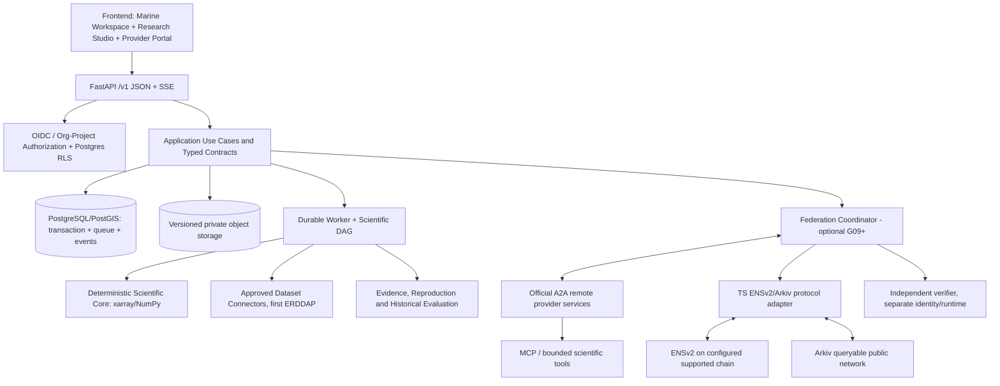
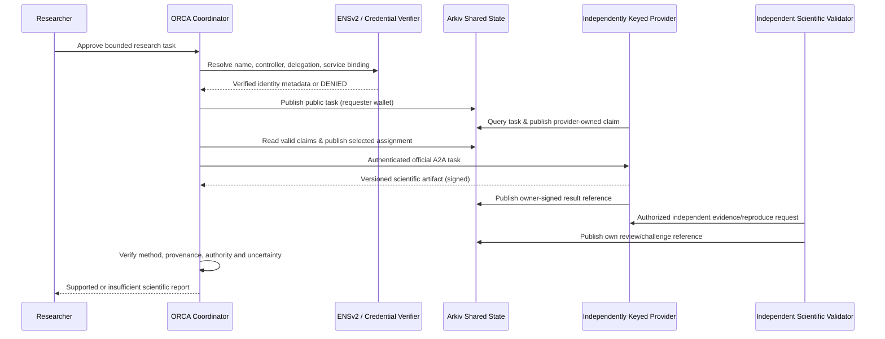

# ORCA 3.0 — Backend Implementation Plan, Repository Blueprint & Mandatory Verification Gates

**Filename:** `implementation plan.md`  
**Date:** 2026-11-06  
**Revision:** `3.2.0-design-proposal`  
**Status:** **PLANNING ONLY — ALL P00–P14 NOT STARTED.** No implementation, test pass, dataset access, chain write, organization acceptance, deployment or scientific validation is represented as complete.  
**Companions:** [`api design.md`](api%20design.md) (220 **planned** HTTP operations, revision 3.1.0-proposal), [`design.md`](design.md) and the seven revised design documents, [`phases and subphases.md`](phases%20and%20subphases.md) (partially supplied: P00–P05 and P06 heading).  
**Audience:** Backend engineer(s), scientific reviewer, DevOps/SRE, frontend engineer (separate team), external agent provider, independent auditor and hackathon judge.  
**Primary outcome:** a reproducible, tenant-isolated scientific research backend; when explicitly selected, a real ENSv2/A2A/Arkiv federation whose providers control their own keys.  
**Non-goal:** claiming the entire specification is implemented just because the scaffolding or frontend mocks run.

> **Source and contract warning.** The supplied mandatory phase excerpt defines P00–P05 and starts P06; its continuation was not supplied. This plan preserves those five phases and the API's existing P06–P12 route assignments, **proposes** detailed G06–G12, and adds P13–P14. A future complete user-authored gate document takes precedence where explicitly identified. The previous ORCA 3.0 design package was an architectural proposal, not migration or code execution evidence. Record every accepted reconciliation as an ADR before implementation.

## Table of contents

1. [Decision hierarchy and document reference catalogue](#1-decision-hierarchy-and-document-reference-catalogue)
2. [Release profiles, sequencing and phase overview](#2-release-profiles-sequencing-and-phase-overview)
3. [Architecture boundaries and runtime composition](#3-architecture-boundaries-and-runtime-composition)
4. [Target repository and purpose of every folder](#4-target-repository-and-purpose-of-every-folder)
5. [Engineering conventions, ownership and source safety](#5-engineering-conventions-ownership-and-source-safety)
6. [P00–P14: phase-by-phase implementation, subphases, tests and exit gates](#6-p00p14-phase-by-phase-implementation-subphases-tests-and-exit-gates)
7. [File-level ownership and mandatory test traceability](#7-file-level-ownership-and-mandatory-test-traceability)
8. [Test taxonomy, live dependencies and adversarial scenarios](#8-test-taxonomy-live-dependencies-and-adversarial-scenarios)
9. [Gate runner, manifests, CI and regression invalidation](#9-gate-runner-manifests-ci-and-regression-invalidation)
10. [Frontend / backend handoff protocol](#10-frontend--backend-handoff-protocol)
11. [Scientific source validation and reproducibility](#11-scientific-source-validation-and-reproducibility)
12. [Federated identity, A2A, ENSv2 and Arkiv delivery model](#12-federated-identity-a2a-ensv2-and-arkiv-delivery-model)
13. [Security, privacy, operations and incident readiness](#13-security-privacy-operations-and-incident-readiness)
14. [API operation-to-phase-to-test traceability — all 220 planned operations](#14-api-operation-to-phase-to-test-traceability--all-220-planned-operations)
15. [Mandatory release checklist and open ADRs](#15-mandatory-release-checklist-and-open-adrs)

---

## 1. Decision hierarchy and document reference catalogue

This is an executable **planning specification**, not evidence of executable artifacts. Sources carry one of three labels: **U** (user-supplied gate language), **D** (prior ORCA design proposal), or **W** (verified public documentation). When they conflict, current official protocol wire format governs external APIs; U governs gates and project requirements; validated scientific source metadata governs scientific semantics; D is a proposed structure requiring an ADR when changed.

| ID | Reference (source type) | Precise section to consult; not fictitious paragraph numbers | What an implementation must inherit |
|---|---|---|---|
| **U-GATE** | User's `phases and subphases.md` excerpt (U; P00–P05 + P06 heading) | `Execution rules`; `P00` through `P05`, `G00`–`G05` | Hard sequencing, required live G03/G04, source preservation, tests, gate manifests |
| **U-IMPL** | User's prior implementation excerpt [`Pasted markdown(2).md`](Pasted%20markdown%282%29.md) (U) | `§4 Proposed project tree` fragment; `§5 File purpose header`; `§6 Storage`; `§7 Mocking`; `§8 Test-gate mechanics`; `§9 Frontend`; `§10 Security`; `§11 Extension` | Folder discipline, mocked tests only, secure RLS, no fictional passed gates |
| **A-API** | [`api design.md`](api%20design.md) (D, user-accepted specification) | `§2 Global HTTP contract`; `§3.1–3.14 Operation inventory`; `§4 DTOs`; `§5 lifecycles`; `§6 examples`; `§7 Science`; `§9–11 ownership/security/tests`; `§13 A2A/MCP/ENS/Arkiv`; `§15–19 traceability` | Exact 220 **designed** routes/phase labels, problem codes, DTOs, SSE, auth, tests |
| **D-MASTER** | [`design.md`](design.md) (D) | `§2 Logical architecture`; `§4 Agents`; `§5 Protocols`; `§7 Databases`; `§8 Contracts`; `§9 Security`; `§10 Science`; `§12 Interfaces`; `§17 source register` | Preserve ORCA's science-first design while adding federation |
| **D-AUDIT** | [`docs/00_SOURCE_AUDIT_AND_MIGRATION.md`](docs/00_SOURCE_AUDIT_AND_MIGRATION.md) (D) | `§1 Dossier inventory`; `§2 preserved assumptions`; `§3 terminology`; `§4 authority`; `§7 update rule` | Avoid inventing old files; distinguish scientific claim and agent task claim |
| **D-UI1** | [`docs/01_user_flows.md`](docs/01_user_flows.md) (D) | `§B.1–B.5 Modes/Research Studio/Provider UX`; `§E Event-to-UI contract`; `§F guardrails` | Four original user surfaces plus research and provider workspaces |
| **D-AGENT2** | [`docs/02_agentic_architecture.md`](docs/02_agentic_architecture.md) (D) | `§1 original logic`; `§2 roles`; `§3 planning`; `§4 registry separation`; `§6 task lifecycle`; `§7 identity`; `§9 events`; `§10 tests` | Internal planner separate from institution-controlled A2A providers |
| **D-DATA3** | [`docs/03_data_processing.md`](docs/03_data_processing.md) (D) | `§1.1 ten stages`; `§2 dataset contract`; `§3.1 connector`; `§3.2 source fitness`; `§4 provenance`; `§5 reproduction`; `§6 cache`; `§7 recovery` | Source metadata and origin are scientific input, not optional logs |
| **D-DB4** | [`docs/04_database.md`](docs/04_database.md) (D) | `§2 old tables`; `§3 relationships`; `§4.1–4.4 columns`; `§5 Arkiv mapping`; `§6 RLS`; `§7 storage`; `§8 cache`; `§10 migration`; `§11 tests` | Private Postgres/PostGIS, immutable object evidence, public Arkiv projection |
| **D-IMPL5** | [`docs/05_implementation.md`](docs/05_implementation.md) (D) | `§1 delivery principles`; `§2 workstreams`; `§3 prior 8 phase groups`; `§4 old demos`; `§5 demo script`; `§6 metrics`; `§7 prizes` | Retain original ORCA scenarios without promoting demos to scientific evidence |
| **D-MEM6** | [`docs/06_memory_context.md`](docs/06_memory_context.md) (D) | **`§1 Seven original planes`, `§2 Trust classification`, `§3 Context packet design`, `§4 Retrieval`, `§5 Federated session memory`, `§6 Multi-org isolation`, `§7 Lifecycle/TTL`, `§8 Tests`** | Explicit place to implement memory: never mistake user memories for current marine observations |
| **D-SCI7** | [`docs/07_scientific_engine.md`](docs/07_scientific_engine.md) (D) | `§1 original engines`; `§2 new platform`; `§3 result`; `§4.1 seasonal SST anomaly`; `§5 scientific challenge`; `§6 historical replay`; `§9 tests` | Independent numerical methods and scientifically qualified abstention |
| **D-SOURCE8** | [`docs/08_data_acquisition_delta.md`](docs/08_data_acquisition_delta.md) (D) | `§2 source catalog`; `§3 ingestion strategies`; `§4 connector tests` | Access/license/source provenance preserved |
| **D-ENG9** | [`docs/09_agentic_engineering_delta.md`](docs/09_agentic_engineering_delta.md) (D) | `§2 executor types`; `§3 distributed consistency`; `§5 authority`; `§6 tests` | Leased jobs and remote provider failures do not produce fake success |
| **D-FISH10** | [`docs/10_fisher_companion_delta.md`](docs/10_fisher_companion_delta.md) (D) | `Fisher needs`; `strict performance boundary`; `UX and evaluation` | Everyday answers do not wait for public-chain confirmations |
| **D-INTEGRATE13** | [`docs/13_legacy_integration_playbook.md`](docs/13_legacy_integration_playbook.md) (D) | `§1 insertion points`; `§2 service boundaries`; `§4 owners`; `§6 cross-chain binding`; `§7 consistency`; `§9 DoD` | Federation added at ports, not by replacing original agent engine |
| **W-UI1** | [Original ORCA Doc 1](https://teampflresearch.vercel.app/doc1.html) (W) | `§3 Four UI Surfaces`; `§4 eight scenarios`; `§12 UI truthfulness`; `§18 activity contract`; `§19 decision boundary` | Retain chat/map/agent activity/evidence and eight original requested workflows |
| **W-AGENT2** | [Original ORCA Doc 2](https://teampflresearch.vercel.app/doc2.html) (W) | Supervisor, tool gateway, complexity router, evidence-first planning; consult the page's own headings | Old specialists remain internal, not automatically external institutions |
| **W-DATA3** | [Original ORCA Doc 3](https://teampflresearch.vercel.app/doc3.html) (W) | Ten-stage processing/data alignment sections; consult table of contents | Preserve scientific variable/depth/time interpretation |
| **W-DB4** | [Original ORCA Doc 4](https://teampflresearch.vercel.app/doc4.html) (W) | PostgreSQL/PostGIS, evidence, Redis, object files, query design sections | Existing logical entities must map to new schemas, not be overwritten blindly |
| **W-IMPLEMENT5** | [Original ORCA Doc 5](https://teampflresearch.vercel.app/doc5.html) (W) | V1 scope and demonstration requirements | Legacy roadmap is background; new hard gates control work |
| **W-MEM6** | [Original ORCA Doc 6](https://teampflresearch.vercel.app/doc6.html) (W) | **`§4.1 Seven memory planes`**, **`§54 Evidence labels`**, **`§62 Checkpoint Recovery`**, **`§83 V1 memory scope`**, **`§100 Final architecture`** | Memory retrieval is provenance-ranked and never current observational truth |
| **W-SCI7** | [Original System 7 Science](https://teampflresearch.vercel.app/scientific.html) (W) | **`§48 Evidence-first computation`**, **`§49 Provenance requirements`**; original engine definitions | Numerics are deterministic, claims link to actual source/method |
| **W-SOURCES** | [Original data acquisition research](https://teampflresearch.vercel.app/data-sources.html) (W) | Provider access, data freshness, format and rights tables | Candidate ≠ tested accessible product |
| **W-AGENT-SPEC** | [Agentic engineering specification](https://teampflresearch.vercel.app/agentic-spec.html) (W) | Tool mediation, execution reliability, security, evaluations | Production tool executor is bounded and audited |
| **W-A2A** | [A2A specification](https://a2a-protocol.org/latest/specification/) (W) | Core operations; Agent Cards; tasks, artifacts; auth; streaming; versioning | Use official SDK-provided wire format; no fake `/a2a/send-task` REST endpoint |
| **W-ENS** | [ENSv2 overview](https://docs.ens.domains/ensv2/overview/) (W) | Hierarchical registries; Enhanced Access Control; permissioned resolvers | Name != institutional certification; permission boundaries tested live |
| **W-ARKIV** | [Arkiv Rabdi documentation](https://docs.arkiv.network/networks/rabdi/) (W) | Actual chain/RPC config; SDK; schemas/query/limits/expiry | Public expiring coordination, not private permanent research archive |

**Citation method for future commits:** A file header uses IDs *and* precise sections: `Refs: A-API §3.6; D-AGENT2 §6; D-MEM6 §3, §6; P05.2`. In an ADR, state whether the reference is original research, a prior proposal, or observed upstream documentation. Source numbers are actual section numbers where given; do not invent `paragraph 5` for an unnumbered heading.

### 1.1 Examples of task-local reading instructions

- **Implement session memory?** Read **D-MEM6 §1–§4**, **§6–§8**, then **W-MEM6 §4.1, §54, §62, §83** and **A-API §3.13**, not the entire 4,000-line historical memory article. The memory module must reject promotion of remembered conditions to live SST truth.
- **Implement data retrieval?** Read **D-DATA3 §2–§7**, **D-SOURCE8 §2–§4**, **A-API §§3.4, 4.2, 7**, then the product's live authoritative metadata before selecting dimensions.
- **Implement an SST anomaly?** Read **D-SCI7 §§3, 4.1, 9**, **D-DATA3 §4–§5**, **W-SCI7 §§48–49**, and **A-API §4.3–§4.4**; never infer an unavailable baseline.
- **Implement external agents?** Read **D-AGENT2 §§4–10**, **D-INTEGRATE13 §§2, 6–7**, **W-A2A** task/Agent Card/security sections, and **A-API §§3.10, 13.1, 17.1**.
- **Implement ENS or Arkiv?** Read **D-INTEGRATE13 §§6–7**, **D-DB4 §5**, **A-API §§3.11–3.12, 13.3**, then current **W-ENS**/**W-ARKIV** before pinning SDK/chain addresses.

---

## 2. Release profiles, sequencing and phase overview

### 2.1 Hard rules

1. **Core release:** `P00 → P01 → P02 → P03 → P04 → P05 → P06 → P07 → P08`. A dependent phase cannot start implementation before its predecessor gate PASS; drafting/research for later phases is permissible.
2. **Federated release:** `P09 → P10 → P11`, only **after G08 PASS**, using real protocol endpoints, separately keyed operator processes, actual ENSv2 resolution and Arkiv writes/queries. No simulated provider is presented as an actual institution.
3. **Expansion:** P12 is selectively added after core (or after federation if the selected release includes it); P13 extends independent institutional research and scaling; P14 is final assurance/release qualification for the explicitly chosen profile. **Neither P13 nor P14 may silently bypass a promised unfinished federation dependency.**
4. **Every subphase has a hard gate** `Gxx.y`; each phase gate `Gxx` reruns all required subphase checks plus affected regressions. Required **BLOCKED**, **FAIL**, missing, skipped or credential-blocked checks prevent PASS.
5. **Scientific truth gates G03/G04 require real source access and scientifically valid reference checks.** Frontend mocks, synthetic subsets, source screenshots and unverified filenames cannot replace this evidence.
6. **All planned API routes start disabled and absent from live OpenAPI** until implemented and gated. The design OpenAPI may include `x-orca-status: DESIGNED` and must be a separate offline artifact.
7. **Independent source decisions:** a fallback dataset or baseline changes scientific meaning. It needs a new reviewed method/data ADR and rerun; do not silently substitute products.
8. **No new partner tech merely for a prize.** ENSv2 identity, Arkiv public coordination and any sponsor compute/payments must satisfy an independently testable user capability.

### 2.2 Exact 15-phase register

| Phase | Responsibility | Release | API coverage | Depends on | Exit gate |
|---|---|---|---|---|---|
| **P00** | Scope, source audit, ADRs and verified decisions | Core | none | — | G00 |
| **P01** | Repo, schemas, test harness, OpenAPI, gate tooling | Core | API P01 (4) | G00 | G01 |
| **P02** | IAM, tenants, RLS, project CRUD, object staging | Core | API P02 (31) | G01 | G02 |
| **P03** | Catalog, ERDDAP connector, raw snapshots, live SST/baseline | Core | API P03 (20) | G02 | G03 |
| **P04** | Scientific method registry and deterministic SST/evidence | Core | API P04 (8) | G03 | G04 |
| **P05** | Durable plan/run jobs, orchestration, polling/SSE | Core | API P05 (19) | G04 | G05 |
| **P06** | Evidence publication, maps, reports and authorized exports | Core | API P06 (17) | G05 | G06 (proposed) |
| **P07** | Independent reproduction, reviews/challenges, historical replay | Core | API P07 (15) | G06 | G07 (proposed) |
| **P08** | Operations, observability, staging integration and core release | Core | API P08 (12) | G07 | G08 (proposed) |
| **P09** | Provider onboarding, A2A federation and network security | Optional federation | API P09 (14) | G08 | G09 (proposed) |
| **P10** | ENSv2 namespaces, permissions, signed cross-chain binding | Optional federation | API P10 (16) | G09 | G10 (proposed) |
| **P11** | Arkiv tasks/claims/results/reviews/indexer, external verifier | Optional federation | API P11 (22) | G10 | G11 (proposed) |
| **P12** | Original ORCA companion, memory, models, alerts and marine expansions | Explicit expansion | API P12 (42) | G08 or G11 per release ADR | G12 (proposed) |
| **P13** | Institutional research QA, scale/chaos, external pilot, scientific benchmarking | Optional research assurance | No new route ownership; verifies existing APIs | selected milestone gates | G13 (new) |
| **P14** | Final release security/DR/observability, sponsor evidence and operational acceptance | Final assurance | No new route ownership; verifies selected profile | selected profile gates (+ G13 if included) | G14 (new) |

API phase counts are from A-API §3 and total **220**. P13/P14 do not reassign the original 220 routes. New endpoints, if justified, require an API revision, operation inventory update and explicit phase assignment.

### 2.3 Gate state vocabulary

`NOT_STARTED → IN_PROGRESS → PASS | FAIL | BLOCKED`; `PASS → STALE` when a relevant contract/source/migration/toolchain change invalidates evidence. `SKIPPED` is a **test record**, not a passing gate state. Every phase manifest stores the selected release profile and direct prerequisites; a promise of federation must be represented in that profile, not hidden in notes.

---

## 3. Architecture boundaries and runtime composition



**Ownership boundaries:** Public REST routes authenticate users and enforce tenant grants; the worker executes approved recipes, never arbitrary code from prompts; the scientific core depends on immutable typed inputs and pure methods; provider connectors are untrusted egress; A2A is external service-to-service communication (not renamed REST); ENSv2 resolves names and delegated authority (not scientific credentials); Arkiv stores public expiring coordination references (not private research datasets). A network outage must not block a local verified science answer.

**Implementation unit:** one modular FastAPI deployable, one worker, PostgreSQL/PostGIS, versioned S3-compatible object storage; a separately deployed adapter begins at P10; separately keyed provider/verifier processes begin at P09. Redis cache is optional; not the only queue, lease, budget or idempotency store. Cluster infrastructure follows measured need, not diagram aesthetics.

---

## 4. Target repository and purpose of every folder

The following is a **target tree**. Do **not** create empty folders, placeholder handlers, mock production services, empty `__init__.py` files or orphan docs simply to look complete. Implement paths **only in their owning phase**. File names under the target tree are proposed and can be refined by ADR while preserving boundaries.

```text
orca/                                      # project root, design and source register
├── design.md                              # architecture authority (existing, proposed)
├── api design.md                          # 220-route human contract (existing, proposed)
├── implementation plan.md                 # this plan (new)
├── phases and subphases.md                # original gate source (P00..P05 excerpt supplied)
├── docs/
│   ├── 00_SOURCE_AUDIT_AND_MIGRATION.md   # source authority and terminology
│   ├── 01_user_flows.md                   # UI flows, four surfaces, Research Studio
│   ├── 02_agentic_architecture.md         # planner/A2A boundaries
│   ├── 03_data_processing.md              # ten-stage data pipeline
│   ├── 04_database.md                     # Postgres and object-store ownership
│   ├── 05_implementation.md               # earlier architecture-level plan
│   ├── 06_memory_context.md               # seven memory planes, provenance
│   ├── 07_scientific_engine.md            # method rules, scientific confidence
│   ├── 08_data_acquisition_delta.md       # acquisition updates
│   ├── 09_agentic_engineering_delta.md    # distributed consistency
│   ├── 10_fisher_companion_delta.md       # fisher experience and safety boundary
│   ├── 13_legacy_integration_playbook.md  # old/new interface seams
│   ├── sources/
│   │   ├── source_register.yaml           # provenance, status, source checksum
│   │   ├── candidate_products.yaml        # possible data products, NO invented IDs
│   │   ├── scientific_baselines.yaml      # compatible as-of baselines, evidence
│   │   └── rights_register.yaml           # preservation, publication, export rights
│   ├── adr/                               # approved architecture/science decisions
│   ├── gates/P00/ ... P14/                # machine-verifiable phase reports
│   ├── runbooks/                          # restore, source failure, keys, chain, rollout
│   └── releases/                          # selected profile and release manifest
├── backend/
│   ├── pyproject.toml                      # pinned project config, tools
│   ├── uv.lock                             # resolved deps after installation, not hand-written
│   ├── README.md                           # local setup, environment, no false status
│   ├── .env.example                        # variable names ONLY
│   ├── Dockerfile                          # minimal non-root release image
│   ├── src/orca/
│   │   ├── __init__.py
│   │   ├── config.py                       # validated settings, fail-fast
│   │   ├── bootstrap.py                    # real adapter dependency composition
│   │   ├── api/
│   │   │   ├── app.py                       # attach implemented routers only
│   │   │   ├── dependencies.py             # OIDC, tenant, uow, request grants
│   │   │   ├── middleware.py               # CORS, request IDs, budgets, controls
│   │   │   ├── errors.py                   # RFC 9457 response translator
│   │   │   └── routers/
│   │   │       ├── meta.py                 # livez, readyz, metadata
│   │   │       ├── identity.py             # org/membership/grants P02
│   │   │       ├── projects.py             # project/members/uploads P02
│   │   │       ├── catalog.py              # products/data snapshots P03
│   │   │       ├── methods.py              # scientific method registry P04
│   │   │       ├── investigations.py       # plan/run/states/events P05
│   │   │       ├── evidence.py              # results/support/map/report P06
│   │   │       ├── reviews.py               # challenge/reproduce/replay P07
│   │   │       ├── operations.py           # ops, budgets, audit P08
│   │   │       ├── federation.py           # public agent registry P09
│   │   │       ├── ens.py                  # name/binding projection P10
│   │   │       ├── arkiv.py                # shared state projection P11
│   │   │       ├── companion.py            # conversations/marine/alert P12
│   │   │       └── models.py               # train/evaluate/diagnostics P12
│   │   ├── contracts/
│   │   │   ├── common.py                   # IDs, spatial/time, paged/errors
│   │   │   ├── identity.py                 # organization/member/policy DTO
│   │   │   ├── catalog.py                  # provider/product/version/baseline
│   │   │   ├── research.py                 # recipes/plans/investigations
│   │   │   ├── science.py                  # deterministic results and uncertainty
│   │   │   ├── evidence.py                 # hashes/manifests/support
│   │   │   ├── events.py                   # SSE event envelopes/replay IDs
│   │   │   ├── network.py                  # agent/binding/claim/review DTO, P09+
│   │   │   └── companion.py                # conversation/memory/risk DTO P12
│   │   ├── domain/
│   │   │   ├── identity/                    # principal, membership, grants, policy
│   │   │   ├── projects/                    # projects, share/archive
│   │   │   ├── catalog/                     # semantic products, coverage, rights
│   │   │   ├── research/                    # approval, recipe, investigation
│   │   │   ├── workflows/                   # statuses, attempts, budgets
│   │   │   ├── evidence/                    # support graph, claim truth states
│   │   │   ├── reviews/                     # reproduction, challenge, replay
│   │   │   ├── federation/                  # provider auth, delegation, claims
│   │   │   └── companion/                   # memory, alert authority, consent P12
│   │   ├── application/
│   │   │   ├── ports/                      # injected interfaces, NO concrete provider HTTP
│   │   │   ├── identity.py                 # identity use cases P02
│   │   │   ├── projects.py                 # project lifecycle P02
│   │   │   ├── catalog.py                  # catalog/search P03
│   │   │   ├── ingestion.py                # snapshot lifecycle P03
│   │   │   ├── planning.py                 # reviewed typed plan P05
│   │   │   ├── investigations.py           # enqueue/cancel/run P05
│   │   │   ├── evidence.py                 # publish evidence P06
│   │   │   ├── exports.py                  # maps/exports P06
│   │   │   ├── reproduction.py             # independent replay P07
│   │   │   ├── federation.py               # agent selection/dispatch P09
│   │   │   └── companion.py                # chat/memory/marine P12
│   │   ├── science/
│   │   │   ├── registry.py                 # method IDs/version/inputs
│   │   │   ├── quality.py                  # QC flags/coverage
│   │   │   ├── units.py                    # Kelvin/Celsius etc
│   │   │   ├── spatial.py                  # weighted spatial statistics
│   │   │   ├── temporal.py                 # calendar/baselines/as-of
│   │   │   ├── manifests.py                # deterministic provenance manifest
│   │   │   └── methods/
│   │   │       ├── sst_anomaly.py           # P04 first deterministic method
│   │   │       └── ...                     # add only when gated, P12+
│   │   ├── infrastructure/
│   │   │   ├── auth/oidc.py                # issuer/audience/JWKS verification
│   │   │   ├── db/
│   │   │   │   ├── models/                  # ORM mapping only
│   │   │   │   ├── repositories/            # tenant-scoped data access
│   │   │   │   ├── tenant_context.py       # SET LOCAL + pool reset guards
│   │   │   │   └── unit_of_work.py         # all-or-nothing DB use case
│   │   │   ├── storage/s3_store.py         # private staged/versioned objects
│   │   │   ├── connectors/
│   │   │   │   ├── registry.py             # approved provider configs
│   │   │   │   └── erddap.py               # first real adapter P03
│   │   │   ├── jobs/postgres_queue.py      # durable jobs/leases/fencing P05
│   │   │   ├── events/postgres_outbox.py   # durable SSE/outbox P05
│   │   │   ├── federation/                 # A2A, bindings, adapter clients P09+
│   │   │   └── telemetry/                  # traces/metrics/logs P08
│   │   └── workers/
│   │       ├── main.py                     # worker process entry
│   │       ├── runner.py                   # staged executor/lease renewal
│   │       ├── leases.py                   # attempt fencing rules
│   │       └── handlers/                   # retrieve, QC, calculate, export
│   ├── migrations/
│   │   ├── env.py                          # Alembic controlled execution
│   │   └── versions/                      # each version purpose/rollback safety
│   ├── scripts/
│   │   ├── export_openapi.py
│   │   ├── check_file_headers.py
│   │   ├── check_import_boundaries.py
│   │   ├── run_phase_gate.py
│   │   ├── probe_source.py
│   │   ├── reconcile_jobs.py
│   │   └── restore_verify.py
│   ├── tests/
│   │   ├── unit/                     # pure policy + method tests
│   │   ├── contracts/                # OpenAPI, DTO, SSE
│   │   ├── integration/              # real Postgres/PostGIS/S3-compatible store
│   │   ├── science/                  # independent scientific references/negative cases
│   │   ├── security/                 # auth/RLS/SSRF/token/agent prompt injection
│   │   ├── recovery/                 # kills, retries, leases, chain ambiguity
│   │   ├── e2e/                      # real HTTP → DB → worker → artifact
│   │   ├── live/                     # controlled real external sources/networks
│   │   └── support/                  # fake clock, injected transports, helpers
│   └── fixtures/
│       ├── providers/incois_erddap/  # sanitized fixtures, rights metadata
│       ├── science/                  # labeled synthetic / independently expected
│       ├── api/                      # frontend mock success/empty/error/partial
│       └── manifests/                # captured source/license/checksum records
├── contracts/
│   ├── openapi/orca-v1.json           # generated from actual enabled implementation
│   ├── designed/orca-proposal.json    # optional separate design-only openapi
│   ├── schemas/                      # event, science, evidence, memory
│   ├── typescript/                   # generated frontend TS, never hand fork
│   └── signing-vectors/             # signed canonical-byte fixtures P09+
├── services/
│   └── protocol-adapter/             # P10+, separate TS process
│       ├── src/ens/                  # configured ENSv2 resolver & subname reads
│       ├── src/arkiv/                # Arkiv indexed queries, expiring entity writes
│       ├── src/authorization/        # cross-chain proof verification
│       ├── src/outbox/               # chain nonce, transaction reconciliation
│       └── tests/                    # viem/SDK schema and live chain tests
├── providers/
│   ├── ocean/                        # separately keyed A2A scientific provider P09+
│   ├── validator/                    # independent numerical reproducer P09+
│   └── weather/                      # optional separate source specialist
├── verifier/                          # independently deployable verifier, P11+
├── infra/
│   ├── compose.yaml                  # local actual Postgres/PostGIS + object storage
│   ├── docker/                       # pinned non-root images
│   ├── staging/                      # managed secrets/network, staging profiles
│   └── observability/                # dashboards/alerts/tracing config
└── .github/workflows/                  # chosen CI implementation, never decorative
```

### 4.1 Layer/dependency policy

`HTTP/worker entrypoint → application use case → domain + ports`; infrastructure implements ports. No `domain → FastAPI`, `science → database`, `science → HTTP`, `runtime → tests/fixtures`, `A2A client → direct DB table`, or `router → scientific formula`. Cross-domain data access occurs through typed use cases, not ad-hoc joins to another module's private tables. Migration role and runtime role are distinct. The runtime DB principal must not be owner or hold `BYPASSRLS`.

### 4.2 File birth/deletion policy

For every newly created file record: phase, explicit purpose, implementation reference, module owner, public API affected, first tests to add, and required gate. Delete obsolete prototypes after approval and preserve any needed reproducibility links in ADRs. Don't commit scaffold files that only return 200/empty arrays and falsely indicate a feature exists.

---

## 5. Engineering conventions, ownership and source safety

### 5.1 File purpose headers (mandatory; check in CI)

Every human-authored source, migration, test, executable script and infra config starts with a short, language-valid purpose header showing **purpose, boundaries, source reference and owning phase**. Python module example:

```python
"""Purpose: approve a version-pinned scientific investigation plan.
Behavior: validate authorization and recipe digest, persist approval transactionally.
Boundaries: no LLM numeric calculation, provider HTTP or fixture import.
Refs: A-API §3.6, §4.3; D-AGENT2 §3, §6; D-MEM6 §3.
Phase: P05.1
"""
```

A test header states *failure mode protected* (`cross-tenant result support FK must fail`), not merely `tests the API`. SQL uses `--`, TypeScript `/** */`, YAML/TOML `#`. Generated artifacts with no comment syntax (JSON, lock files) use valid `$comment` only where accepted or sidecar provenance in `docs/gates/`; **never corrupt JSON syntax**. Third-party vendored assets stay unmodified.

### 5.2 Source-code conventions

- Python source typed and linted under agreed P00 toolchain; Pydantic strict request types, reject unknown fields; deterministic serialized scientific output and explicit `null/unknown/insufficient` policies.
- No direct dict-shaped scientific results escape domain contracts. Standardized timestamps and geometry follow A-API §2.1; never coerce `missing` to `0.0`.
- `Idempotency-Key` durable and scoped; mutable writes use `If-Match`; multi-tenant reads check membership and RLS; optimistic concurrency on versioned objects.
- Persist plan/recipe digest; a run can execute only the exact approved recipe version. Scientific inputs are immutable after evidence publication.
- Transactions owned by application services, not router handlers. Use transactional outbox for durable job creation and event emission.
- Production code always receives real adapters via bootstrap; fake clock/HTTP/queue/object store injected only from test composition. No `MOCK_*` production runtime config or stub-on-provider-error paths.
- Prevent arbitrary Python/notebook execution. User-authored recipes select only registered approved deterministic methods or separately sandboxed signed execution images after security review.
- Cross-organization service calls use scoped task grants, not the browser user's bearer token. Provider responses are untrusted even if cryptographically signed.

### 5.3 Fixed test policy

Each code file must be covered by an identifiable test file or deliberate static verification mapped in `docs/gates/Pxx/file_test_map.json`. A test file protects at least one explicitly documented failure mode, uses synthetic or sanitized sources with provenance, and is collected by the gate runner. For security-sensitive functions test both **success** and **denial**; for durable state test concurrency/crash recovery; for science test independent expected values and rejection. A test passing on mocks cannot satisfy a separate required live test.

### 5.4 Standard test names and gates

- `test_<operation>_success`, `test_<operation>_forbidden`, `test_<operation>_invalid`, `test_<operation>_conflict`, `test_<operation>_idempotency` for JSON routes.
- `test_<scientific_method>_<reference_case>`, `_invalid_*`, `_insufficient_*`, `_reproducible` for science.
- `test_<component>_crash_after_<durable_step>`, `_replay`, `_stale_lease`, `_cancel_race` for workflows.
- `test_<provider>_live_<product>_<window>` is a separately run tagged live integration; credentials/rights and exact product are recorded, never hardcoded into generic route tests.
- All live test files require an explicit opt-in marker and output a redacted evidence manifest. Missing access = `BLOCKED`, not green skip.

---

## 6. P00–P14: phase-by-phase implementation, subphases, tests and exit gates

**Evidence rule per subphase:** Implement the named code/doc files, collect the named tests in CI, execute the tests in the environment stated, record output and source commit, then issue `Gxx.y=PASS/FAIL/BLOCKED`. Test names below are **planned names**, not existing tests or commands. In particular `tests/live` results depend on real providers or networks, not fixture-based stand-ins.

### P00 — Scope, source register and architecture decisions

**Prerequisite:** `—`. **Exit:** `G00`. **Scope:** First-stage core release.

| Subphase | Deliverable / irreversible decision | Primary references |
|---|---|---|
| **P00.1** | Preserve design source references and prove which documents are canonical | `U-GATE P00.1; D-AUDIT §§1–4; D-MASTER §17; W-UI1/AGENT2/DATA3/DB4/MEM6/SCI7` |
| **P00.2** | Define bounded historical SST first slice, user acceptance outcomes and explicit non-goals | `U-GATE P00.2; D-SCI7 §4.1; D-IMPL5 §§4–6; A-API §§0.1,7` |
| **P00.3** | Register scientific candidate products, access rights, variables and baseline uncertainties without inventing IDs | `U-GATE P00.3; D-DATA3 §§2,3.2; D-SOURCE8 §2; W-SOURCES` |
| **P00.4** | Pin viable runtime/auth/queue/testing ADRs; decide trust and privacy policies | `U-GATE P00.4; U-IMPL §§6–10; A-API §§2,9,11` |

#### P00.1 — Preserve design source references and prove which documents are canonical

**Read first:** U-GATE P00.1; D-AUDIT §§1–4; D-MASTER §17; W-UI1/AGENT2/DATA3/DB4/MEM6/SCI7. **Create/modify (only when work begins):** `docs/sources/source_register.yaml`, `docs/sources/source_checksums.sha256`, `docs/adr/ADR-000-authority.md`.

**Mandatory named test assertions** (implement under appropriate `tests/{unit,contracts,integration,science,security,recovery,e2e,live}` folders; exact case IDs preserved in the gate manifest):

- `test_source_register_has_origin_checksum_and_classification` — assert the specified success/failure behavior, including status and durable state where applicable.
- `test_docs_all_local_links_resolve` — assert the specified success/failure behavior, including status and durable state where applicable.
- `test_source_conflicts_have_adrs` — assert the specified success/failure behavior, including status and durable state where applicable.

**Negative/edge/recovery requirements:** Missing/unreachable upstream URLs are labeled unverified and not silently marked authoritative; no source file overwritten.  
**Subphase completion evidence:** All source paths verified or explicitly unresolved, manifest includes SHA-256 and capture date.  
**Subphase gate:** `G00.1 = PASS` only after relevant contract, lint/type, security, file-header, no-runtime-fixture and affected prior-regression checks also pass. `BLOCKED` when mandatory live access is absent.

#### P00.2 — Define bounded historical SST first slice, user acceptance outcomes and explicit non-goals

**Read first:** U-GATE P00.2; D-SCI7 §4.1; D-IMPL5 §§4–6; A-API §§0.1,7. **Create/modify (only when work begins):** `docs/adr/ADR-001-initial-sst-scope.md`, `docs/releases/release_profiles.yaml`, `docs/gates/P00/acceptance_matrix.csv`.

**Mandatory named test assertions** (implement under appropriate `tests/{unit,contracts,integration,science,security,recovery,e2e,live}` folders; exact case IDs preserved in the gate manifest):

- `test_scope_bounded_area_and_time` — assert the specified success/failure behavior, including status and durable state where applicable.
- `test_each_outcome_has_acceptance_metric` — assert the specified success/failure behavior, including status and durable state where applicable.
- `test_no_claim_all_legacy_demos_complete` — assert the specified success/failure behavior, including status and durable state where applicable.

**Negative/edge/recovery requirements:** No forecast safety guarantee, causal inference or real institutional endorsement assumed.  
**Subphase completion evidence:** Signed scope ADR with baseline evaluation methodology, exact ownership and criteria.  
**Subphase gate:** `G00.2 = PASS` only after relevant contract, lint/type, security, file-header, no-runtime-fixture and affected prior-regression checks also pass. `BLOCKED` when mandatory live access is absent.

#### P00.3 — Register scientific candidate products, access rights, variables and baseline uncertainties without inventing IDs

**Read first:** U-GATE P00.3; D-DATA3 §§2,3.2; D-SOURCE8 §2; W-SOURCES. **Create/modify (only when work begins):** `docs/sources/candidate_products.yaml`, `docs/sources/scientific_baselines.yaml`, `docs/sources/rights_register.yaml`.

**Mandatory named test assertions** (implement under appropriate `tests/{unit,contracts,integration,science,security,recovery,e2e,live}` folders; exact case IDs preserved in the gate manifest):

- `test_product_registry_unknown_ids_not_invented` — assert the specified success/failure behavior, including status and durable state where applicable.
- `test_baseline_requires_compatible_units_depth_calendar` — assert the specified success/failure behavior, including status and durable state where applicable.
- `test_license_unknown_is_not_allowed` — assert the specified success/failure behavior, including status and durable state where applicable.

**Negative/edge/recovery requirements:** If real access/availability is unknown, record UNKNOWN; G03 remains BLOCKED until proved.  
**Subphase completion evidence:** Metadata gaps, candidate priorities and live probe acceptance requirements explicit.  
**Subphase gate:** `G00.3 = PASS` only after relevant contract, lint/type, security, file-header, no-runtime-fixture and affected prior-regression checks also pass. `BLOCKED` when mandatory live access is absent.

#### P00.4 — Pin viable runtime/auth/queue/testing ADRs; decide trust and privacy policies

**Read first:** U-GATE P00.4; U-IMPL §§6–10; A-API §§2,9,11. **Create/modify (only when work begins):** `docs/adr/ADR-002-runtime-and-deps.md`, `docs/adr/ADR-003-auth-queue-storage.md`, `docs/adr/ADR-004-safety-and-tenant-policy.md`.

**Mandatory named test assertions** (implement under appropriate `tests/{unit,contracts,integration,science,security,recovery,e2e,live}` folders; exact case IDs preserved in the gate manifest):

- `test_adr_has_alternatives_and_rejected_options` — assert the specified success/failure behavior, including status and durable state where applicable.
- `test_runtime_version_unverified_until_installed` — assert the specified success/failure behavior, including status and durable state where applicable.
- `test_safety_no_production_mock` — assert the specified success/failure behavior, including status and durable state where applicable.

**Negative/edge/recovery requirements:** No use of packages claimed compatible before actual lock/install; no real secrets committed.  
**Subphase completion evidence:** G00 review PASS only when scoped decisions and document checks pass.  
**Subphase gate:** `G00.4 = PASS` only after relevant contract, lint/type, security, file-header, no-runtime-fixture and affected prior-regression checks also pass. `BLOCKED` when mandatory live access is absent.

**G00 phase exit definition:** All 4 subphase gates PASS; all named required tests are collected and passing; a gate manifest and redacted report are present at `docs/gates/P00/`; no false route-readiness or external-dependency claims; all prerequisite gates remain valid.

### P01 — Repository, DTOs, contract generation and test-only frontend mock

**Prerequisite:** `G00`. **Exit:** `G01`. **Scope:** First-stage core release.

| Subphase | Deliverable / irreversible decision | Primary references |
|---|---|---|
| **P01.1** | Initialize installable typed backend, strict config, lint/type/test and reproducible clean build | `U-GATE P01.1; U-IMPL §4–5; A-API §§2,9` |
| **P01.2** | Define canonical common DTOs, error schema, IDs/time/GeoJSON and design-only OpenAPI | `U-GATE P01.2; A-API §§2,4,5,10,11` |
| **P01.3** | Build isolated frontend scenario mock server and independently validated fixtures | `U-GATE P01.3; U-IMPL §§7,9; D-UI1 §§B–F; A-API §11.2` |
| **P01.4** | Implement strict gate runner/header/import analyzer/OpenAPI exporter and CI skeleton | `U-GATE P01.4; U-IMPL §§5,8; A-API §§11,19` |

#### P01.1 — Initialize installable typed backend, strict config, lint/type/test and reproducible clean build

**Read first:** U-GATE P01.1; U-IMPL §4–5; A-API §§2,9. **Create/modify (only when work begins):** `backend/pyproject.toml`, `backend/uv.lock`, `backend/src/orca/config.py`, `backend/src/orca/bootstrap.py`, `backend/README.md`, `backend/.env.example`.

**Mandatory named test assertions** (implement under appropriate `tests/{unit,contracts,integration,science,security,recovery,e2e,live}` folders; exact case IDs preserved in the gate manifest):

- `test_clean_install_from_lock` — assert the specified success/failure behavior, including status and durable state where applicable.
- `test_import_production_graph` — assert the specified success/failure behavior, including status and durable state where applicable.
- `test_invalid_secretless_config_fails_fast` — assert the specified success/failure behavior, including status and durable state where applicable.
- `test_lint_type_format` — assert the specified success/failure behavior, including status and durable state where applicable.
- `test_no_committed_secrets` — assert the specified success/failure behavior, including status and durable state where applicable.

**Negative/edge/recovery requirements:** Outdated or conflicting libraries cause BLOCKED until ADR+pin; no import of fixture data in production.  
**Subphase completion evidence:** Python version, lockfile, toolchain outputs, reproducible install logs.  
**Subphase gate:** `G01.1 = PASS` only after relevant contract, lint/type, security, file-header, no-runtime-fixture and affected prior-regression checks also pass. `BLOCKED` when mandatory live access is absent.

#### P01.2 — Define canonical common DTOs, error schema, IDs/time/GeoJSON and design-only OpenAPI

**Read first:** U-GATE P01.2; A-API §§2,4,5,10,11. **Create/modify (only when work begins):** `backend/src/orca/contracts/common.py`, `backend/src/orca/api/errors.py`, `contracts/designed/orca-proposal.json`, `backend/tests/contracts/test_common_schemas.py`.

**Mandatory named test assertions** (implement under appropriate `tests/{unit,contracts,integration,science,security,recovery,e2e,live}` folders; exact case IDs preserved in the gate manifest):

- `test_uuid_and_id_serialization` — assert the specified success/failure behavior, including status and durable state where applicable.
- `test_timezone_required_utc` — assert the specified success/failure behavior, including status and durable state where applicable.
- `test_geojson_lon_lat_bounds` — assert the specified success/failure behavior, including status and durable state where applicable.
- `test_unknown_fields_rejected` — assert the specified success/failure behavior, including status and durable state where applicable.
- `test_problem_9457_stable_codes` — assert the specified success/failure behavior, including status and durable state where applicable.
- `test_money_decimal_string` — assert the specified success/failure behavior, including status and durable state where applicable.

**Negative/edge/recovery requirements:** Reject NaN, Infinity, antimeridian ambiguities, empty required vs null, unknown columns.  
**Subphase completion evidence:** Generated schema and DTO examples round-trip without false implemented flags.  
**Subphase gate:** `G01.2 = PASS` only after relevant contract, lint/type, security, file-header, no-runtime-fixture and affected prior-regression checks also pass. `BLOCKED` when mandatory live access is absent.

#### P01.3 — Build isolated frontend scenario mock server and independently validated fixtures

**Read first:** U-GATE P01.3; U-IMPL §§7,9; D-UI1 §§B–F; A-API §11.2. **Create/modify (only when work begins):** `backend/tests/support/mock_server.py`, `backend/fixtures/api/scenarios.json`, `backend/tests/contracts/test_mock_scenarios.py`.

**Mandatory named test assertions** (implement under appropriate `tests/{unit,contracts,integration,science,security,recovery,e2e,live}` folders; exact case IDs preserved in the gate manifest):

- `test_fixture_success_empty_partial_error_validate_contract` — assert the specified success/failure behavior, including status and durable state where applicable.
- `test_mock_harness_not_in_release_build` — assert the specified success/failure behavior, including status and durable state where applicable.
- `test_mock_runtime_imports_forbidden` — assert the specified success/failure behavior, including status and durable state where applicable.

**Negative/edge/recovery requirements:** No dummy provider or hidden fallback in `bootstrap.py`; seeded synthetic datasets clearly labeled.  
**Subphase completion evidence:** Frontend receives generated TS types and test-only server provenance.  
**Subphase gate:** `G01.3 = PASS` only after relevant contract, lint/type, security, file-header, no-runtime-fixture and affected prior-regression checks also pass. `BLOCKED` when mandatory live access is absent.

#### P01.4 — Implement strict gate runner/header/import analyzer/OpenAPI exporter and CI skeleton

**Read first:** U-GATE P01.4; U-IMPL §§5,8; A-API §§11,19. **Create/modify (only when work begins):** `backend/scripts/run_phase_gate.py`, `backend/scripts/check_file_headers.py`, `backend/scripts/check_import_boundaries.py`, `backend/scripts/export_openapi.py`, `.github/workflows/ci.yml`, `docs/gates/P01/manifest.json`.

**Mandatory named test assertions** (implement under appropriate `tests/{unit,contracts,integration,science,security,recovery,e2e,live}` folders; exact case IDs preserved in the gate manifest):

- `test_gate_no_tests_collected_fails` — assert the specified success/failure behavior, including status and durable state where applicable.
- `test_gate_required_skip_fails` — assert the specified success/failure behavior, including status and durable state where applicable.
- `test_gate_missing_prerequisite_blocks` — assert the specified success/failure behavior, including status and durable state where applicable.
- `test_gate_live_block_is_not_pass` — assert the specified success/failure behavior, including status and durable state where applicable.
- `test_openapi_export_deterministic` — assert the specified success/failure behavior, including status and durable state where applicable.
- `test_generated_ts_reproducible` — assert the specified success/failure behavior, including status and durable state where applicable.

**Negative/edge/recovery requirements:** A 0-test job or missing report cannot be green; source hash change invalidates applicable gates.  
**Subphase completion evidence:** Full CI local run produces machine-readable PASS/FAIL/BLOCKED and source ref digest.  
**Subphase gate:** `G01.4 = PASS` only after relevant contract, lint/type, security, file-header, no-runtime-fixture and affected prior-regression checks also pass. `BLOCKED` when mandatory live access is absent.

**G01 phase exit definition:** All 4 subphase gates PASS; all named required tests are collected and passing; a gate manifest and redacted report are present at `docs/gates/P01/`; no false route-readiness or external-dependency claims; all prerequisite gates remain valid.

### P02 — Authentication, tenant-isolated persistence, projects and uploads

**Prerequisite:** `G01`. **Exit:** `G02`. **Scope:** First-stage core release.

| Subphase | Deliverable / irreversible decision | Primary references |
|---|---|---|
| **P02.1** | Start actual PostgreSQL/PostGIS and object storage, create ordered IAM/project migrations | `U-GATE P02.1; D-DB4 §§3,4,6,7,10–11; A-API §§3.2–3.3` |
| **P02.2** | Implement OIDC/JWKS verification, principled organization/project ABAC and per-request grants | `U-GATE P02.2; A-API §§2.2,3.2,16; D-DB4 §6` |
| **P02.3** | Apply RLS with non-owner runtime role, composite tenant FKs and pool-safe tenant context | `U-GATE P02.3; D-DB4 §§4,6; A-API §§10,12,16` |
| **P02.4** | Implement authorized org/project/membership/grant endpoints with ETag and idempotency | `U-GATE P02.4; A-API §§3.2,3.3,11.1; D-UI1 §C` |
| **P02.5** | Implement staged object upload/finalization with checksums, access and rights | `U-GATE P02.5; D-DB4 §7; U-IMPL §6; A-API §3.3` |

#### P02.1 — Start actual PostgreSQL/PostGIS and object storage, create ordered IAM/project migrations

**Read first:** U-GATE P02.1; D-DB4 §§3,4,6,7,10–11; A-API §§3.2–3.3. **Create/modify (only when work begins):** `infra/compose.yaml`, `backend/migrations/env.py`, `backend/migrations/versions/*_iam.py`, `backend/migrations/versions/*_projects.py`, `backend/src/orca/infrastructure/db/models/`.

**Mandatory named test assertions** (implement under appropriate `tests/{unit,contracts,integration,science,security,recovery,e2e,live}` folders; exact case IDs preserved in the gate manifest):

- `test_empty_db_upgrade_head` — assert the specified success/failure behavior, including status and durable state where applicable.
- `test_upgrade_from_prior_revision` — assert the specified success/failure behavior, including status and durable state where applicable.
- `test_postgis_extension_and_indexes` — assert the specified success/failure behavior, including status and durable state where applicable.
- `test_fk_check_tenant_safely` — assert the specified success/failure behavior, including status and durable state where applicable.
- `test_schema_no_old_tables_assumed` — assert the specified success/failure behavior, including status and durable state where applicable.

**Negative/edge/recovery requirements:** Migration repeat, downgrade assessment, extension missing and runtime owner privileges rejected.  
**Subphase completion evidence:** Actual database version, migration revision, schema dump and migration logs.  
**Subphase gate:** `G02.1 = PASS` only after relevant contract, lint/type, security, file-header, no-runtime-fixture and affected prior-regression checks also pass. `BLOCKED` when mandatory live access is absent.

#### P02.2 — Implement OIDC/JWKS verification, principled organization/project ABAC and per-request grants

**Read first:** U-GATE P02.2; A-API §§2.2,3.2,16; D-DB4 §6. **Create/modify (only when work begins):** `backend/src/orca/infrastructure/auth/oidc.py`, `backend/src/orca/api/dependencies.py`, `backend/src/orca/domain/identity/`, `backend/tests/security/test_oidc_auth.py`.

**Mandatory named test assertions** (implement under appropriate `tests/{unit,contracts,integration,science,security,recovery,e2e,live}` folders; exact case IDs preserved in the gate manifest):

- `test_valid_local_issuer_token` — assert the specified success/failure behavior, including status and durable state where applicable.
- `test_wrong_issuer_audience_signature_kid` — assert the specified success/failure behavior, including status and durable state where applicable.
- `test_expired_and_nbf` — assert the specified success/failure behavior, including status and durable state where applicable.
- `test_role_scope_downgrade` — assert the specified success/failure behavior, including status and durable state where applicable.
- `test_unknown_workspace_denied` — assert the specified success/failure behavior, including status and durable state where applicable.

**Negative/edge/recovery requirements:** No dummy production principal, forwarded user token to remote agent, open invite token reuse.  
**Subphase completion evidence:** Local issuer integration and negative JWT logs (redacted).  
**Subphase gate:** `G02.2 = PASS` only after relevant contract, lint/type, security, file-header, no-runtime-fixture and affected prior-regression checks also pass. `BLOCKED` when mandatory live access is absent.

#### P02.3 — Apply RLS with non-owner runtime role, composite tenant FKs and pool-safe tenant context

**Read first:** U-GATE P02.3; D-DB4 §§4,6; A-API §§10,12,16. **Create/modify (only when work begins):** `backend/src/orca/infrastructure/db/tenant_context.py`, `backend/src/orca/infrastructure/db/unit_of_work.py`, `backend/tests/security/test_rls_multitenant.py`.

**Mandatory named test assertions** (implement under appropriate `tests/{unit,contracts,integration,science,security,recovery,e2e,live}` folders; exact case IDs preserved in the gate manifest):

- `test_two_tenant_read_write_denied` — assert the specified success/failure behavior, including status and durable state where applicable.
- `test_cross_org_support_fk_rejected` — assert the specified success/failure behavior, including status and durable state where applicable.
- `test_session_pool_reuse_no_leak` — assert the specified success/failure behavior, including status and durable state where applicable.
- `test_runtime_role_bypassrls_false` — assert the specified success/failure behavior, including status and durable state where applicable.
- `test_default_deny_no_context` — assert the specified success/failure behavior, including status and durable state where applicable.

**Negative/edge/recovery requirements:** Reject all security bypass via owner/session reset, row existence leakage, forged org header.  
**Subphase completion evidence:** RLS integration under actual non-owner DB account, no bypass privileges.  
**Subphase gate:** `G02.3 = PASS` only after relevant contract, lint/type, security, file-header, no-runtime-fixture and affected prior-regression checks also pass. `BLOCKED` when mandatory live access is absent.

#### P02.4 — Implement authorized org/project/membership/grant endpoints with ETag and idempotency

**Read first:** U-GATE P02.4; A-API §§3.2,3.3,11.1; D-UI1 §C. **Create/modify (only when work begins):** `backend/src/orca/api/routers/identity.py`, `backend/src/orca/api/routers/projects.py`, `backend/src/orca/application/identity.py`, `backend/src/orca/application/projects.py`, `backend/tests/integration/test_project_crud.py`.

**Mandatory named test assertions** (implement under appropriate `tests/{unit,contracts,integration,science,security,recovery,e2e,live}` folders; exact case IDs preserved in the gate manifest):

- `test_create_once_concurrent_same_key` — assert the specified success/failure behavior, including status and durable state where applicable.
- `test_idempotency_key_changed_body_409` — assert the specified success/failure behavior, including status and durable state where applicable.
- `test_etag_required_428` — assert the specified success/failure behavior, including status and durable state where applicable.
- `test_stale_edit_412` — assert the specified success/failure behavior, including status and durable state where applicable.
- `test_last_admin_cannot_remove` — assert the specified success/failure behavior, including status and durable state where applicable.
- `test_tenant_paginated_list` — assert the specified success/failure behavior, including status and durable state where applicable.

**Negative/edge/recovery requirements:** Concurrent duplicate creates cannot spawn twin rows; grant cannot exceed issuer scope.  
**Subphase completion evidence:** Contract matrix for each P02 HTTP operation; generated TS types.  
**Subphase gate:** `G02.4 = PASS` only after relevant contract, lint/type, security, file-header, no-runtime-fixture and affected prior-regression checks also pass. `BLOCKED` when mandatory live access is absent.

#### P02.5 — Implement staged object upload/finalization with checksums, access and rights

**Read first:** U-GATE P02.5; D-DB4 §7; U-IMPL §6; A-API §3.3. **Create/modify (only when work begins):** `backend/src/orca/infrastructure/storage/s3_store.py`, `backend/src/orca/application/ports/object_store.py`, `backend/tests/integration/test_object_staging.py`.

**Mandatory named test assertions** (implement under appropriate `tests/{unit,contracts,integration,science,security,recovery,e2e,live}` folders; exact case IDs preserved in the gate manifest):

- `test_partial_upload_cannot_publish` — assert the specified success/failure behavior, including status and durable state where applicable.
- `test_checksum_mismatch_reject` — assert the specified success/failure behavior, including status and durable state where applicable.
- `test_cross_tenant_object_denied` — assert the specified success/failure behavior, including status and durable state where applicable.
- `test_signed_url_scoped_ttl` — assert the specified success/failure behavior, including status and durable state where applicable.
- `test_unauthorized_download_404` — assert the specified success/failure behavior, including status and durable state where applicable.

**Negative/edge/recovery requirements:** Object name path-traversal, oversized upload, stolen URL, orphan cleanup, version overwrite checks.  
**Subphase completion evidence:** Actual object backend exercised; staged/final states and audit references prove constraints.  
**Subphase gate:** `G02.5 = PASS` only after relevant contract, lint/type, security, file-header, no-runtime-fixture and affected prior-regression checks also pass. `BLOCKED` when mandatory live access is absent.

**G02 phase exit definition:** All 5 subphase gates PASS; all named required tests are collected and passing; a gate manifest and redacted report are present at `docs/gates/P02/`; no false route-readiness or external-dependency claims; all prerequisite gates remain valid.

### P03 — Verified scientific catalog, ERDDAP connector and immutable source snapshots

**Prerequisite:** `G02`. **Exit:** `G03`. **Scope:** First-stage core release.

| Subphase | Deliverable / irreversible decision | Primary references |
|---|---|---|
| **P03.1** | Model provider/product/version/distribution/asset catalog with source rights and scope | `U-GATE P03.1; D-DATA3 §2–3; D-SOURCE8 §§2–4; A-API §§3.4,4.2` |
| **P03.2** | Develop ERDDAP metadata/subset connector with metadata-driven dimension discovery and hardened egress | `U-GATE P03.2; W-SOURCES; D-DATA3 §3.1; A-API §7` |
| **P03.3** | Preserve raw immutable byte snapshots, QC and availability timestamps, rights evidence | `U-GATE P03.3; D-DATA3 §§2,4,6,7; D-DB4 §7` |
| **P03.4** | Run first bounded real-source probe and acquire compatible observational/baseline products | `U-GATE P03.4; D-SCI7 §4.1; W-SOURCES; A-API §§7,8` |
| **P03.5** | Expose catalog/snapshot API with rights-scoped caching and deduplication | `U-GATE P03.5; A-API §3.4; D-DATA3 §6` |

#### P03.1 — Model provider/product/version/distribution/asset catalog with source rights and scope

**Read first:** U-GATE P03.1; D-DATA3 §2–3; D-SOURCE8 §§2–4; A-API §§3.4,4.2. **Create/modify (only when work begins):** `backend/src/orca/contracts/catalog.py`, `backend/src/orca/domain/catalog/`, `backend/src/orca/api/routers/catalog.py`, `backend/migrations/versions/*_catalog.py`.

**Mandatory named test assertions** (implement under appropriate `tests/{unit,contracts,integration,science,security,recovery,e2e,live}` folders; exact case IDs preserved in the gate manifest):

- `test_catalog_semantic_types` — assert the specified success/failure behavior, including status and durable state where applicable.
- `test_catalog_license_scope` — assert the specified success/failure behavior, including status and durable state where applicable.
- `test_product_version_stability` — assert the specified success/failure behavior, including status and durable state where applicable.
- `test_asset_page_cursor` — assert the specified success/failure behavior, including status and durable state where applicable.
- `test_hidden_restricted_metadata` — assert the specified success/failure behavior, including status and durable state where applicable.

**Negative/edge/recovery requirements:** No guessed dataset IDs or rights, no cross-tenant restricted product leakage.  
**Subphase completion evidence:** Catalog inventory, schema validation, source register linkage.  
**Subphase gate:** `G03.1 = PASS` only after relevant contract, lint/type, security, file-header, no-runtime-fixture and affected prior-regression checks also pass. `BLOCKED` when mandatory live access is absent.

#### P03.2 — Develop ERDDAP metadata/subset connector with metadata-driven dimension discovery and hardened egress

**Read first:** U-GATE P03.2; W-SOURCES; D-DATA3 §3.1; A-API §7. **Create/modify (only when work begins):** `backend/src/orca/infrastructure/connectors/erddap.py`, `backend/src/orca/infrastructure/connectors/registry.py`, `backend/tests/unit/test_erddap_parser.py`, `backend/tests/security/test_erddap_egress.py`.

**Mandatory named test assertions** (implement under appropriate `tests/{unit,contracts,integration,science,security,recovery,e2e,live}` folders; exact case IDs preserved in the gate manifest):

- `test_metadata_dimension_variable_mapping` — assert the specified success/failure behavior, including status and durable state where applicable.
- `test_invalid_401_403_429_retry_after` — assert the specified success/failure behavior, including status and durable state where applicable.
- `test_http_timeout_and_malformed` — assert the specified success/failure behavior, including status and durable state where applicable.
- `test_oversize_413` — assert the specified success/failure behavior, including status and durable state where applicable.
- `test_redirect_ssrf_reject` — assert the specified success/failure behavior, including status and durable state where applicable.
- `test_empty_valid_subset` — assert the specified success/failure behavior, including status and durable state where applicable.

**Negative/edge/recovery requirements:** Reject hostile redirects, private addresses, invalid TLS, decompression bombs and self-signed invalid certs.  
**Subphase completion evidence:** Offline injected transport with recorded sanitized metadata fixtures.  
**Subphase gate:** `G03.2 = PASS` only after relevant contract, lint/type, security, file-header, no-runtime-fixture and affected prior-regression checks also pass. `BLOCKED` when mandatory live access is absent.

#### P03.3 — Preserve raw immutable byte snapshots, QC and availability timestamps, rights evidence

**Read first:** U-GATE P03.3; D-DATA3 §§2,4,6,7; D-DB4 §7. **Create/modify (only when work begins):** `backend/src/orca/application/ingestion.py`, `backend/src/orca/science/manifests.py`, `backend/fixtures/manifests/`, `backend/tests/integration/test_snapshot_integrity.py`.

**Mandatory named test assertions** (implement under appropriate `tests/{unit,contracts,integration,science,security,recovery,e2e,live}` folders; exact case IDs preserved in the gate manifest):

- `test_sha256_exact_bytes` — assert the specified success/failure behavior, including status and durable state where applicable.
- `test_duplicate_retrieval_versioned` — assert the specified success/failure behavior, including status and durable state where applicable.
- `test_source_issued_valid_observed_available_times` — assert the specified success/failure behavior, including status and durable state where applicable.
- `test_depth_unit_semantics` — assert the specified success/failure behavior, including status and durable state where applicable.
- `test_no_partial_publish` — assert the specified success/failure behavior, including status and durable state where applicable.

**Negative/edge/recovery requirements:** No synthetic fallback; repeated download with changed bytes produces new version; insufficient access logged as blocked.  
**Subphase completion evidence:** Raw/snapshot manifest, content hash, right-to-preserve determination.  
**Subphase gate:** `G03.3 = PASS` only after relevant contract, lint/type, security, file-header, no-runtime-fixture and affected prior-regression checks also pass. `BLOCKED` when mandatory live access is absent.

#### P03.4 — Run first bounded real-source probe and acquire compatible observational/baseline products

**Read first:** U-GATE P03.4; D-SCI7 §4.1; W-SOURCES; A-API §§7,8. **Create/modify (only when work begins):** `backend/scripts/probe_source.py`, `backend/tests/live/test_erddap_real_sst.py`, `docs/sources/scientific_baselines.yaml`, `docs/gates/P03/live-evidence.json`.

**Mandatory named test assertions** (implement under appropriate `tests/{unit,contracts,integration,science,security,recovery,e2e,live}` folders; exact case IDs preserved in the gate manifest):

- `test_live_product_metadata_access` — assert the specified success/failure behavior, including status and durable state where applicable.
- `test_live_subset_bytes_and_qc` — assert the specified success/failure behavior, including status and durable state where applicable.
- `test_baseline_season_depth_calendar_compatibility` — assert the specified success/failure behavior, including status and durable state where applicable.
- `test_preservation_license` — assert the specified success/failure behavior, including status and durable state where applicable.
- `test_real_as_of_availability` — assert the specified success/failure behavior, including status and durable state where applicable.

**Negative/edge/recovery requirements:** If source unreachable or seasonal baseline missing/incompatible/licensed for no preservation: BLOCKED, not PASS; alternatives via explicit ADR only.  
**Subphase completion evidence:** Captures exact actual source ID, subset, baseline manifest, rights and redacted HTTP telemetry.  
**Subphase gate:** `G03.4 = PASS` only after relevant contract, lint/type, security, file-header, no-runtime-fixture and affected prior-regression checks also pass. `BLOCKED` when mandatory live access is absent.

#### P03.5 — Expose catalog/snapshot API with rights-scoped caching and deduplication

**Read first:** U-GATE P03.5; A-API §3.4; D-DATA3 §6. **Create/modify (only when work begins):** `backend/src/orca/application/catalog.py`, `backend/src/orca/api/routers/catalog.py`, `backend/tests/contracts/test_catalog_api.py`.

**Mandatory named test assertions** (implement under appropriate `tests/{unit,contracts,integration,science,security,recovery,e2e,live}` folders; exact case IDs preserved in the gate manifest):

- `test_cache_keys_org_license_cycle_depth_as_of` — assert the specified success/failure behavior, including status and durable state where applicable.
- `test_cursor_page_stable` — assert the specified success/failure behavior, including status and durable state where applicable.
- `test_source_unavailable_error` — assert the specified success/failure behavior, including status and durable state where applicable.
- `test_no_dataset_on_cache_miss` — assert the specified success/failure behavior, including status and durable state where applicable.

**Negative/edge/recovery requirements:** Cache collision across org/product/cycle/geo/depth/as-of forbidden; expired grant invalidates cache.  
**Subphase completion evidence:** G03 PASS only with both offline and real live scientific input evidence.  
**Subphase gate:** `G03.5 = PASS` only after relevant contract, lint/type, security, file-header, no-runtime-fixture and affected prior-regression checks also pass. `BLOCKED` when mandatory live access is absent.

**G03 phase exit definition:** All 5 subphase gates PASS; all named required tests are collected and passing; a gate manifest and redacted report are present at `docs/gates/P03/`; no false route-readiness or external-dependency claims; all prerequisite gates remain valid. **LIVE REQUIREMENT:** actual scientific product + baseline checks or real scientific reproduction must PASS, not a mocked provider.

### P04 — Scientifically deterministic SST anomaly and evidence qualification

**Prerequisite:** `G03`. **Exit:** `G04`. **Scope:** First-stage core release.

| Subphase | Deliverable / irreversible decision | Primary references |
|---|---|---|
| **P04.1** | Pin method/recipe schema, QC, units, time, depth and baseline compatibility rules | `U-GATE P04.1; D-SCI7 §§3,4.1,9; W-SCI7 §§48–49; A-API §§3.5,4.3` |
| **P04.2** | Implement pure reference-tested area/time weighted anomaly calculations | `U-GATE P04.2; D-SCI7 §4.1; A-API §§4.3,7` |
| **P04.3** | Compute coverage/sufficiency/uncertainty with explicit unknown and abstention states | `U-GATE P04.3; D-SCI7 §§3,9; A-API §§4.4,7` |
| **P04.4** | Persist immutable data/method input lineage and recompute real reference subset | `U-GATE P04.4; D-DB4 §§3,7; W-SCI7 §§48–49` |

#### P04.1 — Pin method/recipe schema, QC, units, time, depth and baseline compatibility rules

**Read first:** U-GATE P04.1; D-SCI7 §§3,4.1,9; W-SCI7 §§48–49; A-API §§3.5,4.3. **Create/modify (only when work begins):** `backend/src/orca/science/registry.py`, `backend/src/orca/science/quality.py`, `backend/src/orca/science/temporal.py`, `backend/src/orca/contracts/science.py`, `backend/tests/science/test_method_policy.py`.

**Mandatory named test assertions** (implement under appropriate `tests/{unit,contracts,integration,science,security,recovery,e2e,live}` folders; exact case IDs preserved in the gate manifest):

- `test_missing_wrong_season_baseline_rejected` — assert the specified success/failure behavior, including status and durable state where applicable.
- `test_depth_and_skin_bulk_incompatibility` — assert the specified success/failure behavior, including status and durable state where applicable.
- `test_as_of_unknown_rejected` — assert the specified success/failure behavior, including status and durable state where applicable.
- `test_unapproved_method_version_fails` — assert the specified success/failure behavior, including status and durable state where applicable.

**Negative/edge/recovery requirements:** Never silently convert incompatible source; caller cannot override validated physical dimensions.  
**Subphase completion evidence:** Reviewed method registry and source-specific policy/tolerance.  
**Subphase gate:** `G04.1 = PASS` only after relevant contract, lint/type, security, file-header, no-runtime-fixture and affected prior-regression checks also pass. `BLOCKED` when mandatory live access is absent.

#### P04.2 — Implement pure reference-tested area/time weighted anomaly calculations

**Read first:** U-GATE P04.2; D-SCI7 §4.1; A-API §§4.3,7. **Create/modify (only when work begins):** `backend/src/orca/science/units.py`, `backend/src/orca/science/spatial.py`, `backend/src/orca/science/temporal.py`, `backend/src/orca/science/methods/sst_anomaly.py`, `backend/tests/science/test_sst_reference.py`.

**Mandatory named test assertions** (implement under appropriate `tests/{unit,contracts,integration,science,security,recovery,e2e,live}` folders; exact case IDs preserved in the gate manifest):

- `test_constant_field_zero_anomaly` — assert the specified success/failure behavior, including status and durable state where applicable.
- `test_hand_computed_weighted_grid` — assert the specified success/failure behavior, including status and durable state where applicable.
- `test_kelvin_conversion` — assert the specified success/failure behavior, including status and durable state where applicable.
- `test_leap_day_calendar` — assert the specified success/failure behavior, including status and durable state where applicable.
- `test_masked_and_zero_cells` — assert the specified success/failure behavior, including status and durable state where applicable.
- `test_antimeridian_region_handling` — assert the specified success/failure behavior, including status and durable state where applicable.

**Negative/edge/recovery requirements:** Compare against independent fixture expectations, not numbers copied from method implementation; no NaN in JSON.  
**Subphase completion evidence:** Method version and reference fixtures reviewed by scientific reviewer.  
**Subphase gate:** `G04.2 = PASS` only after relevant contract, lint/type, security, file-header, no-runtime-fixture and affected prior-regression checks also pass. `BLOCKED` when mandatory live access is absent.

#### P04.3 — Compute coverage/sufficiency/uncertainty with explicit unknown and abstention states

**Read first:** U-GATE P04.3; D-SCI7 §§3,9; A-API §§4.4,7. **Create/modify (only when work begins):** `backend/src/orca/science/quality.py`, `backend/src/orca/domain/evidence/`, `backend/tests/science/test_coverage_uncertainty.py`.

**Mandatory named test assertions** (implement under appropriate `tests/{unit,contracts,integration,science,security,recovery,e2e,live}` folders; exact case IDs preserved in the gate manifest):

- `test_below_spatial_coverage_abstains` — assert the specified success/failure behavior, including status and durable state where applicable.
- `test_below_temporal_coverage_abstains` — assert the specified success/failure behavior, including status and durable state where applicable.
- `test_uncertainty_unknown_not_zero` — assert the specified success/failure behavior, including status and durable state where applicable.
- `test_sufficient_evidence_supported_only` — assert the specified success/failure behavior, including status and durable state where applicable.
- `test_correlation_not_causation` — assert the specified success/failure behavior, including status and durable state where applicable.

**Negative/edge/recovery requirements:** No arbitrary scalar confidence from LLM; evidence gaps cannot be hidden in recommendation.  
**Subphase completion evidence:** Scientific result status supported/insufficient/inconclusive/invalid with limitations.  
**Subphase gate:** `G04.3 = PASS` only after relevant contract, lint/type, security, file-header, no-runtime-fixture and affected prior-regression checks also pass. `BLOCKED` when mandatory live access is absent.

#### P04.4 — Persist immutable data/method input lineage and recompute real reference subset

**Read first:** U-GATE P04.4; D-DB4 §§3,7; W-SCI7 §§48–49. **Create/modify (only when work begins):** `backend/src/orca/science/manifests.py`, `backend/src/orca/application/evidence.py`, `backend/tests/science/test_real_reference_replay.py`, `backend/tests/integration/test_evidence_fk.py`.

**Mandatory named test assertions** (implement under appropriate `tests/{unit,contracts,integration,science,security,recovery,e2e,live}` folders; exact case IDs preserved in the gate manifest):

- `test_real_pinned_subset_recomputes_within_tolerance` — assert the specified success/failure behavior, including status and durable state where applicable.
- `test_input_hash_matches_original` — assert the specified success/failure behavior, including status and durable state where applicable.
- `test_dangling_support_fk_rejected` — assert the specified success/failure behavior, including status and durable state where applicable.
- `test_method_version_immutable` — assert the specified success/failure behavior, including status and durable state where applicable.

**Negative/edge/recovery requirements:** A signed hash proves bytes not truth; mismatched baseline prevents supported finding.  
**Subphase completion evidence:** G04 real scientific computation report + independently reviewed expected values.  
**Subphase gate:** `G04.4 = PASS` only after relevant contract, lint/type, security, file-header, no-runtime-fixture and affected prior-regression checks also pass. `BLOCKED` when mandatory live access is absent.

**G04 phase exit definition:** All 4 subphase gates PASS; all named required tests are collected and passing; a gate manifest and redacted report are present at `docs/gates/P04/`; no false route-readiness or external-dependency claims; all prerequisite gates remain valid. **LIVE REQUIREMENT:** actual scientific product + baseline checks or real scientific reproduction must PASS, not a mocked provider.

### P05 — Durable research plan, scientific jobs, recovery and SSE

**Prerequisite:** `G04`. **Exit:** `G05`. **Scope:** First-stage core release.

| Subphase | Deliverable / irreversible decision | Primary references |
|---|---|---|
| **P05.1** | Provide draft/approve/versioned investigation recipe with deterministic typed planner | `U-GATE P05.1; D-AGENT2 §§3,6; A-API §§3.6,4.3,5` |
| **P05.2** | Develop DB transactional job queue, leased attempts, fencing and enforced budget reservations | `U-GATE P05.2; D-ENG9 §3; A-API §5.1; D-DB4 §4.4` |
| **P05.3** | Build bounded pipeline workers, safe retries, cancellation and crash checkpoints | `U-GATE P05.3; W-MEM6 §62; D-AGENT2 §6; A-API §5` |
| **P05.4** | Persist event log, operation polling, SSE stream and replay/resync | `U-GATE P05.4; D-UI1 §E; W-UI1 §12; A-API §§3.6,5.3,17.5` |
| **P05.5** | Run full real-source HTTP→worker→method→evidence workflow | `U-GATE P05.5; A-API §6.2–6.3; D-DATA3 §§4–7` |

#### P05.1 — Provide draft/approve/versioned investigation recipe with deterministic typed planner

**Read first:** U-GATE P05.1; D-AGENT2 §§3,6; A-API §§3.6,4.3,5. **Create/modify (only when work begins):** `backend/src/orca/application/planning.py`, `backend/src/orca/application/investigations.py`, `backend/src/orca/api/routers/investigations.py`, `backend/tests/contracts/test_investigation_plan.py`.

**Mandatory named test assertions** (implement under appropriate `tests/{unit,contracts,integration,science,security,recovery,e2e,live}` folders; exact case IDs preserved in the gate manifest):

- `test_invalid_graph_cycle_rejected` — assert the specified success/failure behavior, including status and durable state where applicable.
- `test_plan_budget_rejected` — assert the specified success/failure behavior, including status and durable state where applicable.
- `test_approval_binds_digest` — assert the specified success/failure behavior, including status and durable state where applicable.
- `test_mutated_plan_after_approval_conflict` — assert the specified success/failure behavior, including status and durable state where applicable.

**Negative/edge/recovery requirements:** No model inference required for first deterministic planner; never execute unapproved plan.  
**Subphase completion evidence:** Plan digest and approval audit preserved.  
**Subphase gate:** `G05.1 = PASS` only after relevant contract, lint/type, security, file-header, no-runtime-fixture and affected prior-regression checks also pass. `BLOCKED` when mandatory live access is absent.

#### P05.2 — Develop DB transactional job queue, leased attempts, fencing and enforced budget reservations

**Read first:** U-GATE P05.2; D-ENG9 §3; A-API §5.1; D-DB4 §4.4. **Create/modify (only when work begins):** `backend/src/orca/infrastructure/jobs/postgres_queue.py`, `backend/src/orca/workers/leases.py`, `backend/migrations/versions/*_jobs_outbox.py`, `backend/tests/recovery/test_leases.py`.

**Mandatory named test assertions** (implement under appropriate `tests/{unit,contracts,integration,science,security,recovery,e2e,live}` folders; exact case IDs preserved in the gate manifest):

- `test_two_workers_same_attempt_only_one_leader` — assert the specified success/failure behavior, including status and durable state where applicable.
- `test_expired_lease_recovered` — assert the specified success/failure behavior, including status and durable state where applicable.
- `test_stale_generation_completion_rejected` — assert the specified success/failure behavior, including status and durable state where applicable.
- `test_enqueue_rollback_atomic` — assert the specified success/failure behavior, including status and durable state where applicable.
- `test_budget_reserve_atomic` — assert the specified success/failure behavior, including status and durable state where applicable.

**Negative/edge/recovery requirements:** No duplicate provider expense, no completing cancelled attempts, no in-memory only queue.  
**Subphase completion evidence:** Actual PG concurrency log, unique attempt evidence.  
**Subphase gate:** `G05.2 = PASS` only after relevant contract, lint/type, security, file-header, no-runtime-fixture and affected prior-regression checks also pass. `BLOCKED` when mandatory live access is absent.

#### P05.3 — Build bounded pipeline workers, safe retries, cancellation and crash checkpoints

**Read first:** U-GATE P05.3; W-MEM6 §62; D-AGENT2 §6; A-API §5. **Create/modify (only when work begins):** `backend/src/orca/workers/runner.py`, `backend/src/orca/workers/main.py`, `backend/src/orca/workers/handlers/`, `backend/tests/recovery/test_worker_crashes.py`.

**Mandatory named test assertions** (implement under appropriate `tests/{unit,contracts,integration,science,security,recovery,e2e,live}` folders; exact case IDs preserved in the gate manifest):

- `test_worker_kill_each_durable_stage` — assert the specified success/failure behavior, including status and durable state where applicable.
- `test_retry_only_safe_errors` — assert the specified success/failure behavior, including status and durable state where applicable.
- `test_cancel_during_calculation` — assert the specified success/failure behavior, including status and durable state where applicable.
- `test_output_not_published_after_cancel` — assert the specified success/failure behavior, including status and durable state where applicable.
- `test_max_depth_and_tool_budget` — assert the specified success/failure behavior, including status and durable state where applicable.

**Negative/edge/recovery requirements:** No infinite retry; no orphan artifacts promoted after cancellation.  
**Subphase completion evidence:** Durable state recovered from PG/object storage, not Redis memory.  
**Subphase gate:** `G05.3 = PASS` only after relevant contract, lint/type, security, file-header, no-runtime-fixture and affected prior-regression checks also pass. `BLOCKED` when mandatory live access is absent.

#### P05.4 — Persist event log, operation polling, SSE stream and replay/resync

**Read first:** U-GATE P05.4; D-UI1 §E; W-UI1 §12; A-API §§3.6,5.3,17.5. **Create/modify (only when work begins):** `backend/src/orca/infrastructure/events/postgres_outbox.py`, `backend/src/orca/contracts/events.py`, `backend/tests/contracts/test_sse.py`, `backend/tests/security/test_sse_auth.py`.

**Mandatory named test assertions** (implement under appropriate `tests/{unit,contracts,integration,science,security,recovery,e2e,live}` folders; exact case IDs preserved in the gate manifest):

- `test_monotonic_sequence_reconnect` — assert the specified success/failure behavior, including status and durable state where applicable.
- `test_duplicate_event_idempotence` — assert the specified success/failure behavior, including status and durable state where applicable.
- `test_expired_cursor_resync` — assert the specified success/failure behavior, including status and durable state where applicable.
- `test_auth_expiry_stream_closes` — assert the specified success/failure behavior, including status and durable state where applicable.
- `test_redacted_payloads` — assert the specified success/failure behavior, including status and durable state where applicable.

**Negative/edge/recovery requirements:** No leaked internal chain-of-thought, tokens, protected geometry or cross-tenant event.  
**Subphase completion evidence:** Frontend can reconnect after a restart without losing committed state.  
**Subphase gate:** `G05.4 = PASS` only after relevant contract, lint/type, security, file-header, no-runtime-fixture and affected prior-regression checks also pass. `BLOCKED` when mandatory live access is absent.

#### P05.5 — Run full real-source HTTP→worker→method→evidence workflow

**Read first:** U-GATE P05.5; A-API §6.2–6.3; D-DATA3 §§4–7. **Create/modify (only when work begins):** `backend/tests/e2e/test_research_sst_full.py`, `backend/tests/recovery/test_sst_resume.py`, `docs/gates/P05/e2e-evidence.json`.

**Mandatory named test assertions** (implement under appropriate `tests/{unit,contracts,integration,science,security,recovery,e2e,live}` folders; exact case IDs preserved in the gate manifest):

- `test_real_sst_path_supported_or_insufficient_truthfully` — assert the specified success/failure behavior, including status and durable state where applicable.
- `test_no_success_without_artifacts` — assert the specified success/failure behavior, including status and durable state where applicable.
- `test_duplicate_run_idempotent` — assert the specified success/failure behavior, including status and durable state where applicable.
- `test_stale_etag_412` — assert the specified success/failure behavior, including status and durable state where applicable.
- `test_live_source_error_not_masked` — assert the specified success/failure behavior, including status and durable state where applicable.

**Negative/edge/recovery requirements:** No demo-only fake result; ensure scientifically insufficient outcome is valid terminal state.  
**Subphase completion evidence:** G05 actual worker run and all crash/contract/tenant regressions PASS.  
**Subphase gate:** `G05.5 = PASS` only after relevant contract, lint/type, security, file-header, no-runtime-fixture and affected prior-regression checks also pass. `BLOCKED` when mandatory live access is absent.

**G05 phase exit definition:** All 5 subphase gates PASS; all named required tests are collected and passing; a gate manifest and redacted report are present at `docs/gates/P05/`; no false route-readiness or external-dependency claims; all prerequisite gates remain valid.

### P06 — Reports, map descriptors, immutable exports and authorized downloads

**Prerequisite:** `G05`. **Exit:** `G06`. **Scope:** First-stage core release.

| Subphase | Deliverable / irreversible decision | Primary references |
|---|---|---|
| **P06.1** | Define evidence publishing and map layer descriptors with explicit data provenance | `D-UI1 §§B.2,E,F; D-SCI7 §3; A-API §§3.7,6.6` |
| **P06.2** | Generate PDF/HTML/JSON scientific report views as jobs, with explicit qualitative status | `D-UI1 §B.2; A-API §§3.7,6.6; D-DB4 §7` |
| **P06.3** | Build export manifests containing input/method hashes, licenses and authorized content | `D-DATA3 §§4–5; D-DB4 §7; A-API §§3.7,4.4` |
| **P06.4** | Implement protected download proxy/signed URL lifecycle and cleanup | `D-DB4 §§7–8; A-API §§2.1,3.7; U-IMPL §6` |

#### P06.1 — Define evidence publishing and map layer descriptors with explicit data provenance

**Read first:** D-UI1 §§B.2,E,F; D-SCI7 §3; A-API §§3.7,6.6. **Create/modify (only when work begins):** `backend/src/orca/api/routers/evidence.py`, `backend/src/orca/contracts/evidence.py`, `backend/src/orca/application/evidence.py`, `backend/tests/contracts/test_result_map_contract.py`.

**Mandatory named test assertions** (implement under appropriate `tests/{unit,contracts,integration,science,security,recovery,e2e,live}` folders; exact case IDs preserved in the gate manifest):

- `test_map_descriptor_bbox_crs_units_legend` — assert the specified success/failure behavior, including status and durable state where applicable.
- `test_evidence_claim_support_existing` — assert the specified success/failure behavior, including status and durable state where applicable.
- `test_incomplete_result_blocks_publish` — assert the specified success/failure behavior, including status and durable state where applicable.
- `test_source_stale_disclosed` — assert the specified success/failure behavior, including status and durable state where applicable.

**Negative/edge/recovery requirements:** Never emit map tiles claiming source unsupported; no fabricated layers or evidence.  
**Subphase completion evidence:** Published result references immutable dataset/method versions.  
**Subphase gate:** `G06.1 = PASS` only after relevant contract, lint/type, security, file-header, no-runtime-fixture and affected prior-regression checks also pass. `BLOCKED` when mandatory live access is absent.

#### P06.2 — Generate PDF/HTML/JSON scientific report views as jobs, with explicit qualitative status

**Read first:** D-UI1 §B.2; A-API §§3.7,6.6; D-DB4 §7. **Create/modify (only when work begins):** `backend/src/orca/application/exports.py`, `backend/src/orca/workers/handlers/report.py`, `backend/tests/integration/test_reports.py`.

**Mandatory named test assertions** (implement under appropriate `tests/{unit,contracts,integration,science,security,recovery,e2e,live}` folders; exact case IDs preserved in the gate manifest):

- `test_report_supported_vs_insufficient` — assert the specified success/failure behavior, including status and durable state where applicable.
- `test_report_never_claims_causation` — assert the specified success/failure behavior, including status and durable state where applicable.
- `test_report_revision_preserves_history` — assert the specified success/failure behavior, including status and durable state where applicable.
- `test_report_external_links_sanitized` — assert the specified success/failure behavior, including status and durable state where applicable.

**Negative/edge/recovery requirements:** Output script/text injection, unsupported conclusion and failed generation marked failure.  
**Subphase completion evidence:** Report metadata includes provenance, completed status and revision.  
**Subphase gate:** `G06.2 = PASS` only after relevant contract, lint/type, security, file-header, no-runtime-fixture and affected prior-regression checks also pass. `BLOCKED` when mandatory live access is absent.

#### P06.3 — Build export manifests containing input/method hashes, licenses and authorized content

**Read first:** D-DATA3 §§4–5; D-DB4 §7; A-API §§3.7,4.4. **Create/modify (only when work begins):** `backend/src/orca/workers/handlers/export.py`, `backend/src/orca/science/manifests.py`, `backend/tests/integration/test_export_package.py`.

**Mandatory named test assertions** (implement under appropriate `tests/{unit,contracts,integration,science,security,recovery,e2e,live}` folders; exact case IDs preserved in the gate manifest):

- `test_export_manifest_references_actual_blob_versions` — assert the specified success/failure behavior, including status and durable state where applicable.
- `test_rights_disallow_redistribution` — assert the specified success/failure behavior, including status and durable state where applicable.
- `test_archive_checksum_and_download` — assert the specified success/failure behavior, including status and durable state where applicable.
- `test_missing_snapshot_export_blocked` — assert the specified success/failure behavior, including status and durable state where applicable.

**Negative/edge/recovery requirements:** Never export restricted raw assets merely because user can view derivative report.  
**Subphase completion evidence:** Export package produces portable manifest and permitted inputs/references.  
**Subphase gate:** `G06.3 = PASS` only after relevant contract, lint/type, security, file-header, no-runtime-fixture and affected prior-regression checks also pass. `BLOCKED` when mandatory live access is absent.

#### P06.4 — Implement protected download proxy/signed URL lifecycle and cleanup

**Read first:** D-DB4 §§7–8; A-API §§2.1,3.7; U-IMPL §6. **Create/modify (only when work begins):** `backend/src/orca/api/routers/evidence.py`, `backend/src/orca/infrastructure/storage/s3_store.py`, `backend/tests/security/test_download_guards.py`.

**Mandatory named test assertions** (implement under appropriate `tests/{unit,contracts,integration,science,security,recovery,e2e,live}` folders; exact case IDs preserved in the gate manifest):

- `test_download_after_permission_revocation` — assert the specified success/failure behavior, including status and durable state where applicable.
- `test_range_206_correct` — assert the specified success/failure behavior, including status and durable state where applicable.
- `test_signed_url_ttl_expiry` — assert the specified success/failure behavior, including status and durable state where applicable.
- `test_object_key_path_traversal` — assert the specified success/failure behavior, including status and durable state where applicable.
- `test_export_partial_commit_cleanup` — assert the specified success/failure behavior, including status and durable state where applicable.

**Negative/edge/recovery requirements:** No open public bucket, unscoped presigned URL, role downgrade leak.  
**Subphase completion evidence:** G06 complete project→scientific run→report/map/download test under real local services.  
**Subphase gate:** `G06.4 = PASS` only after relevant contract, lint/type, security, file-header, no-runtime-fixture and affected prior-regression checks also pass. `BLOCKED` when mandatory live access is absent.

**G06 phase exit definition:** All 4 subphase gates PASS; all named required tests are collected and passing; a gate manifest and redacted report are present at `docs/gates/P06/`; no false route-readiness or external-dependency claims; all prerequisite gates remain valid.

### P07 — Independent reproduction, challenges, reviews and historical as-of evaluation

**Prerequisite:** `G06`. **Exit:** `G07`. **Scope:** First-stage core release.

| Subphase | Deliverable / irreversible decision | Primary references |
|---|---|---|
| **P07.1** | Create reproduction from pinned artifacts/methods in separate executable environment | `D-SCI7 §§5–6,9; W-SCI7 §§48–49; A-API §§3.8,4.5` |
| **P07.2** | Implement scientific challenge/review workflow, formal disagreement taxonomy and permission checks | `D-SCI7 §§5,9; D-AGENT2 §10; A-API §§3.8,5` |
| **P07.3** | Implement historical snapshot as-of replay without future-data leakage | `D-SCI7 §6; D-DATA3 §§2,4; A-API §§3.8,7` |
| **P07.4** | Build benchmark evaluation and exportable independent review evidence | `D-SCI7 §6,9; A-API §§3.8,4.5; D-IMPL5 §6` |

#### P07.1 — Create reproduction from pinned artifacts/methods in separate executable environment

**Read first:** D-SCI7 §§5–6,9; W-SCI7 §§48–49; A-API §§3.8,4.5. **Create/modify (only when work begins):** `backend/src/orca/application/reproduction.py`, `backend/src/orca/domain/reviews/`, `backend/tests/science/test_reproducer.py`.

**Mandatory named test assertions** (implement under appropriate `tests/{unit,contracts,integration,science,security,recovery,e2e,live}` folders; exact case IDs preserved in the gate manifest):

- `test_repro_of_known_correct_result` — assert the specified success/failure behavior, including status and durable state where applicable.
- `test_reproducer_not_reuse_origin_output` — assert the specified success/failure behavior, including status and durable state where applicable.
- `test_digest_mismatch` — assert the specified success/failure behavior, including status and durable state where applicable.
- `test_method_removed_blocks_reproduce` — assert the specified success/failure behavior, including status and durable state where applicable.

**Negative/edge/recovery requirements:** Re-run inputs independently; no trusting an LLM statement "verified".  
**Subphase completion evidence:** Reproduction report notes environment digest, tolerance, actual value.  
**Subphase gate:** `G07.1 = PASS` only after relevant contract, lint/type, security, file-header, no-runtime-fixture and affected prior-regression checks also pass. `BLOCKED` when mandatory live access is absent.

#### P07.2 — Implement scientific challenge/review workflow, formal disagreement taxonomy and permission checks

**Read first:** D-SCI7 §§5,9; D-AGENT2 §10; A-API §§3.8,5. **Create/modify (only when work begins):** `backend/src/orca/api/routers/reviews.py`, `backend/src/orca/domain/reviews/`, `backend/tests/integration/test_scientific_challenge.py`.

**Mandatory named test assertions** (implement under appropriate `tests/{unit,contracts,integration,science,security,recovery,e2e,live}` folders; exact case IDs preserved in the gate manifest):

- `test_wrong_baseline_challenged` — assert the specified success/failure behavior, including status and durable state where applicable.
- `test_false_challenge_rejected` — assert the specified success/failure behavior, including status and durable state where applicable.
- `test_reviewer_external_grant_required` — assert the specified success/failure behavior, including status and durable state where applicable.
- `test_original_immutable_and_correction_linked` — assert the specified success/failure behavior, including status and durable state where applicable.

**Negative/edge/recovery requirements:** No majority-vote science, no same-key self-endorsement represented independent.  
**Subphase completion evidence:** Review ties exact challenged claim/version with documented resolution state.  
**Subphase gate:** `G07.2 = PASS` only after relevant contract, lint/type, security, file-header, no-runtime-fixture and affected prior-regression checks also pass. `BLOCKED` when mandatory live access is absent.

#### P07.3 — Implement historical snapshot as-of replay without future-data leakage

**Read first:** D-SCI7 §6; D-DATA3 §§2,4; A-API §§3.8,7. **Create/modify (only when work begins):** `backend/src/orca/application/reproduction.py`, `backend/src/orca/science/temporal.py`, `backend/tests/science/test_historical_asof.py`.

**Mandatory named test assertions** (implement under appropriate `tests/{unit,contracts,integration,science,security,recovery,e2e,live}` folders; exact case IDs preserved in the gate manifest):

- `test_forecast_issued_after_asof_excluded` — assert the specified success/failure behavior, including status and durable state where applicable.
- `test_late_reanalysis_not_substituted` — assert the specified success/failure behavior, including status and durable state where applicable.
- `test_no_archived_original_returns_inconclusive` — assert the specified success/failure behavior, including status and durable state where applicable.
- `test_calendar_timezones` — assert the specified success/failure behavior, including status and durable state where applicable.

**Negative/edge/recovery requirements:** Data with unknown availability cannot be used for claimed historical simulation.  
**Subphase completion evidence:** Replay reports as-of limitations and matched independent observations.  
**Subphase gate:** `G07.3 = PASS` only after relevant contract, lint/type, security, file-header, no-runtime-fixture and affected prior-regression checks also pass. `BLOCKED` when mandatory live access is absent.

#### P07.4 — Build benchmark evaluation and exportable independent review evidence

**Read first:** D-SCI7 §6,9; A-API §§3.8,4.5; D-IMPL5 §6. **Create/modify (only when work begins):** `backend/tests/science/test_benchmark_metrics.py`, `backend/tests/e2e/test_review_export.py`, `backend/src/orca/api/routers/reviews.py`.

**Mandatory named test assertions** (implement under appropriate `tests/{unit,contracts,integration,science,security,recovery,e2e,live}` folders; exact case IDs preserved in the gate manifest):

- `test_mae_rmse_bias_known_vectors` — assert the specified success/failure behavior, including status and durable state where applicable.
- `test_denominator_zero` — assert the specified success/failure behavior, including status and durable state where applicable.
- `test_no_ground_truth_returns_not_evaluable` — assert the specified success/failure behavior, including status and durable state where applicable.
- `test_review_portable_and_signed_if_supported` — assert the specified success/failure behavior, including status and durable state where applicable.

**Negative/edge/recovery requirements:** Do not label measured accuracy without held-out reference; synthetic benchmarks marked such.  
**Subphase completion evidence:** G07 independent reproducer and negative scientific challenge evidence PASS.  
**Subphase gate:** `G07.4 = PASS` only after relevant contract, lint/type, security, file-header, no-runtime-fixture and affected prior-regression checks also pass. `BLOCKED` when mandatory live access is absent.

**G07 phase exit definition:** All 4 subphase gates PASS; all named required tests are collected and passing; a gate manifest and redacted report are present at `docs/gates/P07/`; no false route-readiness or external-dependency claims; all prerequisite gates remain valid.

### P08 — Staging core release, operational APIs, security observability and backup verification

**Prerequisite:** `G07`. **Exit:** `G08`. **Scope:** First-stage core release.

| Subphase | Deliverable / irreversible decision | Primary references |
|---|---|---|
| **P08.1** | Add real health/readiness/ops/budget/audit APIs and telemetry | `A-API §§3.1,3.9,14; U-IMPL §10` |
| **P08.2** | Implement backup/restore, retention, schema rollout, seedless staging deployment | `D-DB4 §§7,10–11; U-IMPL §§6,10; A-API §10` |
| **P08.3** | Run frontend integration against live local/staging HTTP with generated TS contracts | `D-UI1 §§B–F; A-API §§11.2,15; U-IMPL §9` |
| **P08.4** | Run core release threat model, load baseline and live source science gate regression | `A-API §§10,11,14,19; D-DB4 §11; U-GATE rules` |

#### P08.1 — Add real health/readiness/ops/budget/audit APIs and telemetry

**Read first:** A-API §§3.1,3.9,14; U-IMPL §10. **Create/modify (only when work begins):** `backend/src/orca/api/routers/operations.py`, `backend/src/orca/infrastructure/telemetry/`, `infra/observability/`, `backend/tests/contracts/test_operations.py`.

**Mandatory named test assertions** (implement under appropriate `tests/{unit,contracts,integration,science,security,recovery,e2e,live}` folders; exact case IDs preserved in the gate manifest):

- `test_readiness_503_if_science_incomplete` — assert the specified success/failure behavior, including status and durable state where applicable.
- `test_liveness_does_not_claim_readiness` — assert the specified success/failure behavior, including status and durable state where applicable.
- `test_ops_scope` — assert the specified success/failure behavior, including status and durable state where applicable.
- `test_budget_accounting_and_rate_limit` — assert the specified success/failure behavior, including status and durable state where applicable.

**Negative/edge/recovery requirements:** No secret exposure via `/readyz`, traces, HTTP errors or `/v1/meta`.  
**Subphase completion evidence:** Staging dashboard displays real queue/source status and tested capabilities.  
**Subphase gate:** `G08.1 = PASS` only after relevant contract, lint/type, security, file-header, no-runtime-fixture and affected prior-regression checks also pass. `BLOCKED` when mandatory live access is absent.

#### P08.2 — Implement backup/restore, retention, schema rollout, seedless staging deployment

**Read first:** D-DB4 §§7,10–11; U-IMPL §§6,10; A-API §10. **Create/modify (only when work begins):** `backend/scripts/restore_verify.py`, `infra/staging/`, `docs/runbooks/backup_restore.md`, `backend/tests/recovery/test_backup_restore.py`.

**Mandatory named test assertions** (implement under appropriate `tests/{unit,contracts,integration,science,security,recovery,e2e,live}` folders; exact case IDs preserved in the gate manifest):

- `test_db_restore_matches_object_versions` — assert the specified success/failure behavior, including status and durable state where applicable.
- `test_partial_upload_cleanup` — assert the specified success/failure behavior, including status and durable state where applicable.
- `test_prior_migration_upgrade` — assert the specified success/failure behavior, including status and durable state where applicable.
- `test_disaster_restore_without_bypassrls` — assert the specified success/failure behavior, including status and durable state where applicable.

**Negative/edge/recovery requirements:** Backups without object versions or missing key recovery = BLOCKED.  
**Subphase completion evidence:** Restore actual DB + referenced exact object versions in staging.  
**Subphase gate:** `G08.2 = PASS` only after relevant contract, lint/type, security, file-header, no-runtime-fixture and affected prior-regression checks also pass. `BLOCKED` when mandatory live access is absent.

#### P08.3 — Run frontend integration against live local/staging HTTP with generated TS contracts

**Read first:** D-UI1 §§B–F; A-API §§11.2,15; U-IMPL §9. **Create/modify (only when work begins):** `contracts/openapi/orca-v1.json`, `contracts/typescript/`, `backend/tests/e2e/test_frontend_handoff.py`, `docs/releases/core-c.md`.

**Mandatory named test assertions** (implement under appropriate `tests/{unit,contracts,integration,science,security,recovery,e2e,live}` folders; exact case IDs preserved in the gate manifest):

- `test_live_auth_project_run_evidence_report_map` — assert the specified success/failure behavior, including status and durable state where applicable.
- `test_unauthorized_frontend_state` — assert the specified success/failure behavior, including status and durable state where applicable.
- `test_error_partial_sse_reconnect` — assert the specified success/failure behavior, including status and durable state where applicable.
- `test_generated_contract_no_drift` — assert the specified success/failure behavior, including status and durable state where applicable.

**Negative/edge/recovery requirements:** Mock preview explicitly not counted as P08 integration; no route advertised ahead of enablement.  
**Subphase completion evidence:** Frontend signs off tested real flows and consistent error models.  
**Subphase gate:** `G08.3 = PASS` only after relevant contract, lint/type, security, file-header, no-runtime-fixture and affected prior-regression checks also pass. `BLOCKED` when mandatory live access is absent.

#### P08.4 — Run core release threat model, load baseline and live source science gate regression

**Read first:** A-API §§10,11,14,19; D-DB4 §11; U-GATE rules. **Create/modify (only when work begins):** `backend/tests/security/`, `backend/tests/e2e/`, `backend/tests/live/`, `docs/gates/P08/`.

**Mandatory named test assertions** (implement under appropriate `tests/{unit,contracts,integration,science,security,recovery,e2e,live}` folders; exact case IDs preserved in the gate manifest):

- `test_cross_tenant_attack_suite` — assert the specified success/failure behavior, including status and durable state where applicable.
- `test_basic_load_no_duplicate_jobs` — assert the specified success/failure behavior, including status and durable state where applicable.
- `test_g03_g04_live_evidence_fresh` — assert the specified success/failure behavior, including status and durable state where applicable.
- `test_no_traces_contain_secrets` — assert the specified success/failure behavior, including status and durable state where applicable.
- `test_doc_contract_no_implemented_mismatch` — assert the specified success/failure behavior, including status and durable state where applicable.

**Negative/edge/recovery requirements:** G08 FAIL if source/baseline scientific evidence incomplete, even if frontend looks complete.  
**Subphase completion evidence:** Staging core release only upon all G00–G08 PASS.  
**Subphase gate:** `G08.4 = PASS` only after relevant contract, lint/type, security, file-header, no-runtime-fixture and affected prior-regression checks also pass. `BLOCKED` when mandatory live access is absent.

**G08 phase exit definition:** All 4 subphase gates PASS; all named required tests are collected and passing; a gate manifest and redacted report are present at `docs/gates/P08/`; no false route-readiness or external-dependency claims; all prerequisite gates remain valid.

### P09 — Official A2A federation, agent provider registry and separately keyed processes

**Prerequisite:** `G08`. **Exit:** `G09`. **Scope:** Explicit increment; must not change science correctness guarantees.

| Subphase | Deliverable / irreversible decision | Primary references |
|---|---|---|
| **P09.1** | Add registered external capabilities, organizations, agent cards, trust classes and keys | `D-AGENT2 §§2,4,7–8; D-INTEGRATE13 §§2,4; W-A2A agent discovery; A-API §3.10` |
| **P09.2** | Deploy official A2A agent servers/client transport with task/artifact/cancel lifecycle | `W-A2A core ops/tasks/security; D-AGENT2 §§5–6; A-API §§13.1,17.1` |
| **P09.3** | Enforce scoped remote delegation, SSRF defense, budget, timeout and fallbacks | `D-ENG9 §§3,5–6; A-API §§2.2,10,17` |
| **P09.4** | Build independent reproducer and federation event correlation ledger | `D-SCI7 §5; D-AGENT2 §9; A-API §§5.4,13` |

#### P09.1 — Add registered external capabilities, organizations, agent cards, trust classes and keys

**Read first:** D-AGENT2 §§2,4,7–8; D-INTEGRATE13 §§2,4; W-A2A agent discovery; A-API §3.10. **Create/modify (only when work begins):** `backend/src/orca/contracts/network.py`, `backend/src/orca/domain/federation/`, `backend/src/orca/api/routers/federation.py`, `backend/migrations/versions/*_federation.py`.

**Mandatory named test assertions** (implement under appropriate `tests/{unit,contracts,integration,science,security,recovery,e2e,live}` folders; exact case IDs preserved in the gate manifest):

- `test_agent_card_schema_valid` — assert the specified success/failure behavior, including status and durable state where applicable.
- `test_untrusted_capability_cannot_be_automatically_selected` — assert the specified success/failure behavior, including status and durable state where applicable.
- `test_provider_status_expired` — assert the specified success/failure behavior, including status and durable state where applicable.
- `test_org_capability_revoked` — assert the specified success/failure behavior, including status and durable state where applicable.

**Negative/edge/recovery requirements:** Simulated external org named simulated until actually third-party operated.  
**Subphase completion evidence:** Agent registry tests show independent provider capability and authorization.  
**Subphase gate:** `G09.1 = PASS` only after relevant contract, lint/type, security, file-header, no-runtime-fixture and affected prior-regression checks also pass. `BLOCKED` when mandatory live access is absent.

#### P09.2 — Deploy official A2A agent servers/client transport with task/artifact/cancel lifecycle

**Read first:** W-A2A core ops/tasks/security; D-AGENT2 §§5–6; A-API §§13.1,17.1. **Create/modify (only when work begins):** `providers/ocean/`, `providers/validator/`, `backend/src/orca/infrastructure/federation/a2a_client.py`, `backend/tests/integration/test_a2a_interop.py`.

**Mandatory named test assertions** (implement under appropriate `tests/{unit,contracts,integration,science,security,recovery,e2e,live}` folders; exact case IDs preserved in the gate manifest):

- `test_official_sdk_client_server_exchange` — assert the specified success/failure behavior, including status and durable state where applicable.
- `test_get_task_status` — assert the specified success/failure behavior, including status and durable state where applicable.
- `test_async_artifact` — assert the specified success/failure behavior, including status and durable state where applicable.
- `test_cancel_and_reconnect` — assert the specified success/failure behavior, including status and durable state where applicable.
- `test_invalid_agent_card` — assert the specified success/failure behavior, including status and durable state where applicable.

**Negative/edge/recovery requirements:** No proprietary faux A2A under `/v1`; auth and endpoint TLS/service identity enforced.  
**Subphase completion evidence:** Separate service processes, ports and credentials; wire interoperability captured.  
**Subphase gate:** `G09.2 = PASS` only after relevant contract, lint/type, security, file-header, no-runtime-fixture and affected prior-regression checks also pass. `BLOCKED` when mandatory live access is absent.

#### P09.3 — Enforce scoped remote delegation, SSRF defense, budget, timeout and fallbacks

**Read first:** D-ENG9 §§3,5–6; A-API §§2.2,10,17. **Create/modify (only when work begins):** `backend/src/orca/application/federation.py`, `backend/src/orca/infrastructure/federation/`, `backend/tests/security/test_external_agents.py`.

**Mandatory named test assertions** (implement under appropriate `tests/{unit,contracts,integration,science,security,recovery,e2e,live}` folders; exact case IDs preserved in the gate manifest):

- `test_provider_ssrf_reject` — assert the specified success/failure behavior, including status and durable state where applicable.
- `test_signed_grant_scope` — assert the specified success/failure behavior, including status and durable state where applicable.
- `test_remote_task_budget` — assert the specified success/failure behavior, including status and durable state where applicable.
- `test_provider_offline_timeout` — assert the specified success/failure behavior, including status and durable state where applicable.
- `test_replay_task_id_duplicate` — assert the specified success/failure behavior, including status and durable state where applicable.

**Negative/edge/recovery requirements:** Remote agent cannot access internal DB, other tenant memory, arbitrary URLs or unrelated resources.  
**Subphase completion evidence:** G09 independent external process receives sanctioned task, invalid calls denied.  
**Subphase gate:** `G09.3 = PASS` only after relevant contract, lint/type, security, file-header, no-runtime-fixture and affected prior-regression checks also pass. `BLOCKED` when mandatory live access is absent.

#### P09.4 — Build independent reproducer and federation event correlation ledger

**Read first:** D-SCI7 §5; D-AGENT2 §9; A-API §§5.4,13. **Create/modify (only when work begins):** `verifier/`, `providers/validator/`, `backend/tests/e2e/test_federated_challenge.py`.

**Mandatory named test assertions** (implement under appropriate `tests/{unit,contracts,integration,science,security,recovery,e2e,live}` folders; exact case IDs preserved in the gate manifest):

- `test_other_provider_detects_baseline_error` — assert the specified success/failure behavior, including status and durable state where applicable.
- `test_federation_correlation_local_vs_remote` — assert the specified success/failure behavior, including status and durable state where applicable.
- `test_remote_signature_on_artifact` — assert the specified success/failure behavior, including status and durable state where applicable.

**Negative/edge/recovery requirements:** Separate key and process necessary; truly independent institution remains unproven unless externally controlled.  
**Subphase completion evidence:** Federation scientific challenge audited and replayable.  
**Subphase gate:** `G09.4 = PASS` only after relevant contract, lint/type, security, file-header, no-runtime-fixture and affected prior-regression checks also pass. `BLOCKED` when mandatory live access is absent.

**G09 phase exit definition:** All 4 subphase gates PASS; all named required tests are collected and passing; a gate manifest and redacted report are present at `docs/gates/P09/`; no false route-readiness or external-dependency claims; all prerequisite gates remain valid.

### P10 — ENSv2 identity, authorization delegation and signed wallet binding

**Prerequisite:** `G09`. **Exit:** `G10`. **Scope:** Explicit increment; must not change science correctness guarantees.

| Subphase | Deliverable / irreversible decision | Primary references |
|---|---|---|
| **P10.1** | Pin live supported chain/deployments, create ENSv2 agent namespace and dedicated resolver boundaries | `W-ENS hierarchy/EAC/resolver; D-INTEGRATE13 §6; A-API §§3.11,17.3` |
| **P10.2** | Implement ENSv2 EAC scoped delegation, record updates and revocation | `W-ENS EAC/permissioned resolver; A-API §§3.11,17.3` |
| **P10.3** | Bind ENS controller, institutional credential, Arkiv wallet and A2A service key with signed expiring nonces | `D-AGENT2 §7; D-INTEGRATE13 §6; A-API §§4.6,3.11,10` |
| **P10.4** | Expose read-only identity resolution and permission evidence to frontend/provider portal | `A-API §§3.11,17.3; D-UI1 §B.3` |

#### P10.1 — Pin live supported chain/deployments, create ENSv2 agent namespace and dedicated resolver boundaries

**Read first:** W-ENS hierarchy/EAC/resolver; D-INTEGRATE13 §6; A-API §§3.11,17.3. **Create/modify (only when work begins):** `services/protocol-adapter/src/ens/`, `services/protocol-adapter/package-lock.json`, `docs/adr/ADR-ENS-chain.md`, `services/protocol-adapter/tests/ens/`.

**Mandatory named test assertions** (implement under appropriate `tests/{unit,contracts,integration,science,security,recovery,e2e,live}` folders; exact case IDs preserved in the gate manifest):

- `test_live_name_and_text_resolution` — assert the specified success/failure behavior, including status and durable state where applicable.
- `test_correct_deployment_chain` — assert the specified success/failure behavior, including status and durable state where applicable.
- `test_resolver_ocean_weather_isolation` — assert the specified success/failure behavior, including status and durable state where applicable.

**Negative/edge/recovery requirements:** Never claim ENS name registration without transaction and readback; v1 name != v2 integration.  
**Subphase completion evidence:** Chain ID, resolver deployment, real namespace receipt and endpoint readback.  
**Subphase gate:** `G10.1 = PASS` only after relevant contract, lint/type, security, file-header, no-runtime-fixture and affected prior-regression checks also pass. `BLOCKED` when mandatory live access is absent.

#### P10.2 — Implement ENSv2 EAC scoped delegation, record updates and revocation

**Read first:** W-ENS EAC/permissioned resolver; A-API §§3.11,17.3. **Create/modify (only when work begins):** `services/protocol-adapter/src/ens/permissions.ts`, `services/protocol-adapter/tests/ens/test_delegation.ts`, `docs/gates/P10/live-ens.json`.

**Mandatory named test assertions** (implement under appropriate `tests/{unit,contracts,integration,science,security,recovery,e2e,live}` folders; exact case IDs preserved in the gate manifest):

- `test_delegated_ocean_endpoint_update_succeeds` — assert the specified success/failure behavior, including status and durable state where applicable.
- `test_weather_endpoint_unauthorized` — assert the specified success/failure behavior, including status and durable state where applicable.
- `test_revoked_update_fails` — assert the specified success/failure behavior, including status and durable state where applicable.
- `test_revoke_cache_invalidated` — assert the specified success/failure behavior, including status and durable state where applicable.

**Negative/edge/recovery requirements:** Shared resolver accidental permission scope is security bug; old cache cannot grant authority.  
**Subphase completion evidence:** ENSv2 live authorized and denied transaction evidence.  
**Subphase gate:** `G10.2 = PASS` only after relevant contract, lint/type, security, file-header, no-runtime-fixture and affected prior-regression checks also pass. `BLOCKED` when mandatory live access is absent.

#### P10.3 — Bind ENS controller, institutional credential, Arkiv wallet and A2A service key with signed expiring nonces

**Read first:** D-AGENT2 §7; D-INTEGRATE13 §6; A-API §§4.6,3.11,10. **Create/modify (only when work begins):** `services/protocol-adapter/src/authorization/`, `contracts/signing-vectors/`, `backend/tests/security/test_cross_chain_binding.py`.

**Mandatory named test assertions** (implement under appropriate `tests/{unit,contracts,integration,science,security,recovery,e2e,live}` folders; exact case IDs preserved in the gate manifest):

- `test_eip712_domain_chain_and_nonce` — assert the specified success/failure behavior, including status and durable state where applicable.
- `test_expired_binding` — assert the specified success/failure behavior, including status and durable state where applicable.
- `test_stolen_wallet_spoof` — assert the specified success/failure behavior, including status and durable state where applicable.
- `test_erc1271_contract_wallet_if_supported` — assert the specified success/failure behavior, including status and durable state where applicable.
- `test_key_rotation_and_revocation` — assert the specified success/failure behavior, including status and durable state where applicable.

**Negative/edge/recovery requirements:** ENS does not prove institutional status; Arkiv wallet not automatically controlled by ENS name.  
**Subphase completion evidence:** Dual-domain signed bindings, canonical bytes and revocation registry.  
**Subphase gate:** `G10.3 = PASS` only after relevant contract, lint/type, security, file-header, no-runtime-fixture and affected prior-regression checks also pass. `BLOCKED` when mandatory live access is absent.

#### P10.4 — Expose read-only identity resolution and permission evidence to frontend/provider portal

**Read first:** A-API §§3.11,17.3; D-UI1 §B.3. **Create/modify (only when work begins):** `backend/src/orca/api/routers/ens.py`, `backend/tests/contracts/test_ens_api.py`, `services/protocol-adapter/tests/ens/test_indexer.ts`.

**Mandatory named test assertions** (implement under appropriate `tests/{unit,contracts,integration,science,security,recovery,e2e,live}` folders; exact case IDs preserved in the gate manifest):

- `test_name_owner_changes_resolved` — assert the specified success/failure behavior, including status and durable state where applicable.
- `test_unverified_identity_not_accepted` — assert the specified success/failure behavior, including status and durable state where applicable.
- `test_wildcard_and_subregistry_handling` — assert the specified success/failure behavior, including status and durable state where applicable.
- `test_public_metadata_redacted` — assert the specified success/failure behavior, including status and durable state where applicable.

**Negative/edge/recovery requirements:** Never present public ENS text record as credential authorization.  
**Subphase completion evidence:** G10 live identity and revoke scenario PASS; backend rejects revoked service despite stale cache.  
**Subphase gate:** `G10.4 = PASS` only after relevant contract, lint/type, security, file-header, no-runtime-fixture and affected prior-regression checks also pass. `BLOCKED` when mandatory live access is absent.

**G10 phase exit definition:** All 4 subphase gates PASS; all named required tests are collected and passing; a gate manifest and redacted report are present at `docs/gates/P10/`; no false route-readiness or external-dependency claims; all prerequisite gates remain valid.

### P11 — Arkiv public coordination entities, real task claims, review evidence and independent verification

**Prerequisite:** `G10`. **Exit:** `G11`. **Scope:** Explicit increment; must not change science correctness guarantees.

| Subphase | Deliverable / irreversible decision | Primary references |
|---|---|---|
| **P11.1** | Pin Arkiv supported network client, query/index/expiry semantics and define minimal public schemas | `W-ARKIV schema/limits/expiry; D-DB4 §5; A-API §§3.12,4.7` |
| **P11.2** | Implement task→claim→assignment with separate wallets and idempotent intent/outbox | `D-INTEGRATE13 §§4,7; A-API §§3.12,5.2` |
| **P11.3** | Publish result and challenge references, display public timeline from live Arkiv queries | `A-API §§3.12,4.7; D-SCI7 §5; D-UI1 §B.3` |
| **P11.4** | Independent verifier and chain outage/expiry/nonce/reorg recovery | `D-INTEGRATE13 §7; W-ARKIV limits/events; A-API §§3.12,13.3,18.2` |

#### P11.1 — Pin Arkiv supported network client, query/index/expiry semantics and define minimal public schemas

**Read first:** W-ARKIV schema/limits/expiry; D-DB4 §5; A-API §§3.12,4.7. **Create/modify (only when work begins):** `services/protocol-adapter/src/arkiv/schema.ts`, `services/protocol-adapter/src/arkiv/client.ts`, `services/protocol-adapter/tests/arkiv/test_schema.ts`.

**Mandatory named test assertions** (implement under appropriate `tests/{unit,contracts,integration,science,security,recovery,e2e,live}` folders; exact case IDs preserved in the gate manifest):

- `test_size_limits` — assert the specified success/failure behavior, including status and durable state where applicable.
- `test_index_fields` — assert the specified success/failure behavior, including status and durable state where applicable.
- `test_schema_tag_not_auth` — assert the specified success/failure behavior, including status and durable state where applicable.
- `test_expiry_and_readonly_not_eternal` — assert the specified success/failure behavior, including status and durable state where applicable.
- `test_no_sensitive_geolocation` — assert the specified success/failure behavior, including status and durable state where applicable.

**Negative/edge/recovery requirements:** Pin current SDK exact version; do not assume previous Rabdi helper exports unchanged.  
**Subphase completion evidence:** Schema addresses, supported chain ID, test wallet configuration all verified.  
**Subphase gate:** `G11.1 = PASS` only after relevant contract, lint/type, security, file-header, no-runtime-fixture and affected prior-regression checks also pass. `BLOCKED` when mandatory live access is absent.

#### P11.2 — Implement task→claim→assignment with separate wallets and idempotent intent/outbox

**Read first:** D-INTEGRATE13 §§4,7; A-API §§3.12,5.2. **Create/modify (only when work begins):** `services/protocol-adapter/src/arkiv/operations.ts`, `services/protocol-adapter/src/outbox/`, `backend/src/orca/api/routers/arkiv.py`, `backend/tests/recovery/test_chain_outbox.py`.

**Mandatory named test assertions** (implement under appropriate `tests/{unit,contracts,integration,science,security,recovery,e2e,live}` folders; exact case IDs preserved in the gate manifest):

- `test_wallet_a_task_wallet_b_claim` — assert the specified success/failure behavior, including status and durable state where applicable.
- `test_duplicate_claim_reconcile` — assert the specified success/failure behavior, including status and durable state where applicable.
- `test_two_claimants_one_explicit_assignment` — assert the specified success/failure behavior, including status and durable state where applicable.
- `test_ambiguous_tx_no_blind_resubmit` — assert the specified success/failure behavior, including status and durable state where applicable.

**Negative/edge/recovery requirements:** No implicit exclusivity from two public claims; local authoritative assignment and chain reference separated.  
**Subphase completion evidence:** Actual testnet entity keys, writer wallets and filtered query receipt.  
**Subphase gate:** `G11.2 = PASS` only after relevant contract, lint/type, security, file-header, no-runtime-fixture and affected prior-regression checks also pass. `BLOCKED` when mandatory live access is absent.

#### P11.3 — Publish result and challenge references, display public timeline from live Arkiv queries

**Read first:** A-API §§3.12,4.7; D-SCI7 §5; D-UI1 §B.3. **Create/modify (only when work begins):** `services/protocol-adapter/src/arkiv/indexer.ts`, `services/protocol-adapter/tests/arkiv/test_query.ts`, `backend/tests/e2e/test_public_task_timeline.py`.

**Mandatory named test assertions** (implement under appropriate `tests/{unit,contracts,integration,science,security,recovery,e2e,live}` folders; exact case IDs preserved in the gate manifest):

- `test_result_digest_ref_matches_offchain` — assert the specified success/failure behavior, including status and durable state where applicable.
- `test_review_separate_owner` — assert the specified success/failure behavior, including status and durable state where applicable.
- `test_paginate_and_expire` — assert the specified success/failure behavior, including status and durable state where applicable.
- `test_index_lag_visible` — assert the specified success/failure behavior, including status and durable state where applicable.

**Negative/edge/recovery requirements:** No confidential dataset bytes, private geometries or chat prompts on public network.  
**Subphase completion evidence:** Research dashboard shows readback from real chain, not static screenshot.  
**Subphase gate:** `G11.3 = PASS` only after relevant contract, lint/type, security, file-header, no-runtime-fixture and affected prior-regression checks also pass. `BLOCKED` when mandatory live access is absent.

#### P11.4 — Independent verifier and chain outage/expiry/nonce/reorg recovery

**Read first:** D-INTEGRATE13 §7; W-ARKIV limits/events; A-API §§3.12,13.3,18.2. **Create/modify (only when work begins):** `verifier/`, `docs/runbooks/arkiv_reconciliation.md`, `backend/tests/recovery/test_arkiv_unknown_tx.py`, `backend/tests/live/test_arkiv_end_to_end.py`.

**Mandatory named test assertions** (implement under appropriate `tests/{unit,contracts,integration,science,security,recovery,e2e,live}` folders; exact case IDs preserved in the gate manifest):

- `test_orca_api_offline_external_verifier_reads` — assert the specified success/failure behavior, including status and durable state where applicable.
- `test_arkiv_entity_expired_and_deleted` — assert the specified success/failure behavior, including status and durable state where applicable.
- `test_nonce_collision_handled` — assert the specified success/failure behavior, including status and durable state where applicable.
- `test_tx_timeout_unknown_reconcile` — assert the specified success/failure behavior, including status and durable state where applicable.
- `test_rate_limit_backoff` — assert the specified success/failure behavior, including status and durable state where applicable.

**Negative/edge/recovery requirements:** Cryptographic integrity is not scientific truth; testnet outage must not stop local science.  
**Subphase completion evidence:** G11 live multiwallet writes+reads+independent verification; sponsor-specific evidence docs.  
**Subphase gate:** `G11.4 = PASS` only after relevant contract, lint/type, security, file-header, no-runtime-fixture and affected prior-regression checks also pass. `BLOCKED` when mandatory live access is absent.

**G11 phase exit definition:** All 4 subphase gates PASS; all named required tests are collected and passing; a gate manifest and redacted report are present at `docs/gates/P11/`; no false route-readiness or external-dependency claims; all prerequisite gates remain valid.

### P12 — Expanded original ORCA conversations, seven memory planes, marine products, alert/voice and model endpoints

**Prerequisite:** `G08 or G11 (selected profile)`. **Exit:** `G12`. **Scope:** Explicit increment; must not change science correctness guarantees.

| Subphase | Deliverable / irreversible decision | Primary references |
|---|---|---|
| **P12.1** | Add session/conversation/history and seven memory planes with provenance-labeled retrieval | `D-MEM6 §§1–8; W-MEM6 §§4.1,54,62,83,100; A-API §3.13` |
| **P12.2** | Add safe evidence-based natural language interaction and guided tools using model gateway | `D-AGENT2 §§1–3; D-UI1 §B; W-AGENT-SPEC; A-API §§3.13,17` |
| **P12.3** | Add marine condition/PFZ/warning/geofence/route exposure APIs through individually validated provider adapters | `D-FISH10 strict performance; W-UI1 eight scenarios; A-API §3.13; W-SOURCES` |
| **P12.4** | Add opt-in notifications, translation, speech, privacy retention and rate-limited dispatch | `D-UI1 §§B,F; D-FISH10; W-UI1 §§7,9,19; A-API §3.13` |
| **P12.5** | Add model registry/training/evaluations/diagnostics through individually approved protocols | `A-API §3.14; D-SCI7 §§2,9–10; W-SCI7` |

#### P12.1 — Add session/conversation/history and seven memory planes with provenance-labeled retrieval

**Read first:** D-MEM6 §§1–8; W-MEM6 §§4.1,54,62,83,100; A-API §3.13. **Create/modify (only when work begins):** `backend/src/orca/domain/companion/memory.py`, `backend/src/orca/application/companion.py`, `backend/src/orca/api/routers/companion.py`, `backend/tests/security/test_memory_isolation.py`.

**Mandatory named test assertions** (implement under appropriate `tests/{unit,contracts,integration,science,security,recovery,e2e,live}` folders; exact case IDs preserved in the gate manifest):

- `test_user_preferences_not_marine_truth` — assert the specified success/failure behavior, including status and durable state where applicable.
- `test_cross_tenant_memory_no_leak` — assert the specified success/failure behavior, including status and durable state where applicable.
- `test_memory_supersede_revision` — assert the specified success/failure behavior, including status and durable state where applicable.
- `test_saved_location_consent` — assert the specified success/failure behavior, including status and durable state where applicable.
- `test_working_memory_checkpoint` — assert the specified success/failure behavior, including status and durable state where applicable.

**Negative/edge/recovery requirements:** Memory retrieval cannot rewrite signed evidence, issue official alert or inject tool permissions.  
**Subphase completion evidence:** Context packet with source labels, TTL and query-time freshness.  
**Subphase gate:** `G12.1 = PASS` only after relevant contract, lint/type, security, file-header, no-runtime-fixture and affected prior-regression checks also pass. `BLOCKED` when mandatory live access is absent.

#### P12.2 — Add safe evidence-based natural language interaction and guided tools using model gateway

**Read first:** D-AGENT2 §§1–3; D-UI1 §B; W-AGENT-SPEC; A-API §§3.13,17. **Create/modify (only when work begins):** `backend/src/orca/domain/companion/`, `backend/src/orca/infrastructure/model_gateway/`, `backend/tests/security/test_prompt_tool_injection.py`.

**Mandatory named test assertions** (implement under appropriate `tests/{unit,contracts,integration,science,security,recovery,e2e,live}` folders; exact case IDs preserved in the gate manifest):

- `test_llm_output_cannot_invent_science` — assert the specified success/failure behavior, including status and durable state where applicable.
- `test_tool_scope_and_budget` — assert the specified success/failure behavior, including status and durable state where applicable.
- `test_injection_from_data_source_untrusted` — assert the specified success/failure behavior, including status and durable state where applicable.
- `test_model_unavailable_returns_partial` — assert the specified success/failure behavior, including status and durable state where applicable.

**Negative/edge/recovery requirements:** No uncontrolled arbitrary code, no LLM numeric truth replacing scientific engine.  
**Subphase completion evidence:** One multilingual textual turn backed by real evidence or abstention.  
**Subphase gate:** `G12.2 = PASS` only after relevant contract, lint/type, security, file-header, no-runtime-fixture and affected prior-regression checks also pass. `BLOCKED` when mandatory live access is absent.

#### P12.3 — Add marine condition/PFZ/warning/geofence/route exposure APIs through individually validated provider adapters

**Read first:** D-FISH10 strict performance; W-UI1 eight scenarios; A-API §3.13; W-SOURCES. **Create/modify (only when work begins):** `backend/src/orca/infrastructure/connectors/`, `backend/src/orca/api/routers/companion.py`, `backend/tests/live/test_official_warning_sources.py`.

**Mandatory named test assertions** (implement under appropriate `tests/{unit,contracts,integration,science,security,recovery,e2e,live}` folders; exact case IDs preserved in the gate manifest):

- `test_official_alert_issuer_identity` — assert the specified success/failure behavior, including status and durable state where applicable.
- `test_warning_issued_valid_expiry` — assert the specified success/failure behavior, including status and durable state where applicable.
- `test_pfz_missing_not_generated` — assert the specified success/failure behavior, including status and durable state where applicable.
- `test_route_no_safety_certification` — assert the specified success/failure behavior, including status and durable state where applicable.
- `test_geo_boundary_version` — assert the specified success/failure behavior, including status and durable state where applicable.

**Negative/edge/recovery requirements:** Every new data source requires live G03-like product verification and licensing; no synthetic fallback.  
**Subphase completion evidence:** Per-feature live product and methods gate; no broad all-marine-ready claim.  
**Subphase gate:** `G12.3 = PASS` only after relevant contract, lint/type, security, file-header, no-runtime-fixture and affected prior-regression checks also pass. `BLOCKED` when mandatory live access is absent.

#### P12.4 — Add opt-in notifications, translation, speech, privacy retention and rate-limited dispatch

**Read first:** D-UI1 §§B,F; D-FISH10; W-UI1 §§7,9,19; A-API §3.13. **Create/modify (only when work begins):** `backend/src/orca/domain/companion/alerts.py`, `backend/src/orca/workers/handlers/notify.py`, `backend/tests/integration/test_alerts_voice.py`.

**Mandatory named test assertions** (implement under appropriate `tests/{unit,contracts,integration,science,security,recovery,e2e,live}` folders; exact case IDs preserved in the gate manifest):

- `test_alert_subscribe_consent` — assert the specified success/failure behavior, including status and durable state where applicable.
- `test_contact_verification` — assert the specified success/failure behavior, including status and durable state where applicable.
- `test_source_authoritative_vs_generated` — assert the specified success/failure behavior, including status and durable state where applicable.
- `test_speech_input_untrusted` — assert the specified success/failure behavior, including status and durable state where applicable.
- `test_locale_unsupported_fails` — assert the specified success/failure behavior, including status and durable state where applicable.

**Negative/edge/recovery requirements:** No chain delay for official warnings and no synthetic "safe to sail" guarantee.  
**Subphase completion evidence:** Opt-in test message and provider provenance; unsub stops future send.  
**Subphase gate:** `G12.4 = PASS` only after relevant contract, lint/type, security, file-header, no-runtime-fixture and affected prior-regression checks also pass. `BLOCKED` when mandatory live access is absent.

#### P12.5 — Add model registry/training/evaluations/diagnostics through individually approved protocols

**Read first:** A-API §3.14; D-SCI7 §§2,9–10; W-SCI7. **Create/modify (only when work begins):** `backend/src/orca/api/routers/models.py`, `backend/src/orca/application/model_jobs.py`, `backend/tests/integration/test_model_registry.py`.

**Mandatory named test assertions** (implement under appropriate `tests/{unit,contracts,integration,science,security,recovery,e2e,live}` folders; exact case IDs preserved in the gate manifest):

- `test_model_digest_and_version` — assert the specified success/failure behavior, including status and durable state where applicable.
- `test_evaluation_held_out_no_leak` — assert the specified success/failure behavior, including status and durable state where applicable.
- `test_training_budget_enforced` — assert the specified success/failure behavior, including status and durable state where applicable.
- `test_unauthorized_private_dataset_training_denied` — assert the specified success/failure behavior, including status and durable state where applicable.

**Negative/edge/recovery requirements:** No model claimed trained until verified provider output, no RL/fine-tune assumed available.  
**Subphase completion evidence:** G12 only passes for explicitly selected, independently live-tested P12 capabilities.  
**Subphase gate:** `G12.5 = PASS` only after relevant contract, lint/type, security, file-header, no-runtime-fixture and affected prior-regression checks also pass. `BLOCKED` when mandatory live access is absent.

**G12 phase exit definition:** All 5 subphase gates PASS; all named required tests are collected and passing; a gate manifest and redacted report are present at `docs/gates/P12/`; no false route-readiness or external-dependency claims; all prerequisite gates remain valid.

### P13 — Independent institutional validation, reproducible benchmarking and scale/chaos experimentation

**Prerequisite:** `Selected G08/G11/G12`. **Exit:** `G13`. **Scope:** Explicit increment; must not change science correctness guarantees.

| Subphase | Deliverable / irreversible decision | Primary references |
|---|---|---|
| **P13.1** | Run controlled research pilot comparing existing scripts/general agent/ORCA on same tasks | `D-SCI7 §§6,9; D-IMPL5 §6; W-SCI7 §49` |
| **P13.2** | Prove external data sovereignty/self-hostable providers, legal/license isolation | `D-DB4 §§5–7; D-AGENT2 §7; D-INTEGRATE13 §9` |
| **P13.3** | Benchmark and improve source sizes, compute/queue throughput, durability and cost bounds | `D-DATA3 §6; U-IMPL §10; A-API §14` |
| **P13.4** | Run scientific and network adversarial trials with published error taxonomy | `D-SCI7 §9; D-AGENT2 §10; U-IMPL §§7,10` |

#### P13.1 — Run controlled research pilot comparing existing scripts/general agent/ORCA on same tasks

**Read first:** D-SCI7 §§6,9; D-IMPL5 §6; W-SCI7 §49. **Create/modify (only when work begins):** `docs/pilots/protocol.md`, `docs/pilots/consent_rights.md`, `backend/tests/science/test_pilot_replay.py`.

**Mandatory named test assertions** (implement under appropriate `tests/{unit,contracts,integration,science,security,recovery,e2e,live}` folders; exact case IDs preserved in the gate manifest):

- `test_same_test_set_all_systems` — assert the specified success/failure behavior, including status and durable state where applicable.
- `test_human_rater_blinded_when_feasible` — assert the specified success/failure behavior, including status and durable state where applicable.
- `test_ground_truth_independent` — assert the specified success/failure behavior, including status and durable state where applicable.
- `test_no_causal_overclaim` — assert the specified success/failure behavior, including status and durable state where applicable.

**Negative/edge/recovery requirements:** Recruitment is voluntary, not proof of institutional adoption; do not invent participants.  
**Subphase completion evidence:** Real experimental measures: total researcher time, valid claims, reprod, correction workload.  
**Subphase gate:** `G13.1 = PASS` only after relevant contract, lint/type, security, file-header, no-runtime-fixture and affected prior-regression checks also pass. `BLOCKED` when mandatory live access is absent.

#### P13.2 — Prove external data sovereignty/self-hostable providers, legal/license isolation

**Read first:** D-DB4 §§5–7; D-AGENT2 §7; D-INTEGRATE13 §9. **Create/modify (only when work begins):** `providers/`, `docs/runbooks/provider_selfhost.md`, `backend/tests/security/test_data_sovereignty.py`.

**Mandatory named test assertions** (implement under appropriate `tests/{unit,contracts,integration,science,security,recovery,e2e,live}` folders; exact case IDs preserved in the gate manifest):

- `test_provider_keeps_private_dataset_offchain` — assert the specified success/failure behavior, including status and durable state where applicable.
- `test_permission_revocation_stops_new_task` — assert the specified success/failure behavior, including status and durable state where applicable.
- `test_cannot_cross_org_evidence` — assert the specified success/failure behavior, including status and durable state where applicable.

**Negative/edge/recovery requirements:** No claim of two independent institutions when team controls all processes.  
**Subphase completion evidence:** One externally operated endpoint if actual partner joins; otherwise label simulation.  
**Subphase gate:** `G13.2 = PASS` only after relevant contract, lint/type, security, file-header, no-runtime-fixture and affected prior-regression checks also pass. `BLOCKED` when mandatory live access is absent.

#### P13.3 — Benchmark and improve source sizes, compute/queue throughput, durability and cost bounds

**Read first:** D-DATA3 §6; U-IMPL §10; A-API §14. **Create/modify (only when work begins):** `backend/tests/performance/`, `infra/observability/`, `docs/gates/P13/benchmarks.json`.

**Mandatory named test assertions** (implement under appropriate `tests/{unit,contracts,integration,science,security,recovery,e2e,live}` folders; exact case IDs preserved in the gate manifest):

- `test_concurrent_enqueues_exactly_once` — assert the specified success/failure behavior, including status and durable state where applicable.
- `test_real_sst_volume_with_mem_budget` — assert the specified success/failure behavior, including status and durable state where applicable.
- `test_s3_object_lifecycle_under_failure` — assert the specified success/failure behavior, including status and durable state where applicable.
- `test_budget_quota_spike` — assert the specified success/failure behavior, including status and durable state where applicable.

**Negative/edge/recovery requirements:** Targets set before measurements; do not report fiction as SLO success.  
**Subphase completion evidence:** Latency/cost/resource distribution, bottleneck traces and no correctness regressions.  
**Subphase gate:** `G13.3 = PASS` only after relevant contract, lint/type, security, file-header, no-runtime-fixture and affected prior-regression checks also pass. `BLOCKED` when mandatory live access is absent.

#### P13.4 — Run scientific and network adversarial trials with published error taxonomy

**Read first:** D-SCI7 §9; D-AGENT2 §10; U-IMPL §§7,10. **Create/modify (only when work begins):** `backend/tests/security/`, `backend/tests/science/`, `docs/pilots/failure_taxonomy.md`.

**Mandatory named test assertions** (implement under appropriate `tests/{unit,contracts,integration,science,security,recovery,e2e,live}` folders; exact case IDs preserved in the gate manifest):

- `test_unit_depth_and_asof_mismatch_rejection` — assert the specified success/failure behavior, including status and durable state where applicable.
- `test poisoned source text` — assert the specified success/failure behavior, including status and durable state where applicable.
- `test revoked agent results` — assert the specified success/failure behavior, including status and durable state where applicable.
- `test false challenge and provider conflict` — assert the specified success/failure behavior, including status and durable state where applicable.

**Negative/edge/recovery requirements:** LLM/agent unanimity never treated as independent numerical verification.  
**Subphase completion evidence:** G13 measured institutional readiness and reproducibility report, without adoption guarantees.  
**Subphase gate:** `G13.4 = PASS` only after relevant contract, lint/type, security, file-header, no-runtime-fixture and affected prior-regression checks also pass. `BLOCKED` when mandatory live access is absent.

**G13 phase exit definition:** All 4 subphase gates PASS; all named required tests are collected and passing; a gate manifest and redacted report are present at `docs/gates/P13/`; no false route-readiness or external-dependency claims; all prerequisite gates remain valid.

### P14 — Release qualification, disaster recovery, multi-sponsor proof and operational handover

**Prerequisite:** `Selected milestone + G13 if included`. **Exit:** `G14`. **Scope:** Explicit increment; must not change science correctness guarantees.

| Subphase | Deliverable / irreversible decision | Primary references |
|---|---|---|
| **P14.1** | Perform full dependency-scoped security audit, threat model and secret/key rotation | `A-API §§10,11,17; U-IMPL §10; D-DB4 §6` |
| **P14.2** | Exercise full disaster recovery, chain outage, data source disappearance and tenant restore | `U-IMPL §§6,8,10; D-DB4 §§7,10–11` |
| **P14.3** | Run complete selected-release E2E matrix, UI/SDK compatibility, clean install and license audit | `A-API §§19–20; D-UI1 §E–F; U-GATE execution rules` |
| **P14.4** | Prepare ETHGlobal sponsor proof and stakeholder/operator runbooks without overclaiming | `D-IMPL5 §7; D-INTEGRATE13 §9; W-ENS; W-ARKIV` |
| **P14.5** | Operational handover: ownership, monitoring, DPA/licensing and rollback | `D-IMPL5 §§2,6; D-DB4 §§7–8; A-API §§14,20` |

#### P14.1 — Perform full dependency-scoped security audit, threat model and secret/key rotation

**Read first:** A-API §§10,11,17; U-IMPL §10; D-DB4 §6. **Create/modify (only when work begins):** `docs/runbooks/security_incident.md`, `docs/runbooks/key_rotation.md`, `backend/tests/security/`, `services/protocol-adapter/tests/`.

**Mandatory named test assertions** (implement under appropriate `tests/{unit,contracts,integration,science,security,recovery,e2e,live}` folders; exact case IDs preserved in the gate manifest):

- `test_leaked_key_revoked` — assert the specified success/failure behavior, including status and durable state where applicable.
- `test_erc1271_if_deployed` — assert the specified success/failure behavior, including status and durable state where applicable.
- `test_rls_against_live_roles` — assert the specified success/failure behavior, including status and durable state where applicable.
- `test_browser_sse_auth` — assert the specified success/failure behavior, including status and durable state where applicable.
- `test_no_private_payload_on_arkiv` — assert the specified success/failure behavior, including status and durable state where applicable.

**Negative/edge/recovery requirements:** Any critical unmitigated vulnerability blocks production designation.  
**Subphase completion evidence:** Documented reviewer signoff and threat closure records.  
**Subphase gate:** `G14.1 = PASS` only after relevant contract, lint/type, security, file-header, no-runtime-fixture and affected prior-regression checks also pass. `BLOCKED` when mandatory live access is absent.

#### P14.2 — Exercise full disaster recovery, chain outage, data source disappearance and tenant restore

**Read first:** U-IMPL §§6,8,10; D-DB4 §§7,10–11. **Create/modify (only when work begins):** `backend/scripts/restore_verify.py`, `docs/runbooks/disaster_recovery.md`, `docs/gates/P14/restore-manifest.json`.

**Mandatory named test assertions** (implement under appropriate `tests/{unit,contracts,integration,science,security,recovery,e2e,live}` folders; exact case IDs preserved in the gate manifest):

- `test_restore_to_clean_env` — assert the specified success/failure behavior, including status and durable state where applicable.
- `test_missing_object_version_detected` — assert the specified success/failure behavior, including status and durable state where applicable.
- `test_arkiv_offline_core_science_ok` — assert the specified success/failure behavior, including status and durable state where applicable.
- `test_source_429_graceful` — assert the specified success/failure behavior, including status and durable state where applicable.
- `test_db_failover_job_recovery` — assert the specified success/failure behavior, including status and durable state where applicable.

**Negative/edge/recovery requirements:** No manual "backups exist" claim without restore log.  
**Subphase completion evidence:** Measured restore time/loss, exact object hash verification, worker replay.  
**Subphase gate:** `G14.2 = PASS` only after relevant contract, lint/type, security, file-header, no-runtime-fixture and affected prior-regression checks also pass. `BLOCKED` when mandatory live access is absent.

#### P14.3 — Run complete selected-release E2E matrix, UI/SDK compatibility, clean install and license audit

**Read first:** A-API §§19–20; D-UI1 §E–F; U-GATE execution rules. **Create/modify (only when work begins):** `docs/releases/final_release_manifest.json`, `contracts/typescript/`, `.github/workflows/ci.yml`, `backend/tests/e2e/`.

**Mandatory named test assertions** (implement under appropriate `tests/{unit,contracts,integration,science,security,recovery,e2e,live}` folders; exact case IDs preserved in the gate manifest):

- `test_all_enabled_220_op_inventory_checked` — assert the specified success/failure behavior, including status and durable state where applicable.
- `test_mock_artifacts_excluded` — assert the specified success/failure behavior, including status and durable state where applicable.
- `test_openapi_client_regenerated` — assert the specified success/failure behavior, including status and durable state where applicable.
- `test_no_required_skips` — assert the specified success/failure behavior, including status and durable state where applicable.
- `test_repro_clean_install` — assert the specified success/failure behavior, including status and durable state where applicable.

**Negative/edge/recovery requirements:** Missing selected federation G09–11 cannot be bypassed by a core-only PASS certificate.  
**Subphase completion evidence:** Reproducible commit digest, true implemented route list, signed test evidence.  
**Subphase gate:** `G14.3 = PASS` only after relevant contract, lint/type, security, file-header, no-runtime-fixture and affected prior-regression checks also pass. `BLOCKED` when mandatory live access is absent.

#### P14.4 — Prepare ETHGlobal sponsor proof and stakeholder/operator runbooks without overclaiming

**Read first:** D-IMPL5 §7; D-INTEGRATE13 §9; W-ENS; W-ARKIV. **Create/modify (only when work begins):** `arkiv/schema.md`, `arkiv/why-arkiv.md`, `arkiv/how-you-use-arkiv.md`, `docs/releases/demo_runbook.md`, `docs/releases/evidence_index.md`.

**Mandatory named test assertions** (implement under appropriate `tests/{unit,contracts,integration,science,security,recovery,e2e,live}` folders; exact case IDs preserved in the gate manifest):

- `test_live_ens_permission_revoke_receipts` — assert the specified success/failure behavior, including status and durable state where applicable.
- `test_live_arkiv_write_filtered_query` — assert the specified success/failure behavior, including status and durable state where applicable.
- `test_external_verifier_orca_offline` — assert the specified success/failure behavior, including status and durable state where applicable.
- `test_synthetic_vs_real_demo_labels` — assert the specified success/failure behavior, including status and durable state where applicable.

**Negative/edge/recovery requirements:** Eligibility subject to current official prize rules; completed demo not promised win.  
**Subphase completion evidence:** Live trace, chain URLs, API response screenshots, source/project disclosures.  
**Subphase gate:** `G14.4 = PASS` only after relevant contract, lint/type, security, file-header, no-runtime-fixture and affected prior-regression checks also pass. `BLOCKED` when mandatory live access is absent.

#### P14.5 — Operational handover: ownership, monitoring, DPA/licensing and rollback

**Read first:** D-IMPL5 §§2,6; D-DB4 §§7–8; A-API §§14,20. **Create/modify (only when work begins):** `docs/runbooks/oncall.md`, `docs/runbooks/rollback.md`, `docs/releases/owner_matrix.md`, `infra/observability/`.

**Mandatory named test assertions** (implement under appropriate `tests/{unit,contracts,integration,science,security,recovery,e2e,live}` folders; exact case IDs preserved in the gate manifest):

- `test_alert_routes_reach_owner` — assert the specified success/failure behavior, including status and durable state where applicable.
- `test_quota_exceeded_actions` — assert the specified success/failure behavior, including status and durable state where applicable.
- `test_staging_rollback_migration_safe` — assert the specified success/failure behavior, including status and durable state where applicable.
- `test_privacy_export_retention` — assert the specified success/failure behavior, including status and durable state where applicable.

**Negative/edge/recovery requirements:** Do not call testnet integration an enterprise production service without SLA/support/proven benchmark.  
**Subphase completion evidence:** G14 selected-release release certificate PASS only on verified gates and documented residual risk.  
**Subphase gate:** `G14.5 = PASS` only after relevant contract, lint/type, security, file-header, no-runtime-fixture and affected prior-regression checks also pass. `BLOCKED` when mandatory live access is absent.

**G14 phase exit definition:** All 5 subphase gates PASS; all named required tests are collected and passing; a gate manifest and redacted report are present at `docs/gates/P14/`; no false route-readiness or external-dependency claims; all prerequisite gates remain valid.

## 7. File-level ownership and mandatory test traceability

This table is a **minimum file/test map**, not permission to leave newly added code untested. Every emitted human-authored production file needs a matching static or executable check in `docs/gates/Pxx/file_test_map.json` with `{file, phase, purpose_ref, test_ids[], required_env[], last_status}`. A generated artifact requires generator source + reproducibility check instead of an invalid comment header. A file can have multiple owning tests and may be touched by later phases only with affected regression reruns.

### 7.1 Implementation file-to-test matrix

| Implementation file / path group | First phase | File responsibility; see exact design reference | Required test file and protected behavior |
|---|---:|---|---|
| `docs/sources/source_register.yaml` | P00 | D-AUDIT §§1–4; source authority | test_source_register: SHA256/status/history and all refs resolvable |
| `docs/sources/candidate_products.yaml` | P00 | U-GATE P00.3; no invented product IDs | test_candidate_products: `unknown` not promoted to reachable |
| `docs/sources/scientific_baselines.yaml` | P00 | D-SCI7 §4.1; baseline compatibility | test_baseline_manifest: timezone/calendar/depth/QC/rights |
| `docs/adr/*.md` | P00 | Decision/version/evidence authority | test_adr_required_fields: options, owner, state, acceptance |
| `backend/pyproject.toml + uv.lock` | P01 | Reproducible dependency/toolchain | test_clean_install: pinned compatible deps; no unused runtime test deps |
| `backend/src/orca/config.py` | P01 | Environment validation | tests/unit/test_config.py: absent/invalid config fails closed |
| `backend/src/orca/bootstrap.py` | P01 | Only real production ports wired | tests/security/test_bootstrap.py: no fixture/mock adapter import |
| `backend/src/orca/contracts/common.py` | P01 | ID/time/money/GeoJSON/error conventions | tests/contracts/test_common_schemas.py: missing/null/unknown/NaN/time/coords |
| `backend/src/orca/api/errors.py` | P01 | RFC9457 + stable codes | tests/contracts/test_problem_json.py: sanitized fields and 4xx/5xx mapping |
| `backend/src/orca/api/middleware.py` | P01/P08 | Correlation, CORS, limits, privacy | tests/security/test_http_middleware.py: origins, spoofed headers, rate |
| `backend/src/orca/api/app.py` | P01 | Only gated implemented routes | tests/contracts/test_route_exposure.py: no stub endpoints, meta truthfulness |
| `backend/src/orca/api/routers/meta.py` | P01 | Liveness/readiness/meta without lies | tests/contracts/test_health_meta.py: ready=503 when blocked |
| `backend/scripts/export_openapi.py` | P01 | Deterministic contract export | tests/contracts/test_export_openapi.py: stable hash and implemented state |
| `backend/scripts/check_file_headers.py` | P01 | Purpose and reference checks | tests/unit/test_header_checker.py: absent/malformed/different languages |
| `backend/scripts/check_import_boundaries.py` | P01 | Layer and fixture isolation | tests/unit/test_import_boundaries.py: illegal dep violations fail |
| `backend/scripts/run_phase_gate.py` | P01 | Gate state machine, fail closed | tests/unit/test_gate_runner.py: zero tests/skip/prereq missing fail |
| `backend/tests/support/*` | P01 | Injectable fake ports/clocks without runtime use | tests/contracts/test_fixture_harness.py: provenance and prod exclusion |
| `backend/fixtures/api/*` | P01 | Synthetic frontend scenario JSON | tests/contracts/test_scenario_contracts.py: success/partial/error/empty |
| `contracts/designed/orca-proposal.json` | P01 | Designed-only schema, NEVER live route advert | tests/contracts/test_design_openapi.py: x-orca-status designed |
| `contracts/openapi/orca-v1.json` | P01→P14 | Actual generated implemented routes | tests/contracts/test_openapi_drift.py: spec=current code and no extras |
| `contracts/typescript/*` | P01→P14 | Generated TS handoff | tests/contracts/test_ts_generation.py: deterministic and versioned |
| `infra/compose.yaml` | P02 | Real PostGIS/object backend | tests/integration/test_infra_connectivity.py: production-like services present |
| `backend/migrations/env.py + versions/*` | P02→P12 | Schema, RLS, indexes, dependency revisions | tests/integration/test_migrations.py: fresh/upgrade/non-owner and rollback review |
| `infrastructure/db/models/*` | P02→P12 | Storage representation only | tests/integration/test_db_constraints.py: FKs, check, key uniqueness |
| `infrastructure/db/repositories/*` | P02→P12 | Tenant-scoped row access | tests/security/test_repository_tenant.py: foreign org never visible |
| `infrastructure/db/tenant_context.py` | P02 | SET LOCAL/request pool isolation | tests/security/test_tenant_context.py: reset/reuse/absence deny |
| `infrastructure/db/unit_of_work.py` | P02 | Atomic app use-case transactions | tests/integration/test_uow_atomicity.py: rollback all writes/outbox |
| `infrastructure/auth/oidc.py` | P02 | OIDC signature, issuer, audience, JWKS | tests/security/test_oidc_auth.py: expiry, kid, alg confusion, wrong iss |
| `api/dependencies.py` | P02 | Principal and resource grants | tests/security/test_api_dependencies.py: header spoof no authority |
| `domain/identity/* + application/identity.py` | P02 | Membership, invites, grants | tests/integration/test_identity.py: last owner, invite replay, role escalation |
| `api/routers/identity.py` | P02 | Identity/org/project scopes HTTP | tests/contracts/test_identity_routes.py: 401/403/404/409/412 |
| `domain/projects/* + application/projects.py` | P02 | Project lifecycle, idempotency | tests/integration/test_projects.py: concurrent duplicate and stale ETag |
| `api/routers/projects.py` | P02 | Projects/uploads HTTP | tests/contracts/test_projects_routes.py: tenant pagination, unknown fields |
| `infrastructure/storage/s3_store.py` | P02 | Private versions/staging/commit | tests/integration/test_object_storage.py: unauthorized, SHA256, partial |
| `contracts/catalog.py` | P03 | Source/product/version/asset DTO | tests/contracts/test_catalog_dtos.py: version/depth/QC/rights |
| `domain/catalog/*` | P03 | Product fitness and entitlements | tests/unit/test_source_fitness.py: restricted, wrong variable, baseline |
| `infrastructure/connectors/registry.py` | P03 | Egress allowlisted connectors | tests/security/test_connector_registry.py: unapproved host blocked |
| `infrastructure/connectors/erddap.py` | P03 | ERDDAP metadata and subsets | tests/unit/test_erddap_parser.py; tests/security/test_erddap_egress.py |
| `application/ingestion.py` | P03 | Immutable source/snapshot/QC pipeline | tests/integration/test_ingestion.py: checksum/version/availability |
| `api/routers/catalog.py` | P03 | Product/snapshot queries | tests/contracts/test_catalog_routes.py: permissions/pagination |
| `scripts/probe_source.py` | P03 | Bounded live retrieval evidence | tests/live/test_erddap_real_sst.py: actual source+baseline, no mock |
| `science/registry.py` | P04 | Approved versioned methods | tests/science/test_method_registry.py: unregistered/version mismatch |
| `science/quality.py` | P04 | QC/coverage/uncertainty | tests/science/test_scientific_quality.py: all masked, insufficiency |
| `science/units.py` | P04 | Unit conversion | tests/science/test_units.py: K/C, incompatible dimension rejection |
| `science/spatial.py` | P04 | Area weights/masks/grids | tests/science/test_spatial.py: known reference and antimeridian |
| `science/temporal.py` | P04 | Calendars, seasonal/as-of | tests/science/test_temporal.py: leap day and future leakage |
| `science/methods/sst_anomaly.py` | P04 | Deterministic SST anomalies | tests/science/test_sst_reference.py: independent expected values |
| `science/manifests.py` | P03/P04 | Immutable source/method/evidence digests | tests/science/test_evidence_manifest.py: canonical hash and tamper |
| `application/planning.py` | P05 | Typed reviewed plan DAG | tests/unit/test_planner.py: cycle, budget, parameter approval |
| `application/investigations.py` | P05 | Durable start/cancel, approved digest | tests/integration/test_investigation_uow.py: idempotency, ETag, rollback |
| `domain/workflows/*` | P05 | Status state machine + cost budgets | tests/unit/test_workflow_states.py: illegal transitions/overspend |
| `infrastructure/jobs/postgres_queue.py` | P05 | Lease/attempt/claim/fencing | tests/recovery/test_leases.py: two workers/stale completion |
| `workers/main.py, runner.py, leases.py` | P05 | Recoverable worker process | tests/recovery/test_worker_restart.py: kill/replay/cancel |
| `workers/handlers/*` | P05→P12 | Staged scientific execution | tests/e2e/test_worker_handlers.py: actual artifacts vs failures |
| `infrastructure/events/postgres_outbox.py` | P05 | Durable ordered event emission | tests/recovery/test_outbox.py: transaction consistency/replay |
| `contracts/events.py` | P05 | Event/reconnect DTO | tests/contracts/test_sse.py: sequence, schema, Last-Event-ID |
| `api/routers/investigations.py` | P05 | Plan/run/cancel/events HTTP | tests/contracts/test_investigation_routes.py: concurrency, reauth |
| `application/evidence.py` | P06 | Evidence qualification/publication | tests/integration/test_evidence_publication.py: missing support rejection |
| `api/routers/evidence.py` | P06 | Evidence/map/report/download HTTP | tests/contracts/test_evidence_routes.py: no ghost layers, rights |
| `application/exports.py` | P06 | Export and rights validation | tests/integration/test_exports.py: manifest and license restriction |
| `workers/handlers/report.py` | P06 | Report generation | tests/e2e/test_report_generator.py: status/limitations truthful |
| `workers/handlers/export.py` | P06 | Portable package assembler | tests/integration/test_export_archive.py: byte hashes/versioned object |
| `application/reproduction.py` | P07 | Independent method replay/as-of | tests/science/test_reproducer.py: independent calc and no future data |
| `domain/reviews/*` | P07 | Challenge/review state | tests/integration/test_review_state.py: original immutable/correction link |
| `api/routers/reviews.py` | P07 | Reproduction/review/benchmark routes | tests/contracts/test_review_routes.py: independent grant/denials |
| `infrastructure/telemetry/*` | P08 | Sanitized observability | tests/security/test_telemetry_redaction.py: secret/location leakage |
| `api/routers/operations.py` | P08 | Audit/usage/limits/status endpoints | tests/contracts/test_operation_routes.py: scoped and no false ready |
| `scripts/restore_verify.py` | P08/P14 | DB+object restore verification | tests/recovery/test_restore_integrity.py: exact versions |
| `contracts/network.py + domain/federation/*` | P09 | Remote identities/capabilities/task grants | tests/contracts/test_agent_dtos.py; tests/security/test_provider_scope.py |
| `infrastructure/federation/a2a_client.py` | P09 | Official A2A client interoperability | tests/integration/test_a2a_interop.py: task/artifact/cancel |
| `api/routers/federation.py` | P09 | Agent registration/discovery routes | tests/contracts/test_federation_routes.py: unauthorized registration |
| `providers/ocean/*` | P09 | Separately keyed ocean provider | tests/e2e/test_remote_ocean_provider.py: real A2A and signed output |
| `providers/validator/*` | P09 | Independent scientific validator | tests/e2e/test_remote_validator.py: wrong-baseline catch |
| `services/protocol-adapter/src/ens/*` | P10 | ENSv2 resolution/permissions/delegation | services/protocol-adapter/tests/ens/*: live delegation and revocation |
| `services/protocol-adapter/src/authorization/*` | P10 | Cross-chain signed binding verification | tests/security/test_cross_chain_binding.py: expiry/replay/revocation |
| `api/routers/ens.py` | P10 | ENS identity projection endpoints | tests/contracts/test_ens_routes.py: unresolved/stale identity |
| `contracts/signing-vectors/*` | P10 | Cross-runtime canonical payloads | tests/contracts/test_cross_runtime_signatures.py: equal hashes/signature |
| `services/protocol-adapter/src/arkiv/*` | P11 | Arkiv public entities, queries, expiry/index | services/protocol-adapter/tests/arkiv/*: owner/filter/expiry/chain |
| `services/protocol-adapter/src/outbox/*` | P11 | Nonce and uncertain-tx reconciliation | tests/recovery/test_chain_outbox.py: ambiguous retries |
| `api/routers/arkiv.py` | P11 | Arkiv read/write intent REST facade | tests/contracts/test_arkiv_routes.py: no public secret data |
| `verifier/*` | P11 | Standalone audit/chain+science verifier | tests/live/test_external_verifier.py: ORCA API unavailable |
| `domain/companion/memory.py` | P12 | Seven planes and trust-labeled context | tests/security/test_memory_isolation.py: freshness/supersession/tenants |
| `domain/companion/alerts.py` | P12 | Official vs derived alert authority | tests/integration/test_alert_authority.py: issuer/scope/expiry |
| `application/companion.py` | P12 | Chat orchestration through verified tools | tests/e2e/test_chat_supported_claim.py: no invented numerical result |
| `api/routers/companion.py` | P12 | Conversations/marine/voice/alerts routes | tests/contracts/test_companion_routes.py: consent/permissions/failures |
| `api/routers/models.py` | P12 | Model/benchmark/training endpoints | tests/contracts/test_model_routes.py: budget, access, metadata |
| `application/model_jobs.py` | P12 | Model evaluation and training lifecycle | tests/integration/test_training_jobs.py: cost, leakage, status |
| `docs/pilots/*` | P13 | Researcher evaluation protocols and data rights | tests/science/test_pilot_evaluation.py: equivalent frozen tasks, no leak |
| `backend/tests/performance/*` | P13 | Measured resource/cost/performance baseline | gate tool validates thresholds defined before test, not invented |
| `docs/runbooks/*` | P08→P14 | Failure/restore/key/source/operator response | tests/recovery/test_runbook_drills.py: clean restore and audited key rotation |
| `docs/releases/*` | P08→P14 | Selected release and truthful completion evidence | tests/contracts/test_release_manifest.py: dependency profile matches gates |

### 7.2 Directory-specific tests and CI rules

| Directory | First gate | Mandatory invariants and test standards |
|---|---|---|
| `src/orca/domain/` | P02 | Pure typed business rules; no HTTP/DB/LLM imports; every status transition and authorization denial has unit tests. |
| `src/orca/science/` | P04 | Deterministic mathematical functions, independently expected reference outputs, source dimension policy, reproducibility and scientific abstention. |
| `src/orca/application/` | P02 | Tests around transaction/port boundaries; retry/idempotency and no partially committed multi-resource state. |
| `src/orca/infrastructure/` | P02 | Real backend integration tests; network/DB/object failures and safe fallback; never import fixtures in production. |
| `src/orca/api/routers/` | P01–P12 | Every implemented route: status/DTO, authorization, invalid body, tenant check, concurrency or async state where relevant, and OpenAPI export. |
| `src/orca/workers/` | P05 | Stop/restart after durable steps, lease fencing, cancellation and no duplicate data-publishing. |
| `backend/migrations/` | P02–P12 | Fresh install and upgrade from prior revision on actual Postgres/PostGIS, FKs and indexes, RLS as non-owner principal. |
| `backend/fixtures/` | P01 | Every fixture labeled `synthetic` or `sanitized_real`; provenance/hash/license captured; never packaged in production. |
| `backend/tests/unit/` | P01 | Pure functions, deterministic no-network default, explicit assertions and minimum negative cases. |
| `backend/tests/contracts/` | P01 | OpenAPI 3.1, JSON schema, error codes, DTO examples, SSE wire, generated TypeScript. |
| `backend/tests/integration/` | P02 | Actual Postgres/PostGIS/object storage; seedless recreate; process-level auth and dependency failure. |
| `backend/tests/science/` | P04 | Reference calculations not derived from implementation outputs; incompatible baseline and missing coverage. |
| `backend/tests/security/` | P02 | Mis-scoped authority, RLS, SSRF, prompt/source injection, forged key, cross-org access and leak checks. |
| `backend/tests/recovery/` | P05 | Kill before/after atomic stage, retry ambiguity, lease expiry, chain unknown status and restore. |
| `backend/tests/e2e/` | P05 | Real API through queue, worker and storage; no fake scientific truth. |
| `backend/tests/live/` | P03 | Explicit opt-in and credential/probe evidence; missing required live dependencies block. |
| `services/protocol-adapter/tests/` | P10 | Real chain readback and SDK-specific wire tests; no isolated unit test can substitute for live. |
| `providers/*` and `verifier/*` | P09 | Distinct process/key/deploy; independent verifier operates with ORCA API offline. |
| `docs/gates/` | P00 | Machine-generated phase and subphase manifests, no user-edited pass flags. |
| `.github/workflows/` | P01 | Must call actual gate script, publish test artifacts, fail on security/contract errors and no tests. |

### 7.3 Mandatory file-level test completeness algorithm

1. The gate runner calculates changed tracked paths between its base and head, excludes only *declared generated/third-party* files.
2. For each changed human-authored code/config/migration/test file, require valid header, phase ownership and at least one mapped executable/static check.
3. Inspect reverse dependencies: a changed contract invalidates route, frontend types and event tests; a changed scientific method invalidates its reference, reproduction and report tests; a changed RLS policy invalidates all tenant-security tests; a changed signing schema invalidates client, verifier, ENS/Arkiv and binding vectors.
4. If the mapped test is absent, not collected, skipped or marked blocked, record a non-passing gate. Creating an empty test file does not count.
5. Record actual output path, JUnit ID, environment, execution time, commit SHA and artifacts; associate every test result with the source file and expected failure mode.

---

## 8. Test taxonomy, live dependencies and adversarial scenarios

**Always distinguish** `test-only synthetic`, `sanitized captured provider`, `live provider read`, `live blockchain write/read`, `expert-reviewed science`, and `real external institution` evidence. They are not interchangeable.

### 8.1 Mandatory testing tiers

| Tier | Markers / execution | Required assertion | Phase starts |
|---|---|---|---|
| Unit | `pytest -m unit` (planned) | Pure domain/science invariants and negative branches | P01 |
| API contract | `pytest -m contract` | Schema, error status, scopes, generated specs and versions | P01 |
| Local integration | `pytest -m integration` | Real DB, PostGIS and S3-compatible store | P02 |
| Science | `pytest -m science` | Known independently derived results, QC rejection and uncertainty | P04 |
| Security | `pytest -m security` | Unauthorized, malicious, cross-tenant and key-spoof inputs rejected | P02 |
| Recovery | `pytest -m recovery` | Durable retry/fence, crashes, cancellation and restore | P05 |
| End to end | `pytest -m e2e` | HTTP → durable worker → immutable evidence → authorized view | P05 |
| Live scientific | `pytest -m live_source --live` | Real source metadata/subset/baseline with licenses | P03 |
| Live network | `pytest -m live_chain --live` / TS equivalents | Actual ENS record and Arkiv multi-wallet writes/queries | P10/P11 |
| Performance | pinned workload with monitoring | Targets set before run and failures explained | P08/P13 |
| External institutional | authorized independent provider account | Scientific collaboration under actual separate organizational control | P13 when claiming partner adoption |

### 8.2 Adversarial test catalogue (required when the owning feature ships)

| Threat / boundary | Input scenario | Expected behavior | Owning phase |
|---|---|---|---|
| OIDC auth | forged JWT, HS/RS confusion, wrong JWKS, expired `exp`, wrong `iss` or `aud` | 401/403; no resource existence leak | P02 |
| Tenancy | principal from org A guesses org B project ID | 404/403 and RLS denies underlying SQL | P02 |
| DB pool reuse | reused physical PG connection after org A request | org B never sees A rows or GUC context | P02 |
| Membership | remove last owner; invite used twice | deterministic rejection, no inconsistent state | P02 |
| Idempotency | same key/body concurrently, then same key/different body | one logical mutation; 409 mismatch | P02–P12 |
| ETag | stale or missing `If-Match` | 412/428; never silently overwrite | P02–P12 |
| Scientific geospatial | invalid polygon, crossed antimeridian, lat/lon reversal | typed rejection or explicit approved transform | P01/P04 |
| Dataset semantics | skin SST compared with 10-m bulk temperature | reject absent approved transformation | P03/P04 |
| Temporal | future forecast used in historical as-of study | excluded; status insufficient/invalid | P03/P07 |
| Unit handling | K and °C mismatched, area weights missing | correct conversion or rejection | P04 |
| QC | all pixels masked by quality flags | insufficient evidence, not fabricated zero | P04 |
| Provider egress | ERDDAP redirects to link-local/internal host | deny SSRF, log redacted error | P03 |
| Provider throttling | HTTP 429 + Retry-After, half response | bounded retry and accurate failed state | P03/P05 |
| Input size | malicious compressed NetCDF/JSON payload | decompression/cell budget reject | P03 |
| Workflow race | worker lease expires then late result | stale result cannot publish | P05 |
| Cancellation | cancel arrives during export commit | known terminal semantics, no late success | P05/P06 |
| SSE | old cursor, event replay, token expiry, cross-tenant event | resumable or typed resync; no leak | P05 |
| Export | rights restriction disallows raw file distribution | metadata-only or refused export | P06 |
| Scientific review | reviewer endorses own result as independent | invalid independence flag; conflict recorded | P07 |
| Historical replay | no original source archive | `not_evaluable`/insufficient, not proxy present-day reanalysis | P07 |
| Agent discovery | malicious Agent Card directs to internal metadata server | deny discovery/dispatch; no SSRF | P09 |
| Remote grants | agent signs valid request but lacks dataset permission | denied by original data owner | P09 |
| ENS record | valid ENS name with forged institution credential | not institution-verified | P10 |
| ENS revocation | cached endpoint authorized prior to revocation | new privileged task denied until reverified | P10 |
| Cross-chain binding | replay signed credential on wrong chain/nonce | reject signature/domain/expiry | P10 |
| Arkiv schema | attacker posts same `orca.task` schema tag | reject unknown owner; no auto task activation | P11 |
| Arkiv claims | simultaneous proposals from 2 wallets | both claims exist, one explicit assignment only | P11 |
| Arkiv timeout | tx broadcast with unknown receipt | reconcile chain before retransmission | P11 |
| Chain expiry | old result reference expires or deleted | no claim of permanent on-chain archive | P11 |
| Memory poisoning | user/agent says fabricated "wave safe" in past conversation | memory never overrides current authoritative warning | P12 |
| Tool prompt injection | malicious dataset description asks model to exfiltrate secrets | tool guard blocks unapproved action; source treated untrusted | P12 |
| Alert authority | fake warning issuer | reject from official warning interface | P12 |
| Performance | burst of 10k requests exceeds budgets | rate-limited/admission controlled, no hidden fan-out | P08/P13 |
| Backup | DB backup restored without one referenced object version | restore fails integrity check | P08/P14 |

### 8.3 Real-world source test policy

P03 `live_source` evidence must include: provider actual endpoint, resolved DNS destination, source product ID, provider data version, variable+units+depth+time calendar, bounded region/time, subset byte checksum, declared product/license terms, observed/issued/valid/published/as-of timestamps as available, compatible baseline proof and capture timestamp. Run tests with private credentials from secret manager; save *redacted* metadata only if distribution rights prohibit sample retention. Retained raw samples require documented permission.

No generic assertion like `assert response.status_code == 200` is sufficient: validate scientific metadata, numerical plausibility (without replacing independent reference tests), and exact method fitness. A 200 response containing an incompatible variable is a failure.

### 8.4 Test coverage metrics and minimum policy

Coverage percentage is diagnostic, not a substitute for required cases. Every high-risk mutation needs both state-conflict and unauthorized variants; every external integration needs timeout/429/retry and live cases; every scientific method needs reference/negative/insufficiency and reproduction. A gate is blocked if its test manifest lacks required case IDs, even if coverage is high. Use property-based tests for numeric extremes and state-machine invariants; fuzz untrusted parsers with resource limits.

---

## 9. Gate runner, manifests, CI and regression invalidation

### 9.1 Proposed commands, not currently existing

```bash
# Run after P01 implements the gate tooling; commands shown are required deliverables.
cd backend
uv sync --locked
uv run ruff check src tests scripts
uv run mypy src
uv run pytest -m "unit or contract" --strict-markers
uv run python scripts/check_file_headers.py
uv run python scripts/check_import_boundaries.py
uv run python scripts/export_openapi.py --check
uv run python scripts/run_phase_gate.py P00
uv run python scripts/run_phase_gate.py P03   # must include live evidence before PASS
```

The exact pinned tool versions/flags are an ADR outcome, **not asserted working on 2026-11-06**. CI uses the same commands, makes missing dependencies explicit, and does not downgrade a required live gate into an xfail/skip. Staging and live test commands operate on allowlisted domains and read-only or testnet credentials unless specially authorized.

### 9.2 Proposed `docs/gates/Pxx/manifest.json` schema/example

```json
{
  "schema_version": "orca.gate-manifest/1.0",
  "gate_id": "G03",
  "phase": "P03",
  "status": "NOT_STARTED",
  "release_profile": "core-c",
  "source_commit": null,
  "source_tree_sha256": null,
  "upstream_gate_ids": ["G00", "G01", "G02"],
  "contract_revision": "3.1.0-proposal",
  "migration_head": null,
  "subphase_results": {
    "G03.1": "NOT_STARTED",
    "G03.2": "NOT_STARTED",
    "G03.3": "NOT_STARTED",
    "G03.4": "NOT_STARTED",
    "G03.5": "NOT_STARTED"
  },
  "test_evidence": [],
  "required_live_evidence": ["actual_product_metadata", "source_subset_checksum", "compatible_baseline_manifest", "source_rights"],
  "observed_live_evidence": [],
  "blocked_reasons": [],
  "generated_at": null,
  "runner_version": null
}
```

When implemented, `gate report.md` must include test names and counts `expected/collected/passed/failed/skipped/blocked`, command lines, runner output hashes, fixture origins, real live probe IDs, permission/rights evidence, redacted external request IDs, reviewer signoff where science demands it, affected prior regressions and honest unresolved limitations. `status` is computed by the runner and cannot be set to PASS by editing the JSON.

### 9.3 Gate algorithm (normative)

```text
for gate in dependency_closed_selection:
    require all declared prerequisite gates PASS and not STALE
    require all mandatory subphase manifest IDs exist
    require all mapped test files exist, are collected, and run
    require 0 failing and 0 unauthorized-skipped required tests
    require static checks, build, contract exports and secret scan PASS
    require actual DB/service tests for integration gates
    require live scientific/chain evidence wherever declared
    require source hashes, fixture metadata and generated contract digests
    if access/license/chain credentials absent for mandatory test: BLOCKED
    elif tests/constraints fail: FAIL
    else: PASS and store immutable CI report references
```

### 9.4 What invalidates previous gates?

| Changed artifact | Required rerun before release |
|---|---|
| `contracts/common.py` or API DTO | G01 contracts; affected route phases; generated TS; G08/G14 |
| OIDC/RLS/membership grants | G02 security, affected data-access phases, G08/G14 |
| Product selection, baseline, source/rights metadata | G03 LIVE; G04 real calculation; G05–G08; G07 historical tests |
| SST algorithm/method version/QC policy | G04 independent references; G05 pipeline; G06 exports; G07 reproduction; G08 |
| Job queue/lease/outbox | G05 recovery, G06/G07 async, G08/G14 |
| Report/export serializer | G06 manifest/rights, G07 reproduction, frontend types |
| A2A Agent Card/task schema | G09 wire and provider security; G10/G11 if binding depends |
| ENS resolver/permission/binding schema | G10 live grant/revoke and G11 cross-chain trust |
| Arkiv SDK/schema/network config | G11 live writes/queries/reconcile and verification |
| Memory context ranking/trust labels | G12 memory and prompt poisoning; G08 where used |
| Deployment image/secrets or backup process | G08 staging + G14 restore/security |

Keep a generated dependency graph linking source→contract→file→test→gate→release. A newer successful run does not automatically erase the previous failure history.

---

## 10. Frontend / backend handoff protocol

**Frontend is built independently**; this plan owns only server contracts and testability, not React component code. Reference D-UI1 §§B–F and W-UI1 §§3,12,18–20 for four interconnected UI surfaces and truthful progress displays.

| Handoff point | Backend deliverable | Frontend responsibility | Proof |
|---|---|---|---|
| G01 | Designed OpenAPI/DTO schema, generated TS and clearly labeled test-only mock | Build UI for success/empty/error/partial | Contract fixtures pass; fake server not in prod |
| G02 | Real authenticated org/project/storage APIs | OIDC UX and project forms; handle 401/403/412/428 | Local staging client exercises real token/auth |
| G03/G04 | Dataset catalog/method metadata and qualified SST outputs | Show source, units, baseline, coverage/unknown | Field-level DTO validation and no fake data |
| G05 | Durable investigation lifecycle, operation polling, SSE replay | Show queued/running/insufficient/cancelled, reconnection | Real restart/resume demo |
| G06 | Result, provenance, authorized maps/reports/exports | Display scientific status and download rights | Actual report/map/download e2e |
| G07 | Reproduction, challenge and historical replay | Show separate original/review/correction/unknown | Scientific reviewer verifies visible history |
| G08 | Enabled capabilities and real staging contract | Use generated TS, not hand-written duplicate | Cross-origin production-like integration |
| G09–G11 | Agent registry/ENS/Arkiv projections, live-status proofs | Provider portal + verification timeline | Real remote and chain readback, no hardcoded cards |
| G12 | Conversation, preferences, memory, alerts/voice as selected | Consent, revisions, error/safety UX | Each advertised capability gated independently |

**HTTP/SSE client requirements:** bearer tokens acquired by frontend's IdP; server remains source of authorization. Scoped `Idempotency-Key` on mutating requests, `If-Match` for versioned changes. `Last-Event-ID` recovery bounded by user/org and authorization refresh; server never streams hidden model reasoning. Failure results remain typed `insufficient_evidence`, `blocked`, `source_unavailable` rather than silently resolving to `supported`.

**Contract bundle format:** `contracts/openapi/orca-v1.json`, `contracts/typescript/`, `contracts/schemas/`, `contracts/examples/{success,empty,error,partial,insufficient}`, `contracts/CHANGELOG.md`; the runtime `/openapi.json` exposes only implemented routes, while designed-only operations remain in a separate offline file. Every feature rollout includes a generated compatibility diff and versioned frontend handoff note.

---

## 11. Scientific source validation and reproducibility

### 11.1 First historical SST slice: nonnegotiable scientific semantics

1. Data product has a verifiable real source ID, version, variable standard name, data class (observation/forecast/reanalysis), units, valid times, available times, vertical meaning, QC flags and documented preservation rights.
2. Study polygon and time range are bounded by actual product coverage. Spatial weighting, missing-data handling, leap/calendar policy and baseline reference period are specified before executing the experiment.
3. A baseline must be compatible in units, observation type, depth/skin-versus-bulk semantics, spatial/temporal interpretation, and historical availability. When not provable, the algorithm abstains or G03 blocks.
4. Inputs are immutable/hashed. `method_id`, method version, implementation digest, tolerance, baseline definition, QC decisions, coverage and uncertainty are in the manifest.
5. Numerical result is generated by a deterministic verified scientific function, *not an LLM*. Independent scientific reference values are computed separately.
6. Reporting distinction: correct arithmetic does not prove causal mechanism or marine safety. No invented certainty; missing uncertainty is `unknown`, not `0`.
7. Reproduction must work after restart and with an independent worker. The original result cannot be overwritten by challenge; corrections are linked versioned artifacts.
8. Historical evaluation reconstructs only what was available at the chosen `as_of` timestamp. Later reanalysis must not silently replace the original operational product.

### 11.2 Proposed scientific fixture/replay matrix

| Fixture ID | Source | Test requirement | Expected outcome |
|---|---|---|---|
| `SST-SYN-001` | Labeled synthetic 2x2 array | Unit conversion and weighted mean | Independently calculated exact known answer |
| `SST-SYN-002` | Labeled synthetic mask | All cells invalid | `insufficient_evidence` |
| `SST-SYN-003` | Labeled synthetic time series | Leap day/month matching | Approved calendar policy enforced |
| `SST-SYN-004` | Synthetic baseline A/B | Two different seasonal reference periods | Method mismatch detected, not averaged |
| `SST-REAL-001` | Real selected product after G03 | Actual data subset and compatible baseline | Value within predetermined tolerance or insufficient evidence |
| `SST-REPLAY-001` | Archived as-of state | Later forecast excluded | No future data in original hypothesis |
| `SST-CHALLENGE-001` | Origin and independent validator | Wrong baseline or method | Signed challenge, original retained, correction linked |

**Caution:** Synthetic values are necessary for unit tests, but they are insufficient to claim real marine correctness. G03/G04 and G07 have separate real-source and independently reviewed requirements. Scientific correctness is a quality process, not the presence of a chain hash.

### 11.3 Additional scientific methods after the SST core

Additional SST/chlorophyll/current/wind/wave/tide/PFZ/risk/route methods are independently enrolled via a method RFC: variable definition → approved datasets → scientific formula → historical reference → numerical tests → uncertainty/coverage policy → source access and rights → release gate. Do not turn 114 conceptual legacy tools into 114 exposed, unreviewed REST endpoints. Internally approved method IDs and MCP tools remain a separate registry.

---

## 12. Federated identity, A2A, ENSv2 and Arkiv delivery model

### 12.1 Execution path when the federation increment is selected



### 12.2 State ownership (never conflate)

| Concern | Authority | Must not pretend to do |
|---|---|---|
| ENSv2 | Agent name/resolver/permission and current controller | Certify real scientific institution automatically |
| ORCA IAM | Institution credential, membership and approved task grants | Trust a public wallet/name with no verification |
| A2A provider | Scientific task/artifact communications through official SDK | Replace ORCA human REST or automatically authorize data access |
| Arkiv | Public queryable task, claim, assignment/result/review references and wallet ownership | Store confidential raw scientific data or immutable permanent archive |
| PostgreSQL/PostGIS | Private workspace/assignment/evidence policy, tenant data, durable queue | Guarantee independent participants trust operator without external verification |
| Scientific engine | Numerical quality, method semantics, independent reproduction | Certify scientific truth solely from hash/signature or agent consensus |

### 12.3 Required independent demo evidence

- Two provider services with separate key stores and endpoints; at least one independently run process. Label test organizations as simulated unless real external ones control them.
- ENSv2 live name/subname, record readback and delegated update scope; authorized update succeeds, unauthorized or revoked one fails. Resolver permissions must be isolated per required agent scope.
- A2A Agent Card fetched and validated; official protocol task/stream/artifact request exchanged using authenticated transport.
- Arkiv task entity created by wallet A; wallet B independently queries and claims it; an explicit acceptance by requester resolves competition; wallet B publishes a permitted result reference; wallet C submits an independent review.
- Canonical signed object hash and verification across Python/TypeScript; chain records reference immutable off-chain manifests under permitted rights. If on-chain data expired/deleted, the verifier reports correct status rather than inventing persistence.
- Shutdown ORCA API and demonstrate a separately operated verifier can query remaining public coordination records and reproduce the scientific value from independently accessible evidence.
- A2A/ENS/Arkiv outages do not silently degrade core science to a fake success; local science path remains operational if its own data inputs are available.

### 12.4 Cross-chain identity-binding requirements

Use a domain-separated signed binding containing `schema_version`, organization credential reference, ENS name/namehash, ENS chain ID, resolver/controller version, Arkiv wallet/chain ID, service public key, registered capability scope, validity interval, nonce and revocation reference. Verify EIP-712 domain and ERC-1271 where appropriate; verify the public institutional credential and current access grant. Bind an A2A request to task ID, approved operation, budget, source/license scope and expiry. Maintain signed test vectors in `contracts/signing-vectors/` and repeat after key rotation. Never ask an organization to upload its private signing key to ORCA.

### 12.5 Coordination consistency model

Postgres owns private approved assignment. Arkiv is an asynchronously confirmed public publication and discovery system. The application outbox stores intended Arkiv writes and the adapter reconciles `(intent_id, account, nonce, tx_hash, entity_key, observed_chain, status, expiry)`. A network timeout is `UNKNOWN`, not automatic retry or success. The adapter compares actual chain receipts before a replacement submission. Public task claims may coexist; only authorized assignment is exclusive. Indexer staleness and expiration must be shown in UI. Use an immutable, versioned off-chain archive and separately signed receipts for research retention.

---

## 13. Security, privacy, operations and incident readiness

### 13.1 Access and data-classification model

- **Public:** approved coarse capability descriptions, public task metadata and permitted artifact digests. Never post private coordinates, detailed institution research prompts, raw patient/user or vessel data, tokens, private ENS signing material or unpublished licensed dataset payloads on Arkiv.
- **Internal:** scoped project metadata, authorized reports, researcher account details and protected geospatial selections in PostgreSQL/object storage. Cross-tenant access requires audited grants, license compatibility and RLS.
- **Restricted:** confidential investigations, source license restrictions, unpublished methods/data, signing identity material. Run model/agent tools in approved processing environments, optionally institution-controlled.
- **Official warnings:** ingest only from authenticated authoritative issuers; user-facing safety descriptions do not replace those warnings with model-generated all-clears. Low-latency official alert distribution is independent of chain confirmation.

### 13.2 Minimum operational signals

| Signal | Tags permitted | Tags forbidden | Gate |
|---|---|---|---|
| HTTP latency/errors | route template, status class, org opaque ID | raw token/query prompt, exact private lat/lon | G08 |
| Queue/worker | job family, age, attempt count, lease expired | full confidential task payload | G05 |
| Scientific source | provider ID, product/version, valid/available age, QC outcome | restricted raw bytes | G03–G08 |
| Scientific quality | evidence status, reason code, coverage bucket | invented normalized confidence value | G04–G08 |
| A2A | provider opaque ID, task status, timeouts, budget | private agent credential, entire prompt | G09 |
| ENS | configured chain, namehash, binding status, revocation age | private wallet key | G10 |
| Arkiv | chain ID, tx status, expiry, indexer lag | user IP, private coordinates, private evidence | G11 |
| Operations | restore result, secret rotation, error budget | object-store credentials | G08/G14 |

### 13.3 Deployment and incident runbook requirements

1. **Secrets:** environment names in `.env.example`, production values in secret manager, encryption at rest/in transit, scoped identities, separate DB migrate/runtime roles; rotate compromised keys and invalidate bindings.
2. **Network egress:** source connector host/IP allowlist, DNS/rebinding controls, safe redirects, resource/byte/cell/time budgets; no arbitrary external URL from a research prompt.
3. **Data validation:** size-limited uploads, file signature/schema parsing, decompression-bomb limits, exact object checksums, no executable notebook without sandbox and code security review.
4. **Queues:** transaction-bound enqueue/outbox, lease fencing, idempotent side effects, bounded retries, cancelled-run check before publishing. Uncertain external-chain writes reconcile, not blindly replay.
5. **Retention:** per-tenant/project/data-class policy and licensed source rights. Memory and evidence retention differ; deletion may be limited by audit/legal obligations and must be described honestly.
6. **Backup/recovery:** signed/verified DB backup, matching object versions/manifest, restore to a clean environment, key recovery and smoke test. A backup with missing referenced object bytes is not a passing restore.
7. **Service maturity:** testnet integrations are not equivalent to institution-grade SLA. Report actual latency/cost/failure/error measurements and infrastructure limitations.
8. **Runbooks:** source HTTP 429/timeout/malformed data; undercoverage; cache invalidation; RLS breach; worker deadlock; report export rights; ENS revocation; Arkiv expiry/indexer lag/testnet reset; compromised agent signer; loss of independent verifier.

---

## 14. API operation-to-phase-to-test traceability — all 220 planned operations

This appendix is **generated by parsing the operation inventory in A-API §3** on 2026-11-06; it is a release-work checklist, not proof that any route is implemented. The canonical DTO and request fields remain in the 136-KB `api design.md` so there is no competing rewrite of payload schemas. Every row yields at minimum: **(i)** method+path+request DTO success contract, **(ii)** auth/tenant or documented public behavior, **(iii)** invalid input and forbidden/error variant, **(iv)** `Idempotency-Key`/ETag check for relevant mutations, **(v)** feature-specific guard from API's “Critical rules/errors,” **(vi)** no enabled route before gate.

**Test naming:** route ID is stable `API-001`…`API-220`; the phase gate `Gxx` requires a contract-test record named `test_api_NNN_contract` plus any special test attached in the final column. Paths with placeholders are tested with valid, invalid, unknown and unauthorized identifiers. All tests names are **planned** and must be created, not assumed.

| Test ID | Gate | HTTP operation | Permission required | Domain guard / specific negative assertion from API design |
|---|---|---|---|---|
| `API-001` (`test_api_001_contract`) | P01 | `GET /livez` | `public` | Process-only; does not assert DB, source, science or chain is available. |
| `API-002` (`test_api_002_contract`) | P01 | `GET /readyz` | `ops/readiness` | 200 only when release-specific required components pass; otherwise 503; no credentials. |
| `API-003` (`test_api_003_contract`) | P01 | `GET /v1/meta` | `public` | All capabilities include implemented:boolean, live_verified:boolean; default false; do not disclose internal hosts. |
| `API-004` (`test_api_004_contract`) | P01 | `GET /openapi.json` | `docs-policy` | Only generated operations marked implemented/exposed; design-only OpenAPI separate offline artifact. |
| `API-005` (`test_api_005_contract`) | P08 | `GET /v1/operations/{operation_id}` | `operation:read` | Must check ownership and include retryable error/links; opaque operations not enumerated globally. |
| `API-006` (`test_api_006_contract`) | P08 | `GET /v1/operations` | `ops:read` | Tenant scoped; output sanitized. |
| `API-007` (`test_api_007_contract`) | P02 | `GET /v1/me` | `authenticated` | No cross-org leaked claims; user ID derived from verified token. |
| `API-008` (`test_api_008_contract`) | P02 | `GET /v1/organizations` | `org:read` | Only orgs caller is member of or public verified directory visibility. |
| `API-009` (`test_api_009_contract`) | P02 | `POST /v1/organizations` | `platform/invite-policy` | Idempotency; legal verification NOT auto granted; org owner created atomically. |
| `API-010` (`test_api_010_contract`) | P02 | `GET /v1/organizations/{org_id}` | `org:read` | Privacy-aware 404. |
| `API-011` (`test_api_011_contract`) | P02 | `PATCH /v1/organizations/{org_id}` | `org:write` | Cannot self-mark institution verified. |
| `API-012` (`test_api_012_contract`) | P02 | `GET /v1/organizations/{org_id}/members` | `org:members` | Membership privacy; no PII to unauthorized users. |
| `API-013` (`test_api_013_contract`) | P02 | `POST /v1/organizations/{org_id}/invitations` | `org:members` | Invite token only in out-of-band channel; secure TTL, role policy, idempotency. |
| `API-014` (`test_api_014_contract`) | P02 | `POST /v1/invitations/{token}/accept` | `authenticated` | Single use invitation; bind to authenticated principal; avoid token replay. |
| `API-015` (`test_api_015_contract`) | P02 | `PATCH /v1/organizations/{org_id}/members/{member_id}` | `org:members` | Enforce no removing last active owner/admin; prevent privilege escalation. |
| `API-016` (`test_api_016_contract`) | P02 | `DELETE /v1/organizations/{org_id}/members/{member_id}` | `org:members` | Hard no last-owner removal; audit event preserved. |
| `API-017` (`test_api_017_contract`) | P02 | `GET /v1/organizations/{org_id}/policies` | `org:read` | Sanitize security internals. |
| `API-018` (`test_api_018_contract`) | P02 | `PATCH /v1/organizations/{org_id}/policies` | `org:write` | Cannot weaken platform enforced source license/safety policies. |
| `API-019` (`test_api_019_contract`) | P02 | `GET /v1/organizations/{org_id}/access-grants` | `org:members` | Shows limited grants; no indirect cross-tenant membership leakage. |
| `API-020` (`test_api_020_contract`) | P02 | `POST /v1/organizations/{org_id}/access-grants` | `org:members` | Deny blanket cross-tenant grant; explicit license checks. |
| `API-021` (`test_api_021_contract`) | P02 | `DELETE /v1/organizations/{org_id}/access-grants/{grant_id}` | `org:members` | Revocation immediate for new requests; cache invalidation/audit. |
| `API-022` (`test_api_022_contract`) | P02 | `GET /v1/research/projects` | `project:read` | Only membership-permitted projects. |
| `API-023` (`test_api_023_contract`) | P02 | `POST /v1/research/projects` | `project:write` | Idempotent; organization server-authorized; no implicit public access. |
| `API-024` (`test_api_024_contract`) | P02 | `GET /v1/research/projects/{project_id}` | `project:read` | ETag; project scope enforced with RLS. |
| `API-025` (`test_api_025_contract`) | P02 | `PATCH /v1/research/projects/{project_id}` | `project:write` | Stale 412; preserve prior policy changes. |
| `API-026` (`test_api_026_contract`) | P02 | `POST /v1/research/projects/{project_id}/archive` | `project:write` | Archive reversible only via explicit policy; no deletion of evidence chains. |
| `API-027` (`test_api_027_contract`) | P02 | `GET /v1/research/projects/{project_id}/members` | `project:read` | Project member grants separate from org membership. |
| `API-028` (`test_api_028_contract`) | P02 | `POST /v1/research/projects/{project_id}/members` | `project:share` | Cross-organization requires explicit data/license agreement. |
| `API-029` (`test_api_029_contract`) | P02 | `PATCH /v1/research/projects/{project_id}/members/{member_id}` | `project:share` | Cannot elevate beyond issuer rights. |
| `API-030` (`test_api_030_contract`) | P02 | `DELETE /v1/research/projects/{project_id}/members/{member_id}` | `project:share` | No access after revoke; in-flight scoped downloads bounded by TTL. |
| `API-031` (`test_api_031_contract`) | P02 | `POST /v1/research/projects/{project_id}/uploads` | `project:write` | Staged and quarantined; size limits, extension/type sniffing, encryption, digest. |
| `API-032` (`test_api_032_contract`) | P02 | `POST /v1/research/uploads/{upload_id}/complete` | `project:write` | Verify bytes and malware/file format before publication; partial upload never visible. |
| `API-033` (`test_api_033_contract`) | P02 | `GET /v1/research/uploads/{upload_id}` | `project:read` | Only owner; never expose raw storage credentials. |
| `API-034` (`test_api_034_contract`) | P02 | `DELETE /v1/research/uploads/{upload_id}` | `project:write` | Abort multipart/staged upload; audit. |
| `API-035` (`test_api_035_contract`) | P02 | `GET /v1/research/projects/{project_id}/files` | `project:read` | Only finalized files; size/license restrictions. |
| `API-036` (`test_api_036_contract`) | P02 | `GET /v1/research/files/{file_id}` | `project:read` | Metadata only; signed download separate. |
| `API-037` (`test_api_037_contract`) | P02 | `POST /v1/research/files/{file_id}/download-intents` | `project:read` | Short-lived URL, identity/license check, controlled download logging. |
| `API-038` (`test_api_038_contract`) | P03 | `GET /v1/catalog/providers` | `dataset:read` | Provider visibility depends on license; public metadata only. |
| `API-039` (`test_api_039_contract`) | P03 | `GET /v1/catalog/providers/{provider_id}` | `dataset:read` | Provider status includes available/unknown/restricted, no imagined working status. |
| `API-040` (`test_api_040_contract`) | P03 | `GET /v1/catalog/products` | `dataset:read` | Filter safe typed metadata; coverage is not license entitlement. |
| `API-041` (`test_api_041_contract`) | P03 | `GET /v1/catalog/products/{product_id}` | `dataset:read` | Classification observational/forecast/reanalysis/static; source ID exact once verified. |
| `API-042` (`test_api_042_contract`) | P03 | `GET /v1/catalog/products/{product_id}/versions` | `dataset:read` | Version and archive availability distinct from product name. |
| `API-043` (`test_api_043_contract`) | P03 | `GET /v1/catalog/products/{product_id}/versions/{version_id}` | `dataset:read` | Source-issued and availability clocks; method compatibility. |
| `API-044` (`test_api_044_contract`) | P03 | `GET /v1/catalog/products/{product_id}/distributions` | `dataset:read` | URLs may be sensitive; do not echo credentialed URLs. |
| `API-045` (`test_api_045_contract`) | P03 | `GET /v1/catalog/products/{product_id}/variables` | `dataset:read` | Preserve CF standard name, native units, dimensions and depth semantics. |
| `API-046` (`test_api_046_contract`) | P03 | `GET /v1/catalog/products/{product_id}/coverage` | `dataset:read` | Bounding box not proof of full valid ocean pixel coverage. |
| `API-047` (`test_api_047_contract`) | P03 | `GET /v1/catalog/products/{product_id}/licenses` | `dataset:read` | Metadata visibility vs download/republication/derived output rights. |
| `API-048` (`test_api_048_contract`) | P03 | `POST /v1/catalog/products/{product_id}/fitness-checks` | `research:plan` | May return incompatible/unknown; never silently substitute product. |
| `API-049` (`test_api_049_contract`) | P03 | `GET /v1/catalog/snapshots` | `dataset:read` | Authorized snapshots only, exact digest and clock distinctions. |
| `API-050` (`test_api_050_contract`) | P03 | `GET /v1/catalog/snapshots/{snapshot_id}` | `dataset:read` | Frozen inputs immutable; if source rights prohibit storage mark unavailable. |
| `API-051` (`test_api_051_contract`) | P03 | `GET /v1/catalog/snapshots/{snapshot_id}/manifest` | `dataset:read` | Contains QC, location, version, source URL sanitized, rights, digests. |
| `API-052` (`test_api_052_contract`) | P03 | `POST /v1/catalog/snapshot-requests` | `research:plan` | Bounded size/cost; source retrieval may fail; no fixture substitution in runtime. |
| `API-053` (`test_api_053_contract`) | P03 | `GET /v1/catalog/snapshot-requests/{request_id}` | `dataset:read` | Operation links and checked source status. |
| `API-054` (`test_api_054_contract`) | P03 | `POST /v1/catalog/source-probes` | `source:manage` | Operator-only live bounded probe; SSRF, redirect, byte/time, API quota enforced. |
| `API-055` (`test_api_055_contract`) | P03 | `GET /v1/catalog/source-probes/{probe_id}` | `source:manage` | Never treat integration mock as live evidence; includes provider response digest. |
| `API-056` (`test_api_056_contract`) | P03 | `GET /v1/catalog/variable-definitions` | `dataset:read` | Canonical units, semantics, coordinate/depth definitions. |
| `API-057` (`test_api_057_contract`) | P03 | `POST /v1/catalog/compatibility-checks` | `research:plan` | Fail closed for uncertain product kind, calendar/QC/depth mismatch. |
| `API-058` (`test_api_058_contract`) | P04 | `GET /v1/science/methods` | `dataset:read` | Only approved methods available to the planner. |
| `API-059` (`test_api_059_contract`) | P04 | `GET /v1/science/methods/{method_id}` | `dataset:read` | Defined inputs/outputs, code digest, method authority and limitations. |
| `API-060` (`test_api_060_contract`) | P04 | `GET /v1/science/methods/{method_id}/versions/{version}` | `dataset:read` | Immutable and reproducibility-capable; version not floating latest. |
| `API-061` (`test_api_061_contract`) | P04 | `GET /v1/science/recipe-templates` | `research:plan` | Templates are not evidence of data compatibility. |
| `API-062` (`test_api_062_contract`) | P04 | `GET /v1/science/recipe-templates/{template_id}` | `research:plan` | Shows required baseline/QC/resampling policies. |
| `API-063` (`test_api_063_contract`) | P04 | `POST /v1/science/recipe-validations` | `research:plan` | Only static/metadata validation; cannot stand in for real analysis gate. |
| `API-064` (`test_api_064_contract`) | P04 | `GET /v1/science/policies` | `research:plan` | Thresholds and rationale from pre-registered method; no arbitrary model confidence. |
| `API-065` (`test_api_065_contract`) | P04 | `GET /v1/science/quality-codebook` | `dataset:read` | Flags are product-specific with documented mapping. |
| `API-066` (`test_api_066_contract`) | P05 | `GET /v1/research/investigations` | `project:read` | Query limited to project authorized membership. |
| `API-067` (`test_api_067_contract`) | P05 | `POST /v1/research/investigations` | `research:plan` | Initial DRAFT; raw question private; no side effect on source or chain. |
| `API-068` (`test_api_068_contract`) | P05 | `GET /v1/research/investigations/{investigation_id}` | `project:read` | ETag, scientific_status and source readiness explicit. |
| `API-069` (`test_api_069_contract`) | P05 | `PATCH /v1/research/investigations/{investigation_id}` | `research:plan` | Cannot silently change an approved/running recipe; create a new revision. |
| `API-070` (`test_api_070_contract`) | P05 | `POST /v1/research/investigations/{investigation_id}/plans` | `research:plan` | Plan compiler typed DAG, no free-form execution, bound tools/time/cost. |
| `API-071` (`test_api_071_contract`) | P05 | `GET /v1/research/investigations/{investigation_id}/plans` | `project:read` | All versions auditable, no hidden replacing earlier plans. |
| `API-072` (`test_api_072_contract`) | P05 | `GET /v1/research/investigations/{investigation_id}/plans/{plan_id}` | `project:read` | DAG, assumptions, source IDs, baseline and plan digest. |
| `API-073` (`test_api_073_contract`) | P05 | `POST /v1/research/investigations/{investigation_id}/plans/{plan_id}/approve` | `research:run` | Exact approved digest; reject modification/stale authorization. |
| `API-074` (`test_api_074_contract`) | P05 | `POST /v1/research/investigations/{investigation_id}/runs` | `research:run` | Atomic enqueue and reservation; idempotent; cannot run mock product in live release. |
| `API-075` (`test_api_075_contract`) | P05 | `GET /v1/research/investigations/{investigation_id}/runs` | `project:read` | State distinct from scientific verdict. |
| `API-076` (`test_api_076_contract`) | P05 | `GET /v1/research/investigations/{investigation_id}/runs/{run_id}` | `project:read` | Uncertainty and missing evidence explicit. |
| `API-077` (`test_api_077_contract`) | P05 | `POST /v1/research/investigations/{investigation_id}/runs/{run_id}/cancel` | `research:run` | Race-safe cancellation; late worker cannot publish after fence invalidation. |
| `API-078` (`test_api_078_contract`) | P05 | `POST /v1/research/investigations/{investigation_id}/runs/{run_id}/retry` | `research:run` | Only eligible safe retries; non-idempotent stages reconciled first. |
| `API-079` (`test_api_079_contract`) | P05 | `GET /v1/research/investigations/{investigation_id}/events` | `project:read` | Persisted event log, no private model chain-of-thought. |
| `API-080` (`test_api_080_contract`) | P05 | `GET /v1/research/investigations/{investigation_id}/events/stream` | `project:read` | Replay from committed log, reauth and access recheck, heartbeat only, bounded backlog. |
| `API-081` (`test_api_081_contract`) | P05 | `GET /v1/research/investigations/{investigation_id}/activity` | `project:read` | UI “what ran” not hidden LLM reasoning; actual tools/provenance only. |
| `API-082` (`test_api_082_contract`) | P05 | `GET /v1/research/investigations/{investigation_id}/outcome` | `project:read` | Supported/insufficient/invalid/inconclusive; no invented result on failure. |
| `API-083` (`test_api_083_contract`) | P05 | `GET /v1/research/investigations/{investigation_id}/task-graph` | `project:read` | Cycles prohibited; P09 external task refs optional. |
| `API-084` (`test_api_084_contract`) | P05 | `GET /v1/research/investigations/{investigation_id}/costs` | `project:read` | Measured compute/source cost; no impossible totals. |
| `API-085` (`test_api_085_contract`) | P06 | `GET /v1/research/investigations/{investigation_id}/artifacts` | `evidence:read` | Only published/finalized artifacts; preserve superseded versions. |
| `API-086` (`test_api_086_contract`) | P06 | `GET /v1/research/artifacts/{artifact_id}` | `evidence:read` | Digest, classification, source/method lineage, scientific review status. |
| `API-087` (`test_api_087_contract`) | P06 | `GET /v1/research/artifacts/{artifact_id}/manifest` | `evidence:read` | No restricted raw source URLs; supports signed canonical manifest. |
| `API-088` (`test_api_088_contract`) | P06 | `GET /v1/research/artifacts/{artifact_id}/lineage` | `evidence:read` | Every supporting factual claim resolves to source/method or explicit gap. |
| `API-089` (`test_api_089_contract`) | P06 | `GET /v1/research/artifacts/{artifact_id}/claims` | `evidence:read` | Legacy scientific claims, NOT task bids. |
| `API-090` (`test_api_090_contract`) | P06 | `GET /v1/research/claims/{claim_id}` | `evidence:read` | Claim must not be detached from source lineage. |
| `API-091` (`test_api_091_contract`) | P06 | `GET /v1/research/investigations/{investigation_id}/map-layers` | `project:read` | Descriptors: tiles, GeoJSON, raster, times, license, quality, min/max; no silent map extrapolation. |
| `API-092` (`test_api_092_contract`) | P06 | `GET /v1/research/map-layers/{layer_id}` | `project:read` | ETag + bounds/attribution/valid_time. |
| `API-093` (`test_api_093_contract`) | P06 | `POST /v1/research/map-layers/{layer_id}/access` | `project:read` | Signed/short-lived map access; tile auth; no unrestricted third-party proxy. |
| `API-094` (`test_api_094_contract`) | P06 | `POST /v1/research/investigations/{investigation_id}/reports` | `report:publish` | Evidence gate completed, outcomes/limitations included; not auto official advisory. |
| `API-095` (`test_api_095_contract`) | P06 | `GET /v1/research/investigations/{investigation_id}/reports` | `project:read` | Reports revisioned, no in-place mutation of accepted research. |
| `API-096` (`test_api_096_contract`) | P06 | `GET /v1/research/reports/{report_id}` | `project:read` | Every numeric claim bound to artifact; visible study assumptions. |
| `API-097` (`test_api_097_contract`) | P06 | `POST /v1/research/reports/{report_id}/publish` | `report:publish` | Cannot publish embargoed/restricted source artifacts; role/license check. |
| `API-098` (`test_api_098_contract`) | P06 | `POST /v1/research/investigations/{investigation_id}/exports` | `project:read` | json\ |
| `API-099` (`test_api_099_contract`) | P06 | `GET /v1/research/exports/{export_id}` | `project:read` | Pending/succeeded/failed with manifest digest. |
| `API-100` (`test_api_100_contract`) | P06 | `POST /v1/research/exports/{export_id}/download-intents` | `project:read` | Protect export bytes, link short-lived and audit. |
| `API-101` (`test_api_101_contract`) | P06 | `GET /v1/research/investigations/{investigation_id}/evidence-summary` | `evidence:read` | Clear status UI; absence is not zero. |
| `API-102` (`test_api_102_contract`) | P07 | `POST /v1/research/artifacts/{artifact_id}/reproductions` | `review:write` | Independent implementation/worker, no copy-pasted origin output, rights gate. |
| `API-103` (`test_api_103_contract`) | P07 | `GET /v1/research/artifacts/{artifact_id}/reproductions` | `evidence:read` | Includes reviewer identity, method and input digests. |
| `API-104` (`test_api_104_contract`) | P07 | `GET /v1/research/reproductions/{reproduction_id}` | `evidence:read` | Reproduced arithmetic ≠ established causal truth. |
| `API-105` (`test_api_105_contract`) | P07 | `POST /v1/research/artifacts/{artifact_id}/reviews` | `review:write` | Reviewed identity + access; cannot approve own disallowed independent review. |
| `API-106` (`test_api_106_contract`) | P07 | `GET /v1/research/artifacts/{artifact_id}/reviews` | `evidence:read` | Separate original/correction; expose qualified evidence and signatures. |
| `API-107` (`test_api_107_contract`) | P07 | `GET /v1/research/reviews/{review_id}` | `evidence:read` | Preserve immutable reviewer attribution. |
| `API-108` (`test_api_108_contract`) | P07 | `POST /v1/research/artifacts/{artifact_id}/challenges` | `review:write` | Requires supported discrepancy; not automatically proof original wrong. |
| `API-109` (`test_api_109_contract`) | P07 | `GET /v1/research/artifacts/{artifact_id}/challenges` | `evidence:read` | Status OPEN/RESPONDED/RESOLVED/INCONCLUSIVE. |
| `API-110` (`test_api_110_contract`) | P07 | `POST /v1/research/challenges/{challenge_id}/responses` | `evidence:write` | Respond with new signed version, not edit original. |
| `API-111` (`test_api_111_contract`) | P07 | `POST /v1/research/challenges/{challenge_id}/resolve` | `review:write` | Independent resolver and governance; unresolved permitted. |
| `API-112` (`test_api_112_contract`) | P07 | `POST /v1/research/investigations/{investigation_id}/historical-evaluations` | `research:run` | As-of must be reconstructible; future-data leakage forbidden; label impossible replay. |
| `API-113` (`test_api_113_contract`) | P07 | `GET /v1/research/investigations/{investigation_id}/historical-evaluations` | `project:read` | Metrics by issue/valid/observation time, no conflation. |
| `API-114` (`test_api_114_contract`) | P07 | `GET /v1/research/historical-evaluations/{evaluation_id}` | `project:read` | Ground truth source and evaluation code version. |
| `API-115` (`test_api_115_contract`) | P07 | `GET /v1/research/benchmarks` | `project:read` | Frozen test set and independent reference policy visible. |
| `API-116` (`test_api_116_contract`) | P07 | `GET /v1/research/benchmarks/{benchmark_id}` | `project:read` | No secret benchmark answer leakage in public endpoints. |
| `API-117` (`test_api_117_contract`) | P08 | `GET /v1/organizations/{org_id}/audit-events` | `audit:read` | Append-only semantics, redaction; never expose credentials or unapproved private narratives. |
| `API-118` (`test_api_118_contract`) | P08 | `GET /v1/research/projects/{project_id}/access-decisions` | `audit:read` | Reason codes only as permitted; preserve denial audit. |
| `API-119` (`test_api_119_contract`) | P08 | `GET /v1/organizations/{org_id}/usage` | `org:read` | Billing/compute/LLM/source; never use hallucinated usage. |
| `API-120` (`test_api_120_contract`) | P08 | `GET /v1/organizations/{org_id}/quotas` | `org:read` | Include hard/soft limits by source, model, task class. |
| `API-121` (`test_api_121_contract`) | P08 | `PATCH /v1/organizations/{org_id}/quotas` | `org:write` | Cannot exceed platform bounds; audit and protect concurrency. |
| `API-122` (`test_api_122_contract`) | P08 | `GET /v1/admin/source-health` | `source:manage` | Operator-only redacted status; access probe success is not scientific accuracy. |
| `API-123` (`test_api_123_contract`) | P08 | `GET /v1/admin/job-health` | `ops:read` | Backlog, retries, lease recovery, fencing failures. |
| `API-124` (`test_api_124_contract`) | P08 | `GET /v1/admin/retention` | `ops:read` | No raw private content in returns. |
| `API-125` (`test_api_125_contract`) | P08 | `POST /v1/admin/retention/preview` | `ops:read` | Preview before irreversible deletion; legal holds respected. |
| `API-126` (`test_api_126_contract`) | P08 | `GET /v1/admin/data-rights` | `source:manage` | Source licensing and distribution/export limits. |
| `API-127` (`test_api_127_contract`) | P09 | `GET /v1/network/agents` | `network:read` | Unknown self-claims may be shown as unverified but never eligible without trust checks. |
| `API-128` (`test_api_128_contract`) | P09 | `POST /v1/network/agents` | `agent:register` | No auto accreditation/verification; confirm org policy. |
| `API-129` (`test_api_129_contract`) | P09 | `GET /v1/network/agents/{agent_id}` | `network:read` | Split claims, verification and actual operating status. |
| `API-130` (`test_api_130_contract`) | P09 | `PATCH /v1/network/agents/{agent_id}` | `agent:operate` | No unchecked self-upgrade to institution-verified. |
| `API-131` (`test_api_131_contract`) | P09 | `POST /v1/network/agents/{agent_id}/suspend` | `org:write` | Immediately disallow new tasks; scheduled token revoke. |
| `API-132` (`test_api_132_contract`) | P09 | `GET /v1/network/agents/{agent_id}/capabilities` | `network:read` | Methods, data rights, geo/time, input/output contracts. |
| `API-133` (`test_api_133_contract`) | P09 | `POST /v1/network/agents/{agent_id}/capabilities` | `agent:operate` | Self-declared vs independently reviewed distinguished. |
| `API-134` (`test_api_134_contract`) | P09 | `PATCH /v1/network/agents/{agent_id}/capabilities/{capability_id}` | `agent:operate` | Changing supported science contract invalidates cached eligibility. |
| `API-135` (`test_api_135_contract`) | P09 | `GET /v1/network/agents/{agent_id}/endpoints` | `network:read` | Sensitive endpoints may be restricted to authorized peers. |
| `API-136` (`test_api_136_contract`) | P09 | `POST /v1/network/agents/{agent_id}/endpoints` | `agent:operate` | SSRF/host validation; no arbitrary URL fetch from registration. |
| `API-137` (`test_api_137_contract`) | P09 | `POST /v1/network/agents/{agent_id}/endpoint-checks` | `agent:operate` | Allowlisted egress; actual A2A Card compatibility test; rate bounded. |
| `API-138` (`test_api_138_contract`) | P09 | `GET /v1/network/agents/{agent_id}/health` | `network:read` | Operational health not proof of scientific reliability. |
| `API-139` (`test_api_139_contract`) | P09 | `POST /v1/network/discovery` | `research:plan` | Hard filters for authorization/source license, soft rank for latency/reliability; explain exclusions safely. |
| `API-140` (`test_api_140_contract`) | P09 | `GET /v1/network/provider-onboarding/{agent_id}/checklist` | `agent:operate` | Distinguish self-declaration/verified identity/service auth/science method checks. |
| `API-141` (`test_api_141_contract`) | P10 | `POST /v1/identity/ens/resolutions` | `identity:manage` | Resolve via verified RPC/contract; latest block, resolver address, TTL; no client-provided RPC URL. |
| `API-142` (`test_api_142_contract`) | P10 | `GET /v1/identity/ens/names/{encoded_name}` | `identity:manage` | Name encoded safely; ownership and record state distinct from credentials. |
| `API-143` (`test_api_143_contract`) | P10 | `POST /v1/identity/ens/registrations` | `identity:manage` | Only if ORCA controls authorized signer; default institution signs on own wallet; transaction simulation/review first. |
| `API-144` (`test_api_144_contract`) | P10 | `POST /v1/identity/ens/record-updates` | `identity:manage` | Resolver permission checks; EAC cannot implicitly isolate sibling names; restrict supported keys. |
| `API-145` (`test_api_145_contract`) | P10 | `POST /v1/identity/ens/permission-grants` | `identity:manage` | Verify resolver/registry actual boundary; simulate unauthorized sibling mutation negative test. |
| `API-146` (`test_api_146_contract`) | P10 | `POST /v1/identity/ens/permission-revocations` | `identity:manage` | Re-check chain state; invalidate cache immediately; cannot promise third-party network revocation beyond block finality. |
| `API-147` (`test_api_147_contract`) | P10 | `GET /v1/identity/ens/transactions/{transaction_id}` | `identity:manage` | Transaction submitted vs confirmed vs indexed distinct. |
| `API-148` (`test_api_148_contract`) | P10 | `POST /v1/identity/agent-bindings/challenges` | `agent:operate` | Nonce one-time, scoped, server-generated; never accept unbounded arbitrary identity claim. |
| `API-149` (`test_api_149_contract`) | P10 | `POST /v1/identity/agent-bindings` | `agent:operate` | Verify ENS controller, ENS chain, Arkiv chain, expected wallet, service key, scope, nonce, expiry, institutional credential. |
| `API-150` (`test_api_150_contract`) | P10 | `GET /v1/identity/agent-bindings` | `identity:manage` | Only authorized org/agent operators; redact signed credential contents. |
| `API-151` (`test_api_151_contract`) | P10 | `GET /v1/identity/agent-bindings/{binding_id}` | `identity:manage` | Current verified/revoked/expired status; latest chain resolution snapshot. |
| `API-152` (`test_api_152_contract`) | P10 | `POST /v1/identity/agent-bindings/{binding_id}/verify` | `identity:manage` | Read current ENS state and service key; cached identity alone insufficient for privileged operation. |
| `API-153` (`test_api_153_contract`) | P10 | `POST /v1/identity/agent-bindings/{binding_id}/revoke` | `identity:manage` | Immediate local authorization deny, audit, invalidate cache and pending grants; no retroactive erase. |
| `API-154` (`test_api_154_contract`) | P10 | `GET /v1/identity/institution-credentials` | `identity:manage` | Credential proofs stored encrypted and access restricted; no self-attested automatic government verification. |
| `API-155` (`test_api_155_contract`) | P10 | `POST /v1/identity/institution-credentials` | `identity:manage` | Reviewed issuer trust policy; confidential artifact not on-chain. |
| `API-156` (`test_api_156_contract`) | P10 | `POST /v1/identity/institution-credentials/{credential_id}/decisions` | `platform_operator` | Separation of duties; cannot approve self; audit all decisions. |
| `API-157` (`test_api_157_contract`) | P11 | `GET /v1/network/tasks` | `network:read` | Public task subset only; verify Arkiv owner/expiry; stale projection labeled. |
| `API-158` (`test_api_158_contract`) | P11 | `POST /v1/network/tasks` | `network:publish` | Private research details remain off-chain; durable outbox; avoid double creation on unknown tx. |
| `API-159` (`test_api_159_contract`) | P11 | `GET /v1/network/tasks/{external_task_id}` | `network:read` | Separate internal status, chain state, as_of, expiry; public task may expire. |
| `API-160` (`test_api_160_contract`) | P11 | `POST /v1/network/tasks/{external_task_id}/claims` | `network:claim` | Claim from claimant wallet; task owner does not sign for another org; duplicates/non-exclusivity explicit. |
| `API-161` (`test_api_161_contract`) | P11 | `GET /v1/network/tasks/{external_task_id}/claims` | `network:read` | Untrusted claims flagged; cannot reveal private bids outside policy. |
| `API-162` (`test_api_162_contract`) | P11 | `POST /v1/network/tasks/{external_task_id}/assignments` | `network:assign` | ONE authoritative single-award assignment unless explicit multi-award policy; DB constraint and ETag. |
| `API-163` (`test_api_163_contract`) | P11 | `GET /v1/network/tasks/{external_task_id}/assignments` | `network:read` | Signed assignment required by external executor, not just Arkiv claim. |
| `API-164` (`test_api_164_contract`) | P11 | `POST /v1/network/tasks/{external_task_id}/dispatch` | `network:assign` | A2A SDK transport, authenticated task scope; do not call arbitrary unverified endpoint. |
| `API-165` (`test_api_165_contract`) | P11 | `GET /v1/network/tasks/{external_task_id}/a2a-sessions` | `network:read` | Correlate remote task ID, transport, auth, status; no raw A2A secret. |
| `API-166` (`test_api_166_contract`) | P11 | `POST /v1/network/results` | `network:publish` | Artifact scientific gate independently checked; public reference rights verified; wallet owner matches signed agent. |
| `API-167` (`test_api_167_contract`) | P11 | `GET /v1/network/results` | `network:read` | Live chain projection vs expired reflected; not raw research files. |
| `API-168` (`test_api_168_contract`) | P11 | `GET /v1/network/results/{result_ref_id}` | `network:read` | Digest and scientific provenance URI allowed only if public/authorized. |
| `API-169` (`test_api_169_contract`) | P11 | `POST /v1/network/reviews` | `network:review` | Independent reviewer wallet; signed review and off-chain artifact validated separately. |
| `API-170` (`test_api_170_contract`) | P11 | `GET /v1/network/reviews` | `network:read` | Cannot collapse disagreement into vote based on number of reviews. |
| `API-171` (`test_api_171_contract`) | P11 | `POST /v1/network/arkiv/queries` | `network:publish` | Allowlisted schemas and indexed attributes only; max row/page; owner verification, bounds, quota. |
| `API-172` (`test_api_172_contract`) | P11 | `GET /v1/network/arkiv/entities/{entity_key}` | `network:read` | observed_at, expiry, owner, last chain block; after expiry 410 or expired state. |
| `API-173` (`test_api_173_contract`) | P11 | `GET /v1/network/arkiv/transactions/{transaction_id}` | `network:read` | Submitted/confirmed/indexed/unknown; reconciliation after timeout. |
| `API-174` (`test_api_174_contract`) | P11 | `POST /v1/network/arkiv/reconciliation-requests` | `ops:read` | Operator-only; never blind-resubmit after ambiguous timeout. |
| `API-175` (`test_api_175_contract`) | P11 | `GET /v1/network/arkiv/indexer-status` | `ops:read` | Indexer projection is not chain authority; staleness visible. |
| `API-176` (`test_api_176_contract`) | P11 | `GET /v1/network/investigations/{public_task_id}/timeline` | `network:read` | User-facing task→claim→result→review chain from real entities, no hardcoded demo rows. |
| `API-177` (`test_api_177_contract`) | P11 | `POST /v1/network/verifications` | `network:review` | Verify chain owner/digest and independent science separately; no fake assurance. |
| `API-178` (`test_api_178_contract`) | P11 | `GET /v1/network/verifications/{verification_id}` | `network:review` | Labels truthfully distinct; run verifier separately with ORCA API offline. |
| `API-179` (`test_api_179_contract`) | P12 | `GET /v1/conversations` | `user:read` | Tenant/user scoped and consent-aware. |
| `API-180` (`test_api_180_contract`) | P12 | `POST /v1/conversations` | `user:write` | Project context authorized; no forced chain write. |
| `API-181` (`test_api_181_contract`) | P12 | `GET /v1/conversations/{conversation_id}` | `user:read` | Memory plane exposure controlled; no hidden internal traces. |
| `API-182` (`test_api_182_contract`) | P12 | `POST /v1/conversations/{conversation_id}/messages` | `user:write` | Evidence-gated answer, tool budget, locale; no unsupported marine forecasts. |
| `API-183` (`test_api_183_contract`) | P12 | `GET /v1/conversations/{conversation_id}/messages` | `user:read` | Signed/cited evidence cards separate from free text. |
| `API-184` (`test_api_184_contract`) | P12 | `GET /v1/conversations/{conversation_id}/events/stream` | `user:read` | Stream completed *steps*, not hidden chain-of-thought; reauth and redact. |
| `API-185` (`test_api_185_contract`) | P12 | `PATCH /v1/conversations/{conversation_id}` | `user:write` | No silent project/sensitivity reassignment. |
| `API-186` (`test_api_186_contract`) | P12 | `POST /v1/conversations/{conversation_id}/feedback` | `user:write` | Not fed into model training without review/consent. |
| `API-187` (`test_api_187_contract`) | P12 | `GET /v1/me/preferences` | `user:read` | Location/privacy/locale, safe non-sensitive output. |
| `API-188` (`test_api_188_contract`) | P12 | `PATCH /v1/me/preferences` | `user:write` | Consent and privacy, region detection opt-in. |
| `API-189` (`test_api_189_contract`) | P12 | `GET /v1/me/memory` | `user:read` | Only explicit user-visible memory planes; scientific source not replaced by memory. |
| `API-190` (`test_api_190_contract`) | P12 | `DELETE /v1/me/memory/{memory_id}` | `user:write` | Subject to retention/legal obligations with truthful status; do not claim immutable logs erased. |
| `API-191` (`test_api_191_contract`) | P12 | `GET /v1/marine/conditions` | `marine:read` | Authoritative source, issue/valid timestamps, coverage; no fabricated data. |
| `API-192` (`test_api_192_contract`) | P12 | `GET /v1/marine/pfz` | `marine:read` | Official available product only; never auto generate fishing zone on missing source. |
| `API-193` (`test_api_193_contract`) | P12 | `GET /v1/marine/warnings` | `marine:read` | Official issuer verification, publication and expiry; safety critical. |
| `API-194` (`test_api_194_contract`) | P12 | `GET /v1/marine/geofences` | `marine:read` | Authoritative boundary source and valid version. |
| `API-195` (`test_api_195_contract`) | P12 | `POST /v1/marine/route-exposures` | `marine:read` | Decision support; not certified navigational routing or safety guarantee. |
| `API-196` (`test_api_196_contract`) | P12 | `GET /v1/alerts/subscriptions` | `alerts:subscribe` | Only caller notifications; official warnings separate from AI alert predictions. |
| `API-197` (`test_api_197_contract`) | P12 | `POST /v1/alerts/subscriptions` | `alerts:subscribe` | Opt-in; restricted geo retention, rate limiting, no publishing to Arkiv. |
| `API-198` (`test_api_198_contract`) | P12 | `PATCH /v1/alerts/subscriptions/{subscription_id}` | `alerts:subscribe` | Scope and confirmed contact channel. |
| `API-199` (`test_api_199_contract`) | P12 | `DELETE /v1/alerts/subscriptions/{subscription_id}` | `alerts:subscribe` | Stop future sends; retain minimal audit. |
| `API-200` (`test_api_200_contract`) | P12 | `GET /v1/alerts/notifications` | `alerts:subscribe` | Clear issued-vs-generated distinction. |
| `API-201` (`test_api_201_contract`) | P12 | `POST /v1/alerts/notifications/{notification_id}/ack` | `alerts:subscribe` | Acknowledgment does not erase or supersede official alert. |
| `API-202` (`test_api_202_contract`) | P12 | `POST /v1/voice/transcriptions` | `user:write` | Allowed locale, audio retention and size; transcriptions are untrusted user input. |
| `API-203` (`test_api_203_contract`) | P12 | `POST /v1/voice/synthesis` | `user:write` | Only approved text; no unsupported claim introduced in translation. |
| `API-204` (`test_api_204_contract`) | P12 | `GET /v1/localization/languages` | `public` | Distinguish tested vs planned support; avoid fabricated &gt;10-language readiness. |
| `API-205` (`test_api_205_contract`) | P12 | `GET /v1/research/model-registry` | `model:operate` | Model version, provider, data rights, tested capabilities only. |
| `API-206` (`test_api_206_contract`) | P12 | `POST /v1/research/model-registry` | `model:operate` | Never treat source-model assertion as scientific certification. |
| `API-207` (`test_api_207_contract`) | P12 | `GET /v1/research/model-registry/{model_id}` | `model:operate` | Training provenance, evaluation, owner and current state. |
| `API-208` (`test_api_208_contract`) | P12 | `POST /v1/research/model-evaluations` | `model:operate` | Frozen independent test data, source leakage checks. |
| `API-209` (`test_api_209_contract`) | P12 | `GET /v1/research/model-evaluations/{evaluation_id}` | `model:operate` | Measured accuracy, latency, cost, unsupported claim rate. |
| `API-210` (`test_api_210_contract`) | P12 | `POST /v1/research/training-jobs` | `model:operate` | Licensing/consent checked; separate training compute; optional 0G is provider not mandatory. |
| `API-211` (`test_api_211_contract`) | P12 | `GET /v1/research/training-jobs/{training_job_id}` | `model:operate` | Jobs may fail due provider; do not claim trained when queued. |
| `API-212` (`test_api_212_contract`) | P12 | `POST /v1/research/training-jobs/{training_job_id}/cancel` | `model:operate` | Provider-specific cancellation and reconciliation. |
| `API-213` (`test_api_213_contract`) | P12 | `GET /v1/science/variables` | `dataset:read` | Ocean/wind/waves/biogeochemistry mappings. |
| `API-214` (`test_api_214_contract`) | P12 | `POST /v1/science/diagnostics` | `research:run` | Method registry governs deterministic execution; no generic arbitrary Python. |
| `API-215` (`test_api_215_contract`) | P12 | `GET /v1/science/diagnostics/{diagnostic_id}` | `research:run` | Source/method/limits explicit; supported vs inconclusive. |
| `API-216` (`test_api_216_contract`) | P12 | `POST /v1/research/monitoring-jobs` | `research:run` | Only authorized monitoring; delayed source data, false alarms, quotas. |
| `API-217` (`test_api_217_contract`) | P12 | `GET /v1/research/monitoring-jobs` | `project:read` | No assumption data live. |
| `API-218` (`test_api_218_contract`) | P12 | `PATCH /v1/research/monitoring-jobs/{job_id}` | `research:run` | Limits and alert policies audited. |
| `API-219` (`test_api_219_contract`) | P12 | `POST /v1/research/monitoring-jobs/{job_id}/pause` | `research:run` | Stop future scheduling safely. |
| `API-220` (`test_api_220_contract`) | P12 | `GET /v1/research/monitoring-jobs/{job_id}/evaluations` | `project:read` | Time/source provenance and missed-window labels. |

### 14.1 Route inventory audit and release activation

| Phase | Count of **designed** operations from A-API | Required evidence to mark an operation implemented |
|---|---:|---|
| P01 | 4 | Endpoint exists; schema/error/tenant/negative case PASS; owning phase PASS; live integrations marked separately. |
| P02 | 31 | Endpoint exists; schema/error/tenant/negative case PASS; owning phase PASS; live integrations marked separately. |
| P03 | 20 | Endpoint exists; schema/error/tenant/negative case PASS; owning phase PASS; live integrations marked separately. |
| P04 | 8 | Endpoint exists; schema/error/tenant/negative case PASS; owning phase PASS; live integrations marked separately. |
| P05 | 19 | Endpoint exists; schema/error/tenant/negative case PASS; owning phase PASS; live integrations marked separately. |
| P06 | 17 | Endpoint exists; schema/error/tenant/negative case PASS; owning phase PASS; live integrations marked separately. |
| P07 | 15 | Endpoint exists; schema/error/tenant/negative case PASS; owning phase PASS; live integrations marked separately. |
| P08 | 12 | Endpoint exists; schema/error/tenant/negative case PASS; owning phase PASS; live integrations marked separately. |
| P09 | 14 | Endpoint exists; schema/error/tenant/negative case PASS; owning phase PASS; live integrations marked separately. |
| P10 | 16 | Endpoint exists; schema/error/tenant/negative case PASS; owning phase PASS; live integrations marked separately. |
| P11 | 22 | Endpoint exists; schema/error/tenant/negative case PASS; owning phase PASS; live integrations marked separately. |
| P12 | 42 | Endpoint exists; schema/error/tenant/negative case PASS; owning phase PASS; live integrations marked separately. |

**Check:** `220` unique defined operations, **sum=220**, across 12 P01–P12 API phases. Duplicate method/path pairs must fail generated-contract CI. P00/P13/P14 have no extra HTTP routes assigned by this current API. The source API `phase` column governs ownership even if a service gets hardened in later work.

The contract generator should refuse an operation with `x-orca-status: DESIGNED` in live `/openapi.json`; it remains in offline `contracts/designed/orca-proposal.json`. A new or renamed endpoint requires a versioned API update and a matching new route test ID before implementation. Each changed endpoint reruns client type export and relevant frontline error/stream tests.

---

## 15. Mandatory release checklist and open ADRs

### 15.1 Definition of done for each selected release

**Core `core-c`:** G00–G08 PASS. Real approved source + matched seasonal baseline acquired and available under permitted rights; independently checked SST science; project auth/RLS and object staging; durable job/restart/cancel; evidence/provenance; reports/maps/export; reproduction/review/historical evaluation; real frontend staging client; restore and security signoff.

**Federation:** core PASS plus G09–G11 PASS. Official A2A task from separate keyed service; current ENSv2 name and delegated permission checks; explicit cross-chain identity/authority binding; real Arkiv public task/claim/result/review querying under separate wallets; independent verifier operates with ORCA API unavailable. Test participants are labeled simulated unless operated by actual organizations.

**Expanded companion:** only P12 features explicitly enabled by an approved release manifest; individually proven official source adapters, optional model gateway and safety/consent policies. No blanket claim of all Indian languages, all legacy scenarios, 114 tools or maritime safety certification.

**Institutional research readiness:** G13 PASS for selected pilot/scale criteria, with evidence-based benchmarks and independent experts; no inferred commercial adoption.

**Final assurance:** G14 PASS with prior selected gates valid and all real live prerequisites satisfied; published issue and vulnerability register and documented limitations; actual clean-environment restore; reproducible contract and source tree digest.

### 15.2 Unresolved ADR queue (required before affected gates)

| ADR | Decision to settle | Blocks |
|---|---|---|
| `ADR-001` | Exact bounded SST variable, region, historical period and minimum scientifically valid baseline | G03/G04 |
| `ADR-002` | Pinned Python/PostGIS/xarray stack after real compatibility install | G01 |
| `ADR-003` | Auth issuer/audience/JWKS, local IdP integration, principal scopes and least-privilege RLS | G02 |
| `ADR-004` | Object storage/versioning/restore policy, licensing and report export rights | G02/G03/G06/G08 |
| `ADR-005` | Statistical reference/tolerances, uncertainty, coverage and temporal calendar conventions | G04 |
| `ADR-006` | Queue lease duration, fencing, budgets and exactly-once effect policy | G05 |
| `ADR-007` | Historical as-of source availability and holdout benchmark definitions | G07 |
| `ADR-008` | Release profile selection: core only vs federation vs companion and institutional pilot | G08+ |
| `ADR-009` | Official A2A version, service auth/Agent Card/profile, how to establish real operator independence | G09 |
| `ADR-010` | ENSv2 supported chain/deployments, name registry and resolver/EAC isolation, account abstraction support | G10 |
| `ADR-011` | ENS organizational credential, Arkiv wallet and A2A key binding format, signing revocation | G10/G11 |
| `ADR-012` | Arkiv current SDK/testnet network, entity sizes/lifetimes/fees, query/index consistency and fallback policy | G11 |
| `ADR-013` | Memory consent/retention, evidence/fact ranking, multilingual and alert-issuer policy | G12 |
| `ADR-014` | Training/provider cost/data rights, model validation and optional 0G/other sponsor use | relevant G12 |
| `ADR-015` | Agreed scientific/user pilot methodology, genuine institution approval and success criteria | G13 |
| `ADR-016` | Release SLO/restore objectives, security exceptions, maintenance owner and public claims | G14 |

### 15.3 Handoff instructions for coding agents

1. Before modifying a file, find its phase row in §7, read only the precise referenced **source sections** (§1), inspect A-API §3 for endpoint specifics, then review its associated tests.
2. Name and implement its required tests *at the same time* as the file. Production implementation cannot read fixtures or silently use mock data.
3. Run current subphase checks and mandatory prior regressions. Never jump to a later dependent phase after a failure/blocked dependency.
4. Produce `docs/gates/Pxx/manifest.json` and `report.md` from actual test output and source commit, not an edited green status.
5. Only expose an HTTP route and generated frontend types when its contract and owning feature have passing evidence; publish deviations in an ADR and update A-API.
6. Never characterize a source, scientific benchmark, independent institution, ENS delegation, Arkiv write or sponsor eligibility as verified without actual source/chain/test evidence.
7. Preserve the original four UI surfaces and seven memory planes as separately gated product features; do not allow ordinary marine users to wait for blockchain confirmation.
8. This specification supersedes the **planning detail** of the old implementation excerpt but does not override any newer complete user-authored hard-gate policy that may be supplied later.

---

## Verification and version status

- **Generated as a design artifact:** 2026-11-06.
- **Code or infrastructure created by this document:** none.
- **API operations implemented:** **0 claimed** (220 planned).
- **Phase/subphase gates passed:** **0 claimed** (15 phases; 65 defined subphases).
- **Live provider/ENSv2/Arkiv evidence:** **none claimed by this plan**.
- **Source status:** historical ORCA dossier and previous revised architecture available as design references; provided implementation source is partial through P06 heading; full P06–P14 gate semantics here are proposed until reconciled with any fuller user-authored plan.

